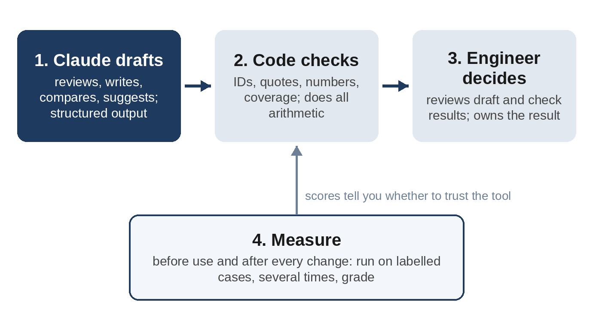

# Part I: Foundations

# Chapter 1: Why AI Belongs in Engineering, and Where It Doesn't

Every engineering team has heard two stories about AI. In the first, it writes your test cases, reviews your requirements and produces your reports while you drink coffee. In the second, it invents numbers, misses the one failure mode that matters, and leaks your design to the world. Both stories are partly true. This chapter gives you a more useful picture: which parts of engineering work suit an AI model, which don't, and a simple way of working that keeps you on the right side of that line.

## What a Language Model Is Good At

A large language model such as Claude reads and writes text very well. That includes text that engineers produce all day:

- **Reading critically.** Spotting that "the window shall close quickly" isn't measurable, or that one requirement says 45 seconds and another says 60.
- **Drafting from a pattern.** Writing a test case for a requirement in the house style, with steps, conditions and pass criteria.
- **Comparing and relating.** Noticing that a defect report from the vehicle test team and one from the HIL bench describe the same problem in different words.
- **Summarising.** Turning a table of results into three sentences a manager can act on.
- **Writing code.** Producing a pandas script that measures stop times in a thousand log files.
- **Applying a method.** Working through each function of a system and asking "how can this fail?", as an FMEA moderator would.

In this book's runs, Claude found every one of the nine problems deliberately planted in the WLC-200 requirements, in all five runs and with all three models tested (Chapter 5). It matched seven pairs of duplicate defect reports written in different words, without a single false match, in every run (Chapter 10). These are tasks that take an experienced engineer real time.

## What It Is Not Good At

The same model has weaknesses that matter a great deal in engineering:

- **Arithmetic and measurement.** A model doesn't calculate the way a computer program does. It can produce a number that looks right and isn't. In this book, Claude never does arithmetic that matters: code computes every measurement, every risk priority number and every range in a report.
- **Knowing what it wasn't told.** A model fills gaps with what is typical. If a fact sheet leaves out that a limit changed, the model may draw a confident and wrong conclusion. It happened in Chapter 9.
- **Being systematic by default.** Asked for an FMEA, Claude's first draft followed the evidence it was given (the defect reports) and missed four failure modes that had never occurred, including "pinch not detected", the most severe one (Chapter 11). A method in the prompt fixed most of that; a checklist in code caught the rest.
- **Consistency.** The same question gives somewhat different answers each time. In one of six Sonnet runs, defect triage rated two safety-relevant defects S2 instead of S1 (Chapter 10).
- **Responsibility.** A model can't sign a test report, own a safety argument or answer an auditor's question. People do.

> **Note:** These weaknesses are not reasons to avoid AI. They are design requirements for the tools you build around it, just as a sensor's noise and drift are design requirements for the software that reads it.

## Draft, Check, Decide

Every project in this book follows the same pattern, and it's the most important idea in the book:

1. **Claude drafts.** It reviews, writes, compares, summarises or suggests. Its output is always structured (a list of findings, a table of test cases, a set of decisions) so that code can read it.
2. **Code checks.** A short program checks the draft against the data and the rules: every requirement is covered, every quote is really in the document, every number in a report exists in the results, every RPN is S × O × D. Code also does every calculation.
3. **An engineer decides.** The engineer reviews the draft and the check results and decides what to keep. Nothing is filed, approved or released by the tool.

A fourth step makes the pattern trustworthy over time:

4. **Measure.** Before a tool is used for real work, it is run on cases where the right answer is known, several times, and scored. This book calls those known answers **labels**, and the program that scores a run a **grader**.

Each part of the pattern does what it is good at. The model handles language and judgement; code handles facts and arithmetic; people handle responsibility.

## Where the Projects Sit in the V

Engineers in regulated industries usually describe development as a **V-model**: requirements and design go down the left side, and verification and validation come up the right side, each level tested against the level opposite it. The ten projects cover the whole V, plus the knowledge that flows across it:

| Stage | Routine work | Project |
| --- | --- | --- |
| Requirements | Reviewing for ambiguity, testability and conflicts | 1. Requirements Reviewer |
| Test design | Writing test cases with traces | 2. Test Case Generator |
| Change management | Finding which tests a specification change affects | 3. Spec Change Impact |
| Test execution | Measuring results in bench logs | 4. HIL Log Analyzer |
| Test reporting | Writing reports with tables and trends | 5. Test Report Writer |
| Problem handling | Sorting and de-duplicating defect reports | 6. Defect Triage |
| Risk analysis | Preparing FMEA drafts | 7. FMEA Assistant |
| Knowledge | Finding what the organisation already learned | 8. Knowledge Assistant |
| Data access | Answering questions about test history | 9. Test Database MCP Server |
| Daily routine | Turning a night of tests into a report and defect drafts | 10. Nightly Validation Assistant |

## How to Choose What to Automate

Not every task deserves an AI tool. Before you build one, ask five questions:

1. **Is it mostly reading and writing?** If the hard part is calculation or measurement, write ordinary code. You may still use Claude Code to write that code faster, as Chapter 8 does.
2. **Can the result be checked?** If you can't write a check, or at least a checklist for a reviewer, you can't trust the tool. The projects that work best in this book all have strong checks.
3. **What happens when it's wrong?** A wrong suggestion that an engineer reviews is cheap. A wrong result that flows straight into a release decision is not. Match the checks and the review to the consequence.
4. **Is it frequent?** Building, testing and maintaining a tool costs time. A task you do every night (Chapter 15) pays that back quickly; a task you do once a year may not.
5. **May the data leave your company?** Chapter 3 covers this. If the answer is no, the tool needs a different deployment or a different task.

| Task | Good candidate? | Why |
| --- | --- | --- |
| Reviewing 300 requirements for testability | Yes | Language work, checkable against labels, an engineer reviews findings |
| Writing first drafts of test cases | Yes | Pattern work; coverage and limits can be checked by code |
| Calculating stop times from logs | No (use code) | Measurement; Claude Code can write the code |
| Deciding whether a release may ship | No | A responsibility, not a task |
| Drafting an FMEA for a workshop | Yes, with care | Useful as a start; method, checks and team review are essential |
| Rating severity of field failures | Suggestion only | Safety judgement stays with people |
| Answering "what did we learn last time?" | Yes | Retrieval with quotes is checkable |

## The Running Example: WLC-200

Ardent Drive Systems is developing the WLC-200 smart window-lift controller for a passenger car. It drives the window motor through an H-bridge, measures window position with a Hall sensor, closes the window automatically with a short press ("express mode"), detects a hand or object being pinched and reverses, protects the motor from overheating, and reports its status on the CAN bus.

Anti-pinch protection makes it a good example: a power window that doesn't reverse in time can injure a child, so its requirements, tests and FMEA must be right. The book's specification asks the controller to detect a pinch above 80 N, stop the motor within 10 ms and reverse by at least 150 mm. You'll meet those three numbers many times.

All of it is fictional. The company, the product, its people, requirements, logs and defects were created for this book, and no real company's document or any standard's text is used. Appendix F describes every file.

> **Tip:** As you read, keep a real task from your own work in mind. At the end of each project chapter, ask whether the same pattern would work for it, and what its labels and checks would be.

## Key Takeaways

- AI models are strong at reading, drafting, comparing, summarising and writing code; weak at arithmetic, unstated facts, systematic coverage, consistency and responsibility.
- Every project in this book follows **draft, check, decide**: Claude drafts, code checks and calculates, an engineer decides. A fourth step, **measure**, scores the tool on known answers before real use.
- Choose tasks that are mostly language, can be checked, are frequent, and whose data may leave your company.
- The running example, the WLC-200 window-lift controller, is fictional, safety-relevant and followed through the whole V.
