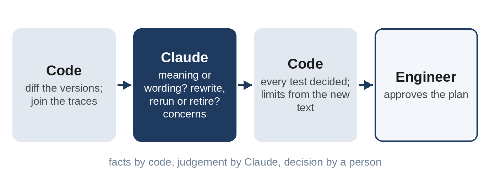

# Chapter 7: Project 3: Spec Change Impact Analyzer

Specifications change. A customer change request lowers a force limit, a review splits a compound requirement, a feature moves to another controller. Each change raises the same questions: which requirements really changed, which test cases are affected, which must be rewritten, which only rerun, and which are now obsolete? On a real program with hundreds of requirements and thousands of tests, answering them takes days, and a missed test means a requirement goes unverified. In this chapter you'll build an analyzer for the change from WLC-200 version 1.2 to version 1.3, and you'll see a principle that applies far beyond this project: **use code for the facts and AI for the judgement**.

## What Changed

Version 1.3 came from a customer change request and the review in Chapter 5. Compared with 1.2:

- The pinch force threshold dropped from 100 N to 80 N and the reversal distance rose from 125 mm to 150 mm.
- The retained-power conflict was resolved at 60 s, and the duplicate of 60 s was deleted.
- Rain closing was replaced by a CAN request, WLC_CloseAll.
- The thermal limit got real values: above 130 °C, limit the current to 15 A.
- The CAN status message cycle went from 100 ms to 50 ms.
- The compound overcurrent requirement was split into three.
- An inhibit was added: after a pinch reversal, no express close for 2 s.
- Four untestable, ambiguous, duplicate or process requirements were deleted.
- One requirement, WLC-021, was reworded without changing its meaning.

## Code for the Facts



Finding which requirements were added, deleted or changed is not a job for an AI model. It's a comparison, and code does it perfectly:

```
@include projects/p03-impact/impact.py::diff
```

Finding which tests trace to the changed and deleted requirements is a join, and code does that too:

```
@include projects/p03-impact/impact.py::traces,affected
```

```
Terminal output:
Code found: 8 changed, 3 added, 5 deleted; 14 tests affected
```

Those numbers are exact, every time, for free. Code doesn't know, though, that WLC-021's change is only wording, that TC-AP-02's pass criteria say "As TC-AP-01" and so don't need rewriting, or that a test which loses its only requirement might still be worth keeping. That's judgement.

## AI for the Judgement

Claude gets the code's findings, the affected tests in full, the list of all tests, and a summary of the team's lessons learned, and makes four kinds of decision:

```
@include projects/p03-impact/impact.py::SYSTEM
```

For each changed requirement, it decides whether the meaning changed or only the wording. For each affected test, it chooses an action from a fixed list, with new pass criteria where needed, given as measures and limits (the lesson from Chapter 6). For each added requirement, it chooses between extending a test and writing a new one. Then it lists other concerns.

Code checks the answer: every change assessed, every affected test decided, every added requirement handled, and every new limit taken from the new requirement text:

```
@include projects/p03-impact/impact.py::check
```

## The Result

The first run with Sonnet 5.5 took 61 seconds and cost 12 cents. It judged seven changes as changes of meaning and WLC-021 as editorial:

```
@include projects/p03-impact/output/impact-sonnet-run1.json#L25-L27
```

So the test for WLC-021 needs no action, which is the right answer: rerunning it would waste bench time. For the anti-pinch test, it wrote new criteria from the new limits:

```
@include projects/p03-impact/output/impact-sonnet-run1.json#L90-L103
```

For the new 2 s inhibit after a pinch, it proposed a new test case, with test points either side of the 2 s and two questions a careful engineer would ask: does manual closing work during the inhibit, and does a second pinch restart the timer?

## The Test That Traceability Would Retire

TC-AP-09 drives the window over a rough-road vibration profile and checks that it doesn't reverse by itself. Its only requirement was WLC-018, "The anti-pinch function shall be robust against all disturbances", which version 1.3 deleted as untestable. By traceability alone, TC-AP-09 should be retired.

Every run, with every model, kept it. Here is the concern from the first run:

```
@include projects/p03-impact/output/impact-sonnet-run1.json#L250-L251
```

That reasoning came from the lessons-learned summary in the prompt. LL-2021-07 recorded that the predecessor product reversed on cobblestones, that the cause was missed because tests used a smooth road, and that "any change to the force threshold ... needs a new check of both false reversals and stop time." Lowering the threshold to 80 N is exactly such a change. The validation team made the same decision by hand and kept the test, re-traced to WLC-016.

This is the best kind of AI help: not a faster version of a mechanical step, but the connection between a change and an old lesson that a busy engineer might not make.

## Other Concerns

The runs raised between 9 and 18 further concerns each. Several were valuable:

- **The CAN cycle change.** "LL-2024-09 says to repeat the worst-case queue calculation when the cycle time is shortened from 100 ms to 50 ms ... Test under worst bus load, including diagnostic sessions." Chapter 8 shows a missing CAN frame on the bench four days after version 1.3 was released.
- **Rain closing.** "Rain-triggered closing has been removed with no replacement ... Confirm that this is intended and not a safety or feature loss."
- **Test setup.** "With the rod at 100 mm, make sure the start position leaves at least 150 mm of travel. Otherwise the test checks the 'fully open' branch instead."

Some were weaker: suggestions to "review" tests that clearly weren't affected. Concerns are cheap to read and dismiss, so a long list is acceptable, but they need an engineer's eye.

## Grading

The grader compares the decisions with the engineer's answer, `impact-truth.json`. It accepts either `rerun` or `update_and_rerun` where a test must be run again (TC-AP-02 to TC-AP-05 say "As TC-AP-01", so either is defensible), and for TC-AP-09 it accepts any decision except a silent retirement:

```
@include projects/p03-impact/grade.py::grade
```

| Run | Score | Concerns | Limits outside the requirement | Output tokens | Cost | Time |
| --- | --- | --- | --- | --- | --- | --- |
| Sonnet 5.5, run 1 | 26 / 26 | 9 | 0 | 8,808 | $0.118 | 61 s |
| Sonnet 5.5, run 2 | 26 / 26 | 14 | 0 | 7,950 | $0.110 | 55 s |
| Sonnet 5.5, run 3 | 26 / 26 | 10 | 0 | 7,666 | $0.107 | 56 s |
| Haiku 5.5 | 26 / 26 | 17 | 5 | 23,018 | $0.017 | 95 s |
| Opus 5.5 | 26 / 26 | 18 | 0 | 10,404 | $0.264 | 94 s |

Every run got every decision right. Once code has done the diffing and the joining, the remaining judgement is within reach of every model. The difference was in the limits check: Haiku copied the 2 s inhibit from the new requirement WLC-039 into the pass criteria of five anti-pinch tests that don't trace to it. Code caught all five.

> **Note:** The first version of this project, like the first version of Project 2, asked for new pass criteria as free text, and the limits check produced between 5 and 17 warnings per run, mostly for test points such as "press at 55 s and at 65 s". Splitting the criteria into measures and limits brought Sonnet and Opus to zero.

## Using It on Real Work

- **Get the facts from your tools.** Requirements management tools can export versions and traces. Let code compute the diff and the affected tests from those exports; never ask a model to find what changed in two long documents.
- **Feed it your lessons.** The most valuable concern in this chapter came from a lessons-learned summary. Chapter 12 builds a searchable knowledge base for larger collections.
- **Treat the output as a proposal** for the change control board or the test lead, with the code's facts and the model's judgement clearly separated.

## Key Takeaways

- Code computes the facts exactly: which requirements changed, which tests trace to them.
- Claude adds the judgement: editorial or real change, rewrite or rerun, extend or create, and what else to worry about.
- Given a lessons-learned summary, every run kept a test that traceability alone would have retired, for the right reason.
- With the facts done by code, all five runs scored 26 of 26; the limits check caught the one model that copied a value where it didn't belong.
