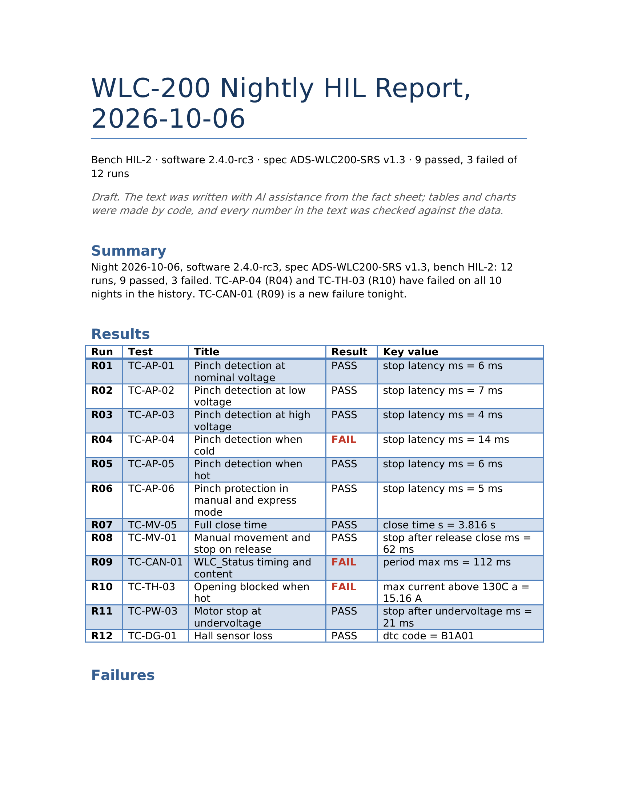
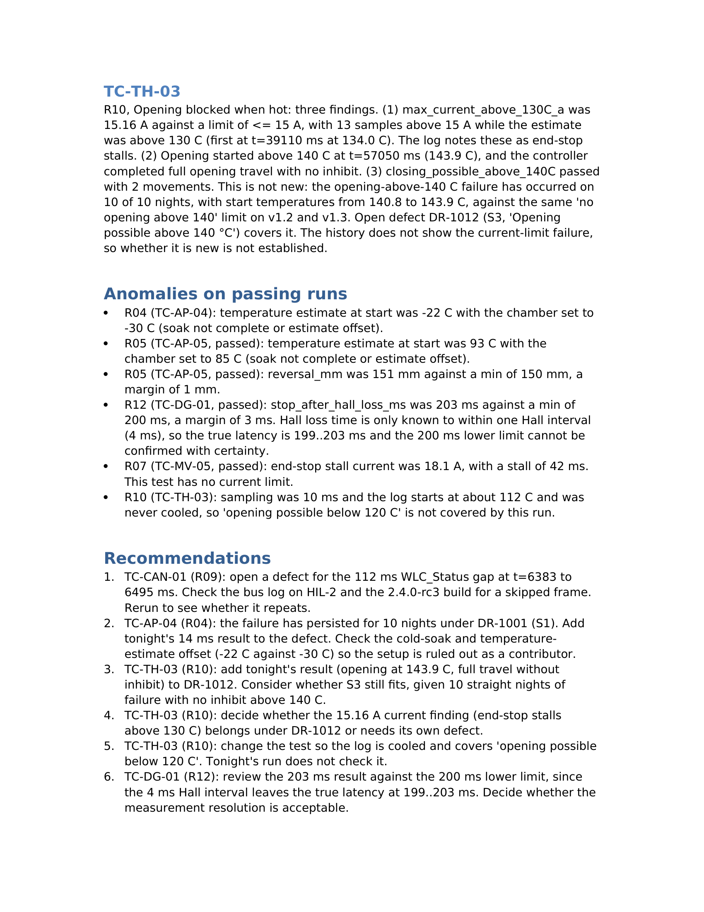

# Chapter 9: Project 5: Test Report Writer

The analyzer in Chapter 8 says what passed and failed. A test report must also say what it means: which failures are new, which have failed for weeks, which open defects cover them, what passed only just, and what someone should do next. Writing that every morning takes an engineer an hour, and it's exactly the kind of writing AI does well. It's also where AI text is most dangerous, because a report is read by people who won't check the numbers. In this chapter you'll build a report writer in which code makes every table and chart, Claude writes the words, and code checks every number and ID in those words before the report is saved.

## The Finished Report

Here is the first page of a real report, produced by the tool for the night of 6 October:



The table was made by code from the analyzer's results. The summary was written by Claude. The note under the title says so, as Chapter 3 recommends.

## Step 1: A Fact Sheet, by Code

Claude never sees the logs or the database. Code assembles a **fact sheet**: everything the text may say, already computed. For each failure, it includes the failed criteria, whether the failure is new tonight, on how many nights it has failed, the full history with the limit that applied each night, the smallest and largest historical values, and the open defects linked to the test:

```
@include projects/p05-test-report/report.py::fact_sheet
```

Here is part of the fact sheet for the CAN timing failure:

```
@include projects/p05-test-report/output/report-sonnet-run1.json#L514-L540
```

Three fields in it (the limit for each night, `history_min` and `history_max`) weren't in the first version. Each was added after a run showed it was needed, as you'll see below.

## Step 2: The Text, by Claude

The prompt asks for short, specific writing, and forbids new numbers:

```
@include projects/p05-test-report/report.py::SYSTEM
```

The schema has a summary, one section per failure, a list of anomalies and a list of recommendations. The `test` field of each failure section is an enum built from tonight's failures, so Claude can neither skip a failure nor invent one:

```
    # Claude must discuss exactly the failing tests, by their IDs
    schema = json.loads(json.dumps(SCHEMA))
    schema["properties"]["failures"]["items"]["properties"]["test"] = {
        "enum": [f["test"] for f in facts["failures"]]}
```

## Step 3: Every Number Checked

The check collects every number in the fact sheet, in its usual written forms, and every ID. Then it reads Claude's text and reports any number or ID that isn't in the fact sheet. Digits inside IDs, dates and version numbers are ignored, so "TC-AP-04" doesn't count as the number 4:

```
@include projects/p05-test-report/report.py::numbers_in,check
```

If Claude writes "stopped after 15 ms" when the fact sheet says 14, or cites a defect that doesn't exist, the check reports it and the report says so in its last section. The offline tests in the project include exactly those two cases.

## Step 4: The Document, by Code

The Word document is built with `python-docx`: the heading, the note, Claude's summary, the results table, the trend chart, Claude's failure sections, anomalies and recommendations, and the result of the checks. The trend chart shows each failing test's key value over ten nights, in red for a failure and green for a pass, with the limit that applied each night as a dashed line:


Generating the document is plain code and costs nothing to repeat. When the table layout and the chart were improved after the runs, the reports were rebuilt from the saved answers with `python report.py --rebuild`, without calling Claude again.

## What Claude Wrote

Here is the section on the thermal failure, from the third page of the report:



Two details show why it's worth having a model write this. It separated the two failed criteria, noted that the opening failure "has occurred on 10 of 10 nights" against the same limit under both specification versions, and linked defect DR-1012. And it was honest about a gap: "The history does not show the current-limit failure, so whether it is new is not established." The database only stores one key value per night, so the history couldn't answer that question, and the text said so instead of guessing.

The recommendations were specific: open a defect for the new CAN failure, add tonight's 14 ms to DR-1001, check whether a severity of S3 is right for DR-1012 given that the window opened fully above 140 °C, and decide whether the 4 ms Hall-counter resolution allows a 200 ms lower limit to be judged at all.

## Three Versions of the Fact Sheet

The first run passed the number check, and was still wrong in one place. Its recommendations included:

```
TC-CAN-01: look at why period max was 101 to 103 ms on 2026-09-27 to 2026-10-02 yet passed against a 55 ms limit.
```

The history listed each night's value and verdict, but not the limit. The limit had been 90 to 110 ms until the specification changed on 3 October. Claude saw values near 100 ms marked PASS, assumed today's limit applied, and recommended investigating a problem that didn't exist. Every number in that sentence was in the fact sheet, so the check couldn't catch it. **The check proves the numbers exist; it doesn't prove the reasoning.** The fix was to add the limit for each night to the fact sheet, and a sentence to the prompt saying limits can change. That version's runs didn't repeat the mistake.

The second version's text included statements like "with values of 13 to 15 ms". Both numbers were in the fact sheet, so the check passed, but nothing guaranteed they were the smallest and largest. They were (the database confirmed it), but the book's rule is that code does arithmetic. The third version adds `history_min` and `history_max` to the fact sheet and tells Claude not to compute ranges.

The first version also reported "failure TC-AP-04 not discussed" three times, although the text discussed all three. Claude had written the `test` field as "TC-AP-04 (R04)", which didn't match. The fix was the enum described above.

| Version | Runs | Check problems | Average cost | Average time |
| --- | --- | --- | --- | --- |
| 1: no limits per night, free `test` field | 1 | 3 (all format) | $0.053 | 14 s |
| 2: limits per night, enum | 3 | 0 | $0.056 | 14 s |
| 3: plus history ranges | 3 | 0 | $0.056 | 16 s |

At under six cents and sixteen seconds, the report costs less than the coffee of the engineer who reads it.

## What This Tool Doesn't Do

- **Judge the test results.** It reports the analyzer's verdicts. If the analyzer is wrong, the report is wrong; that's why Chapter 8 proves the analyzer separately.
- **Change defect records.** It recommends; an engineer updates DR-1001 and DR-1012.
- **Approve anything.** The report is marked as a draft until an engineer has read it.

## Using It on Real Work

- **Use your report template.** Start `build_docx` from your company's Word template so the report has the right header, classification and distribution.
- **Put every needed fact in the fact sheet.** When a sentence in a report surprises you, ask what fact was missing.
- **Keep the fact sheet with the report.** The saved JSON records exactly what the text was based on, which an auditor may ask for.

## Key Takeaways

- Code builds the fact sheet, tables and charts; Claude writes the words; code checks every number and ID in the words.
- A number check proves the numbers exist, not that the reasoning is right; a missing fact (the limit each night) led to a wrong recommendation until it was added.
- Precompute anything that needs arithmetic, including ranges, and use enums so the text covers exactly the failures that occurred.
- A checked draft report took 16 seconds and under six cents.
