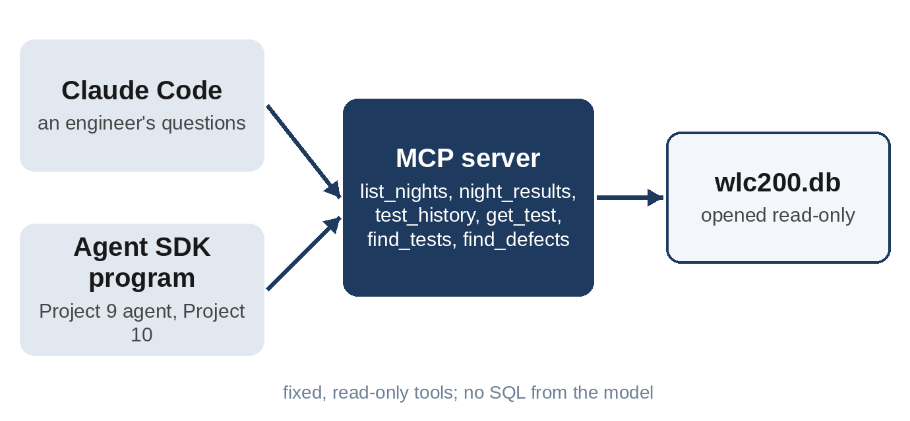

# Part V: Tools for the Team

# Chapter 14: Project 9: A Test Database MCP Server

"When did TC-AP-05 start passing again?" "Which open S1 defects have no test linked?" "What software ran on the third?" Engineers ask questions like these all day, and the answers are in a test database that only a few people know how to query. This chapter gives Claude safe access to that database through the **Model Context Protocol (MCP)**, so that anyone can ask in plain language, from Claude Code or from a program, and get an answer that comes from the data rather than from the model's imagination.

## Why MCP

MCP is an open standard for connecting AI applications to tools and data. You write a small **MCP server** that offers a set of tools; any MCP client, such as Claude Code, Claude Desktop or your own Agent SDK program, can then use them. Write the server once and every client can use it:



## The Database

`wlc200.db` is a SQLite database with four tables: `tests` (the version 1.3 test suite with requirement traces), `nights` (date, software, specification version and bench), `results` (one key measurement per test per night, with its verdict and the limit that applied) and `defects` (status, component, severity and linked test). It holds ten nights of results, from 27 September to 6 October 2026.

## The Server

The server is about 110 lines, using `FastMCP` from the MCP Python SDK. Three design decisions matter more than any line of code.

**The database is opened read-only.** Even if a tool had a bug, it couldn't change a result:

```
@include projects/p09-testdb-mcp/testdb_server.py::db
```

**There is no tool that runs SQL written by the model.** It's tempting to offer a single `run_sql` tool and let Claude write the queries. Don't. A model-written query can be wrong in ways that look right, it can read tables it shouldn't, and on a writable database it could change data. Instead, the server offers six fixed tools, each answering one kind of question:

```
@include projects/p09-testdb-mcp/testdb_server.py::test_history,find_defects
```

`find_defects` builds its query from fixed column names; the values the model supplies are passed as parameters, never pasted into the SQL.

**Errors explain themselves.** Asked for a night that doesn't exist, a tool doesn't return an empty answer that Claude might take for "no failures"; it raises an error that says what's available:

```
raise ValueError(f"No results for {night}. Use list_nights to see the dates.")
```

The server can be tested on its own, with no AI involved:

```
python testdb_server.py --check
```

## From Claude Code

The project folder contains a `.mcp.json` file that tells Claude Code how to start the server:

```
@include projects/p09-testdb-mcp/.mcp.json
```

An engineer opens Claude Code in that folder and asks. Here is a real headless run that allowed the server's tools and nothing else:

```
claude -p "Which tests failed on the night of 2026-10-06, and which open defects are linked to those tests?" \
  --mcp-config .mcp.json --strict-mcp-config \
  --permission-mode dontAsk --allowedTools "mcp__wlc200-testdb__*"
```

```
@include projects/p09-testdb-mcp/output/claude-code-answer.md
```

Four turns, 14 seconds, 8 cents. The table is right, and so is the note that no defect covers the CAN failure. The last paragraph is the kind of thing a good colleague notices. DR-1018, the Hall-loss defect, is still open while its test passed. Claude offers two explanations without choosing, and the second is the right one: the defect was found at 9 V, but the nightly test runs at 13.5 V. The lesson learned in Chapter 12 says the Hall-loss test should run at the lowest supply voltage, and the nightly suite doesn't. That's a test gap, found by asking a database a question.

## From a Program

The same server works from the Agent SDK. The Project 9 agent connects to it as an external process and answers questions with a structured result:

```
@include projects/p09-testdb-mcp/agent.py::options
```

`allowed_tools=["mcp__wlc200-testdb__*"]` allows every tool of this server, `tools=[]` removes the built-in tools (no files, no shell), and `dontAsk` refuses anything else. The agent can read the test database and do nothing more.

## Grading Against SQL

The ten test questions have answers that SQL can compute exactly, so the grader computes them from the database itself instead of storing them. If the database changes, the expected answers change with it:

```
@include projects/p09-testdb-mcp/grade.py::truth
```

Two of the questions are traps. "Which component has the most open defects?" has a three-way tie, and the grader accepts only all three. "Who is the owner of defect DR-1012?" can't be answered, because the database has no owner field; the right answer is an empty list.

The first run scored 8 of 10, and both misses were about the format, not the facts. For "On how many nights did TC-TH-03 fail?", the agent wrote "TC-TH-03 failed on all 10 nights" and listed the ten dates as its items. For the CAN period, it added the test and run IDs to the value. The prompt had asked for "the items that answer the question", which was ambiguous. Saying exactly what belongs in the items ("the number for 'how many', the value for 'what was'") fixed it:

```
@include projects/p09-testdb-mcp/agent.py::SYSTEM
```

```
python agent.py --all sonnet-run1
```

```
@include projects/p09-testdb-mcp/output/log-sonnet-run1.txt#L1-L11
```

| Run | Score | Average turns | Cost (10 questions) |
| --- | --- | --- | --- |
| First prompt | 8 / 10 (facts 10 / 10) | 3.1 | $0.13 |
| Clarified prompt, run 1 | 10 / 10 | 3.0 | $0.11 |
| Clarified prompt, run 2 | 10 / 10 | 3.1 | $0.07 |
| Clarified prompt, run 3 | 10 / 10 | 3.1 | $0.05 |

Almost every answer needed exactly one tool call, which is the sign of well-designed tools: one question, one tool. (The CAN-period question sometimes took two.) The tie was reported as a tie in every run, and every run said the database has no owner field instead of guessing.

## Using It on Real Work

- **Start read-only, with fixed tools.** Add a tool when people keep asking a question the existing tools can't answer.
- **Connect to a reporting copy** of the production database, not the production system itself.
- **Mind the access rights.** The server runs with its own database credentials; give it only the tables and rows the people using it may see.
- **Log every tool call.** Who asked what is useful for improving the tools, and it may be required by your data rules.
- **Grade from the source.** Where the right answer can be computed, compute it rather than storing it.

## Key Takeaways

- An MCP server gives Claude Code, Claude Desktop and your own programs the same safe access to engineering data.
- Open the database read-only, offer fixed tools instead of model-written SQL, and make errors explain themselves.
- An ambiguous instruction about the answer format cost two of ten points; the facts were right every time. After one clarification, three runs scored 10 of 10.
- Asked a simple question, Claude Code noticed that an S1 defect was open while its test passed, which revealed a test gap: the nightly Hall-loss test doesn't run at 9 V.
