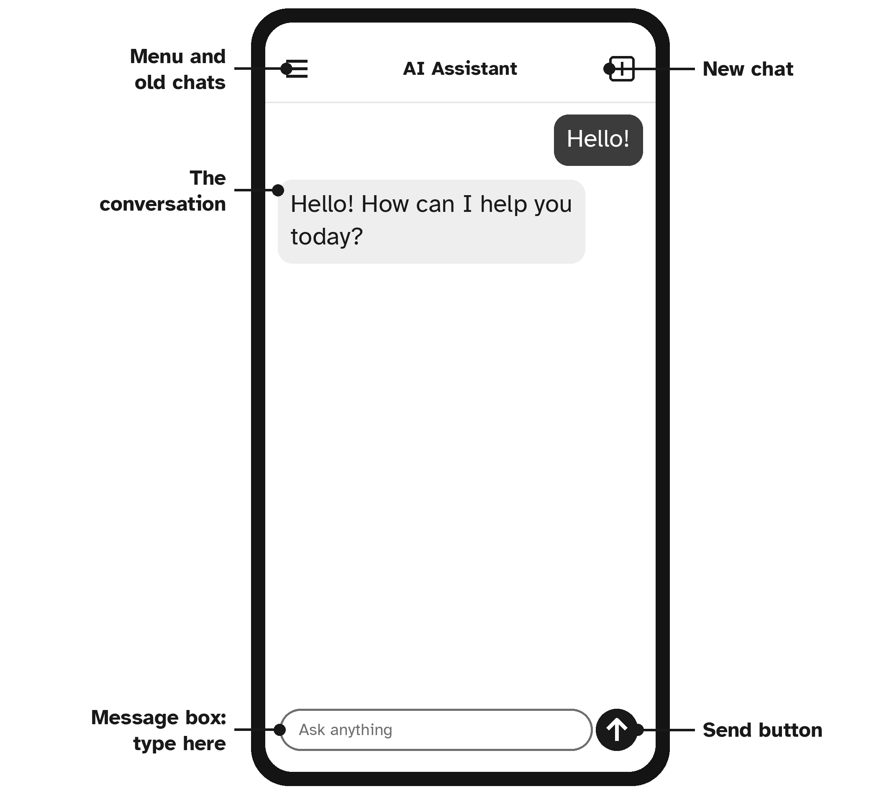

# Chapter 2: Getting Set Up on Your Phone, Tablet or Computer

In this chapter you will choose an AI assistant, install it, and make the screen comfortable to read. It takes about fifteen minutes. If you have a family member or friend nearby, this is a lovely chapter to do together.

## Step 1: Choose One Assistant

There are several well-known AI assistants. They all work in a similar way, and every example in this book works with any of them. The best-known ones today are:

| Assistant | Made by | Website |
| --- | --- | --- |
| ChatGPT | OpenAI | chatgpt.com |
| Gemini | Google | gemini.google.com |
| Claude | Anthropic | claude.ai |
| Copilot | Microsoft | copilot.microsoft.com |
| Meta AI | Meta | meta.ai |

**Which one should you choose?** Any of them is fine. Here is a simple way to decide:

- If a family member already uses one, choose the same one. They can help you.
- If you use an Android phone, Gemini may already be on it.
- If you are not sure, pick any one. You can always try another later.

Pick **one** and stick with it while you learn. Having several apps at once only makes things confusing.

> **Note:** Names, prices and features change often in the world of AI. If a screen looks a little different from what this book describes, look for the same idea: a box to type in, and a button to send.

## Step 2: Install the App on a Phone or Tablet

On a phone or tablet, the easiest way is to install the official app.

1. Open the **app store** on your device. On an iPhone or iPad, this is the blue **App Store** icon. On an Android phone or tablet, it is the colorful **Play Store** (Google Play) icon.
2. Tap the **search** box and type the name of the assistant you chose, for example *Claude* or *ChatGPT*.
3. **Check the maker's name** under the app's name before you install anything. It should be the real company from the table above, such as OpenAI, Google, Anthropic, Microsoft or Meta.
4. Tap **Get** or **Install**. You may need to enter your app store password or use your fingerprint or face.
5. When it has finished, tap **Open**.

> **Safety Tip:** App stores contain look-alike apps with similar names and logos, some of which charge high fees. Always check the maker's name. If you are not sure, ask a family member, or use the official website from the table instead.

## Step 3: Or Use It on a Computer

On a desktop or laptop computer, you do not need to install anything.

1. Open your web browser, the program you use to visit websites.
2. Click in the address bar at the very top and type the website from the table, for example **claude.ai** or **chatgpt.com**.
3. Press **Enter**.

Tip: once the page is open, add it to your **bookmarks** or **favorites** (often a star icon near the address bar), so you can find it again with one click.

## Step 4: Create Your Account

The first time you open the app or website, it will ask you to sign in or create an account. Most assistants let you sign up in one of these ways:

- With your **email address**: you type your email, then the company sends you a code or a link to confirm it is really you.
- With an account you already have, such as a **Google**, **Apple** or **Microsoft** account, by tapping a button like *Continue with Google*.

Using an account you already have is usually the quickest. Follow the steps on the screen. If you are asked to make a new password, choose one you do not use anywhere else, and write it in a safe place at home, not in this book's notes page if you carry the book around.

Some apps ask for your date of birth or phone number. That is normal for well-known apps.

> **Safety Tip:** A real AI app will never ask for your bank card to start the free version. If it asks for payment before you have even tried it, stop and check that you have the right app.

## Step 5: Make the Text Bigger

Comfortable reading makes everything easier. Here is how to make text larger.

**On an iPhone or iPad:** open **Settings**, tap **Display & Brightness**, then **Text Size**, and drag the slider to the right. For even bigger text, go to **Settings**, then **Accessibility**, then **Display & Text Size**, then **Larger Text**.

**On an Android phone or tablet:** open **Settings**, tap **Display** (on some phones, **Accessibility**), then **Font size** or **Font size and style**, and drag the slider to the right. The exact names vary a little between phone makers.

**On a computer:** while the AI website is open, hold down the **Ctrl** key (on a Mac, the **Command** key) and press the **plus** key (**+**) a few times. Each press makes the page bigger. To make it smaller again, use the **minus** key (**−**).

## Step 6: Find Your Way Around

Every AI assistant has the same three important parts. Take a moment to find them now.

1. **The message box.** Usually at the bottom of the screen, with words like *Ask anything* or *Message*. This is where you type.
2. **The send button.** Usually an arrow next to the message box. Tap it to send your message. (On a computer, you can also press **Enter**.)
3. **New chat.** A button, often with a pencil or a plus sign, that starts a fresh conversation. You will usually find it at the top of the screen, or in a menu you open by tapping an icon of three short lines.

Many apps also show a **microphone** button for speaking instead of typing. We will use it in Chapter 15.

> **Try It:** Open your AI assistant and find the message box, the send button and the new chat button. You do not need to type anything yet. Just knowing where they are is a great first step.

## Key Points

- Choose one well-known assistant and stick with it while you learn.
- Install it from your official app store, and check the maker's name.
- On a computer, just visit the website.
- Make the text big enough to read comfortably.
- Find the message box, the send button and the new chat button.
