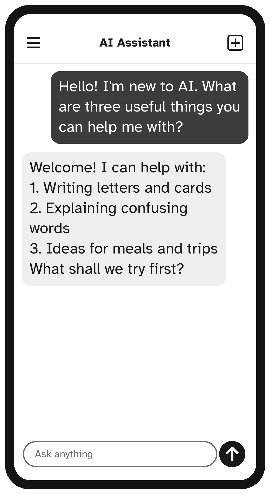

# Chapter 3: Your First Conversation

Now for the fun part. In this chapter you will have your first real conversation with an AI assistant, step by step.

## Say Hello

Open your AI assistant and tap the message box. Type this, exactly as it is, or in your own words:

```text
Hello! I'm new to using AI. Can you tell me, in simple
words, three useful things you can help me with?
```

Now tap the **send** button (the arrow).

Watch the screen. After a moment, words will start to appear. The assistant writes its answer a few words at a time, a little like someone typing. Wait until it stops.



Congratulations, you have just used AI.

## Read the Answer

Read the reply at your own pace. If it is long, you can scroll down by moving your finger up the screen (or using your mouse wheel on a computer).

You will probably notice a few things:

- The answer is written in friendly, everyday language.
- It may use **bold words**, numbered lists, or short headings to make things easy to scan.
- It may end with a question for you, such as *"Would you like to try one of these?"* You can answer it, or ignore it and ask something else.

## Ask a Follow-Up

The real power of an AI assistant is that it remembers what you said earlier **in the same conversation**. So you can keep going, as you would in a real chat. Try this:

```text
Thank you. Can you give me one example of the first one?
```

The assistant knows what "the first one" means, because it is part of this conversation.

Try a few more follow-ups in your own words. Here are some phrases that work wonderfully:

- *"Can you make that shorter?"*
- *"Can you explain that more simply?"*
- *"Can you give me another example?"*
- *"Put that in a numbered list, please."*
- *"Write that bigger, in fewer words."*
- *"I don't understand the word ___. What does it mean?"*

> **Remember:** You never need to be polite to a computer, but you can be. "Please" and "thank you" do no harm, and many people find it feels more natural.

## Start a New Conversation

When you want to talk about something completely different, start a **new chat**. Tap the **new chat** button you found in Chapter 2 (a pencil or a plus sign).

Why start fresh? Because the assistant tries to connect everything in one conversation to what came before. If you were talking about a birthday cake and then ask about your car, the answers may get muddled. A new chat is a clean page.

A good habit: **one topic, one chat.**

## Find an Old Conversation

Most assistants keep a list of your past conversations, so you can go back to them later.

- On a phone or tablet, tap the menu icon (often three short lines at the top left), and you will see a list of your chats, each with a short title.
- On a computer, the list is usually down the left side of the screen.

Tap any chat to open it and carry on where you left off.

## Copy an Answer

Often you will want to use what the AI wrote, for example to paste a letter into an email.

**On a phone or tablet:** below most answers there is a small **copy** button, which looks like two overlapping squares. Tap it, and the whole answer is copied. Then go to your email or messages app, press and hold in the place where you type, and tap **Paste**.

**On a computer:** click the **copy** button below the answer. Then click where you want the text, and press **Ctrl** and **V** together (on a Mac, **Command** and **V**).

## If Something Goes Wrong

Do not worry. Here are the most common hiccups and their cures.

| What happens | What to do |
| --- | --- |
| Nothing appears after you send | Wait 20 seconds. Then check your internet connection and try again. |
| The answer stops halfway | Type *"Please continue."* |
| You see a message about limits | You have used the free version a lot today. Wait a few hours, or come back tomorrow. |
| The answer is far too long | Ask: *"Please answer in three short sentences."* |
| It misunderstood you | Say so, plainly: *"No, I meant ___."* |
| You feel lost | Start a new chat and begin again. Nothing is lost. |

> **Try It:** Start a new chat and ask about something you love. For example: *"Tell me three interesting facts about hummingbirds."* Then ask one follow-up question. You have now done everything you need to use AI every day.

## Key Points

- Type your message, tap send, and wait for the answer to finish.
- Ask follow-up questions in plain words. The assistant remembers the conversation.
- Use **new chat** for a new topic.
- Use the **copy** button to reuse an answer.
- If anything goes wrong, try again or start a new chat.
