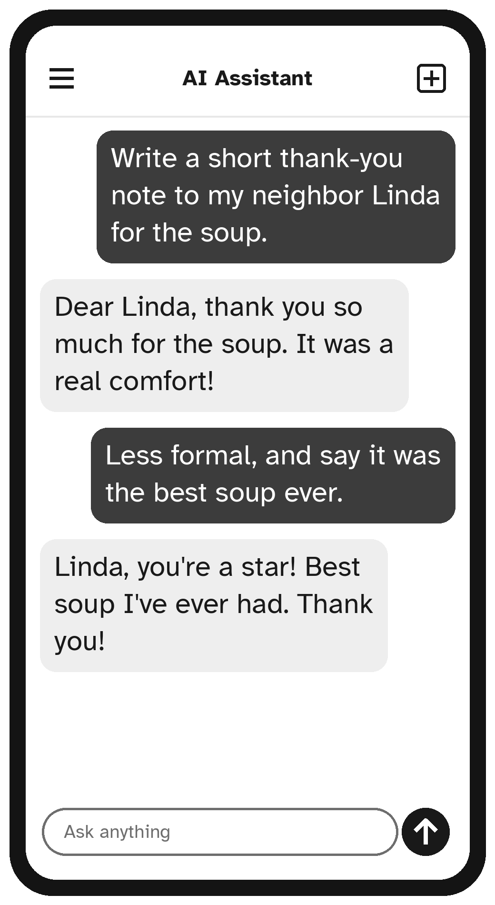

# Chapter 4: Five Golden Rules for Asking Well

You can ask an AI assistant anything in any way, and it will do its best. But a few simple habits make the answers much better. Here are the five golden rules. They are worth learning by heart.

## Rule 1: Say What You Want, Clearly

Imagine asking a helpful neighbor, "Can you help me with the garden?" They would need to know: help with what? A clear request gets a clear answer.

Compare these two requests:

```text
Recipe.
```

```text
Please give me an easy recipe for a chicken dinner
for two people that takes less than 30 minutes.
```

The second one tells the assistant exactly what you want, and you will get exactly that.

## Rule 2: Give It Some Background

The assistant does not know you. A sentence or two about your situation makes the answer fit your life. Useful background includes:

- **Who it is for:** "for my granddaughter who is 8"
- **Your situation:** "I live alone and cook for one"
- **Limits:** "I have bad knees, so I need to avoid stairs"
- **Your experience:** "I have never used a spreadsheet before"

For example:

```text
I am 74 and I have just bought my first tablet.
I want to video call my daughter in Canada.
Please explain how, in very simple steps.
```

## Rule 3: Say How You Want the Answer

You can ask for any shape or size of answer. Just say so:

- "In **three** short sentences."
- "As a **numbered list** of steps."
- "In **large, simple** words, with no jargon."
- "As a **short email** I can send."
- "As a **shopping list**, grouped by aisle."
- "As a **table** with prices."

```text
Explain what "the cloud" means for photos on my phone.
Answer in three short sentences with no technical words.
```

## Rule 4: Keep Talking

The first answer is just the beginning. If it is not quite right, do not start over. Tell the assistant what to change, as you would with a person:

- "Make it warmer and more personal."
- "That's too formal. My sister and I are close."
- "Shorter, please."
- "I don't like mushrooms. Can you change the recipe?"
- "Good, but add something about my trip to Florida."

Most of the best results come from two or three rounds of small changes.



## Rule 5: Check Anything Important

An AI assistant is confident, but not always correct. Before you rely on an answer about your **health, money, legal matters, travel bookings or safety**, check it with a reliable source: your doctor, pharmacist, bank, an official government website, or the company itself.

A handy question to ask at the end of an important answer:

```text
How sure are you about this? What should I double-check,
and with whom?
```

A good assistant will tell you which parts to confirm, and where.

## A Simple Recipe for Any Request

When you are not sure how to ask, fill in this pattern:

```text
I am [who you are or your situation].
Please help me [what you want].
It is for [who or what it is for].
Please [how you want the answer].
```

For example:

```text
I am a retired teacher who loves reading.
Please help me choose five novels for my book club.
It is for a group of women in their 70s who like mysteries.
Please give a one-sentence description of each book.
```

You do not have to use this pattern every time. But when an answer disappoints you, it usually means one of these four parts was missing.

> **Try It:** Choose one of the three things you wrote down in Chapter 1. Write a request using the recipe above, send it, and then use Rule 4 to improve the answer with one follow-up.

## Key Points

- **Clear:** say exactly what you want.
- **Background:** a sentence about you makes the answer fit.
- **Shape:** say how long and in what form.
- **Keep talking:** improve the answer with follow-ups.
- **Check:** confirm anything important with a trusted source.
