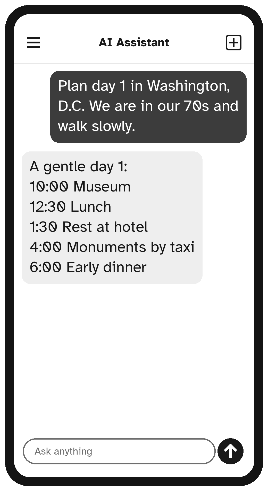

# Chapter 6: Planning Trips and Days Out

Planning a trip involves a hundred small decisions: where to stay, how to get there, what to see, what to pack. An AI assistant can do the first round of thinking for you and suggest a plan that fits your pace, your budget and your needs.

## A Day Out Close to Home

Start small:

```text
I live in Columbus, Ohio. Please suggest five ideas for
a relaxing day out within an hour's drive, suitable for
two people in their 70s who enjoy gardens and history.
Avoid anything with lots of walking or stairs.
```

Then narrow it down:

```text
The second idea sounds lovely. Please plan the day:
when to leave, where to have lunch nearby, and when
to head home so we are back before dark.
```

> **Note:** The AI may suggest restaurants or attractions that have closed or changed their hours. Before you set off, check opening times on the place's own website, or phone them.

## Planning a Longer Trip

For a bigger trip, give the assistant the main facts: where, when, who, budget and any needs.

```text
My wife and I (both 72) would like a 5-day trip to
Washington, D.C., in April. We prefer a comfortable
hotel near public transportation, we walk slowly, and
we would like a rest every afternoon. Our budget is
about $2,500 for the two of us, not including flights.
Please suggest a day-by-day plan.
```

You will get a plan that you can shape with follow-ups:

- "Please move the museum day to Wednesday."
- "Add a nice dinner for our anniversary on the last night."
- "Which of these places have benches or wheelchairs available?"
- "What should we book in advance?"



## Travel With Health or Mobility Needs

AI assistants are very good at thinking through practical needs. Be open about yours; it helps the plan fit.

```text
I use a walker and can manage about 15 minutes of
walking at a time. What should I ask a hotel and an
airline before booking, to make sure the trip is
comfortable for me?
```

```text
I take medication every morning and evening. I am flying
from Chicago to London. How should I adjust my medication
times for the time difference? Please give me questions
to ask my pharmacist.
```

The second example shows a good habit: for anything medical, ask the AI for **questions to bring to a professional**, not for the final answer.

## Packing Lists

```text
Please make a packing list for a 7-day cruise in the
Caribbean in February, for a woman in her 70s.
Include medication reminders and documents.
Group it by category with checkboxes.
```

You can print the list, or copy it into a note on your phone.

## Learning About a Place Before You Go

Part of the joy of travel is knowing a little about where you are going.

```text
I am visiting Savannah, Georgia, next month. Please tell
me five interesting stories from its history that I can
look out for while I'm there.
```

```text
I'm going to Italy. Please teach me ten useful Italian
phrases for restaurants and shops, with how to
pronounce them.
```

## What AI Cannot Do for Your Trip

An AI assistant can plan, but it generally cannot (and should not) **book or pay** for you. When you are ready:

- Book directly with the airline, hotel or a travel agent you trust, or ask a family member to help.
- Check prices, times and rules on the official websites. The AI may be out of date.
- Never give your card details to anyone who contacts you out of the blue offering a "special travel deal."

> **Safety Tip:** Travel scams are common: fake booking websites, "free cruise" phone calls and too-good-to-be-true deals. If in doubt, close the page and book through a company you already know. Chapter 12 has more on spotting scams.

> **Try It:** Ask the AI to plan a relaxing afternoon somewhere near you. Then ask one follow-up question to make it suit you even better.

## Key Points

- Give the AI the facts: where, when, who, budget and needs.
- Improve the plan with follow-ups.
- Be open about health or mobility needs, and ask for questions to check with professionals.
- Check opening times and prices on official sites.
- Book and pay through companies you trust, never through unexpected calls or messages.
