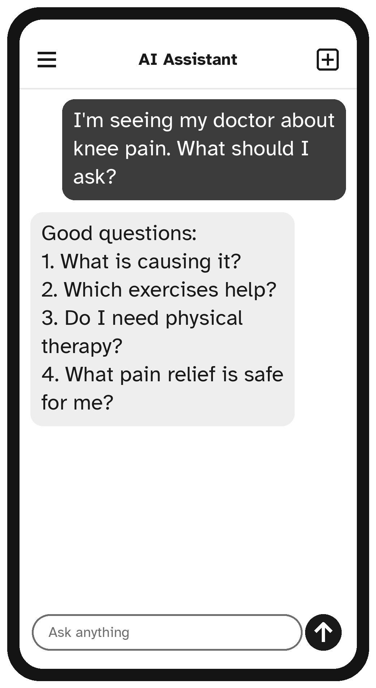

# Chapter 7: Health Questions, Asked Safely

Many people use AI assistants to understand health information: a word on a test result, the name of a new medicine, or what to ask at the next appointment. Used wisely, it can make you a more confident, better-prepared patient. Used carelessly, it can worry you or mislead you. This chapter shows you the wise way.

> **Warning:** An AI assistant is not a doctor. It cannot examine you and does not know your full medical history. **In an emergency, such as chest pain, trouble breathing, signs of a stroke, or a bad fall, call 911 (or your local emergency number) right away.** Do not stop to ask an AI.

## What AI Is Good For in Health

- **Explaining words** on letters, test results or leaflets
- **Preparing questions** for your doctor, nurse or pharmacist
- **General information** about a condition, in plain English
- **Healthy habits**: gentle exercise ideas, meal planning, sleep tips
- **Organizing**: a medication schedule chart, or a symptom diary

## What It Should Never Replace

- Diagnosis: deciding what is wrong with you
- Deciding to start, stop or change any medicine
- Urgent or worrying symptoms
- Your doctor's or pharmacist's advice about *you*

## Understanding Medical Words

Medical letters are full of words most people never learned. An AI can translate them.

```text
My blood test letter says my "eGFR is 58" and my
"HbA1c is 6.1%". What do these words mean, in plain
English? I will discuss my results with my doctor.
```

Notice the last sentence. It reminds the assistant (and you) that this is for understanding, not for deciding.

## Preparing for an Appointment

Doctor visits can feel rushed. Arriving with a short list of questions helps you make the most of the time.

```text
I am seeing my doctor next week about knee pain that
makes stairs difficult. I am 77. Please suggest eight
questions I could ask, in order of importance, and a
short list of things I should tell the doctor.
```

```text
I have just been diagnosed with high blood pressure.
What are the most important questions to ask my doctor
at my next visit?
```

You can then print the list or write it in a notebook to take with you.



## Learning About a Condition

```text
My doctor told me I have osteoarthritis in my hands.
Please explain what that is in simple words, what
usually helps, and what questions I should ask my
doctor about treatment.
```

When you read the answer, remember that it describes what is *usual*. Your own situation may be different, and that is exactly why the questions for your doctor matter.

## Medicines: Ask the Pharmacist

AI can explain what a medicine is generally used for, or help you make a chart of when to take things. But questions about mixing medicines, side effects you are having, or changing doses belong with your pharmacist or doctor.

A good, safe use:

```text
Please make a simple daily chart with times for these
medicines, as my doctor prescribed: one in the morning
with breakfast, one at lunch, and two at bedtime.
Leave space for me to tick each one.
```

Notice that you tell the AI the schedule from your prescription. You do not ask it to decide the schedule.

> **Safety Tip:** You do not need to give the AI your name, date of birth or other personal details to ask a health question. Ask it in general terms, such as "a woman in her 70s with high blood pressure," and keep your private details private.

## Healthy Habits

This is an area where AI can be a cheerful, endlessly patient coach.

```text
Please suggest a gentle 10-minute exercise routine I can
do sitting in a chair, for better balance and strength.
I am 80. Describe each exercise in simple steps.
```

```text
I'd like to eat more vegetables. Please suggest seven
easy dinners for one person, each using no more than
six ingredients.
```

```text
I often wake up at 3 a.m. and can't get back to sleep.
What are some simple habits that might help?
```

Before starting any new exercise routine, especially if you have a heart condition, joint problems or a history of falls, check with your doctor that it is right for you.

## Worrying Answers

Sometimes reading about health makes us more anxious, not less. If an answer worries you:

1. Remember that the AI does not know your situation, and it may be wrong.
2. Do not search endlessly. Write down your worry.
3. Call your doctor's office or a nurse advice line and ask.

> **Try It:** Think of your next appointment, or one you had recently. Ask the AI to help you write five questions for it. Keep the list in your bag or wallet.

## Key Points

- In an emergency, call 911 or your local emergency number first.
- Use AI to understand words and prepare questions, not to diagnose or decide.
- Tell the AI what your doctor prescribed; do not ask it to decide doses.
- Keep personal details private; ask in general terms.
- Check new exercise routines and anything worrying with a professional.
