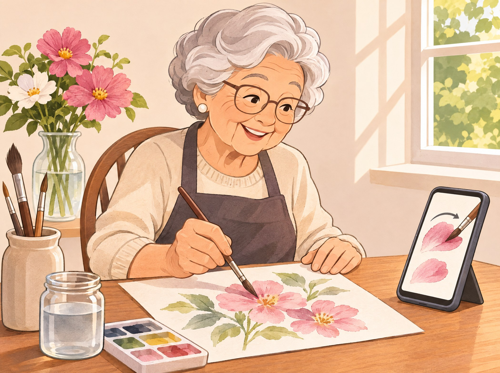

# Chapter 9: Learning New Hobbies and Skills



Retirement can be a wonderful time to learn: a language you always meant to study, the history behind a favorite place, an instrument, a craft. An AI assistant is like a patient private tutor who is available any hour of the day, never sighs, and never minds explaining something a fifth time.

## Ask It to Teach You

The magic phrase is **"teach me."** Add what you already know, and how you like to learn.

```text
Please teach me the basics of birdwatching. I'm a
complete beginner. Start with what equipment I need
and five common birds I might see in my backyard in
Pennsylvania.
```

```text
Teach me how to play a simple card game I can play
alone. Explain the rules step by step, slowly.
```

## Learning a Language

AI is a superb language partner, because you can practice conversation without feeling shy.

```text
I'd like to learn some Spanish before my trip to Mexico.
Please teach me five useful phrases a day. Today, start
with greetings, and test me afterward.
```

```text
Let's practice ordering in a restaurant in French.
You be the waiter. Speak simple French and correct my
mistakes gently, in English.
```

Many AI apps can also speak out loud, so you can hear how words sound. (See Chapter 15.)

## Exploring History and Science

Curious about something? Ask, and keep asking.

```text
Tell me the story of how the Golden Gate Bridge was
built, as if you were telling it to a friend over coffee.
```

```text
Why is the sky blue? Please explain simply, then tell
me one surprising fact about it.
```

```text
My father served in Korea in 1951. Please explain, in
simple terms, what was happening there that year.
```

## Arts, Crafts and Music

```text
I'd like to start watercolor painting. What do I need
to buy to begin, for under $50? Then suggest three
easy first projects.
```

```text
Please explain how to knit a simple scarf for a beginner,
step by step, with the names of the stitches explained.
```

```text
I am learning the piano. Please explain what a chord is,
and how to play C major, F major and G major.
```

## Reading and Book Clubs

```text
I loved "The Remains of the Day". Please recommend five
similar novels, with a one-line description of each.
```

```text
My book club is discussing "To Kill a Mockingbird".
Please suggest eight thoughtful discussion questions.
```

## Brain Games and Puzzles

Keeping the mind active is good for us, and AI can be a cheerful puzzle partner.

```text
Let's play twenty questions. You think of an animal,
and I will ask yes-or-no questions to guess it.
```

```text
Give me a gentle quiz of ten questions about the 1960s,
one question at a time. Tell me if I'm right after each.
```

```text
Please make me a crossword-style word puzzle with five
clues about gardening. Give me the answers only when
I ask.
```

## Setting Learning Goals

```text
I want to learn to identify 30 trees in my local park
by the end of spring. Please make me a simple
twelve-week plan, with one small goal a week.
```

> **Try It:** Choose one thing you have always wanted to learn. Ask the AI: "Please teach me the very first steps of [your hobby], as a complete beginner." Then ask it to test you on what you learned.

## Key Points

- Say "teach me" and explain what you already know.
- Practice languages by role-playing conversations.
- Ask about history, science and nature, and keep asking follow-ups.
- Get beginner shopping lists and first projects for crafts and music.
- Play quizzes and word games to keep your mind active.
