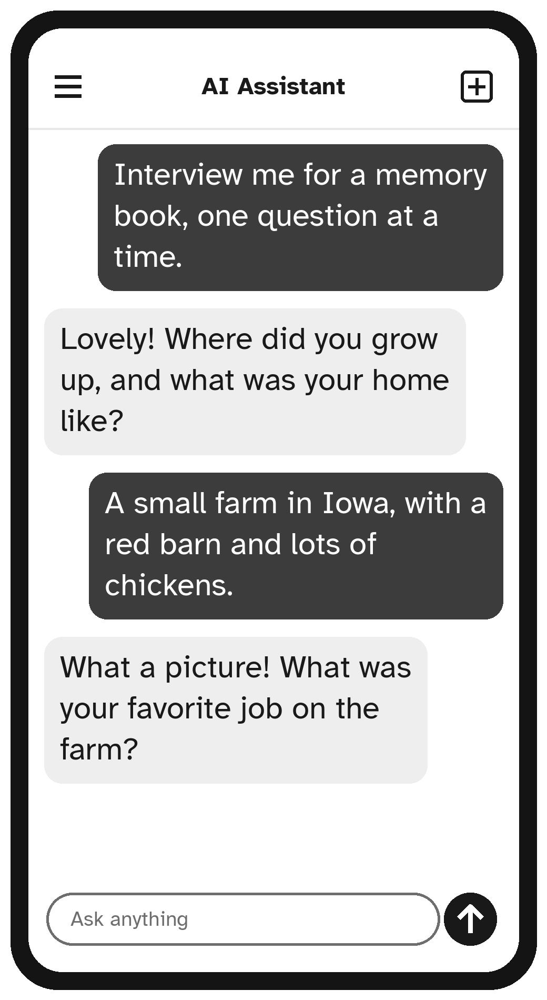

# Chapter 10: Family, Grandchildren and Memories

Families are spread further apart than ever, and the world our grandchildren live in can feel very different from the one we grew up in. An AI assistant can help you stay connected: finding gifts, understanding what the grandchildren are talking about, playing games, and, perhaps most precious of all, recording your own life stories.

## Gift Ideas

```text
Please suggest ten gift ideas for my granddaughter, who
is 9, loves horses and drawing, and already has lots of
toys. Budget: $25 to $40.
```

```text
What is a thoughtful gift for my son and his wife, who
have just bought their first house? Something personal,
not just a gift card.
```

## Understanding the Grandchildren

Not sure what a word, game or app is? Ask.

```text
My 14-year-old grandson keeps talking about "Minecraft"
and "Roblox". What are they, in simple words, and are
they safe for his age?
```

```text
What does "no cap" mean? My granddaughter said it
and I didn't want to ask.
```

```text
What questions could I ask my teenage grandson to start
a conversation, other than "How's school?"
```

## Games and Activities to Share

```text
My grandchildren, aged 6 and 9, are staying with me this
weekend. It may rain. Please suggest ten indoor
activities using things I probably have at home.
```

```text
Please write a short bedtime story about a brave little
hedgehog called Pip, for a 5-year-old. About five
minutes to read aloud.
```

You can even ask the AI to put your grandchild into the story, using only their first name. Children love it.

## Recording Your Life Stories

Your memories are a treasure for your family. Many people mean to write them down but never know where to start. An AI assistant can interview you, one question at a time, and then help you shape your answers into stories.

```text
I would like to write my life story for my grandchildren.
Please interview me, one question at a time, starting
with my childhood. Wait for my answer before asking the
next question.
```

Answer each question in your own words. Do not worry about spelling or neatness. After a few questions, ask:

```text
Please turn my answers so far into a short, warm story,
written in my own voice, keeping my own words where
possible.
```

You can do this a little at a time, one chat per period of your life: childhood, school, work, marriage, children, adventures. Copy each story into a document or email it to yourself, and one day you will have a book of memories for your family.



> **Note:** Treat your stories like a private diary. Keep private matters, like addresses, health details and financial information, out of them, or check with family before sharing.

## Family History

```text
My grandparents came from Ireland to Boston in the 1920s.
Please explain where I could start looking for records
of their journey, and what information I should gather
from my family first.
```

The AI can suggest where to look, such as archives, census records and libraries, but it cannot look up your actual family records. Always check names and dates in real documents.

## Staying in Touch

```text
Please help me write a short, cheerful weekly email
to my family, telling them about my week: I visited the
library, my tomatoes are ripening, and I saw an old
friend at church.
```

```text
How can I make a video call to my daughter from my
iPad? Please give simple step-by-step instructions.
```

> **Try It:** Start the interview: copy the life-story request above and answer the first three questions. You might be surprised how quickly memories come back.

## Key Points

- Get gift ideas by describing the person, their interests and your budget.
- Ask what new words, games and apps mean.
- Make up stories and games to share with grandchildren.
- Let the AI interview you to record your life stories.
- Use it for ideas on family history, then check real records.
