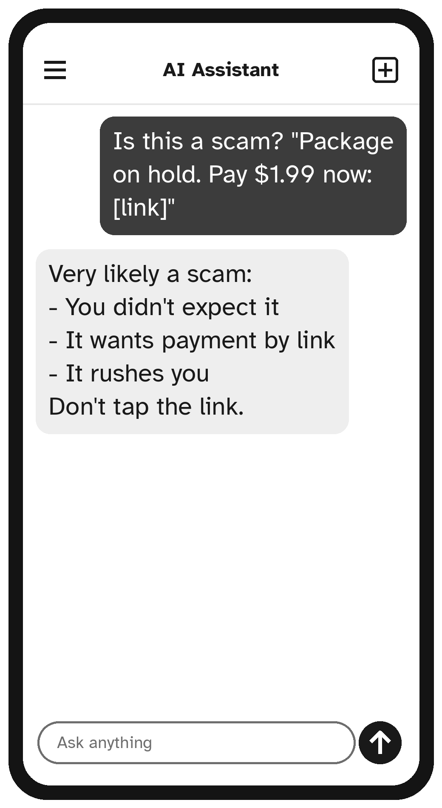

# Part III: Staying Safe

# Chapter 12: Spotting Scams, Old and New


Scammers target everyone, but they often target older adults, because many of us have savings, a home, and a polite habit of answering the phone. Today, scammers also use AI to make their tricks more convincing. The good news: the same few warning signs give away almost every scam, and an AI assistant can help you check suspicious messages.

## The Five Warning Signs

Almost every scam has at least one of these:

1. **Pressure and hurry.** "Act now!" "Today only!" "Your account will be closed in one hour!"
2. **Secrecy.** "Don't tell your family." "Don't tell the bank why you're withdrawing the money."
3. **Strange ways to pay.** Gift cards, wire transfers, cryptocurrency, payment apps, or cash handed to a courier.
4. **Unexpected contact.** A call, text or email you were not expecting, about a prize, a problem, or a relative in trouble.
5. **Requests for private information.** Passwords, codes sent to your phone, bank details or ID numbers.

> **Remember:** No real bank, government agency or company will ever ask you to pay with gift cards, or to read out a code they just sent to your phone. Anyone who does is a scammer.

## New: Scams That Use AI

AI tools can copy a person's voice from a short recording, such as a video posted online. Scammers use this for the **"family emergency" scam**: you get a call from what sounds exactly like your grandchild, crying, saying they have been in an accident or arrested and need money urgently, and begging you not to tell their parents.

It can sound completely real. Here is how to protect yourself:

- **Agree on a family code word.** Choose a word together, in person, that only your family knows. Something unusual, like "pineapple tractor". If someone calls asking for money in an emergency, ask for the code word. No word, no money.
- **Hang up and call back** on the number you already have for that person, or call their parents.
- **Slow down.** Real emergencies can wait the five minutes it takes to check.

Scammers also use AI to write convincing emails and texts without spelling mistakes, and to make fake videos of famous people "recommending" investments. If a celebrity seems to be promoting a get-rich-quick scheme, it is almost certainly fake.

> **Safety Tip:** Set up your family code word this week. Call or visit your children and grandchildren, explain why, and choose the word together. Write it somewhere private at home, not on your phone.

## Common Scams to Know

**The "your computer has a virus" scam.** A pop-up or phone call says your computer is infected and you must call a number or let someone connect to your computer. Never do either. Close the browser, or switch the computer off and on again.

**The delivery scam.** A text says a package can't be delivered unless you pay a small fee through a link. Delete it. Check deliveries on the shop's official website or app instead.

**The bank fraud scam.** Someone claiming to be from your bank's "fraud department" calls and asks you to move money to a "safe account," or to read out a code. Hang up and call the number on the back of your card.

**The government scam.** A caller says you owe taxes or that your Social Security number has been "suspended," and threatens arrest. Real government agencies send letters and do not threaten you on the phone.

**The romance scam.** A friendly stranger online becomes a close companion over weeks or months, then needs money for an emergency, a ticket, or a medical bill. Never send money to someone you have not met in person.

**The prize scam.** You have "won" a lottery or sweepstakes you never entered, but must pay a fee to collect. Real prizes do not cost money to claim.

## Using AI to Check a Suspicious Message

Your AI assistant can be a helpful second opinion. Copy the message, **remove your personal details**, and ask:

```text
I received this message. Is it likely a scam? Please
list the warning signs and tell me what to do.

[paste the message here]
```



The AI will point out the warning signs and suggest safe next steps. If it says the message looks genuine, still **check by contacting the company yourself**, using a phone number or website you already know, not the one in the message.

> **Warning:** Never click links or call numbers in a suspicious message, even to check. Find the real phone number on your card, your statement, or the company's official website.

## If You Think You Have Been Scammed

Don't be embarrassed. Scammers are professionals, and they fool clever, careful people every day. Act quickly:

1. **Call your bank** using the number on the back of your card. Tell them what happened. They may be able to stop a payment.
2. **Change any passwords** you may have shared, or ask a family member to help.
3. **Report it.** In the United States, report scams to the Federal Trade Commission at **ReportFraud.ftc.gov**. If you are 60 or older, you can also call the **National Elder Fraud Hotline** at **833-FRAUD-11** (833-372-8311); check the current opening hours at **justice.gov/stopelderfraud**. In other countries, contact your national fraud reporting service or the police.
4. **Tell someone you trust.** Talking about it helps, and warns others.

> **Try It:** Ask your AI assistant: "What are the most common scams targeting older adults right now, and how can I spot each one?" Then share one tip with a friend.

## Key Points

- Pressure, secrecy, odd payment methods, unexpected contact and requests for private details are the five warning signs.
- AI can fake a loved one's voice: agree on a family code word.
- Hang up and call back on a number you already know.
- Ask your AI assistant for a second opinion, but check with the company directly.
- If something happens, call your bank quickly and report it.
