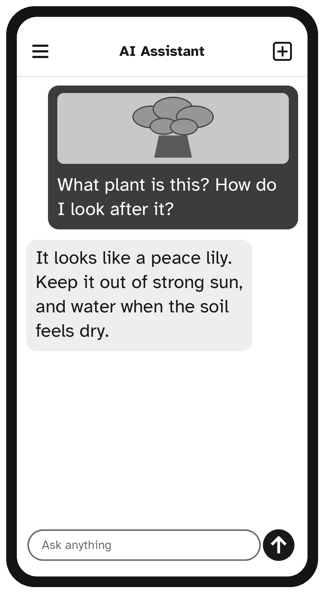

# Part IV: Going Further

# Chapter 15: Talking Instead of Typing, and Using Your Camera


Typing on a small screen can be slow, especially if your fingers are stiff or your eyesight is tired. The good news is that you can **talk** to most AI assistants, and many can **talk back**. Some can even **see** through your phone's camera.

## Speaking Your Message

The simplest way to talk is to use the microphone on your keyboard.

1. Tap the message box, so the keyboard appears.
2. Look for a small **microphone** icon on the keyboard (often near the space bar) or next to the message box.
3. Tap it and speak normally. Your words appear as text.
4. Check the words, fix any mistakes, and tap **send**.

Speak clearly at a normal pace. You can say punctuation, too: say "comma", "period" or "question mark" where you want them.

> **Tip:** The first time you use the microphone, your phone will ask for permission to use it. Tap **Allow**. This is normal for well-known apps.

## A Real Spoken Conversation

Many AI apps have a **voice mode**, where you talk and the AI answers out loud, like a phone call. Look for a button with a sound-wave symbol, a headphones symbol, or the word **Voice**, usually near the message box.

In voice mode:

- Just talk. When you pause, the AI answers out loud.
- You can interrupt it by speaking, if you want to change direction.
- Tap the **X** or **End** button to finish.

Voice mode is lovely for practicing a language, getting cooking instructions while your hands are busy, or simply chatting about a topic you're curious about.

> **Note:** Not every app or device has voice mode, and some features need the latest version of the app. If you can't find it, ask the AI: "Do you have a voice mode in this app, and how do I start it?"

## Listening to Answers

If you prefer to read your messages but hear the answers, many apps have a **read aloud** button (often a small speaker icon) under each answer. Tap it to hear the answer spoken.

Your phone also has built-in features that can read the screen aloud. Ask your AI assistant:

```text
How do I make my iPhone read the text on the screen out
loud? Please give simple steps.
```

## Using Your Camera

Many AI assistants can look at a photo and tell you about it. This opens up wonderful possibilities:

- **Reading small print**: a medicine leaflet, a menu in a dim restaurant, a label in a store
- **Identifying things**: a plant, a bird, a mushroom in the garden (but never eat anything based on an AI's guess)
- **Understanding things**: "What is this warning light on my car's dashboard?"
- **Helping with gadgets**: a photo of the back of your TV, asking which cable goes where

To share a photo, look for a **paperclip**, **plus (+)** or **camera** button next to the message box. You can take a new photo or choose one from your gallery. Then add a question:

```text
What kind of plant is this, and how do I look after it?
```

```text
Please read the instructions on this leaflet and tell me
the main points in simple words, in large text.
```



> **Safety Tip:** Before sharing a photo, check what is in it. Do not share photos of documents showing account numbers, ID cards, prescriptions with your full details, or other people who haven't agreed to it.

## Making a Phone Easier to Use

Ask your AI assistant to help you with your phone's accessibility features, the settings designed to make phones easier for everyone:

```text
I have an Android phone and I find the screen hard to
read. What settings can make it easier? Please list
them with simple steps.
```

```text
My hands shake a little, and I often tap the wrong
thing on my iPhone. Are there settings that can help?
```

> **Try It:** Ask your AI assistant a question by speaking instead of typing. Then try sharing a photo of something in your home, such as a houseplant or a piece of fruit, and ask it what it sees.

## Key Points

- Use the keyboard microphone to speak instead of typing.
- Try voice mode for real spoken conversations.
- Use the read aloud button to hear answers.
- Share photos to read small print, identify plants, or understand gadgets.
- Check photos for private information before sharing.
