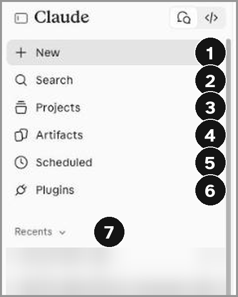
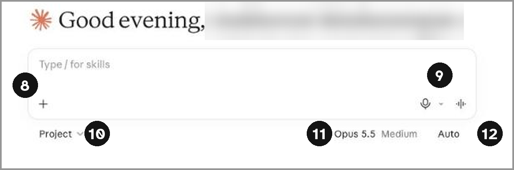
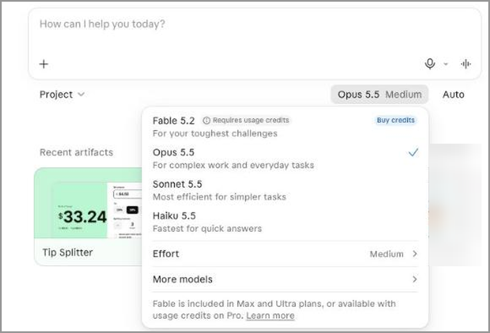

# Chapter 2: Getting Set Up in Ten Minutes

In this chapter you will create your account, choose where to use Claude, pick a plan, learn your way around the main screen, and change the three settings worth changing on day one.

## Step 1: Create Your Account

1. Go to **claude.ai** in any web browser.
2. Choose to sign up with your email address or a Google or Apple account.
3. If you use email, Claude sends you a sign-in link or code. Open it.
4. Enter your name and confirm your age and the terms.

That's it. You can start chatting immediately on the free plan.

> **Tip:** Use the same sign-in method on every device. If you sign up with Google on your laptop, sign in with Google on your phone too. Then all your chats, Projects and settings appear everywhere.

## Step 2: Choose Where to Use Claude

Claude works in three places. Your chats sync between them.

| Where | Best for | How to get it |
| --- | --- | --- |
| Web (claude.ai) | Trying Claude on any computer | Open claude.ai in a browser |
| Desktop app (Mac and Windows) | Daily use, files on your computer, longer tasks, installing artifacts as apps | Download from claude.ai/download |
| Mobile app (iPhone and Android) | Voice, camera, quick questions on the go | Search "Claude by Anthropic" in your app store |

For most people, the best setup is the **desktop app at work** and the **mobile app in your pocket**. The desktop app can do a few things the website cannot, such as working with files on your computer and installing tools that Claude builds for you as real apps.

> **Check First:** Only download Claude from claude.ai or from the official Apple App Store or Google Play listing published by Anthropic. Fake "Claude" apps exist. The real one is free to download.

## Step 3: Pick a Plan

Claude has a free plan and several paid plans. Here is what matters when you choose. Prices and limits change, so check **claude.com/pricing** for current details.

| Plan | Who it suits | What you get, in plain terms |
| --- | --- | --- |
| Free | Trying Claude, light use | Chats, files and photos, Artifacts (including documents, decks and designs), memory, Projects with limits. Usage resets every few hours. |
| Pro | Regular personal or work use | Much more usage, more models, Research, more connectors and Cowork features |
| Max | Heavy daily use | Several times the usage of Pro, and earliest access to new features |
| Ultra | Very heavy individual use | The highest individual usage |
| Team and Enterprise | Companies | Shared Projects, admin controls, and features such as Claude in meetings |

**My advice:** Start on Free and work through Part I. If you hit the usage limit more than twice in a week, or you need Research or Cowork, upgrade to Pro. Very few readers of this book will need more than Pro.

### What "usage limits" means

Every plan has a limit on how much you can use Claude in a few hours and in a week. Long conversations, big files and the most powerful model use your allowance faster. When you get close, Claude shows a message. You can start a fresh chat, switch to a lighter model, or wait for the reset. Chapter 24 has tips for making your allowance last.

## Step 4: Learn the Main Screen

Open Claude on a computer. This is the real home screen of the Claude app in late 2026. (In all the screenshots in this book, personal details such as names and the list of past chats are blurred.)

The two pictures below show the left side of the screen, called the **sidebar** (parts 1 to 7), and the **message box** in the middle, where you type (parts 8 to 12).





| # | Part | What it does |
| --- | --- | --- |
| 1 | New | Starts a fresh conversation with no history |
| 2 | Search | Finds any past conversation by a word in it |
| 3 | Projects | Your workspaces for ongoing topics (Chapter 9) |
| 4 | Artifacts | Every document, deck and tool Claude has made for you (Chapter 8) |
| 5 | Scheduled | Tasks Claude runs for you on a timetable (Chapter 14) |
| 6 | Plugins | Ready-made bundles of skills and connections (Chapter 13) |
| 7 | Recents | Your latest chats. Hover over one to rename, star or delete it |
| 8 | The + button | Adds files and photos, Google Drive, Research, memory and more |
| 9 | Microphone and voice | Dictate your request, or talk with Claude out loud |
| 10 | Project picker | Starts this chat inside one of your Projects |
| 11 | Model and effort | Chooses which Claude model answers, and how hard it thinks |
| 12 | Permissions | Manual or Auto: whether Claude asks before acting in other apps (Chapter 12) |
| 13 | Your name | Opens Settings: profile, appearance, memory, connectors, privacy and your plan |

Take a minute to find each numbered part on your own screen. On the phone, the same parts are there; the sidebar hides behind the menu button in the top corner.

> **Note:** The two small icons at the very top of the sidebar switch between everyday Claude and Claude Code, the tool for building software. Everything in this book uses everyday Claude, the first icon.

## Step 5: Choose a Model and an Effort Level

Click the model name under the message box (part 11). A menu like this opens.



In late 2026 the choices are:

| Model | What the menu says | Use it for |
| --- | --- | --- |
| Fable | For your toughest challenges | The hardest problems. Included on Max and Ultra; uses extra usage credits on Pro |
| Opus | For complex work and everyday tasks | Almost everything. The default for most accounts |
| Sonnet | Most efficient for simpler tasks | Quick writing jobs, making your allowance last longer, and every workflow in this book |
| Haiku | Fastest for quick answers | Short rewrites, quick questions, sorting and tidying |

**Effort** controls how long Claude thinks before it answers. Low is quickest, Medium suits most work, and High is worth it for tricky analysis, long documents and anything you will act on. Higher effort uses more of your allowance.

New model versions arrive every few months, so you may see different numbers from the "5.5" in the screenshot. The advice stays the same: **keep the default for everyday work, step up to a stronger model or higher effort when the job is hard or important, and step down when you just need speed.**

> **Tip:** If you are on the free plan or close to your limit, choose Sonnet. It handles most everyday writing very well and uses less of your allowance.

## Step 6: Three Settings to Change on Day One

Click your name (part 13) and open **Settings**. Change these three things now; it takes two minutes and makes every answer better.

**1. Tell Claude about yourself.** In your profile, find the box that asks what Claude should know about you or how it should respond. Write two or three sentences, for example:

```prompt
I'm Sam, an office manager at a dental clinic in Ohio. I write a lot of emails to patients and staff. I prefer short, warm, plain-English answers with US spelling. Ask me a question if something important is missing.
```

Claude reads this at the start of every conversation, so you never have to repeat it.

**2. Decide about memory.** In **Settings > Memory**, you can let Claude remember useful things from your past chats and search old conversations. Chapter 10 explains this fully. If you are unsure, leave it on; you can review and delete anything it remembers at any time.

**3. Check your privacy choice.** In **Settings > Privacy**, look for the setting about using your chats to help improve Claude. Choose what you are comfortable with. Chapter 23 explains what it means.

## Exercise

1. Install the desktop or mobile app and sign in.
2. Write your "about me" note in Settings.
3. Find all eight numbered parts of the main screen on your own device.
4. Open the model picker and note which models your plan offers.

## Key Points

- Sign up at claude.ai and use the same sign-in on every device.
- Desktop app for work, mobile app for on the go.
- Start on Free; upgrade to Pro if you hit limits or need Research and Cowork.
- Keep the default model for everyday work; step up for hard jobs and down for quick ones.
- Your "about me" note in Settings improves every answer.
