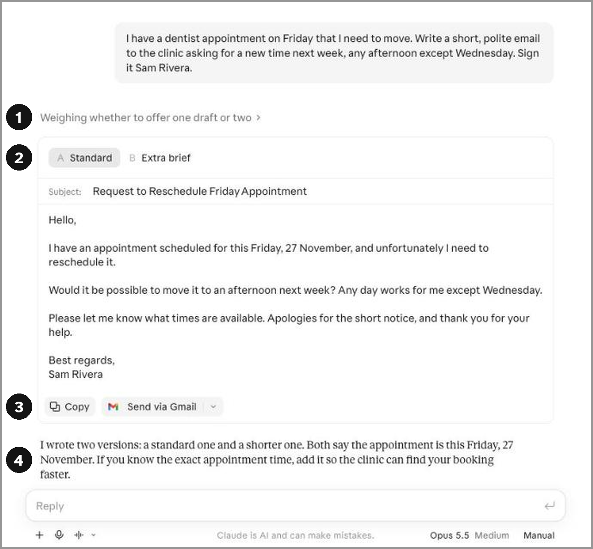

# Chapter 3: Your First Conversation

The fastest way to learn Claude is to use it for something real. In this chapter you will send a real request, read the answer, use the buttons under it, ask a follow-up, and learn how to keep your conversations organized.

## Step 1: Send a Real Request

Pick a small, real task from your week. Here is the one I used:

```prompt
I have a dentist appointment on Friday that I need to move. Write a short, polite email to the clinic asking for a new time next week, any afternoon except Wednesday. Sign it Sam Rivera.
```

1. Click **New** in the sidebar, or open Claude's home screen.
2. Click in the message box and type your request.
3. Press **Enter** or click the send arrow.

To start a new line without sending, press **Shift+Enter**.

## Step 2: Read the Answer

Within a few seconds, Claude replied. This is the real screen.



Notice four things.

**1. A short note about its thinking.** Above the answer, a gray line such as "Weighing whether to offer one draft or two" shows what Claude considered. Click it to see more, or ignore it.

**2. The answer came as a ready-to-use email.** For emails, Claude often shows a special draft card with a subject line, the message, and buttons. This time it offered two versions, **Standard** and **Extra brief**, as tabs.

**3. Buttons under the draft.** **Copy** copies the email so you can paste it anywhere. **Send via Gmail** opens it in Gmail if you have connected your Gmail account (Chapter 13).

**4. A helpful note.** Below the draft, Claude added:

```result
I wrote two versions: a standard one and a shorter one. Both say the appointment is this Friday, 27 November. If you know the exact appointment time, add it so the clinic can find your booking faster.
```

That last sentence is Claude doing what a good assistant does: pointing out what's missing. It's worth reading those notes; they often tell you how to make the result better.

Here is the Standard version in full:

```result
Subject: Request to Reschedule Friday Appointment

Hello,

I have an appointment scheduled for this Friday, 27 November, and unfortunately I need to reschedule it.

Would it be possible to move it to an afternoon next week? Any day works for me except Wednesday.

Please let me know what times are available. Apologies for the short notice, and thank you for your help.

Best regards,
Sam Rivera
```

That email is ready to send. It took about ten seconds.

## Step 3: Use the Buttons Under Every Answer

Under every answer you will find a row of small icons. From left to right they usually are:

| Icon | What it does |
| --- | --- |
| Copy | Copies the whole answer |
| Speaker | Reads the answer out loud |
| Thumbs up and down | Tells Anthropic whether the answer was good. Optional |
| Retry (circular arrow) | Asks Claude to answer again from scratch |

**Retry** is more useful than it looks. If an answer is not quite right, retrying gives you a fresh attempt. You can flip between the old and new versions with the small arrows that appear.

## Step 4: Ask a Follow-Up

The real power of a conversation is that you don't have to start over. Claude remembers everything earlier in the same chat. So instead of rewriting your whole request, just say what to change:

```prompt
Make it a little warmer, and mention that mornings are also fine on Thursday.
```

Good follow-ups are short and specific. Some of the most useful ones:

- "Shorter." / "Half the length."
- "More formal." / "More friendly."
- "Put it in a table."
- "Turn this into bullet points."
- "Give me three other options."
- "What did you assume? List your assumptions."
- "Now write the reply I might get, and my response to it."

## Step 5: Edit Your Own Message

Sometimes you notice a mistake in what *you* wrote: the wrong day, a missing detail. Hover over your message and click the **Edit** (pencil) icon. Change the text and send it again. Claude answers the edited version, and the old branch is kept; you can flip between them with the arrows.

> **Tip:** Editing is better than adding "Sorry, I meant Thursday" as a new message, because the wrong information disappears from the conversation instead of confusing later answers.

## Step 6: Keep Your Chats Organized

Every conversation is saved automatically in **Recents** in the sidebar, with a title Claude picks (mine was "Dentist appointment reschedule email").

- **Rename** a chat: hover over it in the sidebar, click the three dots, choose Rename.
- **Star** a chat you'll come back to, so it stays at the top.
- **Delete** a chat you don't need: three dots, then Delete.
- **Find** an old chat: click **Search** in the sidebar (or press Ctrl+K, or Cmd+K on a Mac) and type any word you remember from it.
- **Share** a chat: click **Share** at the top right to create a link. Only share chats that contain nothing private.

### One task, one chat

Start a **new chat** for each new task. Long chats that wander from topic to topic get slower, use more of your allowance, and can confuse Claude with details from earlier tasks. If you keep returning to the same topic over days or weeks, use a Project instead (Chapter 9).

## Exercise

1. Send a real request from your own week: an email, a message, a short plan.
2. Use **Retry** once and compare the two versions.
3. Send two follow-ups that change the result.
4. Edit your original message to change one detail.
5. Rename the chat to something you'll recognize.

## Key Points

- Type your request, press Enter, and read the whole answer, including Claude's notes.
- Use Copy, Retry and the read-aloud button under every answer.
- Follow-ups are short: say only what to change.
- Edit your own message to fix a mistake, instead of correcting it later.
- One task per chat; use Search to find anything old.
