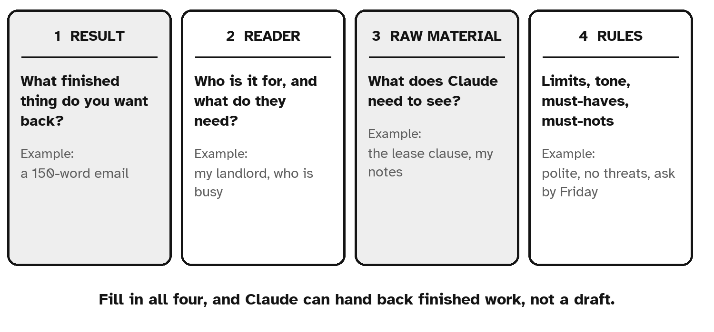

# Chapter 4: The Finished-Work Formula

The biggest complaint about AI assistants is that they produce drafts you still have to fix. This chapter fixes that, with one habit: **describe the finished result, not the task.**

Compare these two requests.

```prompt
Write an email to my landlord about the broken heater.
```

```prompt
Write a 120-word email to my landlord, Mr. Patel, asking him to repair the heater in my apartment (Unit 4B), which stopped working on Monday. He is usually slow to reply, so be polite but clear, mention that my lease (section 9) says urgent repairs are done within 72 hours, and ask him to confirm a repair date by Friday. No threats. Sign it Jordan Lee.
```

The first will get you a generic email with blanks to fill in. The second gets you an email you can send. The difference is not clever wording. It is information that only you had.

## The Four Parts

Every request that produces finished work answers four questions.



**1. Result:** What finished thing do you want back? Name the format and the size: "a 120-word email," "a one-page summary with five bullet points," "a table with three columns," "a seven-day meal plan."

**2. Reader:** Who is it for, and what do they need? A busy boss needs the decision first. A nervous customer needs reassurance. A ten-year-old needs short words. Say who the reader is and Claude adjusts everything: tone, length, detail, vocabulary.

**3. Raw material:** What does Claude need to see? The facts, numbers, names, dates, the document, your notes, the earlier email you're replying to. Paste it in or attach it. This is the part most people skip, and it is the main reason answers come back generic.

**4. Rules:** What are the limits and must-haves? Tone ("warm but professional"), things to include ("mention the 72-hour clause"), things to avoid ("no jargon," "no threats"), deadlines, word counts, spelling style.

You don't need to label the parts or put them in order. Just make sure all four are in your message. With practice it takes about thirty seconds.

## A Worked Example

Priya runs the parents' association at her daughter's school. She needs to ask parents for volunteers.

**Her first attempt:**

```prompt
Write a message asking parents to volunteer for the school fair.
```

The answer was fine but generic: no date, no specific jobs, placeholder brackets everywhere.

**With the formula:**

```prompt
Write a short message for our school parents' WhatsApp group (Result) asking for volunteers for the spring fair. The parents are busy and skim, so it must be readable in 20 seconds (Reader). Details: Saturday 14 March, 10am to 2pm, Oakfield Primary playground. We need 4 people for the bake stall, 3 for games, 2 for setup at 9am and 2 for cleanup at 2pm. Shifts are 1 hour. Sign-up sheet: link in my next message (Raw material). Friendly and upbeat, no emoji, no guilt-tripping, end with a clear call to action (Rules).
```

**Claude's answer:**

```result
Hi everyone!

Our Spring Fair is on Saturday 14 March, 10am to 2pm, in the Oakfield Primary playground, and we'd love your help.

We need:
- Bake stall: 4 people
- Games: 3 people
- Setup at 9am: 2 people
- Cleanup at 2pm: 2 people

Every shift is just 1 hour, so you'll still have plenty of time to enjoy the fair with your kids.

Grab a slot using the sign-up link below. Thank you!
```

She pasted it into WhatsApp unchanged. The labels in brackets were only there to show you the four parts; you don't need to type them.

## When You Don't Know All Four

Sometimes you don't know what the finished result should look like. That's fine. Ask Claude to help you work it out first:

```prompt
I need to tell my team that our Friday deadline is moving to next Wednesday. Before you write anything, ask me the questions you need answered to write a message they can't misunderstand. Ask them all at once.
```

Claude will ask about the reason, who is affected, what changes, and the tone you want. Answer in a few words each and it will write the finished message. This "ask me first" trick is one of the most useful habits in this book.

## Three Shortcuts

**Show an example.** If you have a previous email, report or post you liked, paste it and say "match the style and length of this example." One example beats a paragraph of description.

**Give the reason.** "Keep it under 150 words because it will be read on a phone" works better than "keep it short," because Claude understands what the rule is for and applies it sensibly.

**Say what to do, not only what not to do.** "Use plain words a 12-year-old would understand" works better than "don't be too technical."

## Save Your "About Me" Once

Some raw material is the same every time: who you are, your company, your style. Don't retype it. Put it in your profile in Settings (Chapter 2), in a Project's instructions (Chapter 9), or let memory pick it up (Chapter 10). Then every request only needs the parts that change.

## Exercise

Take a request you sent in Chapter 3. Rewrite it using all four parts and send it as a new chat. Compare the two answers. Which one could you use without editing?

## Key Points

- Describe the finished result, not the task.
- Every good request has a Result, a Reader, Raw material and Rules.
- Raw material is the part people skip, and the main cause of generic answers.
- When you're unsure, ask Claude to ask you questions first.
- Save the details that never change in your profile, a Project or memory.
