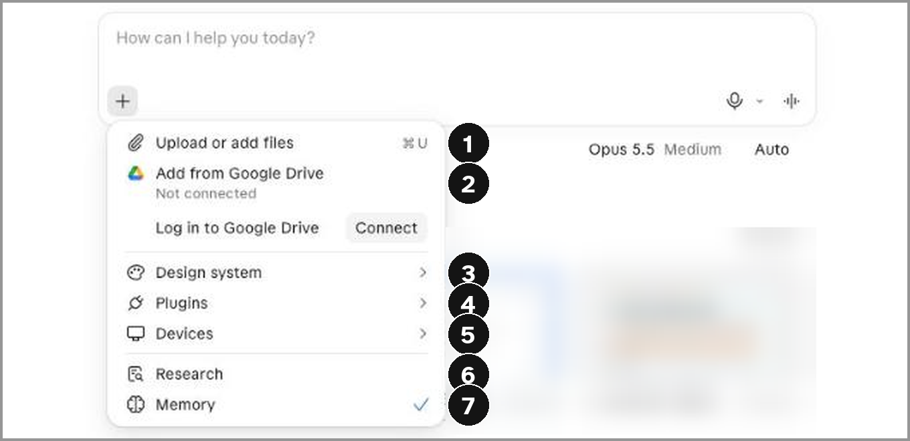
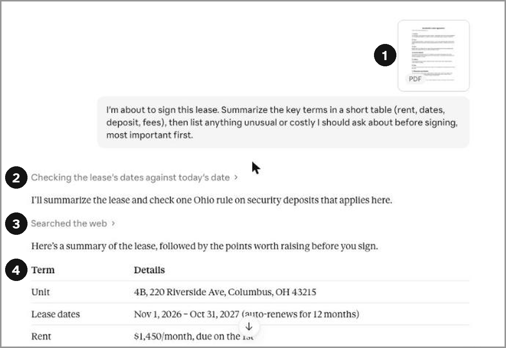

# Part II: The Features, Step by Step

# Chapter 6: Files and Photos

Most real work starts with something you already have: a PDF, a spreadsheet, a photo of a whiteboard, a screenshot of an error, a letter from your bank. When you give Claude the actual material, its answers stop being generic and start being about *your* situation. This chapter shows you how.

## The + Menu

Everything you can add to a chat starts with the **+** button at the bottom left of the message box. This is the real menu.



| # | Option | What it does |
| --- | --- | --- |
| 1 | Upload or add files | Attach files from your computer or phone. Shortcut: Ctrl+U (Cmd+U on a Mac) |
| 2 | Add from Google Drive | Attach a file straight from Google Drive, once you connect it (Chapter 12) |
| 3 | Design system | Choose a visual style for designs and decks Claude makes (Chapter 13) |
| 4 | Plugins | Turn on ready-made skill bundles for this chat (Chapter 13) |
| 5 | Devices | Let Claude work with a connected computer or browser (Chapter 15) |
| 6 | Research | Run a deep, multi-source research report (Chapter 11) |
| 7 | Memory | Turn memory on or off for this chat (Chapter 10) |

## Three Ways to Add a File

1. **Click + then Upload or add files**, and choose the file.
2. **Drag and drop** a file from your desktop onto the chat window.
3. **Paste** an image or screenshot straight into the message box with Ctrl+V (Cmd+V).

You can add several files to one message. They appear as small cards above your text. Click the **x** on a card to remove it before sending.

## What Claude Can Read

| Type | Examples | Good for |
| --- | --- | --- |
| PDFs | Contracts, reports, statements, manuals, research papers | Summaries, key terms, questions, comparisons |
| Documents | Word files, text files, web pages saved as files | Editing, rewriting, checking |
| Spreadsheets | Excel and CSV files | Totals, trends, charts, cleanup, formulas |
| Slides | PowerPoint files | Summaries, speaker notes, critique |
| Images | Photos, screenshots, scans, handwriting | Reading text, describing, extracting data |

Claude reads charts and pictures inside PDFs too, not just the text.

> **Note:** There are limits on file size and on how much text fits in one conversation. Long PDFs often work, but large or scanned files may need splitting. For very large files, ask about one section at a time, or put the files in a Project (Chapter 9).

## A Real Example: Checking a Lease

Jordan was about to sign a new apartment lease. Here is the real conversation: the lease PDF attached, a request using the Finished-Work Formula, and the start of Claude's answer.



The numbers show what happened:

1. **The attached PDF** appears as a card above the request.
2. **Claude checked the dates.** It noticed the lease was dated October 1 but today was late November.
3. **It searched the web by itself** to check one Ohio rule on security deposits, because that rule mattered to the answer. You'll learn more about this in Chapter 11.
4. **It answered in the format asked for:** a table of key terms first.

After the table, Claude listed what to ask about, most important first. Here is part of the real answer. (The deposit rule it quotes is Ohio Revised Code section 5321.16(B), "Security deposits," at codes.ohio.gov. I checked the wording against the statute; treat the point as a question to raise with the landlord or a local attorney, not a legal ruling.)

```result
What to ask about, most important first

The dates are already out of date. The lease is dated October 1 and says both parties signed that day. The term started November 1, but today is November 25. Ask them to correct the signing date and start date, and confirm what you owe for November. [...]

The $225 carpet fee is charged "in all cases." Under Ohio law, a landlord can apply the deposit to past due rent and to the payment of the amount of damages that the landlord has suffered by reason of the tenant's failure to follow the lease or the law. A flat fee charged even if the carpet is fine doesn't clearly fit that. Ask them to remove it, or to charge it only if cleaning is actually needed beyond normal wear.

Auto-renewal with a rent increase. If you don't give written notice by about September 1, 2027, you're locked in for another year at up to 6% more (about $1,537/month). Put that date in your calendar now.

[... five more points, then:]

Your upfront cost is about $3,625 (first month plus deposit), adjusted for whatever they decide about November rent.

I'm not a lawyer. For anything they won't change, especially the carpet fee, a local tenant advocacy group or a landlord-tenant attorney can confirm where you stand.
```

The answer ended with links to its two sources and a suggestion button, **Create a spreadsheet**, to turn the costs into a table you can keep.

Notice three things. Claude found problems Jordan hadn't asked about (the out-of-date signing date). It explained *why* each point mattered and what to ask. And it was clear about its limits: useful preparation, not legal advice.

## Photos and Screenshots

Photos work the same way. Try these:

- A photo of a **receipt**: "List every item and price in a table, and total the groceries separately from household items."
- A photo of a **whiteboard** after a meeting: "Turn this into tidy meeting notes with action items and owners."
- A **screenshot of an error message**: "What does this mean, and what should I try first? I'm not technical."
- A photo of a **plant, rash or car dashboard light**: "What might this be? What should I check, and when should I see a professional?"
- A photo of a **page in another language**: "Translate this into English and explain anything that would confuse a visitor."
- A photo of **handwritten notes or an old recipe card**: "Type this up exactly, then give me a clean version."

> **Tip:** Good light and a straight-on angle make a big difference. If Claude misreads something, tell it which part is wrong and ask it to look again at that part of the image.

## Five Requests That Work on Almost Any File

```prompt
Summarize this in five bullet points for someone who has two minutes. Then list anything that needs a decision or action from me, with dates.
```

```prompt
What are the three most important numbers in this file, and what do they tell me?
```

```prompt
Read this as a careful skeptic. What's missing, unclear, inconsistent or risky?
```

```prompt
I need to explain this file to my manager. Write the explanation in plain English, under 150 words.
```

```prompt
Turn the key information in this file into a table I can paste into a spreadsheet.
```

## Comparing Several Files

Attach two or more files and ask Claude to compare them. This is one of its biggest time savers.

```prompt
These are three quotes for the same job. Compare them in a table: total price, what's included, what's missing, timing and warranty. Then tell me which questions to ask each company before deciding.
```

You'll see this exact workflow, with a real answer, in Chapter 9.

## Privacy Check Before You Upload

Before attaching a file, glance at what's in it. Remove or black out account numbers, ID numbers, passwords and other people's private details you don't need Claude to see. Claude doesn't need your full card number to explain your credit card statement. Chapter 23 covers privacy in full.

## Exercise

1. Find a PDF you've been meaning to read: a policy, a manual, a long email saved as PDF.
2. Attach it and ask for a five-bullet summary plus actions with dates.
3. Take a photo of something on your desk with text on it and ask Claude to turn it into a table or a tidy list.

## Key Points

- The + button adds files, Google Drive files, Research, plugins and more.
- You can also drag and drop files or paste screenshots.
- Claude reads PDFs, documents, spreadsheets, slides and images, including charts and handwriting.
- Real material makes real answers: attach the actual file, not a description of it.
- Remove private numbers you don't need to share before uploading.
