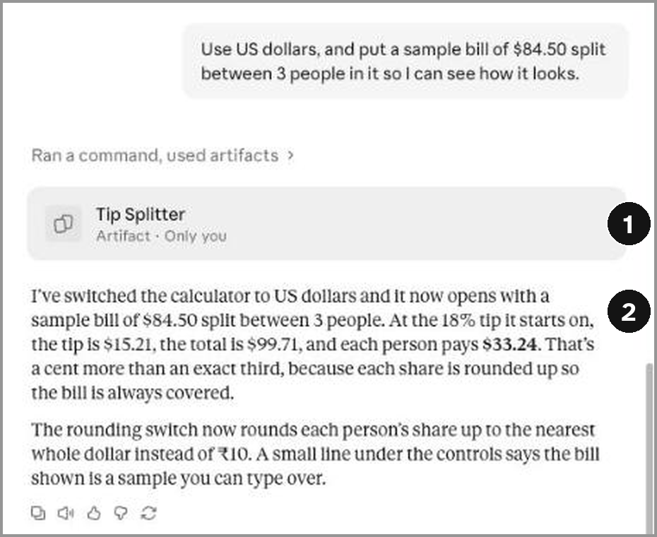
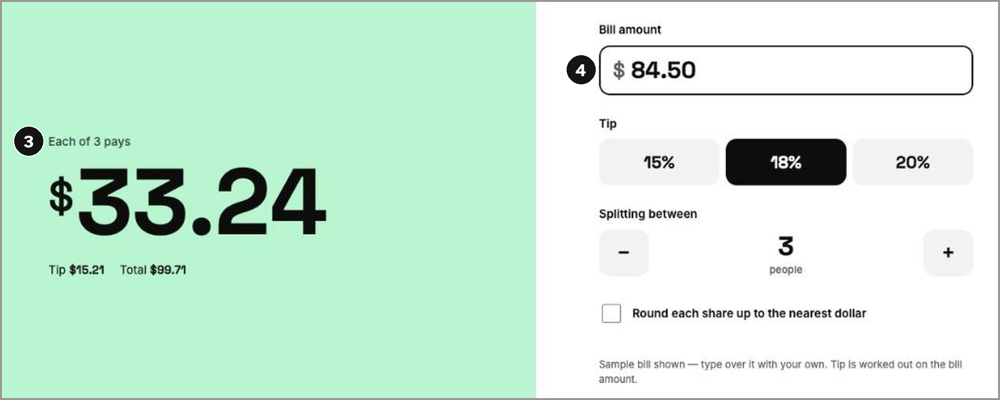

# Chapter 8: Artifacts: Tools, Charts and Pages You Can Use

An **artifact** is something Claude makes that is bigger than a chat reply and that you'll want to use, keep or share: a calculator, a checklist you can tick, a chart, a quiz, a small web page, a planner. Artifacts open in a panel beside the chat, they work right there, and you never touch any code.

## A Real Example: A Tip Calculator in One Request

I asked Claude:

```prompt
Make me a simple tip calculator I can use on my phone: I type the bill, pick 15, 18 or 20 percent, and choose how many people are splitting it. Show what each person pays in big numbers.
```

About twenty seconds later, a working calculator appeared. The first version used my local currency, so I sent one follow-up: "Use US dollars, and put a sample bill of $84.50 split between 3 people in it so I can see how it looks." This is the real result.

The chat appears on the left:



1. **The artifact card.** Click it any time to reopen the artifact.
2. **Claude's explanation** of what it built. It even added two things I hadn't asked for: a "round up" switch and a memory of the last bill.

The artifact itself opens in a panel on the right:



3. **The result**, in big numbers, as requested.
4. **The controls.** The tool is live: type a new bill or tap 15% and the numbers change instantly.

At the top of the panel are the artifact's name (click it to see older versions) and buttons for sharing, opening it in a new tab, and making it full screen.

Notice the label **Artifact · Only you** on the card. Your artifacts are private until you choose to share them.

## What You Can Make

You can make almost anything that fits on a screen and doesn't need a big company's computer systems behind it.

| Kind | Examples |
| --- | --- |
| Calculators | Tip splitter, loan payment, paint needed for a room, freelance rate |
| Trackers | Habit tracker, reading log, chore chart, savings goal |
| Checklists | Packing list you can tick, moving-day checklist, wedding planner |
| Charts and visuals | Bar chart from your numbers, timeline, family tree, flowchart |
| Learning tools | Flashcards, quizzes, times-tables game, vocabulary practice |
| Pages | A one-page event site, a menu, a simple portfolio |
| Small games | Word games, trivia for a party, a memory game for kids |

> **Tip:** Claude also makes quick charts and diagrams right inside its answers when a picture explains things better. Ask "show this as a chart" in any chat.

## Changing an Artifact

You change an artifact the same way you change any answer: tell Claude what to change.

- "Make the buttons bigger; my dad will use this."
- "Add a dark mode switch."
- "Add a 22% option and remove 15%."
- "It shows $33.23 but my math says $33.24. Check the rounding."

Each change creates a new **version**. If a change makes things worse, click the artifact's name at the top of the panel to open the version menu, and go back.

## Keeping and Finding Artifacts

Every artifact you make is saved. Click **Artifacts** in the sidebar to see them all, newest first. The home screen also shows your **recent artifacts** under the message box.

## Sharing an Artifact

Click **Share** at the top of the artifact panel to publish an artifact as a link. Anyone with the link can open and use it, even without a Claude account. You can unpublish it later.

Before you share, check that the artifact contains nothing private. A budget tracker with your real numbers in it is fine to keep, but not to publish.

## Installing an Artifact as an App

On the Claude desktop app for Mac and Windows, you can **install an artifact as an app** (a beta feature in late 2026). It gets its own window and icon and opens like any other program on your computer. This is perfect for something you use every day, like a timesheet calculator or a family chore chart.

On a phone, open a shared artifact link in your browser and use **Add to Home Screen**. Claude suggested exactly that in its note about the tip calculator.

## When an Artifact Isn't the Right Tool

Artifacts are best for small, personal tools. If you need many people to log in, store data for a whole company, or take payments, you need real software. Claude Code (Chapter 25) can help you build that.

## Exercise

1. Think of one calculation you do by hand more than once a month.
2. Ask Claude to build it as an artifact, describing exactly what you type in and what you want to see.
3. Make two changes with follow-up messages.
4. Find it again from the Artifacts page in the sidebar.

## Key Points

- Artifacts are working tools, charts and pages that open beside the chat.
- Describe what you type in and what you want to see; Claude handles the rest.
- Each change makes a new version, and you can go back.
- Artifacts are private until you share them.
- On the desktop app you can install an artifact as an app; on a phone, add it to your home screen.
