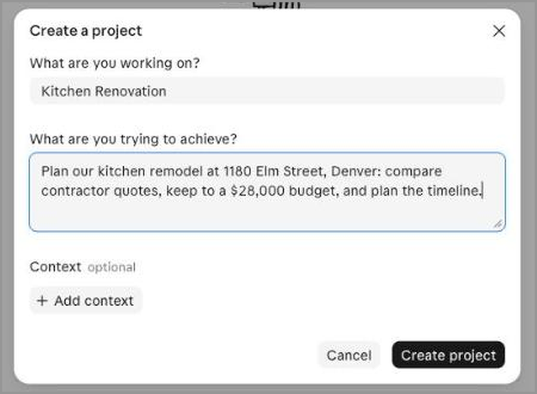
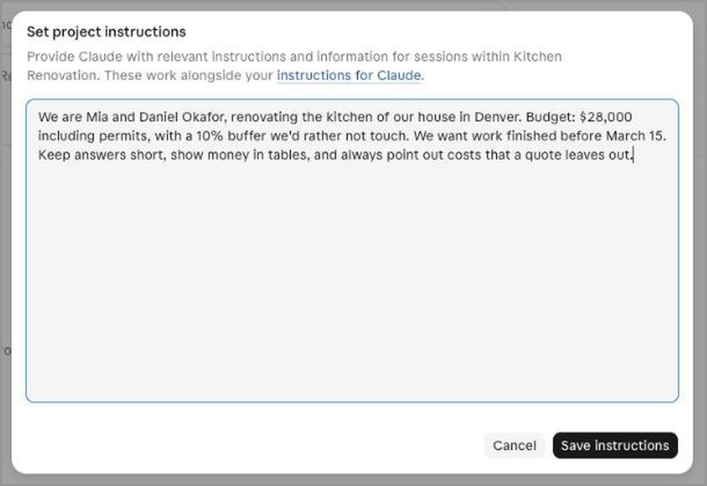
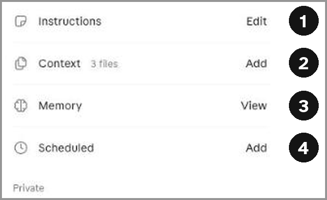
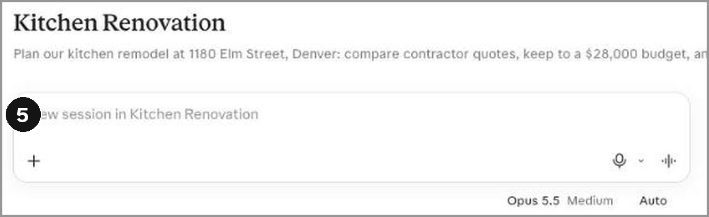
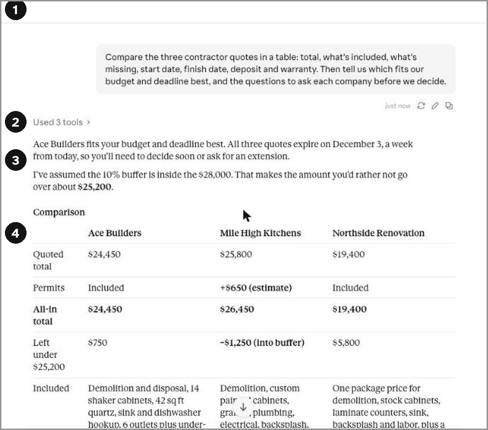

# Chapter 9: Projects: A Workspace for Anything Ongoing

A normal chat is great for a one-off task. But many things in life go on for weeks: a house renovation, a job search, a class you're taking, a client, a book you're writing. For these, starting every chat from scratch is a waste. You'd have to re-upload the same files and re-explain the same background every time.

A **Project** fixes this. It is a workspace with its own instructions and files. Every chat you start inside it already knows the background.

## When to Use a Project

Use a Project when at least two of these are true:

- You'll come back to the topic more than three or four times.
- The same files or background apply to every chat.
- You want a consistent style or format every time.
- You want all the related chats in one place.

Good examples: a kitchen renovation, a job hunt, a small business's marketing, a course you're studying, a family trip, managing an elderly parent's care, a volunteer group you run.

## Step 1: Create the Project

Click **Projects** in the sidebar, then **New project**. A short form opens.



Give it a clear name and say what you're trying to achieve in one or two sentences. The goal becomes the project's description and helps Claude understand what matters. Click **Create project**.

## Step 2: Add Instructions

Instructions are the project's version of the "about me" note from Chapter 2. They apply to every chat in the project. Click **Instructions** on the project page and write who you are, what you want, and how you like answers.



Here are the instructions I used for the Okafors' kitchen project:

```prompt
We are Mia and Daniel Okafor, renovating the kitchen of our house in Denver. Budget: $28,000 including permits, with a 10% buffer we'd rather not touch. We want work finished before March 15. Keep answers short, show money in tables, and always point out costs that a quote leaves out.
```

Notice that it follows the Finished-Work Formula from Chapter 4: who the readers are, the raw facts that never change, and the rules for every answer.

## Step 3: Add Context Files

Click **Context** and add the files the project needs. I added the three contractor quotes as PDFs. You can also add notes, spreadsheets, photos and documents. They stay in the project, so you never upload them again.

This is the finished project page. On the right are four panels:



1. **Instructions:** click Edit to change them at any time.
2. **Context:** the project's files (three here).
3. **Memory:** what Claude has learned within this project. Each project has its own memory. It can also use your account memory; turn off **Use account memory** in the project's settings if you want it fully separate (Chapter 10).
4. **Scheduled:** tasks that run automatically for this project, for example a weekly update (Chapter 14).

On the left are the project's name, its goal and its own message box:



5. **The message box:** every chat you start here is inside the project.

The word **Private** under the panels means only you can see this project.

## Step 4: Chat Inside the Project

Now the payoff. Because the instructions and quotes are already there, a short request is enough:

```prompt
Compare the three contractor quotes in a table: total, what's included, what's missing, start date, finish date, deposit and warranty. Then tell us which fits our budget and deadline best, and the questions to ask each company before we decide.
```

This is the real answer.



1. **The chat title** shows it belongs to the Kitchen Renovation project.
2. **"Used 3 tools":** Claude opened all three quote files by itself.
3. **The recommendation first**, plus something nobody asked about: all three quotes expire in a week.
4. **A comparison table**, because the instructions said to show money in tables.

Here is more of the answer, word for word:

```result
I've assumed the 10% buffer is inside the $28,000. That makes the amount you'd rather not go over about $25,200.

| | Ace Builders | Mile High Kitchens | Northside Renovation |
| All-in total | $24,450 | $26,450 | $19,400 |
| Left under $25,200 | $750 | -$1,250 (into buffer) | $5,800 |
| Start | Jan 12 | Feb 2 | Dec 8 |
| Finish (est.) | ~Feb 23 | ~Mar 30 (misses Mar 15) | ~Jan 5 |
| Deposit | 30% = $7,335 | 50% = $12,900 | 20% = $3,880 |
| Warranty | 2 years | 1 year | 1 year |

[... rows for permits, what's included and what's missing ...]

Ace Builders is the only quote with higher-end finishes that stays under $25,200 and finishes on time. [...] The catch is that only $750 is left before the buffer. Appliance installation, a faucet or paint could use that up, so get those priced before you sign.

Mile High is out. It finishes about two weeks after your deadline and goes into the buffer.

Northside is the cheapest and fastest, but it's a lower spec (stock cabinets and laminate counters, not shaker and quartz), so it isn't a like-for-like price. [...] Its 4 weeks also fall over the holidays, so the finish date could slip.

Questions to ask

Ace Builders
- Is appliance installation included? If not, what does it cost?
- Does the plumbing price include the sink and faucet, or only hooking them up?
- Are drywall repair, paint and cabinet hardware included?
- How do you price changes or surprises behind the walls?
- Will you extend the quote past December 3?

[... five questions each for the other two companies ...]
```

I checked the totals against the PDFs: they're correct. Notice what the project instructions did. Claude used the real budget and deadline without being told again, showed money in a table, and pointed out costs the quotes left out, exactly as instructed.

## Good Habits for Projects

**Keep files current.** When you get a new quote or an updated plan, add it and remove the old one, so Claude doesn't mix them up.

**One project per real-world project.** Don't make a single "Work" project for everything. Separate projects give Claude focused context.

**Start new chats often.** Inside a project, start a fresh chat for each new question. The project keeps the background; the chats stay short and quick.

**Save good answers as files.** When Claude produces something you'll need again, such as the comparison above, ask it to "save this as a document in the project." Claude offered to do exactly that at the end of the quote comparison.

> **Tip:** Projects are also the best place for anything you write regularly. A "Newsletter" project with three past newsletters as context files and your style rules as instructions will produce new issues that sound like you.

## Exercise

1. Pick one ongoing thing in your life.
2. Create a project with a clear name and goal.
3. Write instructions using the Finished-Work Formula.
4. Add two or three files.
5. Start a chat and ask a short question that depends on those files.

## Key Points

- A Project is a workspace with its own instructions, files and memory.
- Use one for anything you'll come back to again and again.
- Instructions apply to every chat in the project; context files never need re-uploading.
- Short requests inside a project get answers shaped by everything in it.
- Keep files current and start fresh chats often.
