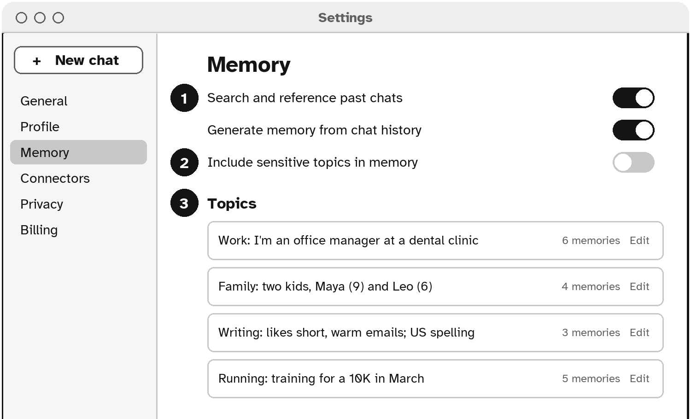
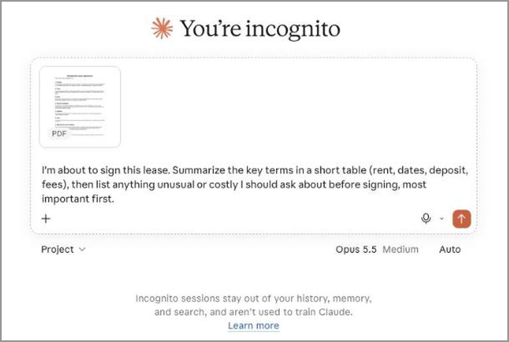

# Chapter 10: Memory, Chat Search and Incognito

Out of the box, every new chat starts fresh. That's safe, but it means repeating yourself: your job, your family, your preferences. **Memory** lets Claude remember useful things from your past conversations, so later answers fit you without you saying it all again. You stay in control: you can see everything it remembers, edit it, delete it, turn it off, or chat **incognito** when you don't want anything kept.

## What Memory Does

With memory on, Claude does two things:

1. **Builds memories from your chats.** When you mention something lasting, such as "I'm training for a 10K in March" or "my daughter is allergic to peanuts," Claude may save it as a memory.
2. **Searches your past chats when helpful.** Ask "what did we decide about the contractor last week?" and Claude can look back through earlier conversations.

You'll notice it when a new chat says something like "Since you're training for your 10K, here's a lighter meal plan for race week."

## Where to Manage It

Open **Settings** (click your name at the bottom of the sidebar), then **Memory**. The screen looks something like this. It's drawn here rather than photographed, because a real memory page is full of private details.

1. **Search and reference past chats:** lets Claude look back at earlier conversations.
2. **Include sensitive topics in memory:** off by default. Health, religion, politics and similar subjects are only remembered if you turn this on.
3. **Topics:** what Claude remembers, grouped by subject. Click a topic to read the memories in it, edit them, or delete them.

> **Tip:** Every few weeks, skim your topics. Delete anything out of date ("Planning trip to Lisbon" after you're back) and correct anything wrong. Two minutes of tidying makes every answer better.

## Telling Claude What to Remember, or Forget

You can manage memory just by talking:

- "Remember that I prefer metric units."
- "Remember that our team meeting is every Tuesday at 10."
- "Forget what I said about my old job."
- "What do you remember about me?"

The last one is worth trying today. It shows you exactly what Claude has kept.

## Turning Memory Off for One Chat

Open the **+** menu in the message box. **Memory** has a check mark when it's on. Click it to turn memory off for this chat only. Use this when you're helping someone else with something, or exploring a topic you don't want to shape future answers.

## Projects Have Their Own Memory

Each project has its own project memory, separate from the memory of your other projects (you saw the Memory panel on the project page in Chapter 9). However, Claude may also use your account memory inside a project. To keep a project fully separate, so that what you discuss in your "Job Search" project stays out of everything else, turn off **Use account memory** in that project's memory settings. This is another good reason to use projects for different parts of your life.

## Bringing Memory from Another Assistant

If you've used another AI assistant for a long time, you can import what it knows about you, and you can export Claude's memory too. Look for **import** and **export** in Settings > Memory. Read what you're importing first, and delete anything you don't want kept.

## Chat Search

Separate from memory, you can search your own chat list yourself on any plan. Click **Search** in the sidebar, or press Ctrl+K (Cmd+K on a Mac), and type any word you remember. Search finds chats by their titles and contents. Inside a project, use the search icon at the top of the project page to search just that project. (This is different from **chat search**, the feature that lets *Claude* look back through your past conversations; if chat search is available on your plan, you can ask Claude about an earlier chat directly.)

## Incognito: Not Saved to History

Sometimes you want a conversation that stays out of your chat history and memory: a sensitive health question, a surprise gift you're planning on a shared computer, or simply trying something out.

Click the **incognito** icon (it looks like a small ghost) at the top right of a new chat. The screen changes to show you're incognito.

As the note says, incognito chats **stay out of your history, memory and search, and aren't used to train Claude**. When you close the chat, it's gone from your list. You can still attach files and use most features, but incognito chats can't create Claude Docs, files or artifacts. For those, use a normal chat. Click the **x** at the top right to leave incognito.

> **Note:** Incognito doesn't mean instant deletion. Anthropic keeps incognito chats for a limited time (30 days by default) for safety, or longer if an organization's retention policy says so, and on Team and Enterprise plans the organization's data and compliance rules still apply.

> **Remember:** Incognito keeps a chat out of *your* account history. It doesn't make it safe to share passwords or bank card numbers. The privacy rules in Chapter 23 still apply.

## Exercise

1. Ask Claude: "What do you remember about me?"
2. Open Settings > Memory and read your topics. Delete one thing that's out of date.
3. Tell Claude one lasting preference to remember, then start a new chat and test it.
4. Start an incognito chat and notice that it doesn't appear in Recents afterwards.

## Key Points

- Memory lets Claude remember lasting facts from your chats.
- Chat search, a separate feature, lets Claude look back through past conversations; it isn't on every plan.
- Manage it in Settings > Memory: read, edit and delete topics.
- Sensitive topics are only remembered if you turn that setting on.
- Turn memory off for one chat from the + menu; projects have their own memory and can also use account memory unless you turn that off.
- Incognito chats stay out of history, memory and search, and aren't used for training.
