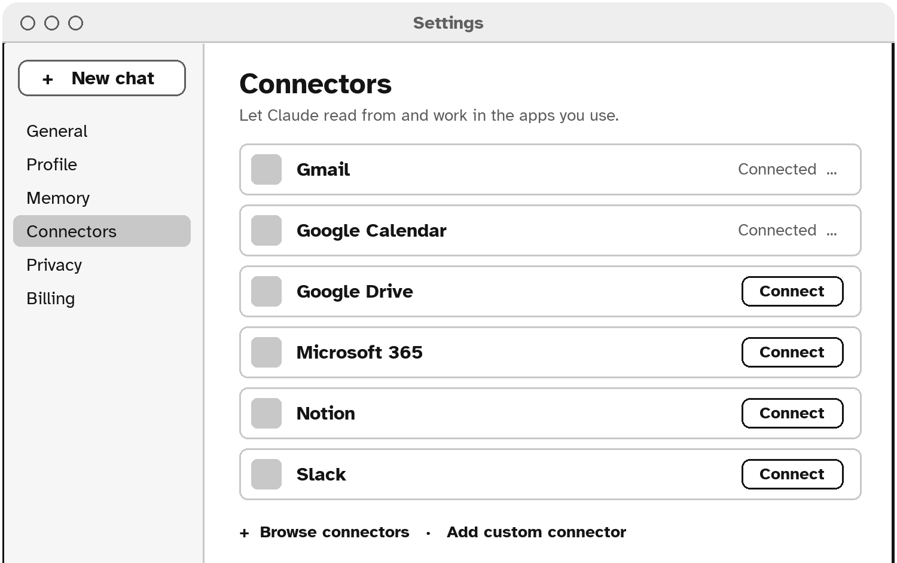

# Chapter 12: Connectors: Claude in Your Email, Calendar and Files

So far you've brought information *to* Claude by typing, attaching and pasting. **Connectors** let Claude go and get it: read your email, check your calendar, find a file in Google Drive, look something up in Notion. With your permission, some connectors also let Claude *act*: draft or send an email, create a calendar event, save a file.

This is where Claude starts to feel like an assistant rather than a chatbot. It's also where you need to think a little about permissions, so this chapter covers both.

## What a Connector Is

A connector is a secure link between Claude and another app. You sign in to that app once, approve what Claude may access, and from then on Claude can use it when a request needs it. Popular connectors include:

| Connector | What Claude can do with it |
| --- | --- |
| Gmail | Search and read emails, draft replies, send when you allow it |
| Google Calendar | Check your schedule, find free time, create events |
| Google Drive | Find, read and save documents and spreadsheets |
| Microsoft 365 | Outlook email and calendar, OneDrive and SharePoint files |
| Slack | Search messages and channels |
| Notion | Read and update pages and databases |

Many more are in the directory, and new ones are added often. Companies can also build their own **custom connectors**.

## Step 1: Connect an App

1. Click your name, then **Settings**, then **Connectors** (in some versions this sits under **Customize**).
2. Find the app and click **Connect**.
3. A sign-in window for that app opens. Sign in **on that app's own page** (for example, Google's sign-in page) and review what Claude is asking to access.
4. Approve, and you're returned to Claude. The connector now shows as **Connected**.



You can also connect some apps straight from the **+** menu. In Chapter 6's screenshot, Google Drive showed **Not connected** with a **Connect** button.

> **Check First:** Only connect your accounts from inside Claude's own Settings or + menu. Never sign in to your email through a link someone sends you claiming to be "Claude setup."

## Step 2: Use It in a Request

Once connected, just ask. Claude decides when to use the connector.

```prompt
Look through my Gmail from the last 7 days and list every email that's waiting for a reply from me, with who it's from, what they need, and how urgent it seems. Most urgent first.
```

```prompt
Find a free hour next week for a call with my sister, avoiding mornings. Suggest three options.
```

```prompt
Find the spreadsheet in my Google Drive called "2026 Budget" and tell me which categories went over in October.
```

You'll see a gray line such as "Searched Gmail" or "Used 3 tools" in the answer. Click it to see exactly what Claude looked at.

## Sending and Saving: The Send Button

When Claude drafts an email, the draft card can offer a **Send via Gmail** button, as you saw in Chapter 3. Nothing is sent until you click it. Claude can also save files it makes into a connected app, such as a document into Google Drive. In late 2026 this "send files to connected apps" ability was rolling out as a beta on paid plans.

## Permissions: Manual and Auto

When a connector can *change* something, such as sending, deleting, booking or editing, you choose how much Claude may do without asking. Look under the message box: you'll see **Manual** or **Auto**.

| Mode | What happens | Use it when |
| --- | --- | --- |
| Manual | Claude asks you before each action in another app | You're new to connectors, or the account matters a lot |
| Auto | Claude acts without asking, except for actions an automated check flags as risky | You trust the task and want it done quickly |

You can also set a single tool to **Always ask** in its connector settings, so Claude asks even in Auto mode. A sensible setup for most people: Auto for reading, **Always ask** for sending email and deleting anything.

> **Safety Tip:** Start with Manual. Watch what Claude asks permission for during the first week. Once you're comfortable, switch to Auto for the tasks you trust, and keep "Always ask" on anything that sends messages or spends money.

## Disconnecting

To remove access, go back to Settings > Connectors, click the connector, and choose **Disconnect**. You can also remove Claude's access from the other app's own security settings, such as your Google account's third-party access page.

## Add Your Own Connector: MCP

Every connector, from Gmail to Notion, works the same way underneath. It uses an open standard called **MCP** (Model Context Protocol): a common plug that lets any app offer "tools" Claude can use. Because it's a standard, you aren't limited to the directory. You can add a connector yourself in two ways.

| Kind | What you add | Where it runs | Example |
| --- | --- | --- | --- |
| Custom connector | A web address (URL) a company gives you | On the internet | Microsoft Learn's documentation server: https://learn.microsoft.com/api/mcp |
| Desktop extension | A file ending in **.mcpb** that you double-click | On your own computer | The official Blender extension |

**To add a custom connector:** go to **Settings > Connectors**, click **Add custom connector**, give it a name, paste the URL, and click **Add**. If the service needs a sign-in, its own sign-in page opens, just as in Step 1. On Team and Enterprise plans, an admin may need to add it for you.

**To add a desktop extension:** desktop extensions work only in the **Claude desktop app**, because they run on your computer. Double-click the .mcpb file, and the desktop app shows an install screen with the extension's name and maker. Click **Install**. You'll find it afterwards under **Settings > Extensions**, where you can turn it off or remove it.

### A Real Example: Connecting Claude to Blender

Blender is free, professional 3D software used for films, games and product design. Its developers, through their Blender Lab group, publish an official extension that lets Claude work inside Blender for you. Here's exactly how I set it up on a Mac in November 2026:

1. **Install Blender** (version 5.1 or newer) from blender.org. It's free.
2. **Download the two files** from the "Releases" page of the Blender Lab MCP project at projects.blender.org: the Blender add-on (a .zip file) and the Claude extension (a .mcpb file).
3. **Install the add-on in Blender:** **Edit > Preferences > Get Extensions**, then the small menu at the top right, **Install from Disk**, and choose the .zip file. Under **Add-ons**, find **MCP** and click **Start**. This opens a private link that only programs on your own computer can use.
4. **Install the extension in Claude:** double-click the .mcpb file and click **Install** in the Claude desktop app.
5. **Try it:** in a new chat in the desktop app, ask "What's in my open Blender scene?" The first time, Claude asks permission to use the Blender tools. Allow it, and Claude lists the objects in your scene.

Chapter 21 shows what you can make once it's connected.

> **Warning:** The Blender extension lets Claude run commands inside Blender, and Blender can read and write files on your computer. Only install extensions and connectors from makers you trust, such as the app's own developers, and download them from the maker's own website. Save your Blender work before asking for big changes. Leave the add-on's **Auto-start** off, and click **Start** only when you want Claude to have access.

## Exercise

1. Connect one app you use every day, such as your calendar.
2. Ask a reading-only question: "What's on my calendar this week that I should prepare for?"
3. Check whether you're in Manual or Auto mode, and decide which you want.

## Key Points

- Connectors let Claude read from, and sometimes act in, your other apps.
- Connect apps in Settings > Connectors, signing in on the app's own page.
- Nothing is sent until you click Send, unless you've allowed Claude to act.
- Manual asks before every action; Auto acts unless a check flags a risk; "Always ask" overrides Auto for one tool.
- Disconnect any time from Settings.
- Any app can offer a connector through MCP. Add one yourself with a URL (custom connector) or a .mcpb file (desktop extension), and only from makers you trust.
