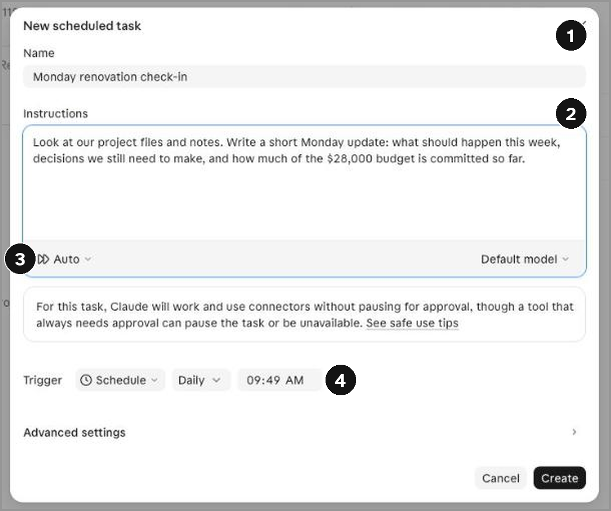

# Chapter 14: Tasks and Scheduled Work: Letting Claude Get On With It

Until 2026, Claude mostly answered one message at a time. Now it can take on a **task**: a job with several steps, such as reading files, searching, using connected apps, making documents, and checking its own work, and carry it through to the end. It can also run tasks **on a schedule**, so a Monday briefing or a monthly summary simply appears.

Anthropic first launched this as a separate mode called **Cowork**. In September 2026 it became part of everyday Claude: "Claude Cowork and chat are one Claude." In this unified experience you don't need to switch modes; you just ask. The change is rolling out gradually, so some accounts still show separate **Chat** and **Cowork** options. If you see them, choose Cowork for multi-step and scheduled tasks.

## Handing Over a Multi-Step Task

Describe the end result and let Claude plan the steps.

```prompt
In my Google Drive there's a folder called "Receipts 2026" with about 40 photos and PDFs of receipts. Read them all, build an Excel file with date, shop, amount and category for each, add totals by category and by month, and flag anything that looks like a duplicate. Save the spreadsheet back to the same folder.
```

While Claude works, you'll see its progress: which files it's reading, what it's building, and any questions it needs to ask. You can leave and come back. Tasks keep running even if you close the window, and with remote sessions they can continue without your computer being on.

### Good task requests

- **Say where the materials are:** a folder, a project, an inbox label.
- **Say what "done" looks like:** the file, its columns, where to save it.
- **Say what to do when unsure:** "If a receipt is unreadable, list it at the end instead of guessing."
- **Say what not to touch:** "Don't delete or move any files."

## Scheduled Tasks

A scheduled task runs automatically, at the time you choose, with the instructions you give it. To create one, click **Scheduled** in the sidebar, or open a Project and click **Add** next to **Scheduled**. This is the real form.



1. **Name:** something you'll recognize, such as "Monday renovation check-in."
2. **Instructions:** what Claude should do on each run, written like any good request.
3. **Permissions and model:** Auto lets the task use connectors without stopping to ask; you can also pick which model runs it.
4. **Trigger:** when it runs, such as daily, weekly or monthly, and at what time.

Under the instructions, a note explains what Auto means for this task: Claude will work and use connectors without pausing for approval, though a tool that always needs approval can pause the task. That's the "Always ask" setting from Chapter 12, and it still protects you here.

Click **Create**, and the task runs on schedule. Each run's result appears in your chats, ready to read.

### Ideas for scheduled tasks

| When | Task |
| --- | --- |
| Every weekday, 7:30am | "Summarize today's calendar and the emails I need to deal with first." |
| Every Monday | "Plan my week from my calendar and to-do list; flag any clashes." |
| Every Friday | "Draft my weekly status report from this week's notes in the project." |
| First of the month | "Summarize last month's spending from my budget sheet and compare it to the plan." |
| Every Sunday evening | "Build next week's meal plan and shopping list for a family of four, vegetarian on weekdays." |

Chapter 22 gives you four of these as complete, worked routines.

> **Safety Tip:** For a new scheduled task, run it once on demand and read the result before letting it run on its own. Keep "Always ask" on any tool that sends messages, deletes things or spends money.

## Pausing, Editing and Stopping

Open **Scheduled** in the sidebar to see all your tasks. From there you can run one now, edit its instructions or timing, pause it, or delete it. If a task's results stop being useful, pause it; you can always turn it back on.

## When Not to Use a Task

Tasks are powerful, but a simple chat is still better when:

- you want to steer the answer as it develops
- the job takes one or two messages
- you're doing something for the first time and want to see each step

A good rule: do a job by hand with Claude two or three times first. When it's going the same way every time, make it a task or a scheduled task.

## Exercise

1. Think of a report, summary or plan you make at the same time every week.
2. Do it once in a normal chat until the result is right.
3. Create a scheduled task with those exact instructions. Run it once now, read it, then let it run on schedule.

## Key Points

- Claude can take on multi-step tasks and carry them through to a finished result.
- In the unified experience, Cowork is part of everyday Claude; if your account still shows a separate Cowork option, use it for tasks.
- Scheduled tasks run at times you choose, from the sidebar or a project.
- Auto lets a task act without pausing; "Always ask" still protects sensitive actions.
- Test a task once by hand before scheduling it.
