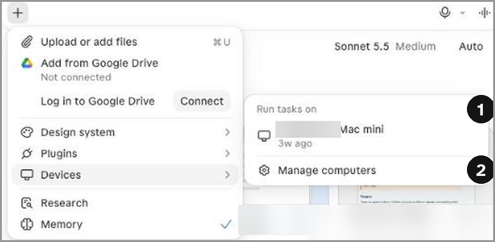
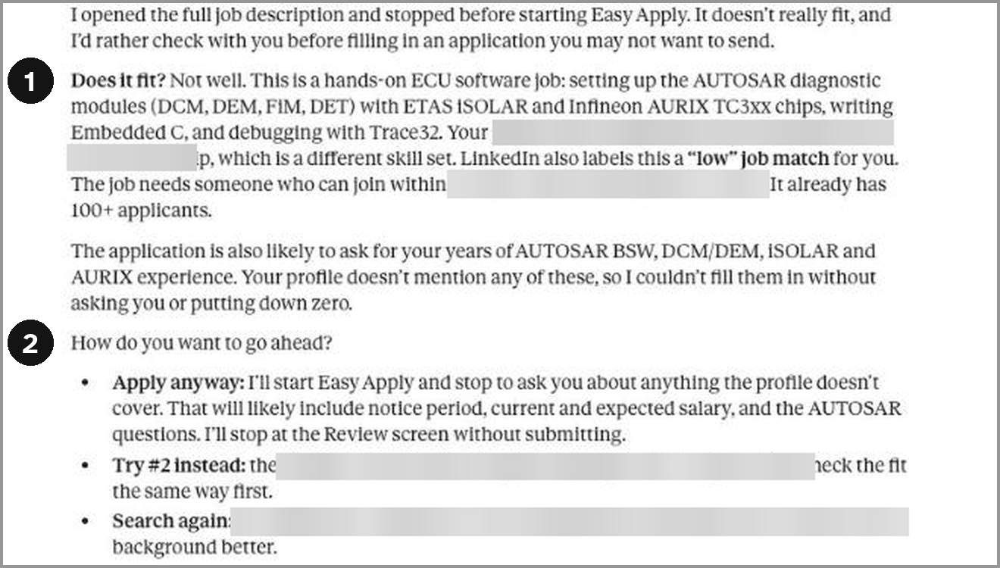
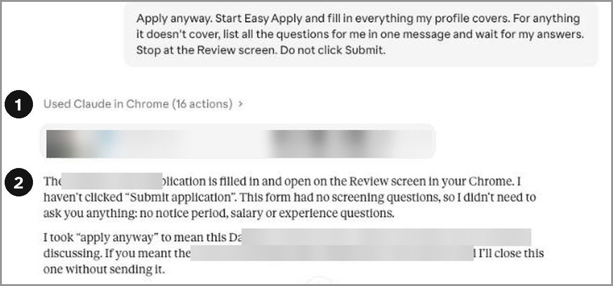
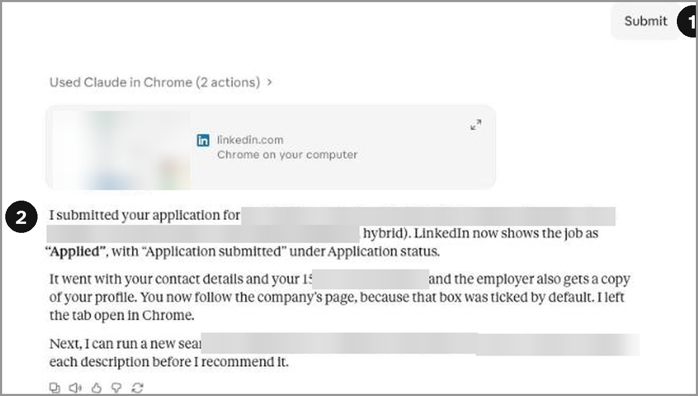
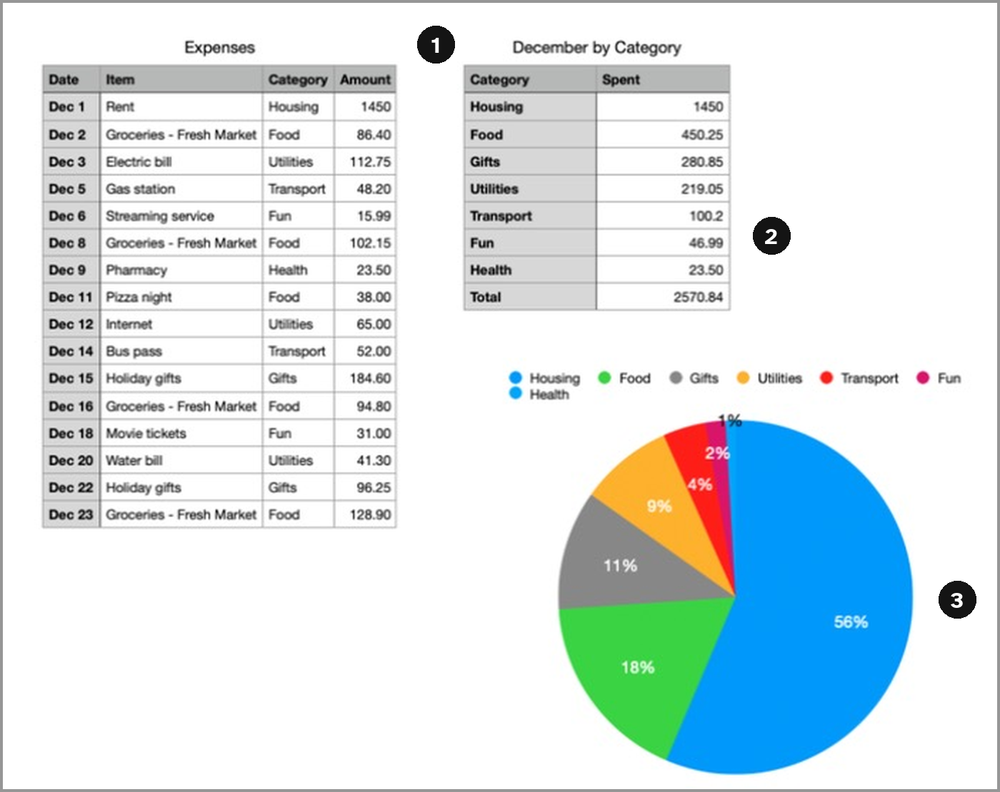

# Chapter 15: Claude on Your Phone, in Chrome and in Office

Claude isn't only a website. The same account works on your phone, inside your web browser, and inside Excel and PowerPoint. This chapter shows you what each one is good for.

## On Your Phone

The Claude app for iPhone and Android covers the core chat features in this book, plus three things that work best on a phone. Features that run on a computer, such as desktop extensions and computer use, need the Claude desktop app.

### Voice

There are two voice buttons next to the message box:

- **Dictate** (the microphone) turns your speech into text in the message box. Check it, then send. Great for long requests you'd rather not type.
- **Voice mode** (the sound-wave icon) is a spoken conversation. You talk, Claude answers out loud, and you can interrupt. Perfect for practicing a presentation, learning a language, or thinking through a problem while you walk.

```prompt
Let's practice my job interview. You're the hiring manager for a junior accountant role. Ask me one question at a time, wait for my answer, and give me one quick tip after each answer.
```

Try that in voice mode. It feels remarkably like the real thing.

### Camera

Tap **+** and take a photo directly: a menu in another language, a broken part, a plant, a page of a textbook, a parking sign you can't make sense of. Everything in Chapter 6 works with the camera.

### On the go

Quick questions, a shopping list from a recipe, a reply to a message you've been avoiding: the phone app is where most people use Claude most often. Your chats sync, so you can start something on your laptop and finish it on the train.

> **Note:** In the US, the mobile app can also analyze health and fitness data from your phone on paid plans, if you choose to connect it. Treat any health insight as something to discuss with your doctor.

## In Chrome: Claude Uses the Web for You

**Claude in Chrome** is an extension for the Google Chrome browser. With it, Claude can work *on* web pages: open sites, read them, click, scroll, type into forms and compare things across tabs. It works in a side panel next to the page you're on, and, as you'll see below, it can also be driven from an ordinary Claude chat.

Install it from the Chrome Web Store (search "Claude" and choose the one published by Anthropic) or from the **Get apps and extensions** link in Claude's sidebar.

## Remote Control: Run Tasks on Your Own Computer

Open the **+** menu in any chat and choose **Devices**. You'll see a list headed **Run tasks on**, with the computers where you've installed the Claude desktop app.



1. **Your computer.** Choose it, and the task you type runs there, using that computer's Chrome, files and apps, even if you typed it on your phone or on another computer's web browser.
2. **Manage computers.** Add or remove computers.

Your computer must be switched on, online, with the Claude desktop app open, for a task that uses its files or apps. (Tasks that run entirely in the cloud don't need it.) This is what "remote control" means for most people: you ask from wherever you are, and the work happens on your own machine, signed in to your own accounts. (Developers also have **Remote Control** in Claude Code, which lets you watch and steer a coding session running on your computer from your phone.)

## A Real Task: Applying for a Job on LinkedIn

To show browser use honestly, I let Claude apply for a real job, on my own LinkedIn account, from a normal chat with my computer chosen under Devices. Here's exactly what happened. (My name, contact details and career specifics are blurred or left out.)

> **Warning:** LinkedIn's User Agreement prohibits using bots and other automated methods on its site. Using an AI agent there could put your account at risk. I did it once, for this book, with every step supervised. Read a site's rules before you let any AI act on it, and never let it apply to jobs unattended.

### Step 1: Ask for matches, not applications

```prompt
Using Chrome on my Mac, open LinkedIn (I'm already signed in). Read my profile, then search for jobs posted in the last week that match it and offer Easy Apply. Show me the 3 best matches with the job title, company, location and one line on why each fits me. Then stop and wait for me to pick one. Don't apply to anything or change my profile.
```

The first thing that appeared was a permission request: **"Claude wants to use Chrome on your computer,"** with **Decline** and **Always allow**. The note under it is worth reading: "Always allow" lets Claude open and read pages, click, and type in Chrome in all your chats and tasks, even when you're away from your computer. I approved it. Claude then opened LinkedIn, read my profile, ran three searches (9 browser actions in all) and came back with three jobs, each with a one-line reason, ending: "I didn't apply to anything or change your profile. Which one do you want to look at?"

### Step 2: Let Claude read the job before applying

I picked the top match and asked Claude to read the full description and tell me whether it really fit before starting the application. This is the most useful thing it did all day:



1. **An honest verdict.** "Does it fit? Not well." The title had sounded perfect, but the job was hands-on software coding, a different skill set. Claude also noticed LinkedIn itself rated me a "low" match, and that the job already had 100+ applicants.
2. **Options, not action.** Claude stopped and asked how I wanted to go on: apply anyway, check the second job, or search again.

The second job turned out to be a poor fit too. Claude's explanation was refreshingly frank: "Both of the top-ranked roles fell through because I ranked them from their titles, which was misleading." It suggested a fresh search, reading each description first.

### Step 3: Fill in the form, stop before Submit

For the book, I told it to go ahead with an application anyway, but to stop before sending:

```prompt
Apply anyway. Start Easy Apply and fill in everything my profile covers. For anything it doesn't cover, list all the questions for me in one message and wait for my answers. Stop at the Review screen. Do not click Submit.
```



1. **"Used Claude in Chrome (16 actions)."** Click it to see each step and the screenshots Claude took along the way.
2. **A clear status report.** Claude said exactly where it had stopped ("I haven't clicked Submit application"), said which job it had assumed I meant and how to undo it, and listed everything on the Review screen: my contact details, which résumé LinkedIn had chosen, and two boxes I might want to change. One was a "follow this company" box that LinkedIn had ticked by default.

### Step 4: Submit only on your word

I typed one word, **Submit**, and Claude sent it.



1. **The instruction.** Nothing was sent until I said so.
2. **The confirmation**, including the side effects: which résumé went, that the employer also gets my profile, and that I now follow the company because of that default box.

### What this teaches about browser use

- **Ask for a shortlist first.** Searching and reading are safe; sending is not.
- **Make Claude check the fit.** Titles mislead people and AI alike. "Read the full description before you recommend it" turned a bad application into a good conversation.
- **Always say where to stop.** "Stop at the Review screen. Do not click Submit." Claude followed it exactly.
- **Read the status report.** Default boxes, the wrong résumé or the wrong job are easy to miss and impossible to unsend.
- **Keep payments and passwords out of it.** Never let any AI enter your passwords or card numbers, and keep Manual mode or "Always ask" on for anything that sends, buys or deletes (Chapter 12).

## Computer Use: Claude Works in Your Desktop Apps

Connectors (Chapter 12) need an app to offer tools to Claude. Browser use works only inside Chrome. **Computer use** covers everything else: Claude looks at screenshots of your desktop and clicks, types and scrolls in ordinary apps like Numbers, Notes, Finder or Photos, the way you would. It's slower than a connector, so use it for apps that have no connector.

**Turning it on.** Computer use works through the Claude desktop app. Turn it on in the desktop app's settings (look for **Computer use** under **System** or **Capabilities**). Then, before Claude touches any app, a dialog asks you to allow that specific app. Some apps get limited access automatically: web browsers can only be looked at (Claude uses Chrome's own tools instead), and terminal and coding apps can only be clicked, never typed into.

### A Real Task: A Budget in Numbers

I put a made-up list of 16 December household expenses in a spreadsheet file and asked Claude, in the Claude desktop app, to open it in Numbers, total the spending by category with formulas, add a pie chart and save it as "December Expenses." This is the finished result:



1. **The original expense list**, untouched apart from its new name, "Expenses."
2. **The summary table.** Each amount is a formula, so it updates if you edit an expense. The total, $2,570.84, matches the list exactly.
3. **The pie chart**, made from the seven categories (not the total): housing is 56% of the month.

Here's what actually happened along the way:

1. **Permission.** Claude asked for access to Numbers, and I clicked **Allow**.
2. **Background first.** Claude normally works "in the background," so you can keep using your computer. It opened the file and used Numbers' menus that way. But Numbers ignored typing into its cells from the background, so Claude stopped, said exactly which step needed more, and asked for **full-screen control**. Nothing had changed in the file.
3. **Full screen, with your OK.** When I approved, a glow appeared around the screen while Claude worked. It added a table named "December by Category," typed a SUMIF formula for each category and a total, deleted the empty columns, and inserted a pie chart. One slip along the way: the chart's title overlapped its legend, so it turned the title off rather than leave a mess.
4. **Saved and handed back.** It saved the file to Downloads and released the screen.

**What this teaches:**

- **Use a connector when there is one.** Computer use took several minutes of clicking; a connector or a file Claude creates directly (Chapter 7) would take seconds. Computer use shines for apps that have no other way in.
- **Expect to approve twice:** once for the app, and again if Claude needs the full screen.
- **Don't use your computer while Claude has the full screen.** Your clicks and Claude's can collide.
- **The same safety rules apply.** Claude won't type your passwords or card numbers, won't move money or make trades in finance apps, and treats links in emails and messages as suspicious, opening them only in a browser it can check.

> **Safety Tip:** Grant only the apps a task needs, and close anything private (email, banking, messages) before you let Claude take the full screen. It sees whatever is on the screen.

## In Excel and PowerPoint

> **Before You Start:** Claude for Excel and PowerPoint need an eligible paid Claude plan and a compatible Microsoft Office setup, and an organization's administrator may restrict them. If you can't find the add-in, check your plan or ask your administrator.

**Claude for Excel** and **Claude for PowerPoint** are add-ins that put Claude in a side panel inside those programs. In Excel, Claude can explain a complicated spreadsheet, fix broken formulas, build new sheets and charts, and tidy messy data, working directly in your workbook. In PowerPoint, it can build slides from your notes, tidy a deck, and keep the style consistent. The two share context, so you can build an analysis in Excel and turn it into slides without starting over.

```prompt
Explain what this spreadsheet does, sheet by sheet, in plain English. Then find any formulas that might be wrong and show me why.
```

To get them, open **Add-ins** in Excel or PowerPoint, search for Claude, and sign in with your Claude account. Availability depends on your plan; check claude.com if you don't see them.

## Other Places You'll Meet Claude

- **Claude Desktop** for Mac and Windows (Chapter 2): installs artifacts as apps, works with files on your computer, and lets you choose a **release channel**: Stable (the default) or Latest, for new features first.
- **At work:** companies on Team and Enterprise plans can add Claude to Slack and to video meetings, where it takes notes and builds documents from the discussion.

## Exercise

1. Install the Claude app on your phone and try voice mode for a two-minute conversation.
2. Take a photo of something with text and ask Claude about it.
3. If you use Chrome, install Claude in Chrome. Ask for a read-only task first, such as "compare the three products I have open in these tabs."

## Key Points

- The phone app adds dictation, voice conversations and the camera.
- Claude in Chrome lets Claude read, click and type on web pages, using your logged-in accounts.
- Devices in the + menu sends a task to run on your own computer, from anywhere.
- For browser tasks: shortlist first, check the fit, say where to stop, and submit only on your word.
- Claude for Excel and PowerPoint work directly inside your files.
- One account, synced everywhere.
