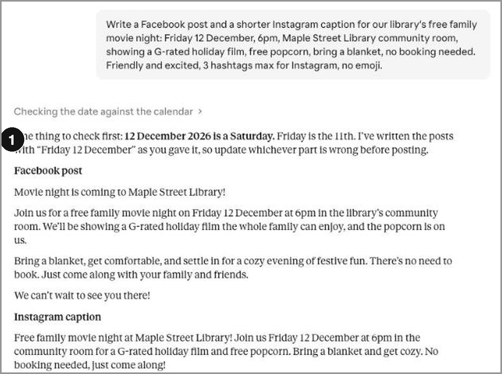

# Part III: 50 Real Workflows

# Chapter 16: Writing and Email

Every workflow in Part III follows the same pattern: what it's for, the exact request I sent, Claude's real answer, what to do next, and how to make it repeatable. All 50 were run in the Claude app on Sonnet 5.5 at Medium effort in November 2026, in incognito chats. The answers are copied exactly; "[...]" marks where I cut something for space. Where a workflow needs something to work on, such as an email or a spreadsheet, the request includes the fictional example I used, so you can see exactly what Claude saw.

Change the details to fit your own situation. The structure is what does the work.

## Workflow 1: Reply to a Difficult Email Without Making It Worse

**For:** an angry, pushy or upsetting email you don't want to answer in the heat of the moment. **Time:** 3 minutes.

```prompt
Here's an email from a parent at the dance studio where I'm the manager. She's angry that her daughter wasn't picked for the spring showcase. I want to stay kind and calm, explain that places were based on attendance (her daughter missed 6 of 12 classes), and offer a meeting. Don't apologize for the decision itself. Under 150 words. Sign it Dana Mitchell, Studio Manager.

Her email:
Hi Dana, I just found out Sofia wasn't picked for the spring showcase. She's devastated. We have paid for this whole term and she has been dancing since she was four. I think this is really unfair and I want to know who made this decision and why. Other girls who joined after her got places. I expect a proper explanation. Carla Alvarez
```

Claude answered with an email draft card:

```result
Subject: Re: Sofia and the spring showcase

Hi Carla,

Thank you for writing. I can hear how disappointed Sofia is, and I know how much dance means to her after all these years with us.

Showcase places this term were allocated using one criterion, applied equally to every student: class attendance. The showcase pieces are built week by week in class, so dancers need to attend consistently to learn the choreography. Sofia attended 6 of the 12 classes this term, which is why she wasn't selected. Students who joined more recently were chosen on that same basis.

I'd be glad to meet with you to talk this through and discuss how Sofia can work toward future performances. Would a time next week suit you?

Warm regards,
Dana Mitchell
Studio Manager

The draft is about 125 words. It answers Carla's "who and why" by explaining that one rule applied to every student, so it doesn't name an individual. If you'd rather say who decided, for example "our teaching team," you can add it to the second paragraph.
```

Notice that Claude answered every point in Carla's email, including "other girls who joined after her," without being told to. **Next:** If you're still upset, ask: "Read my reply as Carla. Is there anything that might come across as cold?" **Make it repeatable:** Put your studio's policies in a Project, so every reply quotes them correctly.

## Workflow 2: A Complaint Letter That Gets Results

**For:** a refund, a repair, a billing mistake. **Time:** 5 minutes.

```prompt
Write a firm, polite complaint email to Brightline Appliances. I bought a dishwasher on September 2 for $649 (order 55120). It has stopped draining twice; a technician visited on October 20 and November 14 and it failed again on November 21. I want a replacement or a full refund, not a third repair. Mention that it's still under the 1-year warranty. Ask for a reply within 10 business days. Include a short timeline. Under 200 words. Sign it Jordan Lee.
```

```result
Subject: Order 55120: Request for Replacement or Refund of Defective Dishwasher

Dear Brightline Appliances Customer Service,

I am writing about the dishwasher I purchased on September 2 for $649 (order 55120). It keeps failing to drain, and two repair visits have not fixed the problem.

Timeline:
- September 2: Dishwasher purchased
- October 20: First technician visit for drainage failure
- November 14: Second technician visit for the same fault
- November 21: Dishwasher stopped draining again

The unit is still covered by its one-year warranty. Because the same fault has continued after two repairs, a third repair is not an acceptable solution. I am requesting either a replacement dishwasher or a full refund of $649.

Please reply within 10 business days to confirm how you will resolve this. I can provide my receipt and service records on request.

Thank you for your prompt attention to this matter.

Sincerely,
Jordan Lee

The email comes in around 150 words. If you have the technicians' service ticket numbers, add them to the October 20 and November 14 lines. That will make your claim harder to dispute.
```

**Next:** Attach a photo of the receipt and ask "check my dates and amounts against this receipt" before sending. **Make it repeatable:** Save the request in a note with blanks for the company, dates and the outcome you want.

## Workflow 3: A Thank-You or Sympathy Note

**For:** notes that matter, where a template feels wrong. **Time:** 2 minutes.

```prompt
Help me write a short handwritten sympathy card to my coworker Ray, whose mother died last week. I met her once at our team picnic, where she brought homemade lemon bars and told funny stories about Ray as a kid. Warm, simple, not religious, 4 or 5 sentences. Give me two versions. I'm Priya.
```

```result
Version 1

Dear Ray,

I was so sorry to hear about your mom. I only met her once, at the team picnic, but I still remember her lemon bars and the stories she told about you as a kid. It was obvious how much she loved you and how proud she was. I'm thinking of you and your family, and I'm here if you need anything at all.

Warmly,
Priya

Version 2

Dear Ray,

I'm so sorry for the loss of your mother. Meeting her at the picnic was a real treat: her lemon bars were delicious, and her stories about you had everyone laughing. She clearly had a big heart and a great sense of humor. Please take all the time you need, and know that we're all thinking of you.

With sympathy,
Priya
```

**Why it works:** one real detail (the lemon bars) turns a generic message into a personal one. Always give Claude one true memory. **Make it repeatable:** Not needed; these should stay personal.

## Workflow 4: A Cover Letter Tailored to the Job

**For:** job applications. **Time:** 10 minutes per application.

```prompt
Here's my résumé summary and a job ad. Write a cover letter under 300 words that matches my three strongest experiences to their top three requirements, using a specific number or result for each. No clichés like "I am writing to express my interest." End with a confident, specific closing line.

My résumé: Nadia Petrov. Office coordinator, Brookline Family Dental, 2022 to now: run scheduling for 6 dentists and 14 staff; moved the clinic from paper to digital records in 4 months; cut supply costs 18% by switching vendors. Front desk lead, Harbor Physical Therapy, 2019 to 2022: trained 5 new receptionists; handled 60 patient calls a day. Skills: Excel, Google Workspace, Dentrix, bilingual English and Russian.

Job ad: Operations Coordinator, Lakeside Health (a group of 4 outpatient clinics). You will: coordinate schedules and staffing across sites; lead our move to a new patient-records system next year; manage supplies and vendor relationships on a tight budget. Must have: 3+ years healthcare admin, strong Excel, calm under pressure. Nice to have: a second language.
```

Claude first tried to create the letter as a Claude Doc, then explained: "Claude Docs can't be created in an Incognito chat because they stay in your account after the chat ends, so here's the letter below." Then:

```result
Dear Lakeside Health Hiring Team,

Your Operations Coordinator role centers on three jobs: coordinating schedules across sites, leading a patient-records migration, and managing vendors on a tight budget. I have done all three in a working clinic, with results I can point to.

Scheduling and staffing. At Brookline Family Dental, I run scheduling for 6 dentists and 14 staff, 20 people whose calendars have to fit together every day. Coordinating four Lakeside sites is the same discipline across more locations, and I build and track those schedules in Excel and Google Workspace.

Records migration. I moved Brookline from paper charts to digital records in 4 months. A migration succeeds or fails on staff training and clean data, and I'd bring that hands-on experience to your move next year.

Supplies and vendors. By reviewing our suppliers and switching vendors, I cut Brookline's supply costs by 18%. Across four clinics, the same scrutiny has more room to pay off.

Your must-haves are covered too. I bring seven years of healthcare administration, including three as front desk lead at Harbor Physical Therapy, where I handled about 60 patient calls a day and trained 5 new receptionists. That is steady work under steady pressure. I'm also bilingual in English and Russian, which helps Russian-speaking patients get clear answers the first time.

I'd welcome 20 minutes to walk you through how I would plan Lakeside's records transition, the first project I'd want to get right for you.

Sincerely,
Nadia Petrov
```

**Next:** Ask "Which requirement in the ad is my weakest match, and how should I address it in the interview?" **Make it repeatable:** Create a "Job Search" Project with your full résumé as a context file. Each new application is then just one paste of the job ad.

## Workflow 5: A Short Bio for Any Occasion

**For:** a LinkedIn "About" section, a conference program, a website, a club newsletter. **Time:** 3 minutes.

```prompt
Write three bios for me: 25 words (for a conference badge list), 75 words (for a speaker page) and 150 words (for LinkedIn, first person). Facts: Leila Haddad, 12 years as a pediatric nurse, now trains new nurses at St. Mark's Hospital in Phoenix, speaks Arabic and Spanish, volunteers teaching CPR at community centers, loves desert hiking. Warm and professional; no buzzwords.
```

```result
Conference badge list (25 words)

Leila Haddad spent 12 years as a pediatric nurse and now trains new nurses at St. Mark's Hospital in Phoenix. She speaks Arabic and Spanish.

Speaker page (75 words)

Leila Haddad is a nurse educator at St. Mark's Hospital in Phoenix, where she helps new nurses build the skills and confidence to care for patients well. Before moving into education, she spent 12 years as a pediatric nurse, caring for children and supporting their families. Leila speaks Arabic and Spanish, and she volunteers her time teaching CPR at local community centers. When she isn't teaching, you'll likely find her out hiking the desert trails.

LinkedIn, first person (150 words)

I've spent my career caring for children and the people who care for them. For 12 years I worked as a pediatric nurse, and those years taught me that good care depends as much on listening and patience as on clinical skill.

[... three more short paragraphs ...]
```

**Next:** "Make the LinkedIn version a little more playful." **Make it repeatable:** Save your facts in your profile instructions; next time just ask "Write me a 50-word bio for a gardening club newsletter."

## Workflow 6: Rough Notes into a Polished Message

**For:** when you know what you want to say, but it's a jumble. Dictation on your phone works well here. **Time:** 2 minutes.

```prompt
Turn my rambling notes into a clear message to the team. Lead with the decision, then the reasons, then what each person needs to do and by when. Short paragraphs.

Notes: ok so we're moving the launch from the 3rd to the 10th, mainly because the printer can't do the brochures in time, also Tom is out sick, the website stays the same, Jen please tell the venue by Friday, Ali update the social posts by Monday, everyone else nothing changes, sorry for the shuffle
```

```result
Hi team,

We're moving the launch from Thursday 3 December to Thursday 10 December.

The main reason is that the printer can't get the brochures done in time for the original date. Tom is also out sick, so the extra week gives us some breathing room.

The website stays as it is, so no changes needed there.

What you need to do:

Jen: let the venue know about the new date by Friday 27 November.
Ali: update the social posts by Monday 30 November.
Everyone else: nothing changes for you.

Sorry for the shuffle, and thanks for rolling with it.

I filled in the full dates assuming the launch is in December and "Friday" and "Monday" mean the next ones. Adjust them if that's wrong.
```

Claude turned "the 3rd" and "Friday" into full dates, and then told you exactly what it had assumed. Always read that kind of note. **Make it repeatable:** Use dictation (Chapter 15) and this same request whenever your thoughts are ahead of your typing.

## Workflow 7: A Post for a Local Event

**For:** a club, school, church, small shop or community group. **Time:** 3 minutes.

```prompt
Write a Facebook post and a shorter Instagram caption for our library's free family movie night: Friday 12 December, 6pm, Maple Street Library community room, showing a G-rated holiday film, free popcorn, bring a blanket, no booking needed. Friendly and excited, 3 hashtags max for Instagram, no emoji.
```

This is the real screen. Look at the first line of the answer.



1. **A mistake caught.** In 2026, 12 December is a Saturday, not a Friday. Claude noticed, wrote the posts as given, and told you to fix whichever part was wrong.

The Instagram caption finished with three hashtags, as asked:

```result
Free family movie night at Maple Street Library! Join us Friday 12 December at 6pm in the community room for a G-rated holiday film and free popcorn. Bring a blanket and get cozy. No booking needed, just come along!

#FamilyMovieNight #MapleStreetLibrary #HolidayFun
```

**Next:** "It's Friday the 11th. Fix both posts, then write a reminder post for the morning of the event." **Make it repeatable:** In a "Library Events" Project, add past posts as examples, and every new post will match your voice.

## Workflow 8: Proofread and Check the Tone Before You Send

**For:** anything important: an application, a message to your boss, a public post. **Time:** 1 minute.

```prompt
Proofread this email to my manager. First, list any spelling, grammar or clarity mistakes in a table (original, fix, reason). Then tell me in one sentence how it's likely to come across. Don't rewrite the whole thing; I want to keep my voice.

Hi Karen, I wanted to follow up on the budget numbers you asked about. Their attached, sorry for the delay, I had alot on this week with the audit. The main thing is we are 4% over on supplies but that's mostly the one-off printer replacement so it shouldnt happen again. Let me know if you want to go through it together, I'm free Thursday afternoon or Friday whenever. Thanks, Sam
```

```result
| Original | Fix | Reason |
| Their attached | They're attached | "Their" shows possession; you need "they're" (they are). |
| sorry for the delay, I had alot on this week | sorry for the delay. I had a lot on this week | "Alot" isn't a word. The comma also joins two complete sentences (a comma splice), so a full stop or semicolon works better. |
| shouldnt | shouldn't | Missing apostrophe. |
| Let me know if you want to go through it together, I'm free | Let me know if you want to go through it together. I'm free | Another comma splice. A full stop or dash fixes it. |
| Thursday afternoon | this afternoon or next Thursday afternoon | Today is Thursday, so "Thursday" is ambiguous. Karen may not know whether you mean today or next week. |
| Friday whenever | any time Friday | "Whenever" at the end reads a little loose. "Any time Friday" is clearer and still casual. |

It comes across as friendly, accountable and on top of the numbers, but the typos make it feel a bit rushed, so fixing them will make your explanation of the overspend land more confidently.
```

The table lets you accept or reject each change, so the email still sounds like you. Claude also caught something no spell-checker would: I sent this on a Thursday, so "Thursday afternoon" was ambiguous. **Make it repeatable:** Turn it into a skill called "Proofread, keep my voice" (Chapter 13).
