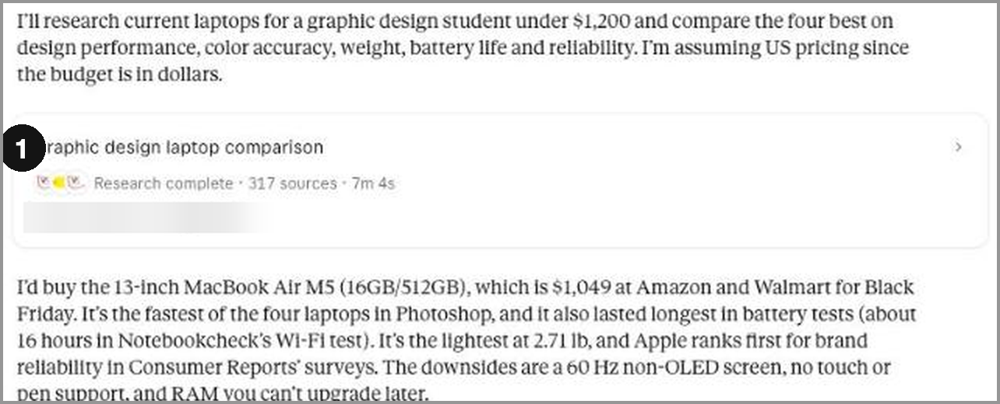
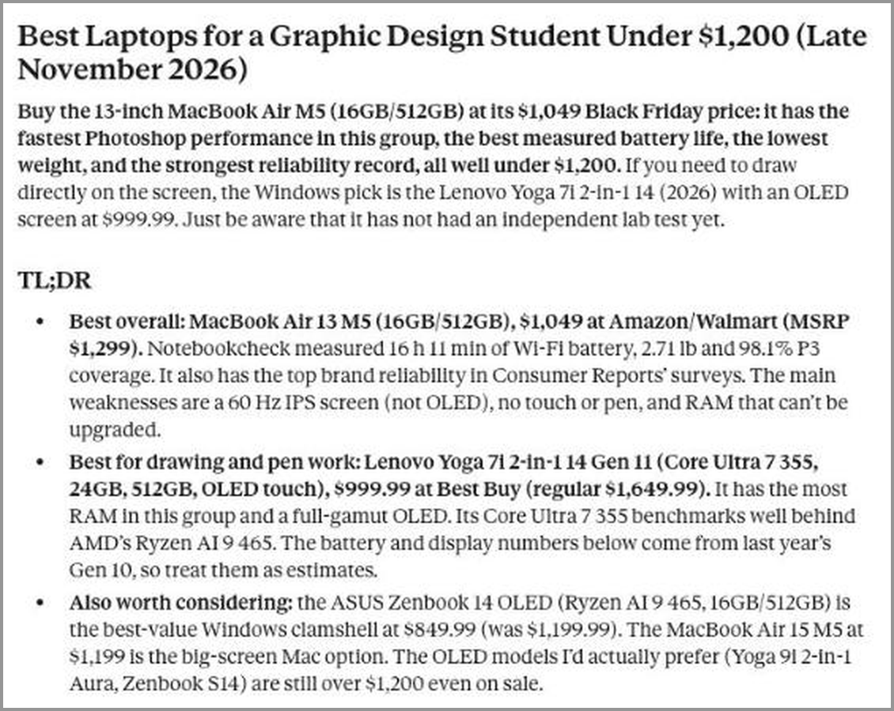

# Chapter 17: Reading, Understanding and Research

Reading is where Claude saves the most hours for the most people. A long report becomes one page; a confusing letter becomes plain sentences; a messy thread becomes a list of who owes what. These eight workflows cover the reading you probably do every week.

## Workflow 9: A Long PDF into a One-Page Brief

**For:** reports, policies, research papers, board packs. **You'll use:** file upload (Chapter 6). **Time:** 3 minutes.

I attached a fictional city parks department's annual report (PDF) and sent:

```prompt
Turn this report into a one-page brief for my director, who has 2 minutes. Structure: the bottom line in two sentences; five key findings with the page number for each; three decisions or actions for us; and anything surprising or worrying. Plain English. Quote numbers exactly as they appear.
```

```result
Parks & Recreation 2026 Annual Report: Director's Brief

Bottom line

2026 was a strong year for use: visits rose 11% to 1.92 million, and program enrollment hit a record 18,400. But spending ran $0.5 million (3.5%) over budget, and failing facilities and unfilled maintenance jobs now need decisions with hard deadlines in 2027.

Five key findings

More people used parks than ever. Visits reached 1.92 million, up from 1.73 million in 2025. Program enrollment reached 18,400, the highest on record. (p. 1)

We overspent, mostly on wages and the pool. We spent $14.6 million against a $14.1 million budget. Seasonal staff wages added +$310,000 and Riverside Pool emergency repairs added +$240,000. Program fees brought in $3.2 million, 4% above target. (p. 1)

[... three more findings, on pp. 2 and 3 ...]

Three decisions or actions for us

Decide on Riverside Pool by March 2027: repair for $2.1 million or replace for $6.8 million. Missing that date means no summer opening. (pp. 2-3)

Start trail work before June 30, 2027, or we lose the $1.2 million state grant. This has to fit alongside the $2.4 million of capital work already pushed into 2027. (pp. 1, 3)

Back the 6% budget increase request for 2027, which is mostly for wages and restroom renovation. It targets the vacancies, the overtime and the top resident complaint. (p. 3)

Surprising or worrying

Overtime doubled to $420,000. This is likely the cost of leaving maintenance posts unfilled, and the pay gap with neighboring cities suggests vacancies won't close on their own.

[...]
```

I checked the page numbers against the PDF: they're all correct. That's the point of asking for them: anyone can jump straight to the source. Notice too that Claude connected two separate facts (the overtime and the vacancies) that were in different sections of the report. **Next:** "What does the report *not* say that we'd need to know before deciding on the pool?" **Make it repeatable:** Make it a skill called "Director brief."

## Workflow 10: Decode a Confusing Letter

**For:** insurance letters, tax notices, bank statements, letters from a landlord or school. **You'll use:** a photo of the letter. **Time:** 2 minutes.

I attached a photo of a (fictional) insurance letter and sent:

```prompt
I got this letter from my health insurer and I don't understand it. In plain English: what is it saying, do I owe anything, is there a deadline, and what exactly should I do next? If anything is unclear, tell me what to ask them when I call.
```

```result
What the letter is saying

This is an Explanation of Benefits (EOB). It's your insurer's summary of how they handled a claim. It is not a bill, so you don't pay anything off this letter.

Here's what happened:
- On October 14, 2026, you had an MRI of your left knee at Lakeview Imaging Center.
- Lakeview charged $1,260.
- Your insurer paid only $410, because nobody got "prior authorization" (advance approval from the insurer) before the MRI. As a penalty, they paid as if the provider were out-of-network, which means a lower rate.
- That leaves $850 that Lakeview may bill you for.

Do you owe anything?

Possibly $850, but not yet, and maybe not at all. Nothing is due until Lakeview sends you an actual bill. If prior authorization gets approved after the fact, or an appeal succeeds, the insurer would reprocess the claim. You'd then owe your normal in-network share, which is likely much less. [...] Getting prior auth is usually the job of the ordering doctor or the imaging center, not the patient.

Is there a deadline?

Yes. You have 180 days from the notice date (November 20, 2026) to appeal. That's about May 19, 2027. Confirm the exact date when you call, since insurers count days differently.

What to do next
1. Call the doctor who ordered the MRI (and/or Lakeview). Tell them the claim was cut for missing prior authorization. Ask them to submit a retroactive authorization request and confirm when it's done. This is usually the quickest fix, and the letter says the provider can do it.
2. Call your insurer (Member Services) using the questions below.
3. If Lakeview bills you, don't pay yet. [...]
```

I checked the date: 180 days after November 20, 2026 is exactly May 19, 2027. **Make it repeatable:** Keep a "Household Paperwork" Project so Claude can refer back to earlier letters from the same company.

## Workflow 11: Meeting Notes into Minutes and Actions

**For:** after any meeting with notes, a whiteboard photo or a transcript. **Time:** 3 minutes.

```prompt
Turn these notes from today's PTA meeting into minutes: attendees, decisions made, and a table of actions with owner and due date. If an action has no owner or date, list it separately under "Needs an owner." Keep it under one page.

Notes: PTA mtg 25 Nov. there: Lisa (chair), Omar, Grace, Ben, Mrs Kaur (principal). winter fair Dec 13 confirmed, gym 10-2. Omar doing raffle prizes by Dec 5. need someone for bake sale table. budget: approved $400 for new library books, Grace to order by Dec 1. Ben says playground bench is broken, report to district?? next meeting Jan 13. Lisa to send fair flyer to classes next week. also talk about parking at pickup, people annoyed, no decision.
```

```result
PTA Meeting Minutes, 25 November 2026

Attendees: Lisa (Chair), Omar, Grace, Ben, Mrs Kaur (Principal)

Decisions made
- Winter Fair confirmed for Saturday 13 December, 10:00 am-2:00 pm, in the gym.
- Library budget approved: $400 for new library books.
- Next meeting set for 13 January.

Action items
| Action | Owner | Due |
| Secure raffle prizes for Winter Fair | Omar | 5 Dec |
| Order new library books ($400) | Grace | 1 Dec |
| Send Winter Fair flyer to all classes | Lisa | Week of 30 Nov |

Needs an owner
- Bake sale table at Winter Fair: volunteer needed to run it (before 13 Dec).
- Broken playground bench (raised by Ben): decide whether to report it to the district, and who reports it.

Discussed, no decision
- Pickup parking: parents have raised frustration about parking at pickup. No decision reached; carry forward to the 13 January meeting.

Your notes are dated 25 Nov rather than today, so I used that as the meeting date, and I read "next week" for the flyer as the week of 30 Nov.
```

These are good minutes, with one real mistake worth learning from. The notes said only "Dec 13." Claude added "Saturday" by itself, and **13 December 2026 is a Sunday.** One wrong day on a flyer and families turn up on the wrong day. This is exactly why Chapter 23 tells you to check every date and name before you send anything. **Next:** "Write a short email to the attendees with the minutes and a reminder of their actions." **Make it repeatable:** A Project for the group with past minutes as examples.

## Workflow 12: Choose Between Products with Research

**For:** any purchase over about $200. **You'll use:** Research (Chapter 11). **Time:** 10 minutes, mostly waiting.

I opened the **+** menu, turned on **Research**, and sent:

```prompt
I need a laptop for a college student studying graphic design. Budget $1,200. Must run Adobe Photoshop and Illustrator smoothly, weigh under 4 lb, and last a full day on battery. Compare the 4 best current options on performance for design work, screen color accuracy, weight, battery life, and reliability complaints. Finish with a table and one recommendation, with sources.
```

Claude said what it was about to do (and that it was assuming US prices because the budget was in dollars), then worked for seven minutes.



1. **The research card.** Click it to open the full report.

The report opened beside the chat as a complete buying guide with a summary, key findings, a comparison table and citations:



In the chat, Claude summed it up:

```result
I'd buy the 13-inch MacBook Air M5 (16GB/512GB), which is $1,049 at Amazon and Walmart for Black Friday. It's the fastest of the four laptops in Photoshop, and it also lasted longest in battery tests (about 16 hours in Notebookcheck's Wi-Fi test). It's the lightest at 2.71 lb, and Apple ranks first for brand reliability in Consumer Reports' surveys. The downsides are a 60 Hz non-OLED screen, no touch or pen support, and RAM you can't upgrade later.

- To draw on the screen: the Lenovo Yoga 7i 2-in-1 14 Gen 11 is $999.99 at Best Buy through November 28. It has 24GB of RAM, an OLED touchscreen and pen support, but its processor is slower. No lab has tested this year's model yet, so its battery and color numbers come from last year's version.
- Cheapest Windows option: the ASUS Zenbook 14 OLED with a Ryzen AI 9 465 is $849.99. It's the fastest of the Windows laptops here, but ASUS rates below average for reliability in Consumer Reports' brand data.
[...]
```

Three things make this better than an ordinary search. It answered the actual question (a recommendation, not a list). It was honest about weak evidence ("No lab has tested this year's model yet"). And it caught a time limit: one price ended in two days. **Next:** Click the sources for your top two choices and check the current price on the retailer's site. Prices in a report like this change daily. **Make it repeatable:** Keep the request as a template: "I need a [thing] for [who]. Budget [X]. Must [three must-haves]. Compare on [what matters]."

## Workflow 13: Prepare for a Doctor's Appointment

**For:** understanding a diagnosis or test result, so you can ask better questions. **Time:** 5 minutes. Consider an incognito chat (Chapter 10) for health questions.

```prompt
My doctor said my blood test shows "borderline high LDL cholesterol" (my LDL is 152). I'm 47, I don't smoke, and my father had a heart attack at 60. I see her again next week. Explain in plain English what this means, what usually affects it, and give me the 8 most useful questions to ask her. I won't make any changes without her advice.
```

Claude searched the web first, then answered:

```result
What "borderline high LDL" means

LDL is the cholesterol carrier often called "bad" cholesterol. Over many years, extra LDL can build up in artery walls as plaque, which narrows arteries and can lead to heart attack or stroke. The traditional labels for LDL are roughly: under 100 is optimal, 100-129 is near optimal, 130-159 is borderline high, 160-189 is high, and 190 or more is very high. At 152 you're near the top of "borderline high," but this is not an emergency.

The bigger point is that doctors no longer decide much from the LDL number alone. Under the major US cardiology guideline updated in March 2026, risk assessment is based on your estimated 10-year chance of heart disease or stroke [...]

8 questions to ask your doctor
1. What is my estimated 10-year risk of heart attack or stroke, and which category does that put me in? This number matters more than LDL alone.
2. What LDL goal should I aim for, given my overall risk?
3. Do my other results matter here? Ask about HDL, triglycerides, non-HDL cholesterol, blood pressure, blood sugar or HbA1c, kidney function and thyroid.
4. Should I have my lipoprotein(a), or Lp(a), measured? [...]
5. Does my father's heart attack at 60 change my risk, and does any other family history matter?
[... three more questions, then:]

It helps to bring your full lab report, a list of any medicines or supplements you take, and details of your family's heart history: who, what happened and at what age.

Sources: [three links to the American College of Cardiology and a lab company]
```

The last sentence of my request ("I won't make any changes without her advice") told Claude how I'd use the answer, so it focused on preparing good questions instead of piling on warnings. **Remember:** Claude helps you prepare; your doctor makes the decisions with you.

## Workflow 14: Catch Up on a Long Email Thread

**For:** coming back from vacation, or being added to a long thread. **You'll use:** pasted text, or the Gmail connector (Chapter 12). **Time:** 2 minutes.

```prompt
Here's an email thread about our office move that I've just been added to. Tell me: what's been decided, what's still open, who's waiting on whom, and is anything waiting on me (I'm Sam, the office manager)? Then suggest a short reply that shows I've caught up.

1) From Priya (Ops director), Nov 10: We've signed the lease for the Riverside building. Move date is Feb 28. We need to pick a mover and sort out IT.
2) From Mark (IT), Nov 12: Internet at Riverside needs 6 weeks lead time. I need a final floor plan before I can order network drops.
3) From Priya, Nov 13: Floor plan is with the architect, should be final by Nov 20.
4) From Dee (Finance), Nov 18: Got 3 mover quotes: Swift $8,400, Carefree $7,100, Atlas $9,050. Need a decision by Dec 1 to hold the date.
5) From Priya, Nov 21: Architect is late, floor plan now Dec 2. Adding Sam, who will run the move day to day. Sam, can you own the mover decision and the move-day plan?
6) From Mark, Nov 24: If the floor plan is Dec 2, ordering internet Dec 3 means live by Jan 14. Tight but OK. Please don't let it slip again.
```

```result
What's been decided
- Lease signed for the Riverside building (Priya, Nov 10).
- Move date is Feb 28. That's a Sunday in 2027, which affects mover pricing and building access, so check the quotes assume a weekend.
- You own the mover decision and the move-day plan (Priya, Nov 21).
- IT timeline: Mark will order internet the day after the floor plan is final. If that's Dec 3, it's live by Jan 14.

What's still open
- Mover choice: Swift $8,400, Carefree $7,100, Atlas $9,050. Not decided.
- Final floor plan: the architect has already slipped once, from Nov 20 to Dec 2.
- Move-day plan: not started.

Who's waiting on whom
- Mark (IT) -> architect, via Priya. He can't order network drops until the floor plan is final.
- Dee (Finance) -> you. She needs a mover decision by Dec 1 to hold the date.
- Priya -> you, for the mover decision and the move-day plan.

What's waiting on you
The mover decision, due Tuesday, Dec 1. That's 5 days away, with a weekend in between. It's your most urgent item. Before choosing, ask Dee for the full quotes. The $1,950 spread between the cheapest and dearest may reflect different scope, such as packing, insurance, IT equipment handling or weekend rates. [...]

Suggested reply

Hi all, thanks for adding me, Priya. I've caught up on the thread.

To confirm: I'll own the mover decision and the move-day plan.

Dee, could you send me the three full quotes today or tomorrow? I want to check they cover the same scope, including weekend rates, since Feb 28 is a Sunday. I'll confirm a mover by Dec 1 so we hold the date. [...]

Thanks,
Sam
```

Claude noticed something nobody in the thread had: the move date is a Sunday, which changes mover prices. I checked: it is. **Make it repeatable:** Part of the weekday briefing in Workflow 47.

## Workflow 15: Check a Claim Before You Share It

**For:** a viral post, a surprising statistic, a "miracle" product. **You'll use:** web search. **Time:** 3 minutes.

```prompt
A post going around says "Drinking a glass of warm lemon water every morning burns 300 extra calories a day." Search the web and check this. What do reliable sources say? Rate the claim as true, partly true, misleading or false, explain why in three sentences, and give me the sources.
```

```result
Rating: False

The most favorable study found that drinking 500 ml of water raised metabolic rate with a total thermogenic response of about 100 kJ (roughly 24 calories), and about 40% of that came from warming the water from 22 to 37°C. So a warm glass, which needs no warming, would burn even less, and later trials found room-temperature water did not increase energy expenditure at all [...]. The lemon adds nothing either: there is no evidence that the citric acid or vitamin C in lemons directly speeds up fat burning in people [...], so 300 calories a day is more than ten times the best-case figure for any glass of water.

The grain of truth is indirect: lemon water can help with weight if it replaces sugary drinks, since a lemon-water drink has roughly 13 to 27 calories, versus 150 in a can of soda.

Sources:
- Water-induced thermogenesis (Boschmann et al., J Clin Endocrinol Metab, 2003), PubMed
- Water-induced thermogenesis reconsidered (Brown et al., J Clin Endocrinol Metab, 2006), PubMed
- Water-induced thermogenesis and fat oxidation: a reassessment (Charrière et al., Nutrition & Diabetes, 2015), PubMed
[... and three more]
```

Notice the sources: published studies, not blogs. **Make it repeatable:** Save it as a skill called "Fact check" so you can paste any claim and get the same structured verdict.

## Workflow 16: Learn a New Topic in an Hour

**For:** a new job, a new hobby, a meeting on a subject you know nothing about. **Time:** 30 to 60 minutes.

> **Note:** The first time I ran this, I didn't say where the job was. Claude tailored the whole crash course to the country it detected I was in, with that country's rules and money. If location matters, and for jobs, laws, prices and services it nearly always does, say where you are.

```prompt
I start a new job at a home solar panel installer in Arizona, USA, on Monday, in the office, not on roofs. I know nothing about solar. Give me a one-hour crash course: the 10 terms I'll hear most (with plain explanations), how a typical home installation works from first call to switch-on, the main things customers worry about, and 5 smart questions I could ask in my first week. Answer here in the chat.
```

Claude checked the current Arizona rules on the web first, then wrote a long, well-organized course. Here is how it began, and how it ended:

```result
Here's your crash course. Arizona is one of the best places in the country for solar, but 2026 changed the money side a lot, so I've flagged the current rules where they matter.

The big picture (2 minutes)

Panels on the roof turn sunlight into electricity. The home uses that power first. Any extra goes out to the utility grid, and the homeowner gets a bill credit for it. [...] Most of the office's job is managing the paperwork and the customer between "yes" and "switched on."

The 10 terms you'll hear most

1. kW vs. kWh. This is the one everyone mixes up. A kW (kilowatt) is size or power, like a car's horsepower. "An 8 kW system" describes how big it is. A kWh (kilowatt-hour) is energy used over time, like miles driven. Electric bills and production estimates are in kWh.

2. Offset. The percentage of a home's yearly electricity the system is designed to cover. [...] Designers size systems from the customer's past 12 months of bills, which is why you'll constantly be asking customers for their utility bills.

[... eight more terms, the installation steps and customer worries ...]

5 smart questions for your first week
- "What are the top three reasons jobs get delayed here, and which ones can the office actually speed up?"
- "What's our mix of cash, loan, lease and PPA right now, and how has that changed since the federal credit ended?"
- "When a customer says their bill is higher than promised, what's our process, and who handles it?"
- "Which utility and which cities or counties are the hardest to work with, and why?"
- "What does a customer hear from us at each stage, and where do they most often feel left in the dark?"

Bonus tip for Monday: ask to see one job file from start to finish. Seeing an actual contract, permit, inspection card and PTO letter will make all of this click faster than anything else.
```

**Next:** "Quiz me on the 10 terms, one at a time, and tell me if I'm right." Then: "Make flashcards of these terms as an artifact." **Make it repeatable:** A "New Job" Project where you add notes as you learn.
