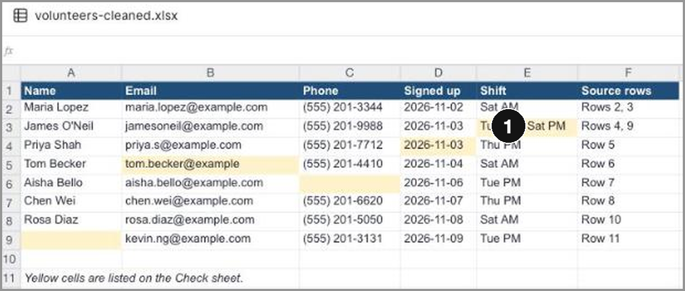
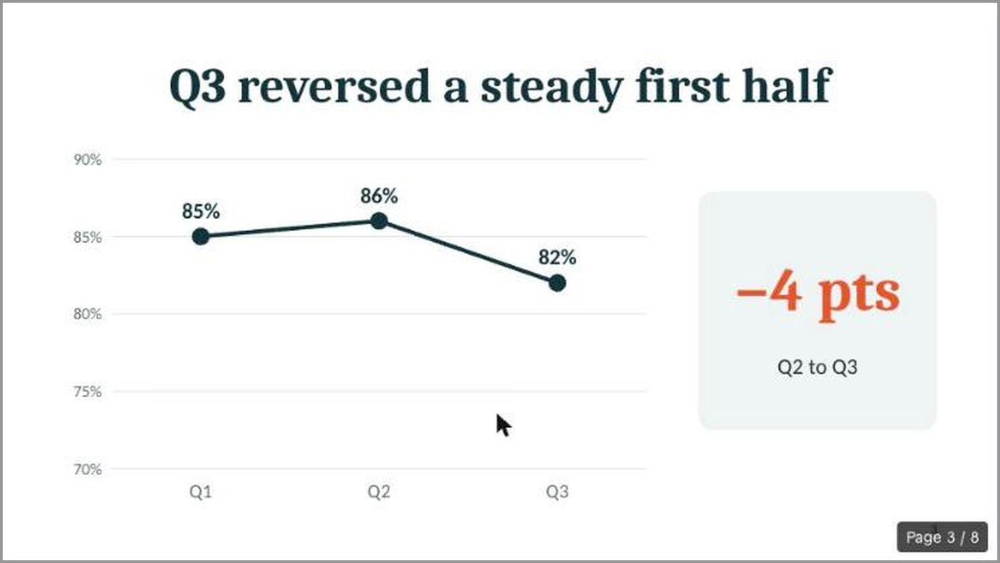
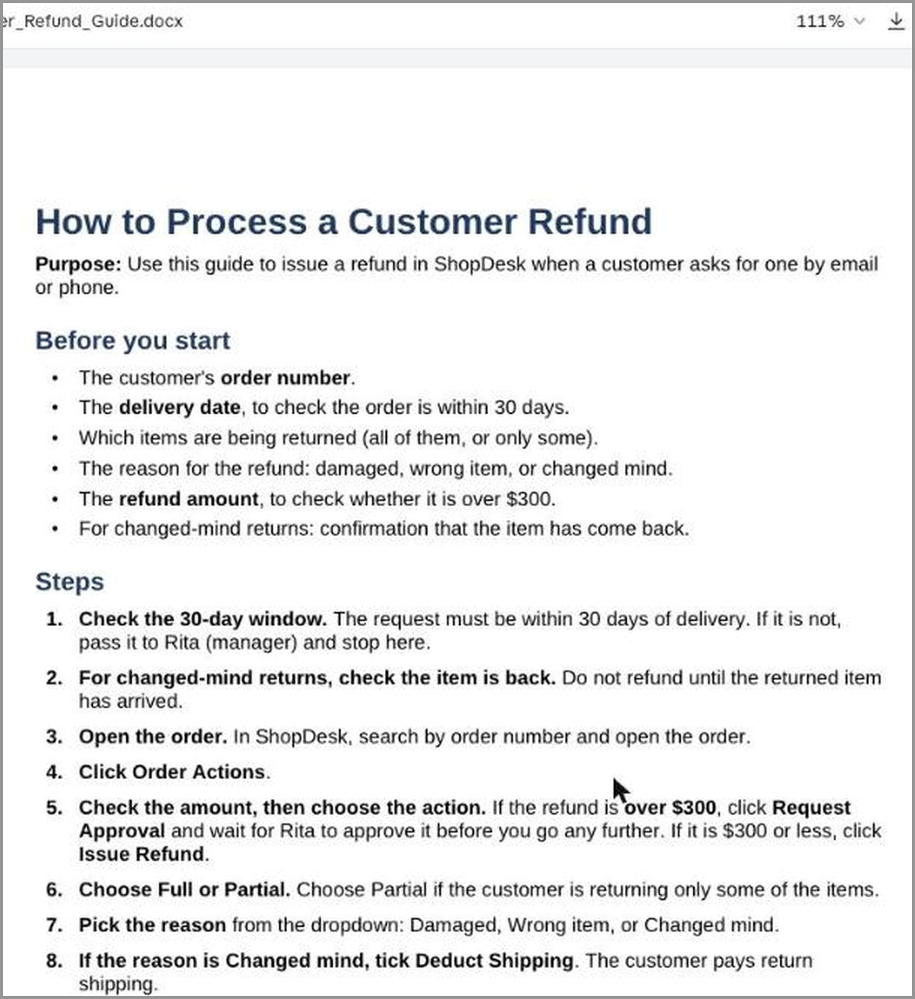

# Chapter 18: Work and Office

These eight workflows take over the routine parts of office work: reports, spreadsheets, presentations, planning and preparing for difficult conversations.

> **Note:** Workflows that create files (spreadsheets, documents and decks) were run in normal chats, not incognito. In an incognito chat, Claude told me plainly: "I can't create an Excel file in this chat." Incognito chats don't keep files, so file creation and Claude's file tools are switched off there (Chapter 10).

## Workflow 17: The Weekly Status Report

**For:** the report your manager wants every Friday. **Time:** 2 minutes.

```prompt
Here are my notes from this week. Write my weekly status report in this format: Done, In progress, Blocked (with what I need), Next week. Under 250 words. Put anything that's late or at risk at the top in bold.

Notes: finished the Q4 vendor review, switching cleaning company saves $3,200 a year. onboarded the 2 new hires (Maya, Luis), laptops done. expense policy draft about 70% done. office move planning started, got 3 mover quotes. cant book the Riverside freight elevator until facilities sends me the building contact, asked twice. badge order is late, supplier now says Dec 8 instead of Dec 1, new hires using temp badges. next week: finish expense policy, pick the mover by Dec 1, start move-day checklist.
```

```result
[warning icon] Late / at risk

Badge order is late: the supplier moved delivery from Dec 1 to Dec 8. Maya and Luis are using temp badges until then.
Riverside freight elevator not booked: I've asked facilities twice for the building contact and haven't received it. This could affect move-day scheduling.

Done
- Completed the Q4 vendor review. Switching cleaning companies will save $3,200 a year.
- Onboarded the 2 new hires (Maya, Luis), with laptops set up.

In progress
- Expense policy draft, about 70% complete.
- Office move planning: 3 mover quotes received.

Blocked
- Freight elevator booking. I need the Riverside building contact from facilities.

Next week
- Finish the expense policy draft.
- Select the mover by Dec 1.
- Start the move-day checklist.
- Follow up on the Dec 8 badge delivery.
```

Claude spotted that the elevator problem was both "blocked" and "at risk," and added a follow-up for the late badges that wasn't in my notes. **Make it repeatable:** After two good weeks, turn it into a skill, or a Friday scheduled task (Workflow 49).

## Workflow 18: Clean Up a Messy Spreadsheet

**For:** exported data with inconsistent names, dates and blanks. **You'll use:** file upload, in a normal chat. **Time:** 5 minutes.

I attached a messy volunteer sign-up export (10 rows from three forms) and sent:

```prompt
This spreadsheet is our volunteer sign-up list exported from three different forms. Clean it up: one row per person, consistent name capitalization, phone numbers in the format (555) 123-4567, dates as YYYY-MM-DD, and merge duplicates (same email = same person). Put anything you weren't sure about on a separate sheet called "Check" with the reason. Give me the cleaned Excel file and a summary of what you changed.
```

The cleaned file opened beside the chat:



1. **Yellow cells** are the ones Claude wasn't sure about. Each is explained on the Check sheet.

```result
I've cleaned the list into volunteers-cleaned.xlsx. The 10 sign-ups became 8 people on the "Volunteers" sheet, and 6 items I wasn't sure about are on the "Check" sheet. Those cells are also highlighted yellow on the main sheet.

[... a list of every change made ...]

Needs your check
- James O'Neil's shift: I kept both shifts. Check whether he's doing both or switched to Sat PM.
- Priya Shah's date: "3/11/2026" could mean March 11 or 3 November. I read it as Nov 3 to match the rest of the list.
- Tom Becker's email: "tom.becker@example" has no .com or other ending, so messages to it won't be delivered.
- Aisha Bello: has no phone number.
- Row 11: has no name. The email suggests Kevin Ng, but I left the name blank until you confirm.
- Maria Lopez: the Check sheet notes that I kept her earlier sign-up date (Nov 2, not Nov 5).
```

Every one of those six is a real problem I'd hidden in the data, and Claude found all of them. Notice it refused to guess Kevin's name from his email. **Make it repeatable:** Save the request; next time, "same cleanup as last time."

## Workflow 19: Explain a Spreadsheet Someone Else Built

**For:** inheriting a colleague's workbook full of formulas. **You'll use:** file upload in a normal chat, or Claude for Excel (Chapter 15). **Time:** 5 minutes.

I attached a small office budget workbook with two hidden problems and sent:

```prompt
I've inherited this budget workbook. Explain it sheet by sheet in plain English: what each sheet is for, where the inputs are, and what the key formulas calculate. Then list anything that looks fragile or wrong, such as hard-coded numbers in formulas, broken references or totals that don't include every row.
```

```result
I went through both sheets. The workbook is small, but it has one real error and two numbers you should question before relying on it.

What each sheet does

Inputs is where you type. It lists six cost categories in column A and a monthly amount for each in column B (B2:B7). [...] These are the only numbers you should need to change. Everything else is calculated from them.

Annual is the output. You shouldn't type anything here. [...]

What looks wrong or fragile

The total leaves out Insurance. This one is definitely wrong. B9 adds rows 2-6, but the categories run to row 7. The sheet shows a total of 281,040 when it should be 284,520, so 3,480 is missing. The shares in column C are therefore divided by the wrong total and add up to about 101%. The fix is =SUM(B2:B7). [...]

B10 has two numbers typed into the formula. The 1.03 is a 3% increase applied to every cost: rent, insurance, everything. The label says "raise", which usually means salaries only. [...] The +2000 has no label or explanation. It might be a bonus pool, a buffer, or a leftover from something else.
```

I checked the arithmetic: Claude is exactly right. (When I first tried this in an incognito chat, Claude could see only the cell values, not the formulas, and said so. File tools need a normal chat.) **Next:** "Fix the problems and give me the corrected file, with a list of every cell you changed."

## Workflow 20: A Presentation from Your Notes

**For:** team updates, pitches, training sessions. **Time:** 10 minutes.

```prompt
Make an 8-slide PowerPoint deck from my notes for a 15-minute talk to our board about last quarter's customer satisfaction results. One idea per slide, no more than 15 words of text per slide, a simple chart on slide 3 using the numbers in my notes, and speaker notes for every slide. The final slide should ask for one specific decision.

Notes: Q3 2026 customer satisfaction (CSAT) 82%, down from 86% in Q2 and 85% in Q1. Survey had 1,240 responses. Biggest drop: phone support wait times, average hold 11 minutes (Q2: 6). Delivery on-time rate steady at 94%. Staff friendliness still top-rated (91% positive). App satisfaction 71%. Cause: two support staff left in July, not replaced. Proposal: hire 2 support agents ($118,000 a year total) and add a callback option ($9,000 one-off). Goal: CSAT back to 86% by Q2 2027.
```

Claude built the deck, checked every slide as an image for overflowing text, and opened it beside the chat. This is the real slide 3:



```result
I've made the deck: Q3-2026-CSAT-Board-Review.pptx. It has 8 slides, no slide has more than 15 words, and every slide has speaker notes. The notes add up to about 11 minutes of speaking, which leaves time for questions in a 15-minute slot. [...]

A few choices you might want to change:
- The $127,000 figure on the last slide is $118,000 plus $9,000. The notes explain that it falls to $118,000 a year after that.
- App satisfaction (71%) isn't on any slide. The notes for slide 5 mention it as a weak area that this proposal doesn't address, so the board doesn't hear about it first through questions.
- The chart's scale starts at 70% so the drop is easy to see. The notes have a line saying so, so the board doesn't think you're exaggerating the drop.
[...]
```

That last point deserves care. A chart that starts at 70% makes a 4-point drop look dramatic, and Claude did flag it in the notes, but a note isn't enough for a board that only glances at the slide. **Fix it:** ask for "a chart with the scale starting at zero, plus a small close-up labeled 'Detail: 70-90%'" so nobody is misled. **Next:** "Give me the three questions the board is most likely to ask, with short answers." **Make it repeatable:** A design system (Chapter 13) so every deck matches your company look.

## Workflow 21: Plan a Project Week by Week

**For:** an office move, an event, a product launch. **Time:** 10 minutes.

> **Tip:** My first run of this didn't say which country the office was in, and Claude's plan used terms and tax registrations from the country it guessed I was in. Adding "Denver, Colorado, USA" fixed it. For anything involving laws, holidays, forms or suppliers, say where you are.

```prompt
Plan our office move in Denver, Colorado, USA. 22 people, moving from 4th Street to the Riverside building, last working day in the old office is Friday February 26, first day in the new one is Monday March 1. Make a week-by-week plan for the 8 weeks before, as a table with task, owner role (office manager, IT, everyone), and week. Include the things people usually forget. Then give me a one-page checklist for moving weekend. Answer here in the chat.
```

```result
Your move dates fall in 2027: Friday Feb 26 is the last day at 4th Street, the move happens the weekend of Feb 27-28, and Monday March 1 is the first day at Riverside. The 8 weeks run from Jan 4 to Feb 26.

Two things to do before Jan 4:
- Order internet at Riverside. Business circuits often take 30-60+ days to install.
- Confirm in writing when you can get into Riverside. Ideally IT gets access a week or more early.

Items marked with a star are the ones offices commonly forget.

| Week | Task | Owner |
| 1 (Jan 4-8) | Get 3 mover quotes and book one for Sat Feb 27 | Office manager |
| 1 | * Ask the movers for a certificate of insurance (COI). Both buildings usually require one before they allow a move. | Office manager |
| 2 | * Reserve the freight elevator and loading dock at both buildings for Feb 27 | Office manager |
| 3 (Jan 18-22, MLK Day Mon) | * Build the change-of-address list: USPS, bank, payroll, insurer, clients, vendors, Colorado Secretary of State business record, CO Dept. of Revenue, and IRS (Form 8822-B) | Office manager |
| 3 | * Update the emergency (E911) address on the phone system or VoIP for the new location | IT |
| 3 | * Book junk removal and e-waste recycling for the old office. Plan to wipe drives first. | Office manager |

[... weeks 4 to 8 and the moving-weekend checklist ...]
```

Look at the starred items: a moving company's insurance certificate, the IRS change-of-address form and the emergency-services address on the phones are exactly the things that get forgotten. **Make it repeatable:** Put the plan in a Project and add a weekly scheduled task: "Tell me what's due this week and what's overdue."

## Workflow 22: Prepare for a Difficult Conversation

**For:** giving hard feedback, asking for a raise, saying no to your boss. **Time:** 15 minutes, including practice.

```prompt
I need to tell my employee Marcus that his reports have been late four times this month and it's affecting the team. He's usually great and I think something might be going on at home. Help me plan a 10-minute conversation: how to open it, the key message in one sentence, three questions to understand what's happening, and how to agree on next steps. Then play Marcus so I can practice. Be realistic, not easy.
```

```result
Key message (one sentence)
"Your reports have been late four times this month, and because the team builds on them, it's holding up their work too. I want to understand what's going on so we can fix it together."

Say it once, plainly, then stop talking. Let the silence do some work.

[... three questions, next steps and a closing line ...]

Practice

I'll play Marcus realistically. He might be guarded, defensive, or deflect, and he won't hand you the answer just because you asked nicely. You can say "pause" anytime to get feedback, or "restart" to try a different opening.

Setting: Thursday afternoon. You've asked Marcus to step into a meeting room. He comes in, sits down, and glances at his phone before putting it face-down on the table.

Marcus: "Hey. You wanted to see me? I've got the Henderson numbers to finish, so..."
```

I replied with the opening Claude had suggested. "Marcus" did not make it easy:

```result
Marcus: (leans back a little, arms folding) "Four times? I mean... okay, yeah, a couple were late. But the Q3 one was late because Priya's data came in a day after it was supposed to. That wasn't really on me."

(pause, glances at the phone on the table)

"It's been a busy month, that's all. Everyone's slammed. I'll get them in on time. You don't need to worry about it."
```

That is exactly how a real conversation goes: a bit defensive, a bit dismissive, and a glance at the phone that hints at something more. Practicing here, out loud with voice mode if you like (Chapter 15), means the real conversation won't be the first time you've heard it.

## Workflow 23: Write a Clear How-To for Your Team

**For:** any process people keep asking you about. **Time:** 10 minutes.

```prompt
Turn this description of how we process a customer refund into a step-by-step guide for new staff, as a Word document: a one-line purpose, what you need before you start, numbered steps with the exact button names, a "common mistakes" box, and who to ask for help.

How we do it: customer emails or calls asking for a refund. Check it's within 30 days of delivery, otherwise it goes to the manager (Rita). Open the order in ShopDesk, search by order number. Click Order Actions, then Issue Refund. Choose full or partial; partial if only some items are returned. Pick the reason from the dropdown (damaged, wrong item, changed mind). If changed mind, they pay return shipping, so tick Deduct Shipping. Click Confirm Refund. Then email the customer using the Refund Sent template. Refunds over $300 need Rita's approval first: use the Request Approval button instead of Issue Refund. Common mistakes: forgetting Deduct Shipping, refunding before the item is back for changed-mind returns.
```

The Word document opened beside the chat:



```result
I've made the refund guide as a one-page Word file, Customer_Refund_Guide.docx. It covers the purpose, what you need before you start, 10 numbered steps with the button names in bold, a shaded "Common mistakes" box, and Rita as the person to ask.

I changed the order of your description in two places, so it's worth checking both match how the team really works:
- Item back first: checking that a changed-mind item has arrived is now step 2, before anyone opens ShopDesk. That way the "refunding before the item is back" mistake gets caught early.
- The $300 check: this happens at the Order Actions step. [...] Your description doesn't say what happens once she approves, so the guide doesn't either. If staff then finish the refund themselves from step 6, add a line to say so.
```

Claude found a gap in my own process (what happens after Rita approves?) and said so instead of inventing an answer. **Make it repeatable:** Keep all your guides in one "Team Guides" Project.

## Workflow 24: Turn Feedback into a Plan

**For:** survey results, reviews, comments. **You'll use:** file upload. **Time:** 5 minutes.

I attached 52 survey comments (as a CSV file) and sent:

```prompt
Here are the comments from our end-of-year customer survey. Group them into themes, and for each theme give the number of comments, two typical quotes and one suggested action. Order by how often each theme appears. Then list any single comment that's serious enough to deal with right away, even if only one person said it.
```

```result
The 52 comments fall into five themes, plus one safety issue that needs attention today.

| # | Theme | Comments | Suggested action |
| 1 | Phone wait times and access | 14 | Add a callback option and add staff at lunchtime, the busiest period. |
| 2 | Late or inaccurate delivery | 12 | Check how delivery estimates are calculated. Mark orders "delivered" only after a driver's confirmation scan. |
| 3 | Praise for staff (positive) | 10 | Pass the praise on to Jenna, the Elm Street team and the driver, and recognize them publicly. |
| 4 | App usability | 9 | Fix the daily logout bug first. Then make it easier to change addresses and find past orders. |
| 5 | Rising prices | 6 | Review the delivery fee increase against competitors and explain any price changes to customers. |

Needs action right away

Response 1018: "The heater in my rental unit you installed sparks when it turns on. Please send someone." Sparking from a heater is a fire and electrical risk. Contact this customer today. Tell them to stop using the heater and switch it off at the breaker. Then send a qualified technician. You should also check whether other heaters from the same batch or installer have the same problem.

One thing to note about the data: many comments are word-for-word identical. For example, "Waited 40 minutes on hold" appears 7 times [...]. These could be repeat submissions or preset answers in the survey. If they are, the counts may overstate some themes, so check how the survey collected comments before relying on the exact numbers.
```

(I've removed the "typical quotes" column to fit the page.) The counts are exactly right, the one dangerous comment was caught, and Claude even noticed something about the data itself: my sample comments did repeat. Grouping by theme hides rare but serious problems, which is why the last line of the request matters. **Make it repeatable:** Run the same request on every survey so you can compare themes year to year.
