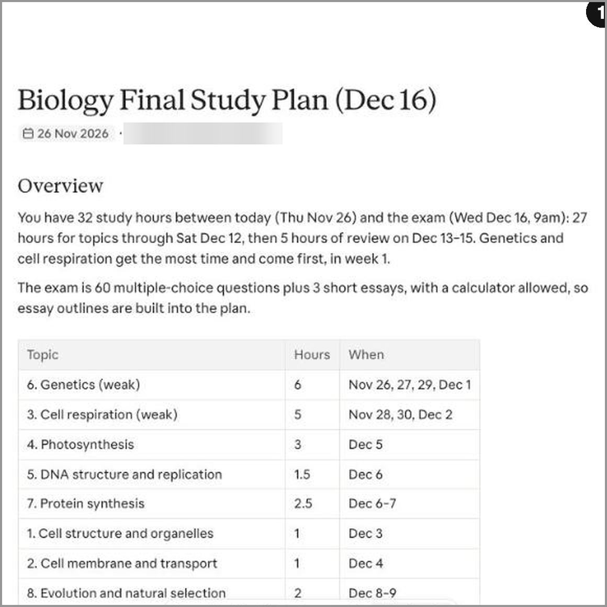
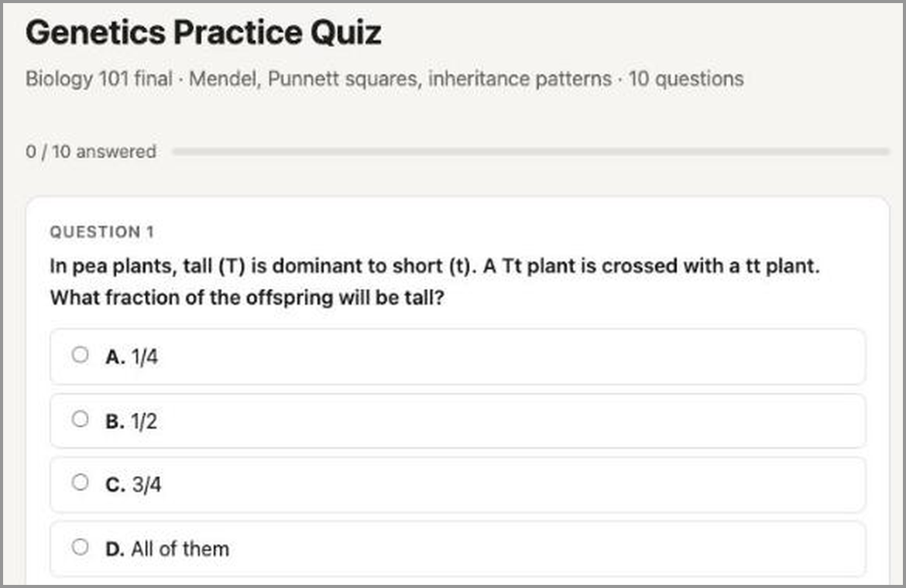
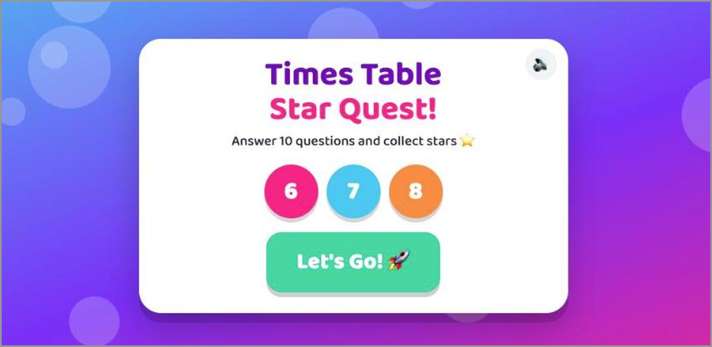

# Chapter 19: Learning and Studying

Claude is a patient tutor that's available at 11pm the night before an exam, never makes you feel silly for asking, and can explain the same idea five different ways until one clicks. Used well, it helps people learn faster. Used badly, it does the work for them and they learn nothing. These workflows are designed for the first kind.

> **Note:** Claude adapts spelling, currency and examples to where it thinks you are. When I didn't say, it sometimes used British spelling or my local currency. If that matters, add "Use US spelling and US dollars" to your request, or put it in your profile instructions once (Chapter 2).

## Workflow 25: A Homework Tutor That Doesn't Give Away the Answer

**For:** students of any age, and parents helping them. **Time:** as long as the homework.

```prompt
You're my math tutor. I'm in 8th grade. Don't give me the answer. Ask me one question at a time to help me work it out myself, and give a hint only if I'm stuck twice. When I get it right, give me one similar problem to try on my own.

My problem: A phone plan costs $25 a month plus $0.10 per text. Another plan costs $40 a month with unlimited texts. How many texts in a month would make the two plans cost the same?
```

Here is the real exchange:

```result
Claude: Let's work through it together.

First question: If you send 0 texts in a month, how much does each plan cost?

Me: Plan A is $25 and plan B is $40.

Claude: Exactly right! So at zero texts, Plan A is cheaper by $15.

Next question: What happens to the cost of each plan every time you send one more text?
```

No answer handed over, just the next small step. **For parents:** Put the first paragraph of that request in a "Math Tutor" Project's instructions, so your child gets this kind of help every time in that Project. **Make it repeatable:** One Project per subject, with the textbook chapter or class notes as context.

## Workflow 26: A Study Plan with a Practice Quiz

**For:** an exam, certification or test. **Time:** 5 minutes to set up.

I attached the course syllabus (PDF) and sent:

```prompt
I have my biology final on December 16, which is about 3 weeks away. The syllabus is attached. I can study 1 hour on weekdays and 3 hours on weekends. Make a day-by-day plan that covers every topic, puts my weakest topics (genetics and cell respiration) earlier, and leaves the last 3 days for review. Then make a 10-question practice quiz on genetics as an interactive artifact that tells me which answers I got wrong and why.
```

Claude made two things at once. The plan became a **Claude Doc**, an editable document with a checkbox for each day:



1. **Editing and Share.** You can edit the doc yourself, ask Claude to change it, or share it.

And the quiz became an interactive artifact:



```result
I've made your study plan as an editable doc with a checkbox for each day, plus a genetics practice quiz.

The plan:
- Starts today (Thu Nov 26). That gives you 32 hours before the exam. 27 of them cover all 9 syllabus topics, and the last 3 days (Dec 13-15) are only for review.
- Week 1 is genetics and cell respiration. Genetics gets about 6 hours and respiration 5, and the two take turns so you come back to each after a short break.
- The other seven topics run Dec 3-11. Photosynthesis falls on a 3-hour Saturday so you can compare it with respiration.
- Sat Dec 12 is a catch-up day. [...]
- Essay practice is built in, since the exam has 3 essays.
- The review days start with a timed mock exam on Dec 13. The last two days then go to whatever the mock shows you got wrong.

The quiz: it has 10 questions covering Mendel's laws, mono- and dihybrid crosses, incomplete dominance vs codominance, ABO blood types, sex-linked traits, test crosses and pedigrees. When you submit, it gives your score and links to each question you missed. For every wrong answer it explains why your choice was wrong and why the correct one is right. [...]
```

Claude read details from the syllabus I hadn't mentioned (3 essays, the exam time) and built them into the plan. **Next:** Each day, open the doc, tick off the day, and ask "Quiz me on today's topic." **Make it repeatable:** Ask for "a matching quiz for cell respiration," which Claude offered to make next.

## Workflow 27: Practice a Language by Talking

**For:** learning or brushing up a language. **Time:** 10 minutes a day; try it in voice mode on your phone (Chapter 15).

```prompt
Let's practice Spanish. I'm a beginner (about 3 months of lessons). Have a slow, simple conversation with me about ordering food in a restaurant. You're the waiter. After each of my replies, gently correct any mistake in English, then continue in Spanish.
```

I answered with a deliberate beginner's mistake. The real exchange (emoji removed for print):

```result
Claude: Camarero: ¡Buenas tardes! Bienvenido al restaurante. ¿Mesa para cuántas personas?
(Good afternoon! Welcome to the restaurant. A table for how many people?)
Tip: You can answer with something like "Para una persona, por favor" or "Para dos personas." Your turn!

Me: Para uno persona, por favor. Yo quiero ver el menu.

Claude: Corrections:
- "uno persona" -> "una persona." Persona is a feminine word, so it takes una. (Even if the person is a man, the word itself is feminine.)
- "menu" -> "menú." Small detail: it has an accent on the ú.
- "Yo quiero ver el menú" is correct! Just so you know, Spanish speakers often drop the yo, since quiero already means "I want." A slightly more polite version is "¿Puedo ver el menú, por favor?" (Can I see the menu, please?)

Great job overall!

Camarero: ¡Claro! Aquí tiene el menú. ¿Quiere algo para beber?
(Of course! Here is the menu. Would you like something to drink?)
```

Corrections, the reason for each, a more natural way to say it, and then straight back into the conversation. **Make it repeatable:** Put your level and goals in a "Spanish" Project's instructions; change the scene daily.

## Workflow 28: Explain It at My Level

**For:** any concept that isn't clicking. **Time:** 2 minutes.

```prompt
Explain how vaccines train the immune system three ways: first for a curious 10-year-old, then for a high-school student, then for a nursing student. Use an everyday comparison in the first one.
```

```result
For a curious 10-year-old

Imagine your body has a team of security guards whose job is to keep out germs. The problem is that a new germ is like a stranger the guards have never seen, so it takes them a while to figure out it's a troublemaker. While they're figuring that out, the germ can make you sick.

A vaccine is like showing the guards a "Wanted" poster before the troublemaker ever shows up. The poster isn't the real criminal and can't cause trouble; it's just a picture or a harmless piece of the germ. The guards study it, practice how to catch that exact troublemaker, and then keep the poster on the wall for years. [...]

For a high-school student

Your immune system has two broad layers. The innate system responds quickly to anything that looks foreign, but it's general-purpose. The adaptive system is slower the first time but highly specific, and it can remember what it's fought. [...]

For a nursing student

Vaccination induces active artificial immunity by presenting antigen in a controlled way so the adaptive immune system generates durable, antigen-specific memory without the morbidity of natural infection. [...]
```

Seeing all three levels side by side often helps more than any one of them. Pick the one that fits and ask follow-ups from there. **Make it repeatable:** Just say "explain it three ways" whenever you're stuck.

## Workflow 29: Learn a Practical Skill with Real Practice

**For:** Excel formulas, writing, budgeting, anything with exercises. **Time:** 20 minutes per session.

```prompt
Teach me Excel's XLOOKUP in a 20-minute lesson. Explain it simply with one example, then give me a practice Excel file with a small product list (prices in US dollars) and three tasks that get harder. I'll do them and send the file back for you to check. Use US spelling.
```

```result
XLOOKUP in 20 minutes

What it does (about 3 minutes)

XLOOKUP looks for a value in one column and returns the matching value from another column. It's like asking: "Find P108 in the ID column, then tell me what's in the Category column on that same row." [...]

One example (about 2 minutes)

=XLOOKUP("P108", Products!A5:A14, Products!C5:C14)   ->  Audio

[...]

The practice file (about 15 minutes)

XLOOKUP_Practice.xlsx has a "Start Here" sheet with a cheat sheet and a "Products" sheet with 10 products priced in US dollars. It also has three task sheets that get harder:
- Task 1 (easy): Look up prices from Product IDs.
- Task 2 (medium): Look up stock by product name. One product isn't in the list, so you'll use the if_not_found argument to show "Not found."
- Task 3 (harder): Price an order, add up the subtotal, then find the discount tier using match_mode -1. The subtotal won't exactly match any tier, which is the point of this task.

Each task sheet tells you which yellow cells to fill. When you're done, save the file and send it back. I'll check your formulas and your results.

You'll need Excel 2021, Excel 2024 or Microsoft 365, because older versions of Excel don't have XLOOKUP.
```

Under the file, Claude also suggested installing Claude for Excel (Chapter 15; it needs a paid plan), so it could check your work directly in the spreadsheet. **Make it repeatable:** "Next lesson" in the same chat continues where you stopped.

## Workflow 30: A Learning Game for Kids

**For:** times tables, spelling words, state capitals. **Time:** 5 minutes.

```prompt
Make a fun times-tables game for my 8-year-old as an artifact. Big buttons, 10 questions per round on the 6, 7 and 8 times tables, a happy message and a star for each right answer, and at the end show which ones to practice again. Bright colors, no ads, no sign-in.
```



```result
I've made Times Table Star Quest. It's a bright, colourful game with no ads and no sign-in, and it works on a phone, tablet or computer.

How it plays:
- Each round is 10 questions from the 6, 7 and 8 times tables, from x2 to x10. Sometimes the numbers are flipped, so your child sees both 7 x 8 and 8 x 7.
- There are four big, coloured answer buttons.
- Right answer: a happy message pops up, a star lights up in the star row, there's a little burst of confetti and a chime, and the next question starts on its own.
- Wrong answer: a gentle "Good try!" appears, the right answer is shown (for example 7 x 8 = 56), and a big Next button moves on when they're ready.
- End screen: it shows their score and stars, plus a "Let's practise these again" box listing every fact they missed with its answer. [...]

There's a sound on/off button in the top corner. I only checked the code for errors and haven't clicked through it in a browser, so try one round yourself before handing it over.
```

That last sentence is worth noticing: Claude told me exactly what it had and hadn't tested. Take its advice and play one round yourself first. **Make it repeatable:** Install it as an app on the family computer, or ask for a new version each week with that week's spelling words.
