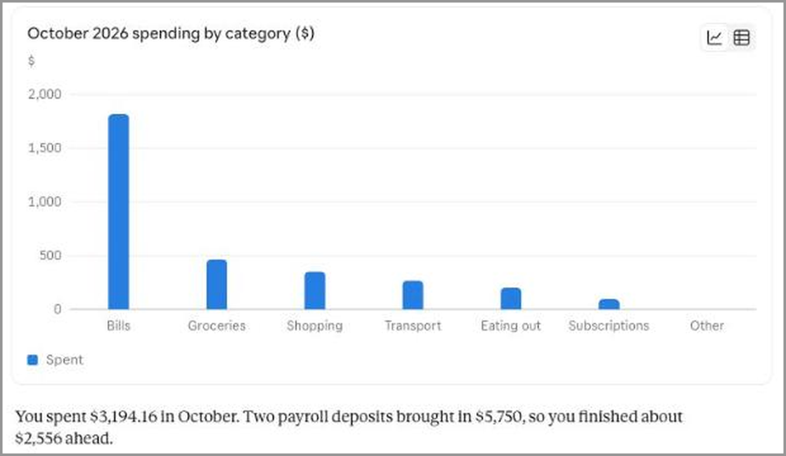
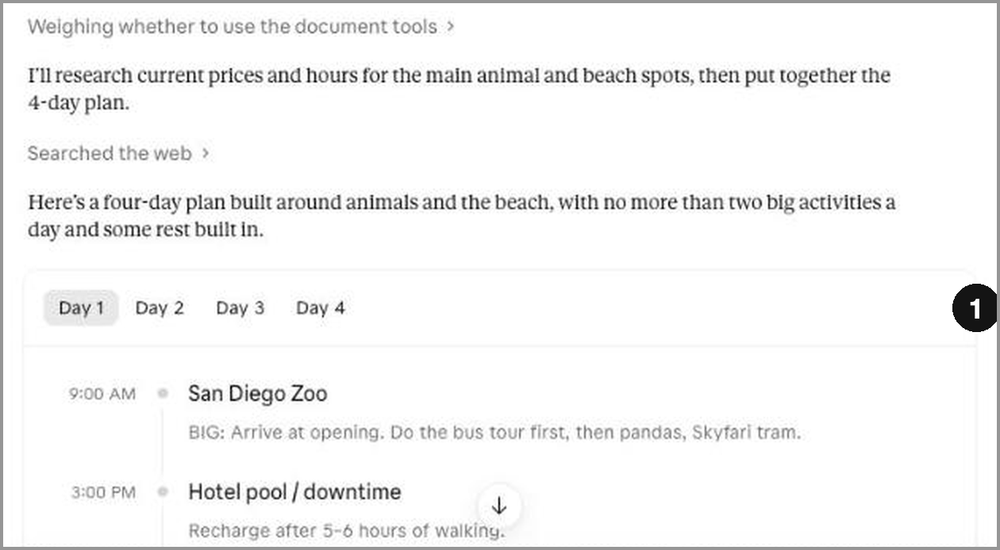

# Chapter 20: Home, Family and Money

The workflows in this chapter take the mental load out of running a household: what's for dinner, where the money went, how to plan the trip, and what to do when something breaks. Every request here says where I live, because prices, rules and recycling all depend on it.

## Workflow 31: A Week of Dinners and the Shopping List

**For:** anyone tired of deciding what's for dinner. **Time:** 3 minutes.

```prompt
We live in Ohio, USA. Plan 5 weeknight dinners for a family of four (two kids aged 7 and 11, one picky about spicy food). Under 40 minutes each, $120 total budget, one vegetarian night, and use leftovers from Monday in Tuesday's meal. Then give me one shopping list grouped by store section, with quantities. Answer here in the chat.
```

```result
5 Weeknight Dinners for a Family of Four

Everything is mild by default. Adults can add hot sauce or red pepper flakes at the table.

Monday: Sheet-Pan Chicken Thighs with Potatoes and Carrots (35 min)
[... method ...]
Set aside about 1 lb of cooked chicken (roughly 2 cups shredded) for Tuesday.

Tuesday: Chicken and Black Bean Quesadillas (20 min) (uses Monday's leftovers)
Wednesday (Vegetarian): Creamy Tomato Tortellini with Spinach (25 min)
Thursday: Mild Beef and Broccoli Rice Bowls (30 min)
Friday: Breakfast for Dinner (25 min)

[... a shopping list grouped by store section, with a price for each item ...]

Estimated total: about $113. That leaves roughly $7 of cushion. Ohio doesn't charge sales tax on grocery food, so you shouldn't see tax added on top.

Pantry staples to check before you go (not in the total): cooking oil, salt, pepper, garlic powder, paprika, cumin, Italian seasoning, ground ginger, cornstarch.

These prices are typical estimates for Kroger or Aldi. [...]
```

Saying "Ohio" got me local supermarkets and a sales-tax note I didn't think to ask for. **Make it repeatable:** Put your family's likes, dislikes and allergies in a "Meals" Project, then use Workflow 50 to get a plan every Sunday.

## Workflow 32: Where Did the Money Go?

**For:** a monthly spending check. **You'll use:** a CSV export from your bank, with account numbers removed, in a normal chat. **Time:** 5 minutes.

```prompt
This is last month's transactions exported from my bank (account numbers removed). Group the spending into categories (groceries, eating out, transport, subscriptions, shopping, bills, other), show a table with the total for each, and a simple chart. Then list every subscription or repeating charge, and any single purchase over $100. Finally, three realistic ways to save $200 next month based on what you see.
```

Claude drew the chart right in its answer:



```result
You spent $3,194.16 in October. Two payroll deposits brought in $5,750, so you finished about $2,556 ahead.

[... a table of the seven categories ...]

Subscriptions and repeating charges
- Streamflix, $15.99, charged twice (Oct 3 and Oct 24). Check this first. It's either a duplicate charge or a second account.
- TuneBox Music: $10.99 a month
- FitLife Gym: $49.00 a month
- CloudSave Storage: $2.99 a month
[...]

Three realistic ways to save $200 next month
- Limit shopping to $200 (saves about $150). Most of October's $351 came from two one-off purchases [...].
- Eat out at restaurants twice instead of four times, and halve the cafe visits (saves about $100). [...]
- Fix the Streamflix double charge and take transit instead of Ride Now (saves about $56). You already pay $98 for a transit pass, so the $40 in ride-shares was spent on top of it. [...]

Together these come to about $300, so you'd still reach $200 if one of them doesn't work out.
```

I checked every total against the file; they're all correct. The double streaming charge was hidden in 31 rows, and Claude found it. **Privacy first:** Before uploading, delete account numbers, or export only the date, description and amount. **Note:** In the US, paid plans can also link bank accounts through **Personal Finance** (a beta feature in late 2026). Read exactly what access you're granting before you link anything.

## Workflow 33: Plan a Trip Day by Day

**For:** vacations, family visits, weekend breaks. **Time:** 10 minutes.

```prompt
Plan 4 days in San Diego, California in mid-March 2027 for two adults and a 10-year-old who loves animals and the beach. We're renting a car, staying near Old Town, and don't want more than 2 big activities a day. Include one rainy-day backup, rough costs for tickets, and which things need booking in advance. Check current opening hours and prices online and give sources.
```

Claude searched the web, then laid the trip out as an interactive itinerary with a tab for each day:



1. **Day tabs.** Click a day to see its schedule.

```result
Prices below are current 2026 rates. 2027 prices may rise a few dollars, so treat them as estimates.

Rough ticket costs (2 adults + 1 child, age 10)
| Activity | Price | Family total |
| Zoo + Safari Park (2-Visit Pass) | $130 adult / $120 child | ~$386 with fees |
| Birch Aquarium (book ahead) | $34.95 / $29.95 | ~$100 |
| Whale-watching cruise | from $44 / $33 | ~$121 |
| Cabrillo National Monument | $20 per car | $20 |
[...]

Core total: about $660, or $740-830 with the kayak tour.

Zoo parking: The city is making parking free again across Balboa Park from January 1, but the Zoo is keeping its paid parking. [...]
```

Notice the honesty about time: the trip is in 2027, the prices are 2026's, and Claude said so. **Next:** "Turn this into a printable one-page itinerary" and "Make a packing list for the three of us as a checklist artifact." **Make it repeatable:** A trip Project where you add booking confirmations as you go.

## Workflow 34: Compare Plans and Bills

**For:** phone plans, internet, insurance, energy. **Time:** 5 minutes.

```prompt
Compare our current phone plan with two offers over 2 years for our family of four in the US, including device payments, fees and promotional prices that end. Show it in a table, then tell me which is cheapest over 2 years and what catches to watch for in each offer.

Current plan (BlueWave): 4 lines, $160/month including taxes and fees. No device payments left.
Offer 1 (Nimbus Mobile): 4 lines $100/month for the first 12 months, then $140/month. Taxes and fees about $18/month extra. $35 activation fee per line. Free phone for one line if we stay 24 months (worth $830, credited over 24 months).
Offer 2 (Pulse Wireless): 4 lines $130/month flat including taxes. $200 switching bonus after 90 days. Must have autopay and paperless billing, otherwise +$5 per line per month.
```

```result
Pulse Wireless is the cheapest over 2 years at about $2,920, which saves you roughly $920 compared with staying on BlueWave.

| Cost over 24 months | BlueWave (current) | Nimbus Mobile | Pulse Wireless |
| Plan, months 1-12 | $1,920 | $1,200 | $1,560 |
| Plan, months 13-24 | $1,920 | $1,680 | $1,560 |
| Taxes & fees | Included | ~$432 | Included |
| Activation fees | $0 | $140 | $0 |
| Switching bonus | - | - | -$200 |
| 2-year total | $3,840 | $3,452 | $2,920 |

Pulse stays cheapest even if you lose the autopay and paperless discount. That would add $20 a month, or $480 over 2 years, for a total of $3,400, which is still a little under Nimbus.

Catches with Nimbus Mobile
- Price increase in year 2: After the first 12 months, the bill rises to about $158 a month with taxes. That's almost the same as you pay BlueWave now, so all of Nimbus's savings come from the first year.
- The free phone ties you in: The $830 phone is usually set up as an installment plan, with a credit each month that cancels the payment. If you leave early, the credits stop and you owe the rest. Leaving after 12 months could mean paying about $415. [...]
```

I checked the arithmetic: every total is right. The phrase "over 2 years" is what exposes a first-year discount. **Make it repeatable:** Run this every time a contract or policy renews.

## Workflow 35: Declutter One Space at a Time

**For:** moving, downsizing, or just too much stuff. **Time:** 5 minutes to plan. (You can also attach photos of the space instead of listing what's in it.)

```prompt
Help me declutter our two-car garage in Denver, USA, over two Saturday mornings of 3 hours each. Here's what's in it: two adult bikes and one kid's bike outgrown 3 years ago, a broken treadmill, 14 cardboard boxes from our last move (unopened), old paint cans (about 10, half full), a lawn mower we use, garden tools, a box of baby clothes, camping gear we use twice a year, a dresser we don't need, 3 car tires, Christmas decorations, an old TV. Group everything into keep, donate, sell and recycle, suggest where each group should go (local donation, online selling, city recycling rules for paint, tires and electronics), and give me a simple order to work in so we see progress quickly.
```

Claude searched the web for Denver's rules first, then answered:

```result
Here's a two-Saturday plan, assuming your Saturdays are Nov 28 and Dec 5 and that you're on Denver city trash service.

| Group | Items |
| Keep | Lawn mower, garden tools, camping gear, Christmas decorations, adult bikes (only if someone rode them this year) |
| Sell | Dresser, adult bikes you don't ride, kid's bike (if in good shape) |
| Donate | Baby clothes, kid's bike, dresser if it hasn't sold in 2 weeks |
| Recycle/dispose | Paint, tires, TV, broken treadmill, flattened boxes |

The 14 moving boxes go in a "decide" group until you open them. Their contents will end up split across all four groups.

[... named local donation places, with addresses and opening times ...]

Paint (about 10 cans): Paint, hardware and home improvement stores that join the PaintCare program take leftover paint for free. Use the locator at paintcare.org to find one near you. [...]
```

The best idea here wasn't on my list: the 14 unopened boxes can't be sorted until they're opened, so they get their own "decide" group. **Next:** For the "sell" items: "Write short, honest listings for these with a fair asking price."

## Workflow 36: Fix Something That's Broken

**For:** an appliance error code, a leaking tap, a router that keeps dropping. **Time:** 5 minutes.

```prompt
My dishwasher shows error code E24 and there's water left in the bottom. Walk me through what to check, simplest first, with one step at a time. Wait for me to say what I see before moving to the next step. Tell me clearly when it's time to stop and call a technician.
```

```result
Claude: E24 is a drain error on Bosch, Siemens and Neff dishwashers: the machine couldn't pump the water out. If yours is a different brand, tell me, since the code may mean something else.

Step 1: Check the drain hose for kinks
- Turn the dishwasher off.
- Open the cabinet under your kitchen sink and find the ribbed grey hose running from the dishwasher to the sink drain pipe (or garbage disposal, if you have one).
- Follow it as far as you can and look for any spot where it's bent sharply, flattened, or squashed by items stored in the cabinet. [...]

Tell me what you find: was the hose kinked or squashed, and did the error come back?

Me: It's a Bosch. The hose looks fine, no kinks. Error is still there.

Claude: Good, that rules out the hose. Next is the most common cause on Bosch machines.

Step 2: Clean the filter
- Make sure the dishwasher is off.
- Pull out the bottom rack completely.
- Lay towels in front of the machine. The standing water will make this a bit messy [...]
- Look into the hole where the filter sat, and carefully feel for anything stuck there, like food, a label or broken glass. Go gently in case there's glass. [...]
```

"One step at a time, wait for me" turns a wall of instructions into a guided repair, and Claude worked out the likely brand from the error code alone. **Safety Tip:** For anything involving gas, mains electricity or structural work, use Claude to understand the problem and prepare questions, then call a qualified professional.

## Workflow 37: Plan a Party or Family Event

**For:** birthdays, reunions, holidays, retirement parties. **Time:** 10 minutes.

```prompt
Help me plan my mom's 70th birthday lunch for 25 people in our backyard in Austin, Texas on Saturday 8 May 2027, budget $800. She loves gardens and 1970s music. Give me: a timeline from 6 weeks out to the day, a menu that can mostly be made ahead, a playlist of 20 songs, and a one-page run-of-show for the day itself. Skip the shopping list for now. Answer here in the chat.
```

```result
Here's the full plan. One thing worth knowing up front: May 8, 2027 is the day before Mother's Day, so bakeries and florists will be slammed that week. That's why the cake and flowers are ordered early in the timeline below.

Rough budget ($800)
| Category | Amount | Notes |
| Food | $340 | Menu below is built around budget proteins and seasonal produce |
| Drinks + ice | $110 | Agua fresca, tea, one bottle of bubbly per ~6 guests for the toast |
| Rentals | $180 | 25 chairs, 3-4 tables, linens. Borrow pop-up canopies rather than rent a tent |
| Cake | $75 | Order from a local bakery |
| Garden decor and flowers | $65 | Potted herbs and flowers that double as take-home favors |
| Contingency | $30 | Extra ice, forgotten items |

Timeline

6 weeks out (Sat, Mar 27)
- Finalize the guest list and send invites with an RSVP deadline of Apr 24.
- Book chair and table rentals now. Early May is graduation season in Austin, so stock goes fast.

[... the rest of the timeline, a make-ahead menu, 20 songs from the 1970s and a minute-by-minute run-of-show ...]
```

Two things I never mentioned, Mother's Day and graduation season, would both have caught me out. That's what local, dated context gets you. **Make it repeatable:** A Project for the event holds the guest list and RSVPs, so you can ask "Who still hasn't replied?" or "Scale the menu to 32 people."

## Workflow 38: Thoughtful Gift Ideas Within Budget

**For:** birthdays and holidays when you're stuck. **Time:** 3 minutes.

```prompt
Give me 10 gift ideas for my brother-in-law, 45, who loves fly fishing, cooks a lot of barbecue, and already "has everything." We're in the US. Budget $50 to $80. Mix of things to buy and experiences. For each, one line on why he'd like it, and check online that it's available at that price.
```

Claude searched the web and checked each price:

```result
Here are ten ideas, all within $50-80. Prices were checked online today, but Black Friday is tomorrow, so some may drop or change.

Things to buy

Postfly Guide Series fly box (~$50). He gets 20+ guide-picked flies he didn't choose himself, which is hard to "already have." [...]

ThermoWorks Thermapen ONE (~$59 on sale). It's the instant-read thermometer serious pitmasters use, and it's rarely this cheap. [...] Skip this one if he already owns a Thermapen.

Meat Church Fab 5 rub gift box (~$65). These are rubs that competitive BBQ cooks swear by, and he'll use every bottle. [...]

[... seven more ideas, including experiences, each with its source ...]
```

"Skip this one if he already owns a Thermapen" is the kind of judgment that makes the list usable. **Next:** "Write a short, funny card message to go with the fly box." **Make it repeatable:** Add family members' interests to a "Gifts" Project and you're set for every birthday.
