# Chapter 21: Build Useful Tools Without Code

In Chapter 8 you built a tip calculator in one request. This chapter gives you eight more tools that people actually keep using. Each one is an artifact or a file: you describe it, Claude builds it, and you can use it, change it, share it, or install it as an app on your computer. All eight were built in normal chats, because incognito chats can't save artifacts or files.

**The recipe for every tool:** say who uses it, what they type or tap, what they should see, and one or two rules for how it should look. Then test it like a real user and ask for fixes.

## Workflow 39: A Habit Tracker

```prompt
Build a habit tracker I can use every day. I want to track 5 habits I can rename (start with: walk 30 min, read 20 pages, no phone after 10pm, drink 8 glasses of water, stretch). Show this month as a grid I can tap to tick. Show my current streak for each habit and a percentage for the month. Remember my ticks between visits. Clean, calm design, big tap targets for a phone. Use US spelling.
```

```result
I've built your habit tracker as a page you can open on your phone each day. It starts with your five habits, and the Rename button lets you change any of them.

- Grid: This month is shown one row per day, with one big square per habit. Tap a square to tick it and tap again to untick it. Today's row is highlighted, and you can't tick days that haven't happened yet. The arrows let you look back at earlier months.
- Summary: A card for each habit shows your current streak and your percentage for the month. The percentage only counts days up to today, so you don't start the month looking behind. A streak stays alive until the end of the day even if you haven't ticked today yet.
- Saving: Your ticks are saved to your account, so they'll still be there on your next visit. [...]
```

Two thoughtful details I never asked for: the percentage only counts days so far, and today's streak doesn't "break" before the day is over. **Test it:** tick a few days, close it, reopen it. Do your ticks stay?

## Workflow 40: A Family Chore Chart with Points

```prompt
Make a chore chart for our two kids, Maya (9) and Leo (6). Chores: make bed (1 point), set table (2), feed the cat (2), tidy toys (1), help with laundry (3). Each kid has a column; tap a chore to give points. Show a weekly total and a progress bar toward a reward at 30 points. Big, colorful and easy for a 6-year-old to read. A "new week" button resets the points. Use US spelling.
```

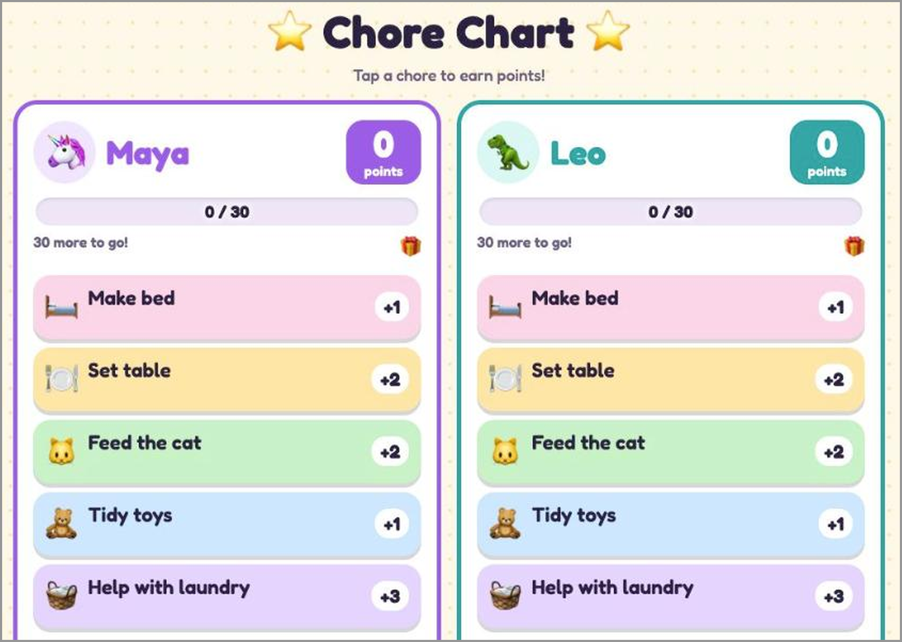

```result
I've made Maya and Leo's chore chart and published it as a page. I checked that its code has no syntax errors, but I haven't opened it in a browser or tapped through it, so try a few taps when you first open it.

- Layout: each kid has a column (purple for Maya, teal for Leo) with a big points total. Below that is a progress bar toward 30, a gift box at the end, and a "more to go!" count.
- Chores: each one is a large colored button with a picture and its points [...]. A tap adds the points and floats a "+2" up the screen.
- Reaching 30: confetti falls and that kid's column shows "Reward time!"
- Oops! Undo last: I added this button to each column because little fingers mis-tap. You can drop it if you'd rather not have it.
[...]
```

The "Undo last" button is the kind of thing you only think of after the first tantrum. **Tip:** Install it as an app on the family computer (Chapter 8) so the kids can open it themselves.

## Workflow 41: A Party Quiz Game

```prompt
Make a trivia game for our family holiday party: 4 rounds (movies, music, geography, family history) of 5 questions each, multiple choice, playable on a TV screen from a laptop. Two teams take turns; show the score at the top. Big text, fun reveal animation for the right answer. For the family history round, use these facts: Grandpa Joe was born in 1948 in Duluth, Minnesota; Aunt Rosa ran the Chicago Marathon in 2019; our family dog Biscuit was a beagle; Mom and Dad got married at Lake Tahoe in 1996; cousin Theo has a pet tortoise named Speedy. Use US spelling.
```

```result
Your trivia game is ready. Open it on the laptop, connect the laptop to the TV, and press F for full screen.

How it plays:
- Each team types its name on the start screen.
- The teams take turns, one question each, so each team gets 10 of the 20.
- The scoreboard stays at the top and lights up for whichever team's turn it is.
- To answer, click a choice or press 1-4 or A-D. Press Enter to go to the next question.
- After each answer there's a short pause. Then the right answer grows and glows gold. A correct answer also fires confetti and plays a chime, and the team gets +100. A wrong answer shakes and buzzes. [...]

Family History round: all six of your facts are in. Grandpa Joe's birth year is part of the question about his birthplace, and the wedding year is in the question about where Mom and Dad married. The last geography question is a small hint toward Grandpa Joe's hometown.
```

I gave five facts, not six; a small slip, and harmless here, but a reminder to read Claude's summary against what you actually asked for. The family-history round is the part of this game you can't buy in a shop.

## Workflow 42: A One-Page Event Website

```prompt
Make a simple one-page website for our neighborhood's summer block party: Saturday 19 June 2027, 3 to 8pm, Linden Street in Madison, Wisconsin (closed to cars). Sections: what's happening (bouncy castle, potluck, live band at 6pm), what to bring, a map description, a FAQ (pets, parking, rain plan) and a contact email (lindenstreetparty@example.com). Bright summer colors, readable on a phone.
```

Claude built this one with **Claude Design**, which opens the page on a design canvas where you can keep editing it:

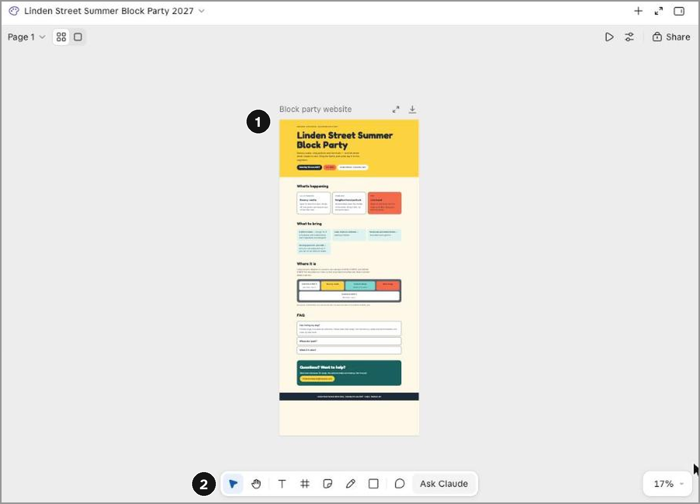

1. **The page**, shown small on the canvas. Click to zoom in or preview it.
2. **Editing tools** and **Ask Claude**, for changing anything on the page.

```result
I've built the block party page with all the sections you asked for. It's private until you share it.

The look is sunny yellow, coral and teal with big, rounded headings. On a phone, the cards and the street layout stack into a single column. The FAQ answers open with a tap, and the contact button opens an email to lindenstreetparty@example.com.

Things to check before you share it:
- Text to fill in: I left a few marked spots like [CROSS STREET], [RAIN DATE] and the restroom [LOCATION]. They're for details I didn't have.
- Street layout: the "Where it is" diagram puts the bouncy castle at one end, the potluck tables in the middle and the band at the other end. That's my guess, so move things around if your plan is different.
- Wording I made up: these are my suggestions, so change any that don't match what the organisers decided: leashed dogs are welcome; people park on nearby streets [...]
```

Claude marked what it didn't know instead of inventing it. **Check First:** Don't put home addresses or phone numbers on a public page; use a group email instead.

## Workflow 43: A Loan Calculator That Shows the Real Cost

```prompt
Build a loan calculator in US dollars: I enter the amount, the interest rate and the term in years. Show the monthly payment, the total interest paid, and a chart of how much of each year's payments goes to interest versus the loan. Add a box for "extra payment per month" that shows how many months and how much interest it saves. Explain each number in one plain sentence underneath. Start it with a $25,000 loan at 7.5% for 5 years.
```

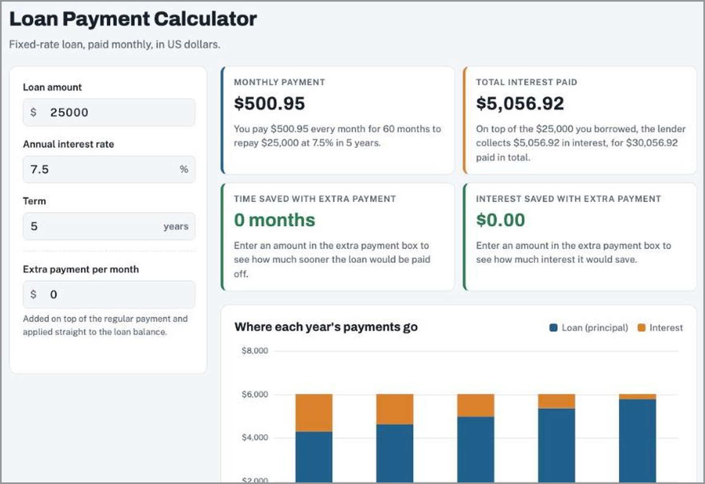

```result
For that loan:
- Monthly payment: $500.95, paid for 60 months.
- Total interest: $5,056.92, so you pay $30,056.92 in all.
- Chart: in year 1, about 29% of what you pay goes to interest. By year 5 that drops to about 4%, because interest is charged on a smaller balance each year.
- Extra payment: this box starts at $0. As an example, an extra $100 a month pays the loan off in 49 months instead of 60, which is 11 months sooner and saves $1,013.61 in interest.
```

I checked every number with my own calculation: all four are exactly right. **Remember:** this helps you understand options; your lender's official figures are the ones that count.

## Workflow 44: An Interactive Chart from Your Spreadsheet

I attached a CSV of a bakery's monthly sales and sent:

```prompt
Here's our small bakery's sales by month for 2025 and 2026, by product, in US dollars. Make an interactive chart: I can pick a product and see both years side by side, hover for exact numbers, and see the growth percentage. Below it, a short table of the three best and three worst months.
```

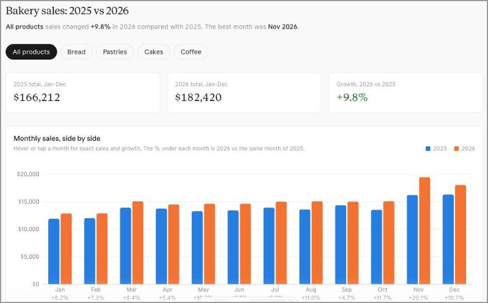

```result
I've built your sales chart as a page. Across all products, sales went from $166,212 in 2025 to $182,420 in 2026, up 9.8%. Cakes and coffee grew fastest (+10.2% each), and bread and pastries grew +9.3%.

- Product picker: choose All products, Bread, Pastries, Cakes or Coffee. The chart, the yearly totals and the growth figure all change to match. I added "All products", which adds the four together.
- Chart: for each month, the 2025 bar sits beside the 2026 bar. Hover over or tap a month to see the exact dollar amounts and its growth. [...]
- Best and worst months: two short tables with the top three and bottom three of all 24 months for the chosen product. [...]

Anyone you share the page with can also download the full sales file from it. [...]
```

The yearly totals match the spreadsheet exactly. Note the privacy warning in the last line: sharing the page shares the data too.

## Workflow 45: A Reading Log or Collection Tracker

```prompt
Build a reading log. I add a book with title, author, date finished, a 1 to 5 star rating and a one-line note. Show my books as cards with the newest first, a counter for books this year against a goal of 24, and a search box. Remember everything between visits. Let me export my list as a spreadsheet. Use US spelling.
```

```result
Your reading log page is ready. It's saved to your account, so your books will still be there on any device where you're signed in to Claude. The list is private to you, even if you share the page later.

- Adding a book: enter the title, author, date finished, a rating (click the stars) and a one-line note. The date is set to today to start with.
- Cards: your most recently finished book is always first, and each card has a Delete button that asks you to confirm.
- Yearly goal: the counter at the top shows how many books you've finished this year out of 24, with a progress bar. It counts by the date you finished each book.
- Search: finds matches in the title, author or note as you type.
- Export: the "Export to spreadsheet" button downloads an Excel file (.xlsx) with all your books, newest first.
```

Swap "book" for wine, plants, recipes, records or hikes, and you have a tracker for any hobby.

## Workflow 46: A Printable Weekly Planner

```prompt
Design a printable weekly planner page as a PDF, US Letter size: the week's dates across the top (Monday start), a box for each day with lines, a top-3 priorities box, a small habit-tick row, and a notes area. Minimal black-and-white design so it prints well on a home printer. Make 4 weeks starting Monday 4 January 2027.
```

Partway through, Claude looked at its own first draft, said "Character spacing from the title leaks into the date range (it runs off the page). Fixing that and darkening the notes dots so they show up on a home printer," and fixed both. The result:

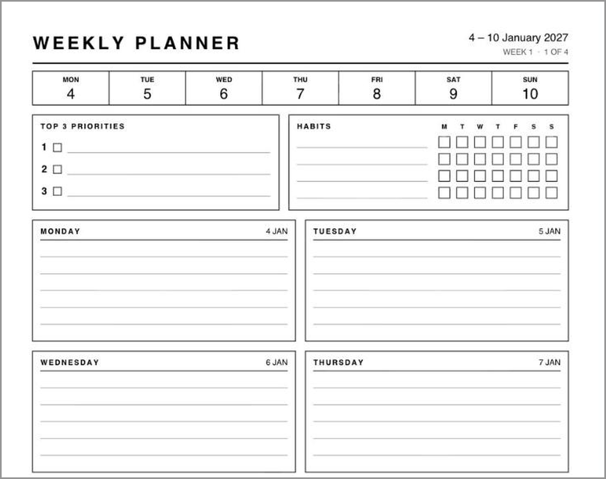

```result
I've made your planner: Weekly_Planner_Jan_2027.pdf has four US Letter pages, one for each week from Monday 4 January to Sunday 31 January 2027. [...]

It's black, white and grey only, with no filled areas, so it won't use much ink. The 0.5-inch margins sit inside what home printers can print. Print it at "Actual size" rather than "Fit to page" so the boxes keep their spacing.
```

## Bonus Project: A Café Brand Kit in 3D

With the Blender extension from Chapter 12, Claude can do creative work too: 3D models, animation, product images, illustration and a website to show them off. To show you what's realistic, I made a complete small brand kit for an imaginary café, Harbor Beans, in one sitting in the Claude desktop app with Blender open beside it. Every picture below is the real result. Claude has no built-in photo generator, so the "images" come from two places: 3D renders made in Blender, and vector drawings Claude writes itself.

### Step 1: A 3D Model

```prompt
In Blender, build a product mockup of a coffee mug for my café, Harbor Beans: a teal ceramic mug with a cream stripe around the middle and the name HARBOR BEANS raised on the stripe, coffee inside, on an oak table against a plain wall. Add soft studio lighting and a camera. Keep the default camera and light, and name every object clearly. Check a test render before you finish.
```

Claude built the mug piece by piece: the body, the handle, the stripe, the lettering wrapped around the curve, the coffee, the table and the lights. Then it rendered a small test image and looked at it. The first test showed the coffee floating above the mug and the edge of the wall showing, so it fixed both before going on. In Blender, everything it made appears as normal, named objects you can select and change by hand:

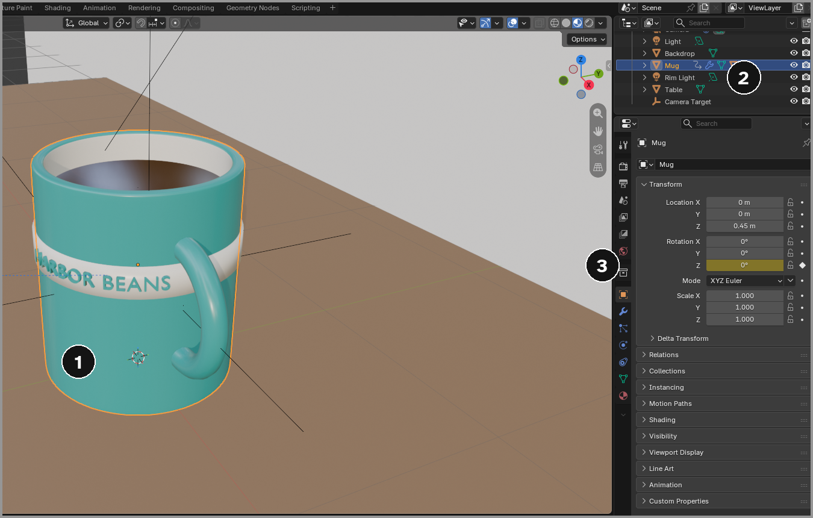

1. **The model** in Blender's 3D view, which you can turn and zoom with the mouse.
2. **The object list.** Claude named everything (Mug, Table, Backdrop, Rim Light), so you can find and change any part yourself.
3. **Rotation Z**, shown in yellow because it's animated. You'll see why in Step 3.

> **Tip:** Ask Claude to "check a test render" in every Blender request. Claude can see the picture it renders, so it catches its own mistakes.

### Step 2: A Product Image

```prompt
Render the mug as a high-quality 1600 x 1200 product photo for my website and save it with the Blender file.
```

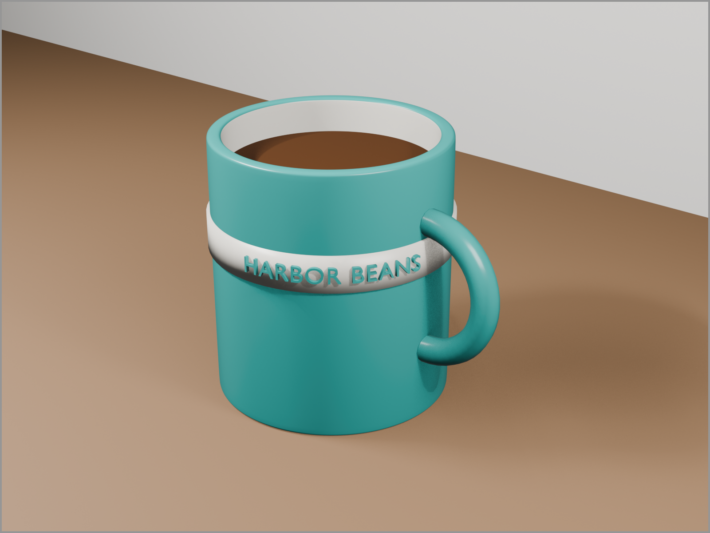

That's a usable website or catalog picture of a product that doesn't exist yet, made without a photographer.

### Step 3: An Animation

```prompt
Make a 3-second turntable animation: the mug spins once, smoothly, at a steady speed, so it loops without a jump. Render it as an MP4 video and a small GIF for social media.
```

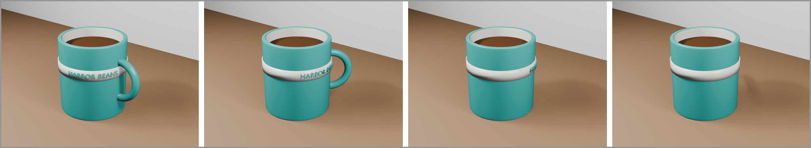

Claude added two keyframes (the start and end of one full turn), set a steady speed so the loop is seamless, and rendered all 72 frames in about a minute and a half. Then it joined them into a video.

### Step 4: An Illustration

This step needs no Blender at all. Claude drew the logo itself as a vector image, which stays sharp at any size, from a business card to a sign:

```prompt
Draw a round logo badge for Harbor Beans as an SVG: teal and cream, the name curved around the top, "COFFEE · EST. 2027" around the bottom, and a simple steaming mug above a wave in the middle. Flat style, no gradients, so it prints well.
```

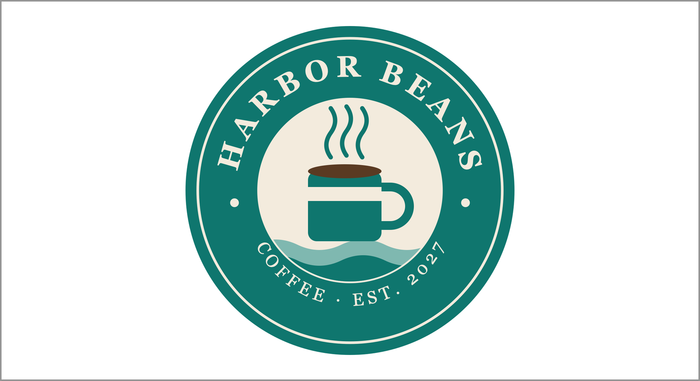

### Step 5: A Professional Website

```prompt
Build a one-page website for Harbor Beans using the product render, the turntable video and the logo: a header with the logo, a big headline, a section about the mug, three menu favorites with prices, and opening hours. Warm, calm design, gentle animations as you scroll, and it must work on a phone.
```

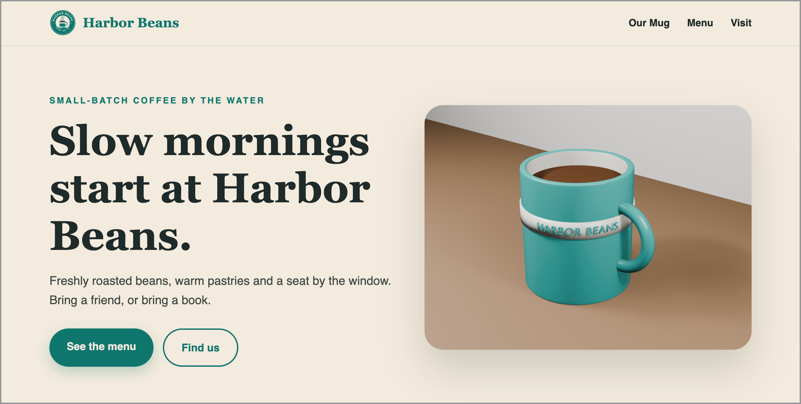

The finished page has a sticky header, sections that fade in as you scroll, the spinning mug playing on a loop, and a layout that stacks into one column on a phone. Ask Claude to publish it as an artifact (Chapter 8) to share the link.

> **Check First:** What Claude makes in Blender is real 3D work, but keep expectations sensible. Clean, simple objects like products, logos, furniture and room layouts come out well. Lifelike people, animals and detailed characters still need a 3D artist. And always replace sample prices, hours and email addresses with your own before you publish.

## Bonus Project: Make Your Own Game

Workflows 30 and 41 were simple quiz games. Claude can also build a real arcade game, with movement, collisions, scoring, rising difficulty and sound, from one description. To keep the café theme going, I asked for a game about Harbor Beans' delivery boat, in a normal chat:

```prompt
Make an original arcade game I can play in the browser, called Harbor Run. You steer a little delivery boat left and right across the harbor while the water scrolls toward you. Collect coffee crates for points and dodge buoys and rocks. Every 30 seconds it gets a bit faster. 3 lives, a title screen, a pause button, sound on/off, and a "Game over" screen with my score and best score (remember the best score between visits). Controls: arrow keys or A/D on a computer, and tapping the left or right side of the screen on a phone. Bright, friendly cartoon style drawn in code, no images needed. Use US spelling.
```

Claude worked for about five minutes. Along the way it took its own screenshots of the game at computer and phone sizes, early and late in a round, to check how it looked. Then it published the game as an artifact:

```result
I've built Harbor Run and published it as a page you can open in any browser on your computer or your phone. I tested it at desktop and phone screen sizes, and steering, scoring, pausing and the game over screen all worked. I didn't test it on a real touchscreen, so phone tapping is the part to check first.

- How it plays: your little red delivery boat steers smoothly left and right between stone harbor walls while the water scrolls toward you. On a wide screen there are wooden docks with barrels and crates on both sides.
- Points: each coffee crate is worth +10. You also earn a few points for every second you stay afloat, and that bonus goes up as the speed level rises. I added this so surviving longer counts too, even when you miss crates.
- Hazards: buoys and rocks each cost one life (some rocks have a seagull sitting on them). After a hit you get a short moment where you flash and can't be hit again.
- Speed: every 30 seconds a "Faster!" banner pops up and the water speeds up. More obstacles start appearing as well.
- Controls: arrow keys or A/D to steer. P or Esc pauses, M turns sound on or off, and Space starts or restarts. On a phone, press and hold the left or right half of the screen to steer.
- Saved settings: the browser remembers your best score and your sound setting between visits. [...]

The game also pauses automatically if you switch tabs or apps.
```

Then I played it:

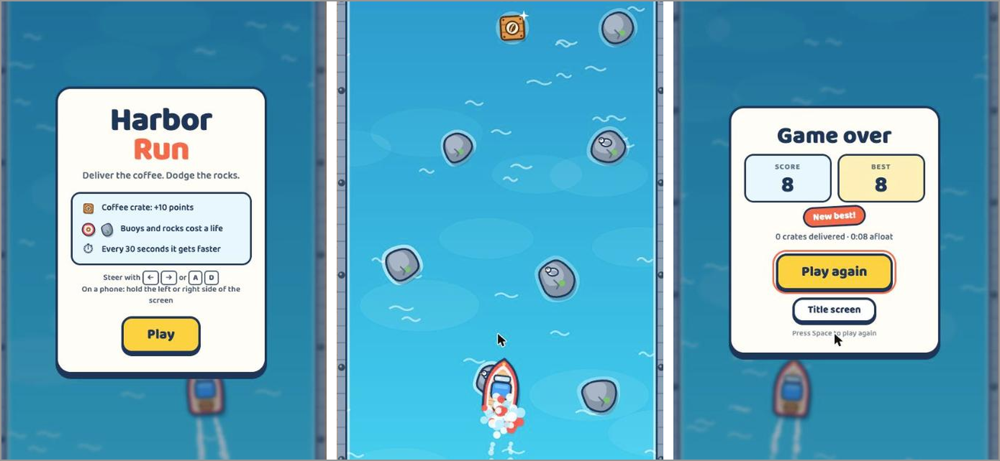

My first round lasted eight seconds, which says more about my steering than the game. Notice the extras I never asked for: points for staying afloat, a moment of safety after a hit, seagulls on the rocks, and an automatic pause when you switch tabs.

**Improve it by playing it.** Games get better one request at a time, the same way as any other tool. Play a few rounds, then ask for what's missing:

```prompt
It's too hard at the start. Make the first 20 seconds easier with fewer rocks, add a gold crate worth 50 points that appears now and then, and add a short shield power-up that protects the boat from one hit.
```

**Taking it into 3D.** For a game made in a game engine such as Godot or Unity, Claude can make the 3D models too, through the Blender connector. Here I asked for a game-ready version of the delivery boat:

```prompt
In Blender, make a low-poly version of the Harbor Run delivery boat for a game: red hull, white cabin with a teal roof, a chimney and three coffee crates on deck. Keep it simple, under 100 faces, with clear names for every part. Render a preview on blue water, then export only the boat as a .glb file for a game engine.
```

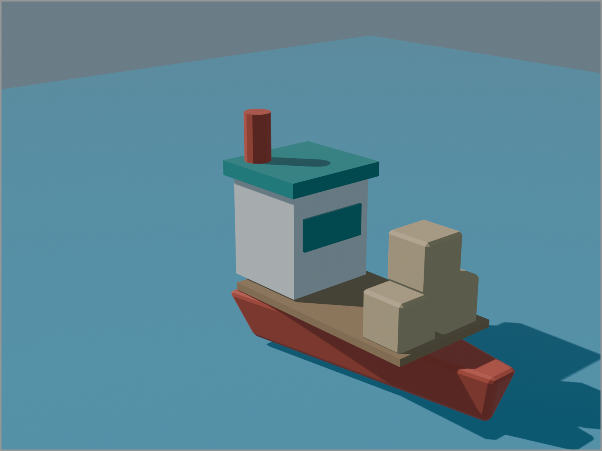

The boat came out at 62 faces, light enough for any game, and the .glb file opens directly in Godot and most web 3D tools. Unity and Unreal Engine import it with their glTF add-ons.

> **Check First:** Make games your own. Ask for an original game "in the style of" a genre (racing, puzzle, platformer), not a copy of a famous game, its characters or its music. Those belong to their makers, and you can't share or sell a copy.

## When a Tool Doesn't Work

Several of these answers ended with the same honest note: Claude had checked the code but hadn't clicked through the tool itself. So test it. If a button does nothing or a number looks wrong, tell Claude exactly what you did and what happened:

```prompt
When I tap "new week," Leo's points reset but Maya's don't. Please fix it, and check the other buttons for the same problem.
```

Describing what you tapped and what you expected is all Claude needs. You never need to look at the code.
