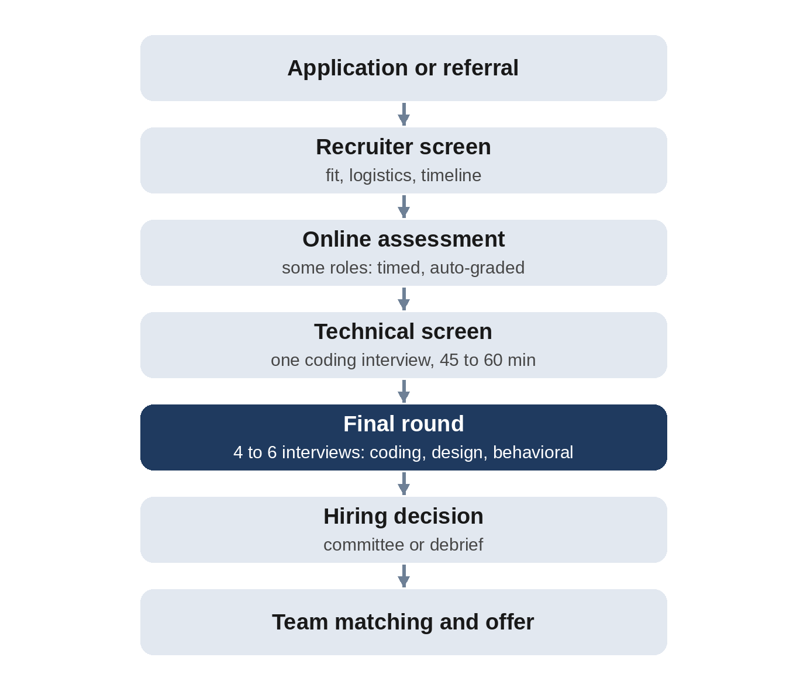

# Part I: Getting Ready

# Chapter 1: How Top Tech Companies Interview

Before you practice a single problem, it helps to know what you are practicing for. Large technology companies differ in the details, but their software engineering interviews share a common shape, and they look for the same handful of qualities. This chapter describes that shape, what each company says it is looking for, and how interviews have changed with the spread of AI tools.

## The Typical Pipeline

For most software engineering roles at large technology companies, the process looks something like this:

1. **Application or referral.** A referral from a current employee usually gets your résumé read sooner, but it doesn't skip any interviews.
2. **Recruiter screen.** A 20- to 30-minute call about your background, the role and the process. Ask your recruiter what the rounds will be and how to prepare; they want you to succeed.
3. **Online assessment.** Some companies, especially for new graduates and interns, send a timed set of coding problems to solve on your own.
4. **Technical screen.** One or two interviews of about 45 to 60 minutes, by video, with an engineer and a shared code editor. Usually one or two coding problems.
5. **The final round, or "onsite" loop.** Four to six interviews, often on one day, in person or by video. For most software roles: two or three coding interviews; a system design interview for mid-level and senior candidates; and a behavioral interview about how you work with others.
6. **The decision.** Each interviewer writes feedback independently. At some companies a hiring committee of people who did not interview you makes the decision; at others, the interviewers and hiring manager meet in a "debrief".
7. **Team matching and offer.** Some companies hire into a specific team; others hire first and match you with a team afterwards.

The whole process typically takes from three weeks to two months.

## What Interviewers Are Looking For

Every company has its own rubric, but four qualities appear again and again in what companies publish for candidates:

- **Problem solving.** Can you take a vague problem, ask good questions, find an approach, and improve it?
- **Coding.** Can you turn the idea into correct, readable code, in a reasonable time, without an IDE doing the work for you?
- **Verification.** Do you test your own code, find your own bugs and think about edge cases?
- **Communication.** Can the interviewer follow your thinking? Do you explain trade-offs, and do you take hints well?

Notice that only one of the four is "getting the right answer". Meta's guidance for candidates says this directly: the way you solve problems can be as important as the answer, and a working but non-optimal solution beats fragments of an optimal one that you didn't finish. Google's long-standing advice to candidates makes the same points: think out loud, ask clarifying questions, state your assumptions and discuss trade-offs.

> **Interviewer's View:** An interviewer has to write down evidence for every rating they give. "The candidate explained why a hash map makes this O(n), tested the empty list without being asked, and found their own off-by-one bug" is strong evidence. A silent candidate who types a correct answer leaves the interviewer with almost nothing to write.

## What the Companies Say

Companies publish a surprising amount of advice for candidates. The table summarizes the main points, with the type of source; always check the current version of each company's pages and ask your recruiter.

| Company | Key points | Source |
| --- | --- | --- |
| Meta | Review core data structures and big-O; practice without autocomplete and under a time limit; talk through your approach. Select roles now include an authorized AI assistant in some technical interviews, with a practice environment provided in advance | Meta careers site: interview preparation pages and hiring process page |
| Amazon | Behavioral questions are based on Amazon's 16 Leadership Principles; answer with the STAR method; for software roles, roughly half the process is technical; a "Bar Raiser" from outside the hiring team helps protect the hiring standard | Amazon's official interview guides on aboutamazon.com and amazon.jobs |
| Google | Think out loud, ask clarifying questions, state assumptions, discuss trade-offs; decisions are made by a hiring committee; in 2025 Google said it was bringing back at least one in-person interview round for some roles, partly because of concerns about AI-assisted cheating in virtual interviews | Google's candidate guide; reported remarks by Sundar Pichai in 2025 |
| Apple | Expect open-ended questions about your past work; bring specific examples; ask about the team and how success is measured | Apple careers interview tips |
| Microsoft | Recruiters single out fundamental coding skills as one of the hardest parts of the interview; know the technical skills the role requires | Microsoft's careers blog |
| SpaceX | Candidates commonly report a strong emphasis on C++ for many software roles, timed or take-home coding tests, and practical, engineering-flavored problems such as parsing data or modelling state machines | Candidate reports (no official guide found); treat as anecdotal |

Two lessons stand out. First, the core skills are the same everywhere: data structures, algorithms, clean code and clear communication. Second, each company adds its own emphasis. Amazon weights behavioral questions heavily, hardware and aerospace companies often care more about C++ and systems knowledge, and some companies now test how well you work *with* an AI assistant.

## Coding Interviews in the Age of AI

AI coding tools have changed interviews in two opposite directions.

- **More in-person rounds.** Because a candidate in a video interview could secretly paste a problem into an AI assistant, several large companies have brought back in-person interviews for some rounds. Google's chief executive Sundar Pichai said in 2025 that the company would add at least one in-person round for some roles.
- **AI-assisted rounds.** Other companies have gone the other way, and made AI part of the test. Meta says that select roles now include an authorized AI assistant in some technical interviews. Candidates who have taken these rounds describe a longer, multi-step task in a small codebase, where they are judged on how well they guide the assistant, check its output and explain the code. Chapter 27 covers how to prepare for these formats.

Either way, the fundamentals matter more, not less. In an in-person round, you need them because there is no assistant. In an AI-assisted round, you need them to tell whether the assistant's code is correct.

## New Graduates, Experienced Engineers and Senior Roles

Expectations scale with the level of the role:

- **Interns and new graduates** mostly face coding interviews, often with an online assessment first, plus a short behavioral conversation.
- **Mid-level engineers** add a system design interview, and are expected to code faster and more cleanly.
- **Senior and staff engineers** face harder system design, deeper behavioral questions about leadership and conflict, and sometimes a project deep-dive about past work. Coding interviews are still there, and still matter.

## How to Use This Book

- **If your interview is in two weeks or less**, read Chapters 2 to 4, then do the first three problems of each pattern chapter, and one mock interview. Chapter 29 has a two-week plan.
- **If you have six weeks**, work through Part II in order, solving every problem before reading the solution, then Part III and the mock interviews.
- **If you are aiming at senior roles**, give extra time to Chapters 24 to 26 on design and behavioral interviews.

## Key Takeaways

- Most software interviews at large technology companies follow the same pipeline: recruiter screen, technical screen, a final loop of four to six interviews, and a collective decision.
- Interviewers assess problem solving, coding, verification and communication, not just the final answer.
- Companies publish useful guidance; use it, and ask your recruiter about the exact format.
- AI has led to both more in-person rounds and new AI-assisted rounds. In both, strong fundamentals are what count.

## Sources and Further Reading

- Meta Careers, "Preparing for your software engineering interview at Meta"; "Preparing for your technical screen"; "Preparing for your full loop interview"; "Hiring process". metacareers.com
- Amazon, "Your complete guide to the Amazon interview process"; "Exploring Amazon's unique interview process" (the Bar Raiser program); "What's it like to interview at Amazon?". aboutamazon.com; amazon.jobs/content/en/how-we-hire
- Google, "Preparing for Google technical internship interviews" (candidate guide). services.google.com
- Reports of Sundar Pichai's remarks on in-person interviews, 2025, for example CXO Digital Pulse, "Google Reinstates In-Person Job Interviews Amid Rising AI Cheating Concerns".
- Apple Careers, "Interview tips". apple.com/careers/us/interview_tips.html
- Microsoft, "How to land a job at Microsoft". news.microsoft.com/life
