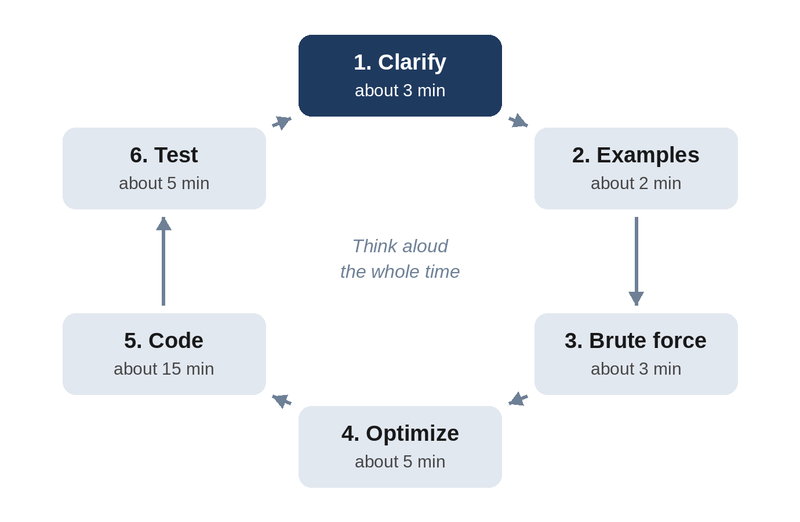

# Chapter 2: A Six-Step Method for Any Coding Problem

Strong candidates don't solve problems faster because they are smarter. They solve them faster because they never wonder what to do next. They follow a routine, the same one every time, and it carries them through problems they have never seen. This chapter gives you that routine: six steps you can use for every coding problem in this book and in your interviews.

## Step 1: Clarify

Interview problems are often deliberately vague. Before you think about a solution, make sure you are solving the right problem. Restate it in your own words, then ask about:

- **Inputs:** What types? Can the list be empty? Can numbers be negative, or repeated? How large can the input be?
- **Outputs:** Exactly what should be returned? What if there is no answer: an empty list, -1, an exception?
- **Rules:** Can I modify the input? Is the input sorted? Are there several valid answers, and if so, does it matter which?

The size of the input is the most useful question of all, because it tells you how fast your solution must be. Chapter 3 explains how to turn "up to 100,000 items" into "I need roughly O(n log n) or better".

> **Tip:** Write the answers to your questions at the top of the editor as a comment. It shows the interviewer you are organized, and stops you forgetting a rule halfway through.

## Step 2: Examples

Work through one or two small examples by hand, including at least one tricky case. Examples do three jobs: they confirm that you understood the problem, they often reveal the solution's key idea, and they become your test cases at the end.

Good examples are small (four to six items) but not trivial, and they include an edge case: an empty input, a single item, all items equal, or no valid answer.

## Step 3: Brute Force

State the simplest correct solution, even if it is slow, and give its complexity: "I could try every pair, which is O(n²)." You usually don't need to code it. Saying it out loud proves that you can solve the problem at all, gives you a fallback, and gives you something to improve.

## Step 4: Optimize

Now look for a better approach. Ask yourself:

- **What work does the brute force repeat?** Can a hash map, a running total or a sorted order remember it instead?
- **Which pattern does this look like?** The signals listed at the start of each chapter in Part II are designed for exactly this moment: "longest block of a string or list that satisfies a rule" suggests a sliding window, while "longest run of consecutive values in an unsorted list" suggests a hash set (Problem 5.4); "sorted" suggests two pointers or binary search; "all combinations" suggests backtracking; "fewest steps" suggests breadth-first search.
- **What is the best possible complexity?** If you must read every item, you can't do better than O(n). If your current solution is O(n), you may already be done.

Before you write any code, describe your approach and its complexity to the interviewer and ask whether it sounds reasonable. This is the cheapest moment to catch a wrong idea.

## Step 5: Code

Write the code in clear, small pieces, explaining as you go. Use descriptive names, such as `seen` and `need` rather than `d` and `x`. If a part is fiddly, write a helper function with a clear name and fill it in later. Don't optimize prematurely, and don't stay silent for minutes at a time.

## Step 6: Test

Don't announce "I'm done" the moment you stop typing. Walk through your code with the small example from Step 2, line by line, tracking the variables. Then check the edge cases: empty input, one item, duplicates, the largest values. Fix any bug you find calmly; finding your own bugs is a strong positive signal. Finally, state the time and space complexity.

## The Method in Action

Here is how the six steps sound in practice on Problem 5.1, *Budget Pair*: given a list of prices and a budget, find two different items whose prices add up to exactly the budget.

**Candidate:** So I'm given a list of prices and a target budget, and I return the positions of two different items that sum exactly to the budget. Can the list be empty? And if there's no pair, what should I return?

**Interviewer:** It can be empty. Return an empty list if there's no pair.

**Candidate:** If several pairs work, does it matter which one I return? And roughly how long can the list be?

**Interviewer:** Any pair is fine. Up to a hundred thousand prices.

The candidate writes the rules as a comment, then tries an example: prices `[12, 7, 30, 18]`, budget 25. Seven and eighteen make 25, so the answer is `[1, 3]`.

**Candidate:** The simplest approach is to try every pair, which is O(n²). With a hundred thousand prices that's five billion pairs, too slow. But for each price, I know exactly which other price I need: the budget minus this price. If I remember the prices I've already seen in a hash map, I can check for the one I need in O(1), so the whole thing is O(n) time and O(n) extra space. Does that sound good?

**Interviewer:** Go ahead.

The candidate writes the solution (it appears in Chapter 5), then traces the example: at 12, need 13, not seen; at 7, need 18, not seen; at 30, need -5; at 18, need 7, seen at index 1, so return `[1, 3]`. Then the edge cases: an empty list returns `[]`; `[5, 5]` with budget 10 works because 5 is stored only after it is checked, so an item is never paired with itself.

That is the whole method. It takes discipline to follow under pressure, which is why you should practice it on every problem in this book, out loud.

## Managing Your Time

A typical 45-minute coding interview leaves about 35 minutes for the problem itself. A rough budget:

| Step | Minutes |
| --- | --- |
| Clarify and examples | 5 |
| Brute force and optimize | 5 to 10 |
| Code | 15 |
| Test and analyze | 5 |

## When You Get Stuck

- **Go back to the example.** Solve it by hand, slowly, and notice what your brain is doing. That is often the algorithm.
- **Simplify the problem.** Solve it for a sorted input, or for only two items, or without the hardest constraint. Then add the constraint back.
- **Try the pattern list.** Go through Appendix A's cheat sheet in your head: could a hash map, two pointers, a sliding window, a heap, a graph search or dynamic programming help?
- **Ask.** Say what you are thinking and what is blocking you; taking a hint well counts in your favor. "I'm considering two approaches, A and B; I'm leaning to A because of this. What do you think?" is a perfectly good thing to say.

## Key Takeaways

- Follow six steps every time: clarify, examples, brute force, optimize, code, test.
- Ask about the input size, and state a brute force with its complexity before optimizing.
- Agree on the approach before coding, explain as you write, and test your own code.
- When stuck, think out loud; a hint taken well is not a failure.
