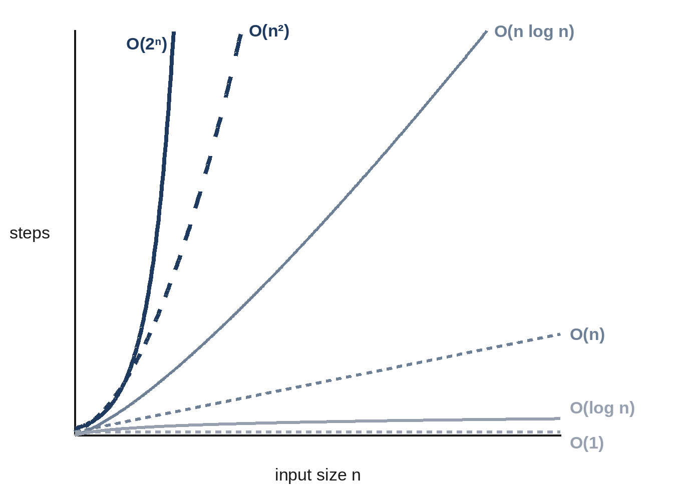

# Chapter 3: Big-O Without Fear

Every interviewer will ask, "What is the time and space complexity of your solution?" Big-O notation is how you answer. It sounds mathematical, but for interviews you need only a handful of ideas, and they are all about one question: **as the input grows, how fast does the work grow?**

## The Idea

Big-O describes how the running time (or memory) of an algorithm grows with the size of its input, usually called *n*, ignoring constant factors. If doubling the input doubles the work, the algorithm is **O(n)**, "linear". If doubling the input quadruples the work, it is **O(n²)**, "quadratic".

We ignore constants because they don't change the big picture. An algorithm that does 3n steps and one that does 50n steps are both O(n): for a large enough input, either will beat any O(n²) algorithm.

## The Complexities You Will Meet

| Big-O | Name | Typical example | Doubling n... |
| --- | --- | --- | --- |
| O(1) | Constant | Looking up a key in a hash map | changes nothing |
| O(log n) | Logarithmic | Binary search in a sorted list | adds one step |
| O(n) | Linear | One pass through a list | doubles the work |
| O(n log n) | Linearithmic | Sorting | slightly more than doubles it |
| O(n²) | Quadratic | Checking every pair | quadruples it |
| O(2ⁿ) | Exponential | Trying every subset | squares it |
| O(n!) | Factorial | Trying every ordering | makes it astronomically bigger |



## Reading Complexity From Code

You can usually find the complexity by looking at loops:

- A single loop over the input is **O(n)**.
- A loop inside a loop, both over the input, is **O(n²)**.
- A loop that halves the remaining work each time, as binary search does, is **O(log n)**.
- Sorting first costs **O(n log n)**, which then dominates any O(n) work after it.
- Recursion that branches into two calls at each of n levels is **O(2ⁿ)**.

Here is the brute-force solution to Problem 5.1, which checks every pair:

```python
@include code/ch05/p01_budget_pair.py::budget_pair_brute
```

The outer loop runs n times and the inner loop up to n times, so the work is proportional to n × n: **O(n²) time**. It uses only a few variables, so it needs **O(1) extra space**.

And here is the faster solution:

```python
@include code/ch05/p01_budget_pair.py::budget_pair
```

One loop over the prices, with an O(1) hash-map lookup inside: **O(n) time**. The map may hold every price: **O(n) extra space**. That is the most common trade-off in interviews: use extra memory to save time.

## What Counts as "Fast Enough"?

As a rough guide, Python executes on the order of ten million simple operations per second (compiled languages such as C++ manage about a hundred times more). Interview problems usually expect a solution to finish in about a second, which gives a useful rule of thumb from the input size:

| Input size n | Complexity you need (roughly) |
| --- | --- |
| up to about 10 | O(n!) or O(2ⁿ) is fine: try everything |
| up to about 20 | O(2ⁿ): all subsets |
| up to about 500 | O(n³) |
| up to about 5,000 | O(n²) |
| up to about 1,000,000 | O(n log n) or O(n) |
| larger | O(n), O(log n) or O(1) |

That's why "how big can the input be?" is such a useful question in Step 1 of the six-step method: the answer tells you which algorithms are worth considering.

## Space Complexity

Space complexity counts the **extra** memory an algorithm uses, beyond the input itself: new lists, maps, sets and the call stack. Two things are easy to forget:

- **Recursion uses memory.** Each recursive call adds a frame to the call stack, so a recursion that goes n levels deep uses O(n) space, even if it creates no lists.
- **Slices copy.** In Python, `items[1:]` creates a new list, so slicing inside a loop or a recursion can quietly add O(n) time and space per step.

## Amortized and Average Cases

Some operations are usually fast but occasionally slow:

- **Appending to a Python list** is O(1) *amortized*: once in a while the list grows its storage and copies everything, but averaged over many appends each costs O(1).
- **Hash-map lookups** are O(1) *on average*: with a bad hash function or deliberately chosen keys they can degrade, but in interviews you can treat them as O(1).

When you use these operations, say "O(1) amortized" or "O(1) average"; interviewers appreciate the precision.

## Several Inputs

When there are several inputs, use several letters. Merging a list of length m with a list of length n is O(m + n). Comparing every word in one list with every word in another is O(m × n). Don't collapse them into a single n unless they really are the same size.

## Key Takeaways

- Big-O describes how work grows with input size, ignoring constant factors.
- Know the common classes: O(1), O(log n), O(n), O(n log n), O(n²), O(2ⁿ), O(n!).
- Loops multiply; sequential steps add, and the biggest term wins.
- Use the input size to decide how fast your solution must be.
- Count extra space too, including the recursion stack and copies made by slicing.
