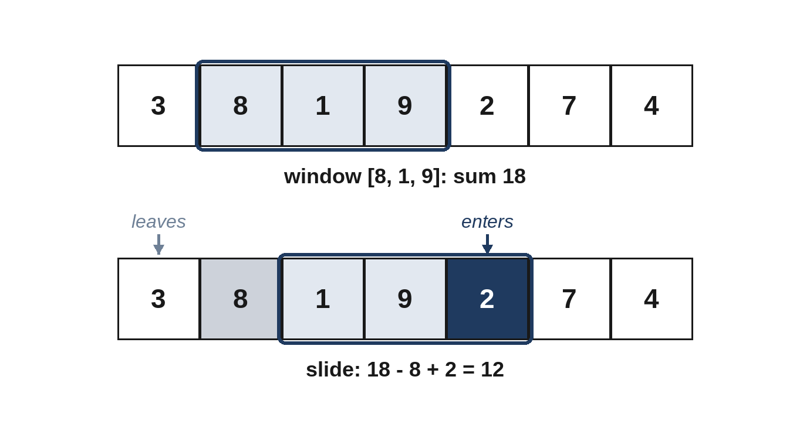

# Chapter 7: Sliding Window

A sliding window is a special case of two pointers, where the two pointers mark the start and end of a block of consecutive items: a "window". As the end moves right, new items enter; as the start moves right, old items leave. If you can update what you know about the window in O(1) when one item enters or leaves, you can examine every window in O(n) instead of recomputing each from scratch.



## When to Use It

- The problem asks about a **consecutive** block: a substring, a subarray, a run of days.
- It asks for the **longest**, **shortest** or **best** such block, or **whether one exists**.
- Adding or removing one item changes the answer in a simple way (a sum, a count of characters).

Two kinds of windows:

- **Fixed size k.** Add the new item and remove the one that falls out, every step (Problem 7.1).
- **Variable size.** Expand the right edge every step; shrink from the left while the window breaks a rule (for "longest") or while it still meets the goal (for "shortest").

The variable-size template, in words: for each `right`, add `items[right]` to the window's state; then, while the state is invalid (or while it satisfies the goal), update the answer if appropriate and remove `items[left]`, moving `left` forward. Each item enters once and leaves at most once, so the total work is O(n).

> **Warning:** Variable-size windows rely on a property called *monotonicity*: making the window bigger can only move it toward "invalid" (or toward "goal met"). If values can be negative, a sum doesn't behave this way, and a sliding window gives wrong answers. Use prefix sums instead (Chapter 8).

## 7.1 Best Week (Easy)

Given daily sales, find the highest total over any k consecutive days.

```
@include code/ch07/p01_best_week.examples.txt
```

**Brute force.** Sum each window separately: O(n × k).

**The better idea.** Keep the current window's total. Moving one day forward, add the new day and subtract the day that left.

```python
@include code/ch07/p01_best_week.py::best_window
```

**Complexity:** O(n) time, O(1) space.

## 7.2 Longest Unique Run (Medium)

Find the length of the longest block of a string in which no character repeats.

```
@include code/ch07/p02_longest_unique.examples.txt
```

**Think first:** When the next character is already in the window, where must the window's new start be?

**Brute force.** Check every block for repeats: O(n³) if each block is checked from scratch, or O(n²) if each block grows from its start with a running set.

**The better idea.** Remember the last position of each character. When the next character was last seen *inside* the current window, jump the start of the window to just after that position. Positions before the window are ignored.

```python
@include code/ch07/p02_longest_unique.py::longest_unique
```

**Complexity:** O(n) time; O(k) space for k distinct characters.

> **Common Mistake:** Forgetting the condition `last_seen[ch] >= start`. In "abba", when the final "a" arrives, its earlier copy is already outside the window; without the check, the start would jump *backwards*, and the answer would be 3 instead of 2. The last example above tests exactly this.

## 7.3 Shortest Span (Medium)

Deliveries arrive with positive weights. What is the shortest run of consecutive deliveries whose total weight is at least a target? Return 0 if no run reaches it.

```
@include code/ch07/p03_shortest_span.examples.txt
```

**The idea.** Expand the window to the right. As soon as the total reaches the target, record the length and try to shrink from the left, since a shorter window might still be enough. Because all weights are positive, removing an item always lowers the total, which is what makes shrinking safe.

```python
@include code/ch07/p03_shortest_span.py::shortest_span
```

**Complexity:** O(n) time, O(1) space.

> **Follow-Up:** With negative weights allowed, the window idea breaks. A solution uses prefix sums and a monotonic deque in O(n), or prefix sums and binary search in O(n log n).

## 7.4 Repaint the Fence (Medium)

A fence's boards are painted in colors, given as capital letters. You may repaint at most k boards. What is the longest run of boards of a single color you can achieve?

```
@include code/ch07/p04_repaint.examples.txt
```

**Think first:** For a given window, how many boards would you need to repaint to make it all one color?

**The idea.** A window can be made one color by repainting everything except its most common color: `length - most`. Keep counts of the colors in the window. If `length - most` exceeds k, slide the window: move the left edge forward by one.

```python
@include code/ch07/p04_repaint.py::repaint
```

A subtle point: `most` is the highest count seen in *any* window so far, and is never decreased when boards leave. That's safe, because the answer can only improve when some window has a higher count than before, and until then, the window just slides at its best length without shrinking.

**Complexity:** O(n) time, O(1) space for 26 colors.

## 7.5 Hidden Anagram (Medium)

Does `text` contain a block of consecutive characters that is a rearrangement of `word`?

```
@include code/ch07/p05_hidden_anagram.examples.txt
```

**The idea.** Slide a fixed window of length `len(word)` across the text, keeping a `Counter` of its characters. Compare it with the word's counts after each step, adding the new character and removing the old one, and deleting a count when it reaches zero, so the comparison stays exact.

```python
@include code/ch07/p05_hidden_anagram.py::hidden_anagram
```

**Complexity:** O(n) time for a fixed alphabet, because comparing two counters of at most 26 letters is O(1).

> **Follow-Up:** Return the starting positions of *all* the anagrams. Same window; collect `i - k + 1` at every match.

## 7.6 Smallest Cover (Hard)

Find the shortest block of `text` that contains every character of `needed`, including repeats. If several are equally short, return the leftmost; if none exists, return "".

```
@include code/ch07/p06_smallest_cover.examples.txt
```

**Think first:** How do you know, in O(1), that the window now contains everything?

**The idea.** Keep `need`, a count of how many of each character the window still lacks (it can go negative when the window has extras), and `missing`, the total number of characters still lacking. Expand to the right; when `missing` reaches zero the window covers everything, so record it and shrink from the left until it no longer does.

```python
@include code/ch07/p06_smallest_cover.py::smallest_cover
```

**Complexity:** O(n + m) time for text length n and m needed characters; O(k) space for k distinct characters.

> **Interviewer's View:** This is a classic hard problem because of its bookkeeping. Explain the meaning of `need` and `missing` before writing the code, and test with repeated characters, such as needing "aa".

## Key Takeaways

- Sliding windows examine every block of consecutive items in O(n) by updating, not recomputing.
- Fixed windows add one item and remove one each step; variable windows expand right and shrink left.
- They need a monotonic condition: with negative numbers, switch to prefix sums.
- Store just enough state to update in O(1): a sum, a count of characters, a last-seen position.
