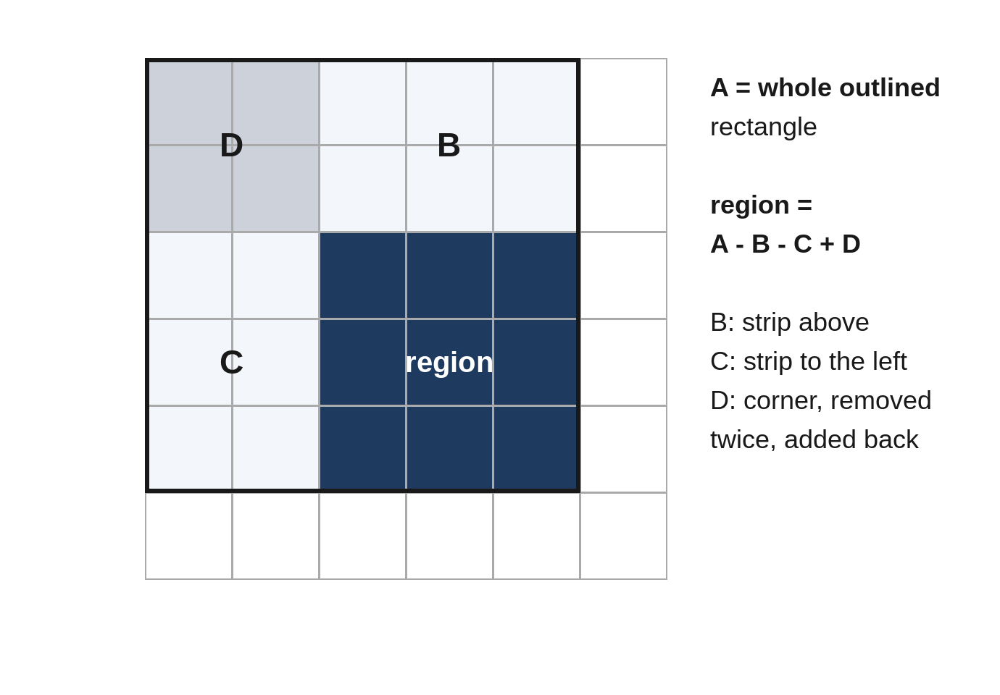

# Chapter 8: Prefix Sums

A prefix sum is a running total: `prefix[i]` is the sum of the first i values. With it, the sum of any block of consecutive values is a single subtraction, `prefix[b + 1] - prefix[a]`. Combined with a hash map, prefix sums can also *count* blocks with a given total in one pass, even when values are negative, which is exactly where sliding windows fail.

## When to Use It

- Many questions about **sums of ranges** in a list that doesn't change.
- **Counting** or finding the **longest** subarray with a given sum, especially with **negative** values.
- Conditions on sums **modulo k**, or on **balance** (more of one thing than another).
- The same ideas in two dimensions: sums of **rectangles** in a grid.

The key identity: the sum of `values[a..b]` equals `prefix[b + 1] - prefix[a]`. So "is there a block ending here with sum k?" becomes "have I seen the prefix sum `prefix - k` before?", which is a hash-map lookup.

## 8.1 Range Totals (Easy)

Given daily values and many queries "what is the total from day a to day b, inclusive?", answer each query in O(1).

```
@include code/ch08/p01_range_totals.examples.txt
```

**The idea.** Precompute running totals once, starting with 0 for "no values". Then each query is one subtraction.

```python
@include code/ch08/p01_range_totals.py::RangeTotals
```

**Complexity:** O(n) to build, O(1) per query, O(n) space.

> **Follow-Up:** "What if values can change between queries?" Prefix sums then need O(n) per update. A *Fenwick tree* or *segment tree* supports both updates and range sums in O(log n).

## 8.2 Exact Total Runs (Medium)

How many blocks of consecutive values add up to exactly k? Values may be negative or zero.

```
@include code/ch08/p02_count_runs_k.examples.txt
```

**Think first:** A block ending at position i sums to k when the prefix sum before it equals what?

**Brute force.** Extend a running sum from every start: O(n²).

**The better idea.** Walk through the values, keeping the current prefix sum and a count of how many times each prefix sum has occurred. A block ending here sums to k exactly when an earlier prefix equals `prefix - k`, so add that count. Start the map with `{0: 1}` for the empty prefix, so blocks starting at position 0 are counted.

```python
@include code/ch08/p02_count_runs_k.py::count_runs
```

**Complexity:** O(n) time, O(n) space.

> **Common Mistake:** Forgetting the starting `{0: 1}`. Then a block that starts at the very beginning, such as `[1, 2]` for k = 3, is never counted.

## 8.3 Balance Point (Easy)

Find the leftmost position where the sum of everything to its left equals the sum of everything to its right (the item itself is in neither). Return -1 if there is none.

```
@include code/ch08/p03_balance_point.examples.txt
```

**The idea.** Compute the total once. Walking left to right with a running left sum, the right sum at position i is `total - left - values[i]`.

```python
@include code/ch08/p03_balance_point.py::balance_point
```

**Complexity:** O(n) time, O(1) space.

## 8.4 Even Split (Medium)

A team's results are recorded as 1 (win) and 0 (loss). Find the longest run of consecutive games with as many wins as losses.

```
@include code/ch08/p04_even_split.examples.txt
```

**Think first:** Count each win as +1 and each loss as -1. What is the "balance" of a block with equal wins and losses?

**The idea.** With the +1/-1 trick, a block is even exactly when its sum is 0, that is, when the running balance at its end equals the balance just before its start. To get the *longest* such block, remember the *first* position where each balance occurred.

```python
@include code/ch08/p04_even_split.py::even_split
```

**Complexity:** O(n) time, O(n) space.

> **Common Mistake:** Updating `first_seen` every time a balance repeats. The map must keep the *earliest* position, because the longest block starts as early as possible.

## 8.5 Region Sums (Medium)

Given a grid of numbers, answer many queries "what is the sum of the rectangle from (r1, c1) to (r2, c2)?" in O(1) each.

```
@include code/ch08/p05_region_sums.examples.txt
```

**The idea.** Build a two-dimensional prefix table: `p[r][c]` is the sum of the rectangle from the top-left corner to cell (r-1, c-1). Each entry adds the cell to the rectangles above and to the left, and subtracts the overlap, which was counted twice. A query uses the same inclusion-exclusion in reverse.



```python
@include code/ch08/p05_region_sums.py::RegionSums
```

**Complexity:** O(rows × cols) to build, O(1) per query.

## 8.6 Divisible Runs (Medium)

How many blocks of consecutive values have a total divisible by k?

```
@include code/ch08/p06_divisible_runs.examples.txt
```

**Think first:** When is the difference of two numbers divisible by k?

**The idea.** A block's total is divisible by k exactly when the prefix sums at its two ends have the same remainder modulo k. So count remainders as you go, just like Problem 8.2 counts prefix sums. Python's `%` always returns a value between 0 and k-1 for positive k, even for negative sums, so no extra adjustment is needed.

```python
@include code/ch08/p06_divisible_runs.py::divisible_runs
```

**Complexity:** O(n) time, O(k) space.

> **Common Mistake:** In Java and C++, `%` can return a negative remainder for negative numbers. If you translate this solution, use `((prefix % k) + k) % k`.

## Key Takeaways

- Prefix sums turn any range sum into one subtraction.
- With a hash map of earlier prefix sums, you can count or find blocks with a given sum in O(n), even with negative values.
- Transform the problem to fit: +1/-1 for balance, remainders for divisibility.
- In two dimensions, use inclusion-exclusion: add the big rectangle, subtract two strips, add back the corner.
