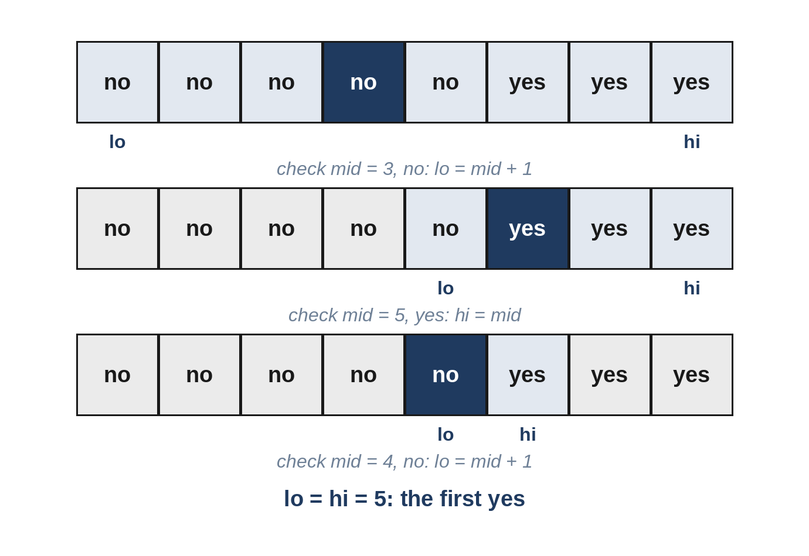

# Chapter 10: Binary Search

Binary search finds an item in a sorted list by repeatedly halving the range where it could be: look at the middle, decide which half the answer is in, and discard the other half. A million items need only about twenty steps. In interviews, binary search shows up in two forms: searching *in a sorted list*, and searching *for an answer*, when you can test any guess and the tests change from "no" to "yes" at some point.



## When to Use It

- The input is **sorted**, or sorted and **rotated**.
- You must find the **first** or **last** position where something becomes true.
- The problem asks for the **minimum** (or maximum) value that works, and you can **check a guess** efficiently: "the smallest capacity", "the earliest day", "the largest size".
- The input is huge, or the hint is "better than O(n)".

The safest template searches for the *first* position where a condition is true, on a range `[lo, hi]` that always contains the answer:

1. While `lo < hi`: take `mid = (lo + hi) // 2`.
2. If the condition holds at `mid`, the answer is at `mid` or to its left: `hi = mid`.
3. Otherwise it is to the right: `lo = mid + 1`.
4. When the loop ends, `lo == hi` is the answer.

Because `mid` is rounded down and `lo` moves past it, the range always shrinks, so the loop never runs forever. If you need the *last* position where something is true, round `mid` up instead, as in Problem 10.5.

## 10.1 Find in a Sorted Catalogue (Easy)

Return the position of a value in a sorted list of distinct values, or -1.

```
@include code/ch10/p01_find_sorted.examples.txt
```

```python
@include code/ch10/p01_find_sorted.py::find_sorted
```

**Complexity:** O(log n) time, O(1) space.

> **Common Mistake:** Writing `while lo < hi` with this version, which searches for an exact match. With `lo < hi`, a one-item range is never examined, so the item at the edge can be missed. Match your loop condition to your template.

## 10.2 First Bad Build (Easy)

Builds are numbered 1 to n. Once a build is bad, every later build is bad too. You have a function `is_bad(build)`; each call is expensive. Find the first bad build (or -1 if none) with as few calls as possible.

```
@include code/ch10/p02_first_bad_build.examples.txt
```

The examples use a small wrapper that makes every build from `first` onward bad.

**The idea.** This is exactly the "first true" template. Including n + 1 in the range as a "none" answer avoids a special case.

```python
@include code/ch10/p02_first_bad_build.py::first_bad
```

**Complexity:** O(log n) calls. The test for this problem checks that a million builds need at most 21 calls.

## 10.3 Rotated Catalogue (Medium)

A sorted list of distinct values was rotated at some unknown point, for example `[9, 12, 1, 4, 7]`. Find a target's position in O(log n), or return -1.

```
@include code/ch10/p03_rotated_search.examples.txt
```

**Think first:** After a rotation, at least one half of any range is still sorted. How can you tell which?

**The idea.** Compare the middle with the left end. If `items[lo] <= items[mid]`, the left half is sorted, and you can check directly whether the target lies in it; otherwise the right half is sorted. Search in the half that could contain the target.

```python
@include code/ch10/p03_rotated_search.py::rotated_search
```

**Complexity:** O(log n) time, O(1) space.

> **Follow-Up:** "With duplicates allowed?" When `items[lo] == items[mid] == items[hi]`, you can't tell which half is sorted; shrink both ends by one. The worst case becomes O(n).

## 10.4 Truck Capacity (Medium)

Parcels with given weights must be shipped in order over a number of days, one truckload per day; a truckload can't exceed the truck's capacity. What is the smallest capacity that ships everything in time?

```
@include code/ch10/p04_truck_capacity.examples.txt
```

**Think first:** If a capacity works, does every bigger capacity work too?

**The idea.** Yes: more capacity never hurts. So the answer is the first capacity for which "can ship in time" is true, which is binary search *on the answer*. The capacity must be at least the heaviest parcel and at most the total weight. Each guess is checked by a greedy simulation that fills each day as much as possible.

```python
@include code/ch10/p04_truck_capacity.py::days_needed
```

```python
@include code/ch10/p04_truck_capacity.py::truck_capacity
```

**Complexity:** O(n log S), where S is the total weight: O(log S) guesses, each checked in O(n).

> **Interviewer's View:** Recognizing "binary search on the answer" is the whole problem. The tell-tale signs are "smallest capacity such that..." and a check that is easy for a given guess.

## 10.5 Integer Square Root (Easy)

Return the largest integer r with r × r ≤ n, without using square-root functions or powers.

```
@include code/ch10/p05_integer_root.examples.txt
```

**The idea.** We want the *last* r for which `r * r <= n` is true. Use the template with `mid` rounded *up*, so that `lo = mid` always makes progress.

```python
@include code/ch10/p05_integer_root.py::integer_root
```

**Complexity:** O(log n) time. Python's `math.isqrt` does the same job, and the tests compare the two on random numbers up to a billion.

> **Common Mistake:** Rounding `mid` down when the update is `lo = mid`. With `lo = 2, hi = 3`, mid would be 2 forever: an infinite loop.

## 10.6 Median of Two Sorted Lists (Hard)

Find the median of the combined values of two sorted lists, in O(log(min(m, n))).

```
@include code/ch10/p06_merged_median.examples.txt
```

**Think first:** The median splits the combined values into a left half and a right half. If you take i values from the first list for the left half, how many must come from the second?

**The idea.** Binary search on i, the number of values taken from the shorter list `a`; the second list must supply `half - i`. The split is correct when everything on the left is less than or equal to everything on the right, that is, `a_left <= b_right` and `b_left <= a_right`. If `a_left` is too big, take fewer from `a`; otherwise, take more. Infinite values stand in for "nothing on that side".

```python
@include code/ch10/p06_merged_median.py::merged_median
```

**Complexity:** O(log(min(m, n))) time, O(1) space.

> **Tip:** This is one of the hardest standard problems. In an interview, it's fine to start with the O(m + n) merge (Problem 6.5) and then explain the partition idea before coding it.

## Key Takeaways

- Binary search halves the search range each step: O(log n).
- Use one template consistently: find the first position where a condition becomes true, with the range always containing the answer.
- Round `mid` up when searching for the last true position, to avoid infinite loops.
- "Binary search on the answer" solves many "smallest value that works" problems, combined with a fast check.
