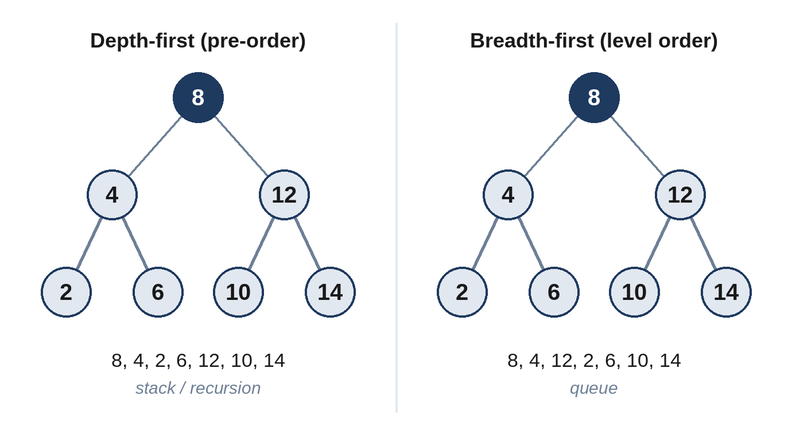

# Chapter 12: Trees and Binary Search Trees

A binary tree is a set of nodes in which each node has at most two children, a left one and a right one, and every node except the root has exactly one parent. Trees model hierarchies such as file systems, organization charts and the structure of expressions, and they are the most common subject of medium-level interview questions. Almost every tree problem is solved by one of two traversals, and by asking one question: *what does each node need from its children, and what must it return to its parent?*

## The Building Blocks

```python
@include code/common/structures.py::TreeNode
```

The examples describe trees in level order, with `None` for missing children, the format most interview platforms use. `[3, 9, 20, None, None, 15, 7]` is a root 3 with children 9 and 20; 9 has no children; 20 has children 15 and 7. Two helpers, `build_tree` and `tree_values`, convert between this format and nodes.

## When to Use Which Traversal

- **Depth-first search (DFS)**, usually recursive, follows one branch to the bottom before trying the next. Use it when each node's answer depends on its subtrees: heights, sums, paths, validity.
- **Breadth-first search (BFS)**, with a queue, visits the tree level by level. Use it for anything about levels: level lists, the shallowest leaf, the rightmost node of each level.
- **In-order DFS** (left, node, right) visits a binary search tree's values in sorted order.



The recursive DFS recipe: handle the empty tree; ask the left and right subtrees for their answers; combine them with the current node; return the result to the parent. If the final answer isn't what you return to the parent, as in Problem 12.7, keep it in a separate variable.

## 12.1 Tree Depth (Easy)

How many nodes are on the longest path from the root down to a leaf?

```
@include code/ch12/p01_tree_depth.examples.txt
```

**The idea.** The depth of a tree is one more than the deeper of its two subtrees; an empty tree has depth 0.

```python
@include code/ch12/p01_tree_depth.py::depth
```

**Complexity:** O(n) time; O(h) space for the recursion, where h is the height (O(n) for a tree shaped like a list).

A level-by-level BFS counts levels instead, and avoids recursion:

```python
@include code/ch12/p01_tree_depth.py::depth_iterative
```

## 12.2 Mirror a Tree (Easy)

Swap the left and right children of every node.

```
@include code/ch12/p02_mirror.examples.txt
```

```python
@include code/ch12/p02_mirror.py::mirror
```

**Complexity:** O(n) time, O(h) space.

> **Common Mistake:** Writing `root.left = mirror(root.right)` and then `root.right = mirror(root.left)` on separate lines. By the second line, `root.left` has already been replaced. Python's simultaneous assignment evaluates both right-hand sides first.

## 12.3 Level by Level (Medium)

Return the values of a tree as a list of levels, each from left to right.

```
@include code/ch12/p03_level_lists.examples.txt
```

**The idea.** BFS with a queue. At the start of each round, the queue holds exactly one level; process that many nodes, collecting their values and queueing their children.

```python
@include code/ch12/p03_level_lists.py::levels
```

**Complexity:** O(n) time, O(w) space, where w is the widest level.

> **Follow-Up:** "Zigzag order" (alternate directions per level) or "the rightmost value of each level" are small changes to the same loop.

## 12.4 Valid Search Tree (Medium)

In a binary search tree, every value in a node's left subtree is smaller than the node, and every value in its right subtree is larger. Check whether a tree satisfies this, with no duplicate values allowed.

```
@include code/ch12/p04_valid_bst.examples.txt
```

**Think first:** Is it enough to check that each node is bigger than its left child and smaller than its right child?

**The idea.** No: in the second example, 6 is the right child of 3, which is fine locally, but 6 is in the left subtree of 5, where everything must be smaller than 5. So pass down the allowed range: going left lowers the upper bound to the node's value; going right raises the lower bound.

```python
@include code/ch12/p04_valid_bst.py::valid_bst
```

**Complexity:** O(n) time, O(h) space.

An equally good alternative: an in-order traversal must produce strictly increasing values.

## 12.5 Closest Common Manager (Medium)

In a company's reporting tree, every person has a distinct ID. Given two people, a and b, find their lowest common manager: the deepest node that has both in its subtree. A person counts as being in their own subtree.

```
@include code/ch12/p05_common_manager.examples.txt
```

**Think first:** If a is somewhere in the left subtree and b in the right subtree of a node, what is that node?

**The idea.** Search both subtrees. Return a node upwards when it is a or b, or when it is the meeting point. If both sides return something, the current node is the answer; otherwise pass up whichever side found something.

```python
@include code/ch12/p05_common_manager.py::common_ancestor
```

**Complexity:** O(n) time, O(h) space.

> **Follow-Up:** In a *binary search tree*, you can use the values instead: while both values are smaller than the node, go left; while both are larger, go right; otherwise the current node is the answer, in O(h).

## 12.6 Save and Restore a Tree (Hard)

Write `serialize`, which turns a binary tree into a string, and `deserialize`, which rebuilds the identical tree from the string.

```
@include code/ch12/p06_serialize.examples.txt
```

**The idea.** A pre-order traversal (node, left, right) with a marker such as `#` for every missing child describes the tree completely. Deserializing reads the tokens in the same order, and each recursive call builds exactly the subtree that was written at that point.

```python
@include code/ch12/p06_serialize.py::serialize,deserialize
```

**Complexity:** O(n) time and space for both.

## 12.7 Best Path (Hard)

A path is any sequence of nodes connected by edges, without repeating a node; it may start and end anywhere. Find the largest possible sum of node values along a path. Values may be negative.

```
@include code/ch12/p07_best_path.examples.txt
```

**Think first:** A path has a highest node, where it "bends". What does the path look like below that node?

**The idea.** Every path bends at exactly one node, and consists of that node plus the best downward path into its left subtree, plus the best into its right subtree (or nothing, if those are negative). A recursive helper returns the best *downward* path from each node, which is what its parent can use, while the best *bending* path at each node updates a separate answer.

```python
@include code/ch12/p07_best_path.py::best_path
```

**Complexity:** O(n) time, O(h) space.

> **Interviewer's View:** The crucial insight is the difference between what a node *returns* (a downward path, which can extend upwards) and what it *records* (a bending path, which can't). Say it explicitly.

## Key Takeaways

- Most tree problems are DFS: get answers from the subtrees, combine, return.
- Use BFS with a queue for anything about levels.
- In a binary search tree, pass down allowed ranges, or use the sorted in-order sequence.
- When the overall answer differs from what a node returns to its parent, track it separately.
- Recursion depth equals tree height; mention the O(h) space and the risk with very deep trees.
