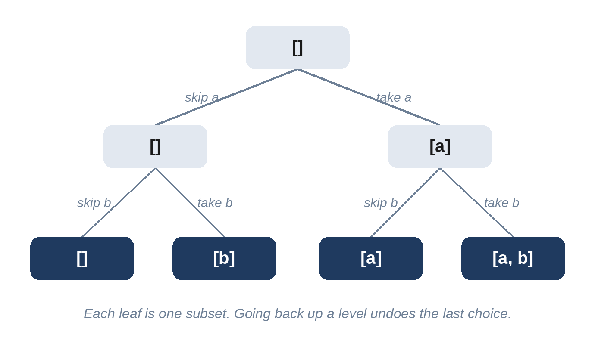

# Chapter 15: Backtracking

Some problems ask for *every* solution: all subsets, all orderings, all ways to make change, every valid arrangement. Backtracking builds candidates one choice at a time, explores everything that follows from each choice, and then *undoes* the choice to try the next. Think of it as walking a decision tree, and climbing back up after each branch.



## When to Use It

- "Return **all** combinations, subsets, permutations, partitions or arrangements."
- "Is there **any** arrangement that satisfies these rules?" (Sudoku, queens, word search).
- The input is **small** (often 20 items or fewer), a hint that exponential time is expected.

The template has three parts:

1. **Base case:** if the current candidate is complete, record a *copy* of it.
2. **Choices:** for each option available at this point, if it's allowed, apply it.
3. **Recurse, then undo** the choice, so the next option starts from the same state.

**Pruning**, skipping branches that can't lead to a solution, is what makes backtracking practical: in Problem 15.3, a coin that is too big ends the loop immediately, because all later coins are bigger still.

## 15.1 All Bundles (Medium)

Return every subset of a list of distinct items, including the empty one.

```
@include code/ch15/p01_all_bundles.examples.txt
```

**The idea.** For each item in turn, there are two choices: skip it or take it. The recursion explores both, building the current bundle in a list and undoing each "take" with `pop`.

```python
@include code/ch15/p01_all_bundles.py::all_bundles
```

**Complexity:** O(n × 2ⁿ): there are 2ⁿ subsets, and copying each takes up to n steps.

An iterative alternative treats the numbers 0 to 2ⁿ - 1 as bit masks, where bit i says whether item i is included:

```python
@include code/ch15/p01_all_bundles.py::all_bundles_bits
```

> **Common Mistake:** Appending `bundle` instead of `bundle[:]`. The result would contain many references to the same list, which ends up empty after all the undoing.

## 15.2 All Orders (Medium)

Return every ordering (permutation) of a list of distinct items.

```
@include code/ch15/p02_all_orders.examples.txt
```

**The idea.** Fill the order one position at a time; at each position, try every item not yet used, marking it as used while exploring.

```python
@include code/ch15/p02_all_orders.py::all_orders
```

**Complexity:** O(n × n!).

> **Follow-Up:** "With duplicate items, return only distinct orders." Sort the items, and skip an item if it equals the previous one and the previous one is *not* currently used.

## 15.3 Exact Change (Medium)

Given distinct coin values, which may each be used any number of times, list all the combinations that add up to an amount, each in non-decreasing order.

```
@include code/ch15/p03_exact_change.examples.txt
```

**Think first:** How do you avoid listing both [2, 3, 3] and [3, 2, 3]?

**The idea.** Only allow coins in non-decreasing order: after choosing coin i, the next choice starts from i again (reuse is allowed), never from an earlier coin. Sorting the coins lets the loop stop as soon as a coin is too big.

```python
@include code/ch15/p03_exact_change.py::exact_change
```

**Complexity:** exponential in the worst case, but pruning keeps it fast for realistic amounts.

> **Follow-Up:** "How many combinations are there?" If you only need the count, don't list them: dynamic programming counts them in O(amount × coins) (Chapter 18).

## 15.4 Grid Word (Medium)

Can a word be spelled by moving up, down, left or right through a grid of letters, using each cell at most once?

```
@include code/ch15/p04_grid_word.examples.txt
```

**The idea.** Try every cell as a starting point. From each, explore the four neighbors that match the next letter. Mark a cell as used by temporarily replacing its letter with `#`, and restore it on the way back, so other paths can use it.

```python
@include code/ch15/p04_grid_word.py::grid_word
```

**Complexity:** O(r × c × 3ᴸ) for a word of length L: from each step there are at most three new directions.

> **Tip:** Marking cells in the grid itself avoids a separate set, but changes the input while the search runs. Mention it, and restore every cell, as this solution does.

## 15.5 Safe Queens (Hard)

How many ways can n queens be placed on an n × n chessboard so that no two attack each other (no shared row, column or diagonal)?

```
@include code/ch15/p05_safe_queens.examples.txt
```

**The idea.** Place one queen per row. A queen at (row, col) occupies column `col`, the diagonal `row - col` and the anti-diagonal `row + col`; three sets make each safety check O(1).

```python
@include code/ch15/p05_safe_queens.py::safe_queens
```

**Complexity:** roughly O(n!) in the worst case, with heavy pruning in practice. The tests check n = 1 to 10 against the known counts (1, 0, 0, 2, 10, 4, 40, 92, 352, 724), using a brute force over permutations for small n.

## 15.6 Bracket Sets (Medium)

Generate all strings of n pairs of correctly nested parentheses.

```
@include code/ch15/p06_bracket_sets.examples.txt
```

**The idea.** Build the string one character at a time. You may add "(" while fewer than n have been opened, and ")" while fewer have been closed than opened. These two rules guarantee that every string produced is valid, so no checking is needed at the end.

```python
@include code/ch15/p06_bracket_sets.py::bracket_sets
```

**Complexity:** proportional to the number of results, the n-th Catalan number, which grows roughly like 4ⁿ.

## Key Takeaways

- Backtracking explores a decision tree: choose, recurse, undo.
- Record copies of the current candidate, never the candidate itself.
- Avoid duplicate results by controlling the order of choices, for example "only equal or later coins".
- Prune early: invalid partial candidates should never be extended.
- Small input limits are a hint that exponential solutions are expected.
