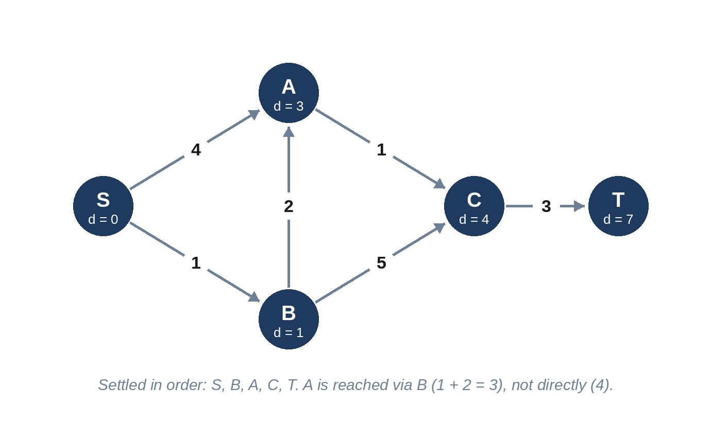

# Chapter 17: Advanced Graphs

This chapter covers the graph algorithms that come up when plain BFS and DFS aren't enough: **topological sorting** for dependencies, **union-find** for merging groups, **Dijkstra's algorithm** for shortest paths with different edge costs, a limited **Bellman-Ford** for paths with a maximum number of steps, and **minimum spanning trees** for connecting everything as cheaply as possible.

## When to Use Which

| Problem shape | Algorithm | Time |
| --- | --- | --- |
| Tasks with prerequisites; "an order that respects dependencies"; detect a cycle in a directed graph | Topological sort (Kahn's algorithm, or DFS) | O(V + E) |
| Connecting things and asking "are these already connected?" | Union-find (disjoint sets) | nearly O(1) per operation |
| Shortest path with non-negative edge weights | Dijkstra with a heap | O(E log V) |
| Shortest path with at most k edges, or negative weights | Bellman-Ford, k rounds | O(k × E) |
| Cheapest way to connect all nodes | Minimum spanning tree (Prim or Kruskal) | O(E log V) |



## 17.1 Can I Graduate? (Medium)

A degree has courses numbered 0 to n-1. A pair (a, b) means course b must be completed before course a. Can every course be completed?

```
@include code/ch17/p01_can_finish.examples.txt
```

**Think first:** When is it impossible?

**The idea.** It's impossible exactly when the prerequisites form a cycle. Kahn's algorithm finds out: count each course's unmet prerequisites; start with the courses that have none; "take" a course and reduce the count of every course that depends on it, adding a course to the ready queue when its count reaches zero. If some courses are never taken, they are stuck in a cycle.

```python
@include code/ch17/p01_can_finish.py::can_finish
```

**Complexity:** O(n + p) for p prerequisites.

The DFS alternative marks nodes as "on the current path"; meeting such a node again means a cycle:

```python
@include code/ch17/p01_can_finish.py::can_finish_dfs
```

## 17.2 Build Order (Medium)

Packages 0 to n-1 have build dependencies: (a, b) means b must be built before a. Return a valid build order, choosing the smallest-numbered package whenever several are ready, or an empty list if there is a cycle.

```
@include code/ch17/p02_build_order.examples.txt
```

**The idea.** Kahn's algorithm again, recording the order. Using a heap instead of a queue for the ready packages makes the order deterministic, which interviewers sometimes require.

```python
@include code/ch17/p02_build_order.py::build_order
```

**Complexity:** O((n + d) log n) with the heap; O(n + d) with a plain queue.

## 17.3 The Extra Cable (Medium)

n computers, numbered 1 to n, were connected by cables into a tree (every computer reachable, no loops). Then one extra cable was added. Return a cable whose removal restores a tree; if several qualify, return the one listed last.

```
@include code/ch17/p03_extra_cable.examples.txt
```

**The idea.** Union-find keeps track of which computers are already connected. Add cables in order; the first cable whose two ends are already connected creates the loop. It is also the last cable of the loop in the listed order, which matches "the one listed last".

```python
@include code/ch17/p03_extra_cable.py::extra_cable
```

**Complexity:** nearly O(n). *Path compression*, the line that shortens paths as it walks them, keeps the trees of the union-find structure almost flat.

## 17.4 Signal Time (Medium)

A network has n nodes, 1 to n. A link (u, v, t) carries a signal from u to v in t milliseconds. A signal starts at node k. How long until every node has received it? Return -1 if some node never does.

```
@include code/ch17/p04_signal_time.examples.txt
```

**The idea.** Dijkstra's algorithm: a heap always gives the node with the earliest arrival time not yet settled. When a node comes out of the heap for the first time, its arrival time is final, because every other route would arrive later. The answer is the latest arrival time.

```python
@include code/ch17/p04_signal_time.py::signal_time
```

**Complexity:** O(E log E) time, O(V + E) space.

> **Warning:** Dijkstra's algorithm requires non-negative weights. With negative weights, a node settled early could later be reached more cheaply. Use Bellman-Ford instead.

## 17.5 Cheapest Trip With Few Stops (Medium)

Flights (u, v, price) connect n cities. What is the cheapest way from src to dst with at most k stops, that is, at most k + 1 flights? Return -1 if impossible.

```
@include code/ch17/p05_cheap_flights.examples.txt
```

**Think first:** Why doesn't plain Dijkstra work here?

**The idea.** Dijkstra finds the cheapest route regardless of the number of flights, and may discard a slightly more expensive route that uses fewer flights. Bellman-Ford limited to k + 1 rounds solves it directly: round i allows routes with up to i flights. Each round reads the previous round's prices, so a round can't chain two flights together.

```python
@include code/ch17/p05_cheap_flights.py::cheap_flights
```

**Complexity:** O(k × F) for F flights.

> **Common Mistake:** Updating `price` in place within a round. Then a single round can use several flights, and the limit on stops is silently broken. The copy `new = price[:]` prevents this.

## 17.6 Cheapest Wiring (Medium)

Sensors sit at points on a grid. A cable between two sensors costs their Manhattan distance, `|x1 - x2| + |y1 - y2|`. What is the cheapest way to connect all the sensors?

```
@include code/ch17/p06_cheapest_wiring.examples.txt
```

**The idea.** This is a *minimum spanning tree*. Prim's algorithm grows the tree from one sensor, always adding the cheapest cable that reaches a new sensor, which a heap provides.

```python
@include code/ch17/p06_cheapest_wiring.py::cheapest_wiring
```

**Complexity:** O(n² log n) here, because every pair of sensors is a possible cable. Kruskal's algorithm, which sorts all cables and joins them with union-find unless they would form a loop, gives the same total; the tests compare the two.

## Key Takeaways

- Dependencies are directed graphs: topological sort orders them and detects cycles.
- Union-find answers "already connected?" almost in O(1), ideal for finding redundant edges.
- Dijkstra finds shortest paths with non-negative weights; a node's distance is final when it leaves the heap.
- Limit Bellman-Ford to k rounds for "at most k steps" constraints.
- Minimum spanning trees connect everything cheaply: Prim with a heap, or Kruskal with union-find.
