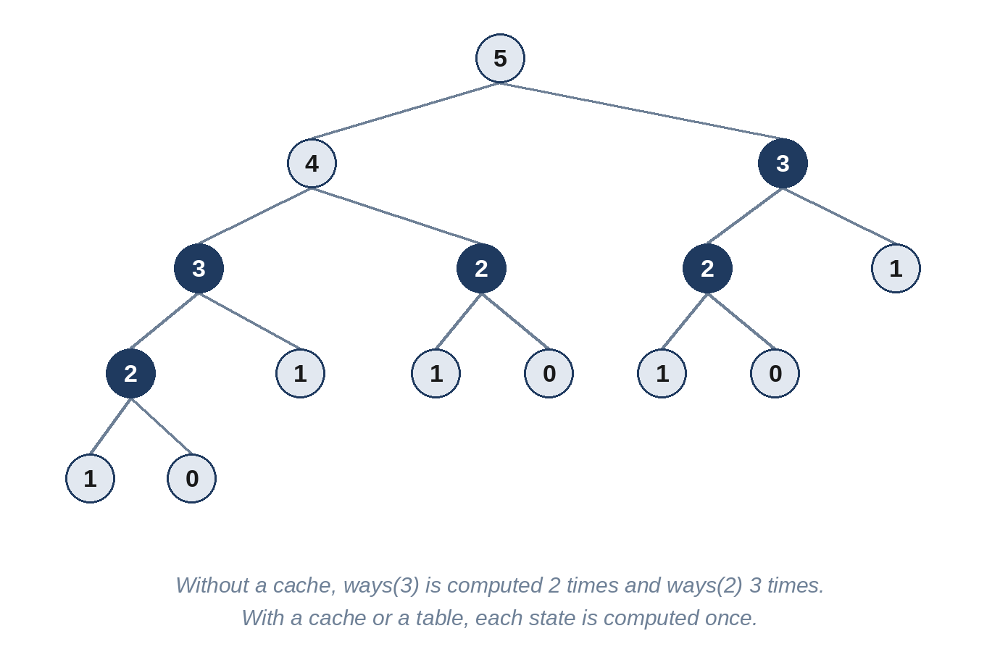

# Chapter 18: Dynamic Programming I: One Dimension

Dynamic programming (DP) has a reputation as the hardest interview topic. Most of that reputation comes from trying to guess the final, compact solution directly. Approached step by step, it is a mechanical process: write the plain recursive solution, notice that it solves the same smaller problems again and again, and store their answers. This chapter covers DP problems where the state is a single number, such as a position in a list or an amount of money.

## The Four-Step Recipe

1. **Define the state** in words: "`ways(i)` is the number of ways to reach step i." Most of the difficulty is here.
2. **Write the recurrence**: how does the answer for a state follow from smaller states? "`ways(i) = ways(i - 1) + ways(i - 2)`."
3. **Choose the base cases**: the smallest states, whose answers you know directly.
4. **Choose the order**: either recursion with a cache (*top-down*, or *memoization*) or a loop that fills a table from the smallest state upward (*bottom-up*, or *tabulation*).

Top-down is usually quicker to write correctly: in Python, `functools.cache` turns a recursive function into a memoized one with one line. Bottom-up avoids Python's recursion limit and often allows keeping only the last few values, cutting the memory from O(n) to O(1). In an interview, start with whichever you can write confidently, and mention the other.



## When to Use It

- "**How many ways**...", "**fewest** / **most** / **longest**...", "**is it possible**..." over sequences of choices.
- A brute force that tries every combination of choices, where different combinations reach the **same situation** (the same remaining amount, the same position).
- Choices made now affect only what is possible *later*, not what happened before.

If a greedy rule works (Chapter 14), it is simpler and faster. DP is for when no single rule is safe and you must compare options.

## 18.1 Stair Ways (Easy)

How many different ways are there to climb n steps, taking 1 or 2 steps at a time?

```
@include code/ch18/p01_stair_ways.examples.txt
```

**Brute force.** The last move onto step n came from step n - 1 or from step n - 2, so the answer is the sum of the two smaller answers:

```python
@include code/ch18/p01_stair_ways.py::stair_ways_brute
```

That's correct but takes exponential time: `stair_ways_brute(40)` makes over 300 million calls and takes many seconds, and each extra step multiplies the time by about 1.6, because the same values are recomputed an enormous number of times.

**With a cache.** Adding `@cache` stores each answer the first time it's computed, so each of the n states is computed once:

```python
@include code/ch18/p01_stair_ways.py::stair_ways_memo
```

**Bottom-up with O(1) memory.** Each answer depends only on the previous two, so two variables are enough:

```python
@include code/ch18/p01_stair_ways.py::stair_ways
```

**Complexity:** O(n) time and O(1) space. The answers are the Fibonacci numbers.

> **Interviewer's View:** Showing all three versions, and explaining why each is faster than the last, is a complete answer to this problem, and a model for every DP problem that follows.

## 18.2 Quiet Street (Medium)

Volunteers collect donations along a street of houses in a row. To avoid annoying the neighbors, they never visit two neighboring houses. Given the donation each house would give, what is the largest total they can collect?

```
@include code/ch18/p02_quiet_houses.examples.txt
```

**Think first:** For the last house, there are two choices. What does each choice leave?

**The idea.** Process the houses left to right, tracking two numbers: the best total if the house just seen was *taken*, and the best total if it was *skipped*. Taking the current house is only allowed after a skip; skipping it keeps the better of the two.

```python
@include code/ch18/p02_quiet_houses.py::quiet_street
```

**Complexity:** O(n) time, O(1) space.

> **Follow-Up:** "The houses are arranged in a circle, so the first and last are neighbors." Solve the row twice, once without the first house and once without the last, and take the better result.

## 18.3 Fewest Coins (Medium)

Given coin values, with an unlimited supply of each, what is the fewest number of coins that adds up to exactly an amount? Return -1 if it's impossible.

```
@include code/ch18/p03_fewest_coins.examples.txt
```

**Think first:** Why does "always take the largest coin that fits" fail for coins [1, 3, 4] and amount 6?

**The idea.** Greedy takes 4 + 1 + 1, three coins, but 3 + 3 uses two. Instead, define `best[a]` as the fewest coins for amount a. The last coin used is one of the coin values c, so `best[a] = 1 + min(best[a - c])` over all coins that fit. Fill the table from 0 upward.

```python
@include code/ch18/p03_fewest_coins.py::fewest_coins
```

**Complexity:** O(amount × coins) time, O(amount) space.

The top-down version expresses the same recurrence directly:

```python
@include code/ch18/p03_fewest_coins.py::fewest_coins_memo
```

> **Common Mistake:** Using 0 or -1 for "impossible" inside the table, where it then wins every `min`. Use infinity inside the computation and convert to -1 only at the end.

## 18.4 Longest Rising Sequence (Medium)

Find the length of the longest strictly increasing subsequence: values in their original order, but not necessarily next to each other.

```
@include code/ch18/p04_rising_run.examples.txt
```

**The O(n²) DP.** Let `best[i]` be the length of the longest rising sequence that *ends* at position i. It extends the best sequence ending at any earlier, smaller value.

```python
@include code/ch18/p04_rising_run.py::rising_quadratic
```

**The O(n log n) idea.** Keep `tails[k]`, the smallest value that can end a rising sequence of length k + 1. The list is always sorted, so binary search finds where each new value goes: past the end, it extends the longest sequence; otherwise it replaces a larger tail, which can only make later extensions easier.

```python
@include code/ch18/p04_rising_run.py::rising
```

**Complexity:** O(n log n) time, O(n) space.

> **Warning:** `tails` is not itself a rising subsequence of the input; only its length is meaningful. If the interviewer asks for the sequence itself, store a link from each value to its predecessor.

## 18.5 Split Into Words (Medium)

Can a string without spaces be split into words from a dictionary? Words may be used more than once.

```
@include code/ch18/p05_split_words.examples.txt
```

**Think first:** In "parkingspace", both "park" and "parking" match at the start. Why can't you simply take the longest match?

**The idea.** Let `ok[i]` mean "the first i characters can be split". Then `ok[i]` is true if some earlier `ok[j]` is true and `text[j:i]` is a word. Only the last `longest` positions need checking, where `longest` is the length of the longest word.

```python
@include code/ch18/p05_split_words.py::split_words
```

**Complexity:** O(n × L × L) for text of length n and words up to length L: n positions, L split points each, and O(L) to slice and hash each piece.

> **Follow-Up:** "Return every possible sentence." Then you need backtracking (Chapter 15), and the output itself can be exponential in size. Memoize the list of sentences for each starting position.

## 18.6 Decode Ways (Medium)

A message of capital letters was encoded as numbers, A = 1 to Z = 26, and the spaces between the numbers were lost. In how many ways can a digit string be read back as letters?

```
@include code/ch18/p06_decode_ways.examples.txt
```

**Think first:** What makes a single digit or a pair of digits a valid letter?

**The idea.** It's Stair Ways with rules: the last letter used either one digit, which must not be "0", or two digits, which must form a number from 10 to 26. So the number of ways for a prefix is the number for the prefix one shorter (if the last digit is valid alone) plus the number for the prefix two shorter (if the last pair is valid).

```python
@include code/ch18/p06_decode_ways.py::decode_ways
```

**Complexity:** O(n) time, O(1) space.

> **Common Mistake:** Treating "06" as a valid two-digit letter. Comparing the strings with `"10" <= pair <= "26"` excludes a leading zero, because "06" sorts before "10".

## Key Takeaways

- DP is recursion plus remembering: write the brute force, find the repeated states, and cache them.
- Define the state in one sentence before writing code.
- Top-down with `@cache` is fast to write; bottom-up avoids the recursion limit and can save memory.
- When each state depends only on the last few states, keep only those few values.
- Greedy rules often fail on "fewest coins"-style problems; test them on a small counterexample.
