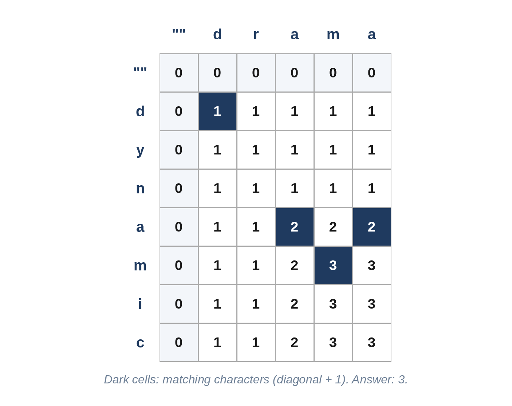

# Chapter 19: Dynamic Programming II: Grids, Strings and Knapsacks

The second DP chapter moves to states described by two numbers: a cell in a grid, a position in each of two strings, an item and a remaining capacity. The recipe from Chapter 18 does not change. What changes is that the table becomes two-dimensional, and choosing the filling order needs a moment's thought: every entry must be computed after the entries it depends on.

## Recognizing Two-Dimensional DP

| Problem shape | State | Typical recurrence |
| --- | --- | --- |
| Paths through a grid | `t[r][c]`: the answer for cell (r, c) | from the cell above and the cell to the left |
| Two strings | `t[i][j]`: the answer for `a[:i]` and `b[:j]` | from `t[i-1][j-1]`, `t[i-1][j]`, `t[i][j-1]` |
| Choose items under a limit | `best[c]`: the best value within capacity c, after the items so far | take or skip each item |
| One string, all substrings | `t[i][j]`: the answer for `s[i:j+1]` | from the shorter substring inside it |



> **Tip:** When each row of the table depends only on the row above, keep just one or two rows. That turns O(m × n) memory into O(n), a common follow-up question.

## 19.1 Grid Paths (Medium)

A robot moves only right or down across a grid, from the top-left cell to the bottom-right cell. Some cells are blocked (1). How many different routes are there?

```
@include code/ch19/p01_grid_paths.examples.txt
```

**The idea.** The number of routes into a cell is the number into the cell above plus the number into the cell to the left; a blocked cell has none. Filling the grid row by row, a single list is enough: before the update, `ways[c]` still holds the count from the row above, and `ways[c - 1]` already holds the new count from the left.

```python
@include code/ch19/p01_grid_paths.py::grid_paths
```

**Complexity:** O(r × c) time, O(c) space.

> **Follow-Up:** "No blocked cells: is there a formula?" Every route consists of r - 1 moves down and c - 1 moves right in some order, so the count is the binomial coefficient `math.comb(r + c - 2, r - 1)`. For the 3 × 7 grid, that's `comb(8, 2) = 28`.

## 19.2 Longest Shared Subsequence (Medium)

Find the length of the longest sequence of characters that appears, in order but not necessarily together, in both of two strings.

```
@include code/ch19/p02_common_subsequence.examples.txt
```

**Think first:** Compare the first characters of both strings. What are the cases?

**The idea.** If the first characters match, use them both and continue with the rest of each string. If they don't, one of them is not part of the answer: try dropping each, and keep the better result. Top-down, that's three lines of logic:

```python
@include code/ch19/p02_common_subsequence.py::shared_memo
```

Bottom-up, `t[i][j]` holds the answer for the first i characters of a and the first j characters of b:

```python
@include code/ch19/p02_common_subsequence.py::shared
```

**Complexity:** O(m × n) time and space.

> **Interviewer's View:** "Longest common subsequence" is the ancestor of many string problems, including file comparison tools that show which lines changed. Interviewers like it because the recurrence is explainable in two sentences.

## 19.3 Typo Distance (Hard)

What is the fewest single-character insertions, deletions or replacements that turn one string into another? This is the *edit distance*, or *Levenshtein distance*, used by spelling correctors.

```
@include code/ch19/p03_edit_distance.examples.txt
```

**The idea.** Compare the last characters of the two prefixes. If they match, no edit is needed for them. Otherwise, the last edit was one of three, and each leaves a smaller problem:

- **delete** the last character of a: the cell above;
- **insert** the last character of b: the cell to the left;
- **replace** one with the other: the cell diagonally up and to the left.

The first row and column are the costs of building a prefix from nothing, or erasing it.

```python
@include code/ch19/p03_edit_distance.py::typo_distance
```

**Complexity:** O(m × n) time, O(n) space with two rows.

The top-down version is a direct translation of the three cases:

```python
@include code/ch19/p03_edit_distance.py::typo_distance_memo
```

## 19.4 Backpack (Medium)

Items have weights and values, and each item can be packed at most once. What is the most value that fits within a weight capacity? This is the classic *0/1 knapsack* problem.

```
@include code/ch19/p04_backpack.examples.txt
```

**Think first:** Why can't you simply sort by value per unit of weight?

**The idea.** Ratio-greedy fails because items can't be split: a good-ratio item can waste capacity that a pair of other items would fill exactly. Instead, for each item, decide for every capacity c whether to take it: `best[c] = max(best[c], best[c - w] + v)`.

```python
@include code/ch19/p04_backpack.py::backpack
```

**Complexity:** O(n × capacity) time, O(capacity) space.

> **Common Mistake:** Looping capacities upward in the one-list version. Then `best[c - w]` may already include the current item, so the item gets packed twice. The backward loop reads only values from before this item. (Looping upward is exactly right for the *unlimited* version, as in Fewest Coins.)

## 19.5 Fair Split (Medium)

Can a set of parcels be divided into two groups of exactly equal total weight?

```
@include code/ch19/p05_fair_split.examples.txt
```

**Think first:** What does the total weight tell you, and what single question is left?

**The idea.** An odd total can't be split. Otherwise the question becomes: can some group of parcels weigh exactly half the total? Track the set of reachable sums, adding each parcel in turn.

```python
@include code/ch19/p05_fair_split.py::fair_split
```

**Complexity:** O(n × total) time and O(total) space.

Python's unlimited-size integers allow a compact trick: bit s of `sums` records whether sum s is reachable, and one shift and OR adds a parcel to every reachable sum at once.

```python
@include code/ch19/p05_fair_split.py::fair_split_bits
```

> **Tip:** The bit version is fast in practice, but explain the set version first. The interviewer is grading whether you see the "subset sum" structure, not the trick.

## 19.6 Longest Mirror (Medium)

Find the longest block of consecutive characters that reads the same backwards (a palindrome). If several are equally long, return the leftmost.

```
@include code/ch19/p06_longest_mirror.examples.txt
```

**The DP view.** `t[i][j]` is true when `text[i:j+1]` is a palindrome: its two end characters match, and the inside is a palindrome too. That takes O(n²) time and O(n²) space.

**The better idea.** Every palindrome has a centre: a character (odd length) or the gap between two characters (even length). Expand outward from each of the 2n - 1 centres while the characters match. Same time, no table.

```python
@include code/ch19/p06_longest_mirror.py::longest_mirror
```

**Complexity:** O(n²) time, O(1) extra space.

> **Follow-Up:** Manacher's algorithm finds the answer in O(n), reusing information from palindromes already found. It is rarely expected in interviews; knowing that it exists is enough.

## Key Takeaways

- Two-string problems use `t[i][j]` for the prefixes `a[:i]` and `b[:j]`, with an extra row and column for empty prefixes.
- Grid problems combine the cell above and the cell to the left; one row of memory is often enough.
- 0/1 knapsack loops capacities backwards; the unlimited version loops forwards.
- "Split into two equal groups" is subset sum in disguise.
- Before building a table, check whether a simpler structure, such as expanding from centres, does the same job.
