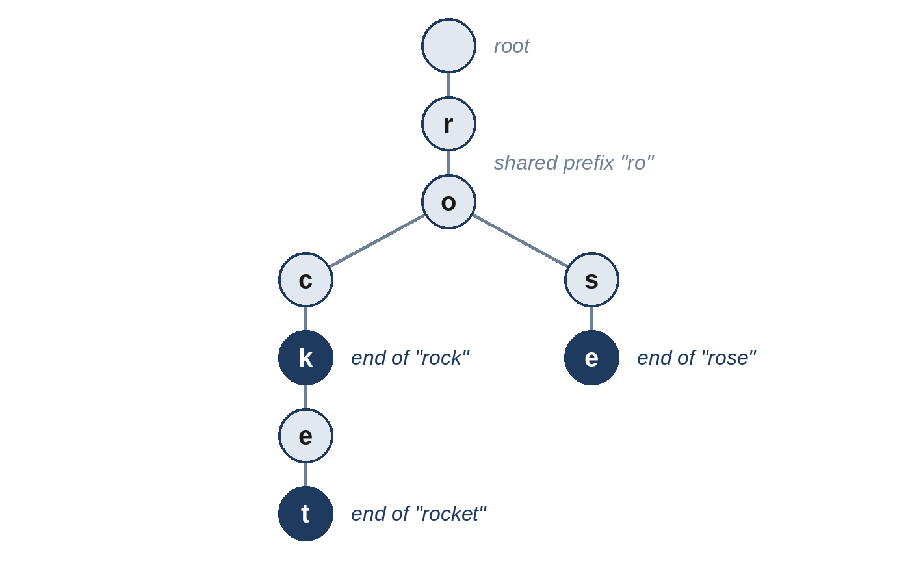

# Chapter 20: Tries and String Techniques

Strings appear in nearly every interview, usually combined with a pattern from earlier chapters: a hash map for anagrams, a sliding window for substrings, DP for edit distance. This chapter adds the tools specific to strings: the **trie**, or prefix tree, for searching many words by prefix; a few techniques for prefixes and encodings; and a linear-time algorithm for finding a pattern in text.

## When to Use a Trie

- **Prefix queries** over a set of words: autocomplete, "does any word start with...?"
- **Searching for many words at once**, for example in a letter grid, sharing the work for words with a common start.
- Problems where a sorted list with binary search would also work. Mention both; a trie is easier to extend, a sorted list is simpler.

A trie stores words letter by letter in a tree. Each node maps a letter to a child node, and a marker records where a whole word ends. Words with the same prefix share the same path, so looking up a word or prefix of length L takes O(L) time, however many words are stored.



## 20.1 Prefix Tree (Medium)

Implement a structure that adds words and answers two questions: is this exact word stored, and does any stored word start with this prefix?

```
@include code/ch20/p01_prefix_tree.examples.txt
```

The examples replay a session of operations: `('add', w)` stores w, `('word', w)` asks whether w is stored, and `('prefix', p)` asks whether any word starts with p. The output lists the answers to the questions.

**The idea.** Nested dictionaries make a compact trie in Python: each node is a dict from letter to child, and the key `"$"` marks the end of a word. Both questions walk down the tree letter by letter; they differ only in what they check at the end.

```python
@include code/ch20/p01_prefix_tree.py::Trie
```

**Complexity:** O(L) per operation for a word of length L; space proportional to the total length of the stored words.

> **Common Mistake:** In an early version of this solution, `has_prefix` returned `node is not None`. That looks right, but for the empty prefix the walk stops at the root, which exists even when the trie is empty, so `has_prefix("")` claimed a word existed in an empty trie. The random tests against a simple set-based version found the case. Returning `bool(node)` fixes it, because an empty root is an empty dict. Edge cases like the empty string are exactly where hand-written tests miss bugs and comparisons with a brute force find them.

## 20.2 Autocomplete (Medium)

After each character typed into a search box, suggest up to three product names that start with the text typed so far, in alphabetical order.

```
@include code/ch20/p02_autocomplete.examples.txt
```

**Think first:** Once the names are sorted, where are all the names that start with a given prefix?

**The idea.** In a sorted list, all names with the same prefix sit next to each other, starting at the first name that is greater than or equal to the prefix. Binary search finds that position, and the next three names are the candidates, as long as they still start with the prefix.

```python
@include code/ch20/p02_autocomplete.py::autocomplete
```

**Complexity:** O(n log n × L) to sort, then O(log n × L) per character typed.

> **Follow-Up:** A trie works too: store at each node the three best suggestions below it, so each keystroke is answered in O(1) after walking one level down. That's how you would scale it to rank by popularity rather than alphabetically.

## 20.3 Board Words (Hard)

Which words from a list can be traced on a letter grid, moving up, down, left or right, without using a cell twice in the same word?

```
@include code/ch20/p03_board_words.examples.txt
```

**Brute force.** Run the Grid Word search from Problem 15.4 for each word. With many words, that repeats the same work: words that start the same way explore the same paths.

**The idea.** Put all the words into a trie, then run one backtracking search from each cell, following the trie as you go. A path stops as soon as no word continues with the next letter, and every word found along the way is recorded.

```python
@include code/ch20/p03_board_words.py::board_words
```

**Complexity:** O(r × c × 3ᴸ) in the worst case for words up to length L, but the trie prunes most paths early, and the time hardly depends on the number of words.

> **Tip:** Storing the whole word at its end marker (`node["$"] = w`) avoids rebuilding the word from the path. A further optimization removes a word's marker once found, so it isn't reported twice, and removes trie branches that have no words left.

## 20.4 Shared Start (Easy)

Find the longest prefix shared by all the strings in a list.

```
@include code/ch20/p04_shared_start.examples.txt
```

**The idea.** Compare the strings position by position against the first one, and stop at the first position where any string is too short or has a different character.

```python
@include code/ch20/p04_shared_start.py::shared_start
```

**Complexity:** O(total length) time, O(1) extra space.

A neat alternative: the alphabetically smallest and largest strings differ the most, so the prefix they share is shared by all.

```python
@include code/ch20/p04_shared_start.py::shared_start_minmax
```

## 20.5 Pack and Unpack (Medium)

Write two functions: one that turns a list of strings into a single string, and one that turns it back. The strings may contain any characters, including any separator you might choose.

```
@include code/ch20/p05_pack_strings.examples.txt
```

**Think first:** Why does joining with a comma, or any other special character, fail?

**The idea.** Any separator might appear inside a string. Instead, write each string's *length* before it, followed by a colon: `"5:hello0:3:a:b"`. Reading it back, the number before the first colon says exactly how many characters to take, so colons inside the strings don't matter.

```python
@include code/ch20/p05_pack_strings.py::pack,unpack
```

**Complexity:** O(total length) for both.

> **Interviewer's View:** This is how many real network protocols frame messages: a length header, then the data. Saying so connects a puzzle to engineering practice, which interviewers value.

## 20.6 Find Every Match (Hard)

Return every position where a pattern occurs in a text, including overlapping matches, in O(n + m) time for text length n and pattern length m.

```
@include code/ch20/p06_find_pattern.examples.txt
```

**Brute force.** Compare the pattern at every position: O(n × m) in the worst case, for example searching "aaab" in "aaaa...a".

**The idea.** The Knuth-Morris-Pratt (KMP) algorithm never moves backwards in the text. When a mismatch happens after k matching characters, it already knows those k characters, because they equal the pattern's first k. A table computed from the pattern alone, `fail`, says how much of the pattern is still matched after the mismatch: the longest prefix of the pattern that is also a suffix of what was matched.

```python
@include code/ch20/p06_find_pattern.py::find_all
```

**Complexity:** O(n + m) time, O(m) space.

> **Tip:** In Python's own code, `text.find(pattern, start)` in a loop is the practical choice. Explain KMP when the interviewer asks for a guaranteed linear time, and ask whether they want you to implement it; many are content with a clear explanation of the `fail` table.

## Key Takeaways

- A trie answers word and prefix questions in O(L), and lets one search look for many words at once.
- In a sorted list, all strings sharing a prefix are adjacent, so binary search finds them.
- Length-prefixed encoding works for any content; separator-based encoding doesn't.
- KMP finds all matches in linear time by never re-reading the text.
- Test strings with the empty string, one character, and repeated characters: that's where bugs hide.
