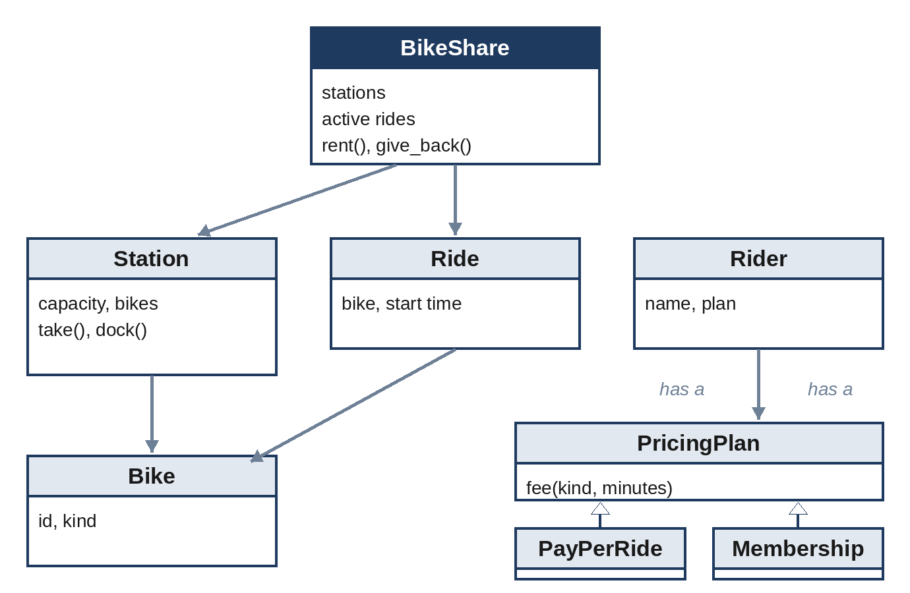

# Chapter 24: Object-Oriented Design

An object-oriented design (OOD) interview asks you to model a small system in code: a parking garage, a vending machine, a library, a card game. There is no single right answer. The interviewer wants to see how you turn vague requirements into classes with clear responsibilities, how you keep the design open to change, and whether you can write the core of it in working code within the hour. OOD rounds are more common for experienced engineers, and at companies whose products involve many interacting objects, but anyone can be asked a lighter version.

## A Repeatable Approach

1. **Clarify the scope (5 minutes).** Who uses the system? What are the main actions? What's out of scope? Write a short list of use cases: "a rider rents a bike", "a rider returns a bike to any station", "the system charges a fee".
2. **Find the nouns and verbs.** Nouns become candidate classes (rider, bike, station, ride); verbs become methods (rent, return, charge).
3. **Assign responsibilities.** Each class should have one clear job and own its data. A station knows its docks; a pricing plan knows how to compute a fee; the system coordinates.
4. **Identify what varies.** Wherever the requirements say "different kinds of" (bikes, plans, payment methods), plan for an interface with several implementations, rather than `if` statements on a type.
5. **Write the core code**, then walk through a use case, including a failure.
6. **Discuss extensions**: what changes if we add a new bike type, reservations, or a second city?

## Principles Worth Naming

You don't need to recite design-pattern catalogs, but a few principles help you explain choices:

- **Encapsulation:** an object protects its own state; other objects call its methods instead of changing its data directly. `station.dock(bike)` checks capacity; code outside the class never appends to the list.
- **Single responsibility:** a class has one reason to change. Pricing rules change for business reasons; docking rules change for hardware reasons. Keep them in separate classes.
- **Open for extension, closed for modification:** adding a new pricing plan should mean writing a new class, not editing existing ones.
- **Composition over inheritance:** a rider *has* a pricing plan, rather than being a "MemberRider" subclass. Riders can then change plans without becoming a different object.
- **Fail loudly:** an invalid action (renting a second bike, returning to a full station) raises a clear error instead of corrupting state.

## Worked Example: A Bike-Share System

**The requirements, after clarifying:** stations have a fixed number of docks. Bikes are classic or electric. A rider rents one bike at a time from a station and returns it to any station with a free dock. Casual riders pay an unlock fee plus a per-minute rate, higher for electric bikes; members get a lower electric rate, and classic rides up to 45 minutes are included. Payments, maps and maintenance are out of scope.

The simple, stable parts are data classes and an enumeration:

```python
@include code/ch24/bike_share.py::BikeKind,Bike,Station
```

What varies is pricing, so it's an abstract base class with one method, and each plan is a small class:

```python
@include code/ch24/bike_share.py::PricingPlan,PayPerRide,Membership
```

The coordinating class keeps track of stations and of the ride each rider currently has. Notice that it never computes a fee itself: it asks the rider's plan.

```python
@include code/ch24/bike_share.py::Rider,Ride,BikeShare
```

A short session shows the design at work, including a failed return to a full station:

```python
@include code/ch24/bike_share.py::demo
```

```
@include code/ch24/bike_share.demo.txt
```

The whole design fits in one picture:



The book's test for this design checks every failure path (a second rental, no bike of the requested kind, returning without a bike, returning to a full station) as well as the fees.

> **Interviewer's View:** The strongest signal in this example is the `PricingPlan` interface. When the interviewer asks "what if we add a student plan?", the answer is "one new class, no changes elsewhere". Designs full of `if rider.type == "member"` checks make that same change risky.

## Common Follow-Up Questions

- **"How would you add reservations?"** A `Reservation` object holds a bike at a station for a few minutes. `Station.take` must then skip reserved bikes, so the change stays inside the class that owns the bikes.
- **"Two riders try to take the last bike at the same moment."** In a real service, the station's bike list is shared state. Discuss a lock per station, or an atomic database update that succeeds for only one rider. Naming the race condition is more important than the exact mechanism.
- **"How would you store this?"** Tables for stations, bikes, riders and rides; a ride row is created at rental and completed at return. That's a bridge to system design (Chapter 25).
- **"How would you test it?"** Unit tests for each pricing plan's fees at the boundaries (45 and 46 minutes), and scenario tests for the failure paths.

## Other Classic Design Prompts

Practice the same approach on these prompts. For each, list the use cases, the classes, the one or two things that vary, and the failure cases.

| Prompt | What usually varies | A failure case to handle |
| --- | --- | --- |
| Parking garage | Vehicle and spot sizes; pricing | Garage full; a car leaves without a ticket |
| Vending machine | Payment method; product types | Product sold out; not enough change |
| Elevator controller | Scheduling strategy | Requests while moving; overweight |
| Library lending | Item types (book, audio, film); loan rules | Item already lent; overdue fines |
| Card game (deck and hands) | Game rules | Empty deck; invalid move |
| Chat room | Message types; notification channels | User not in room; message too long |
| Food delivery order | Order states; delivery options | Restaurant closes mid-order |

> **Tip:** The order and elevator prompts contain hidden state machines, like the launch sequence in Chapter 23. Writing the allowed transitions as a table is a quick way to show rigor.

## Key Takeaways

- Clarify use cases first, then turn nouns into classes and verbs into methods.
- Give each class one responsibility, and let objects protect their own state.
- Put what varies behind an interface; new behavior should mean new classes, not edited ones.
- Prefer composition: a rider has a plan.
- Write and walk through working code for the core, including failures, and be ready to extend it.
