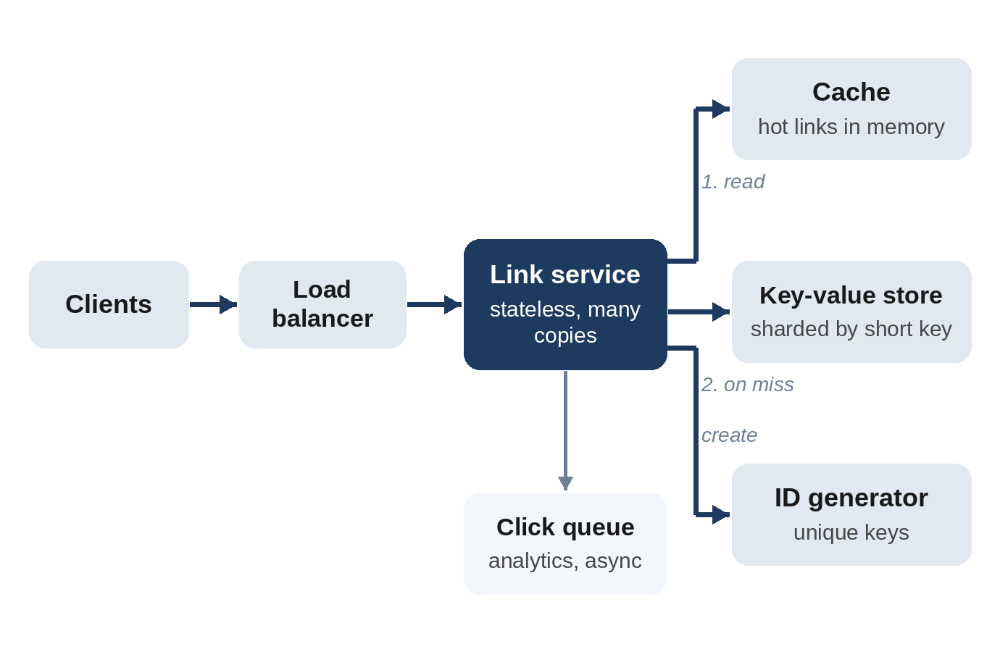

# Chapter 25: System Design Fundamentals

In a system design interview, you're asked to design a large service, such as a link shortener, a chat system or a news feed, in about 45 minutes, on a whiteboard or in a drawing tool. Nobody expects a complete design. The interviewer is evaluating how you handle ambiguity, how you reason about scale, whether you know the standard building blocks and their trade-offs, and whether you can go deep on one part when asked. It's usually part of the loop for mid-level roles and above, and often the round that decides the level of the offer.

This chapter gives you a framework, the building blocks, the numbers you need for quick estimates, and two worked designs. It's an introduction: system design is a large subject, and the "Further Reading" list at the end points to good next steps.

## A Framework for 45 Minutes

| Step | Time | What you do |
| --- | --- | --- |
| 1. Requirements | 5 min | Functional: what the system does. Non-functional: scale, latency, availability, consistency. Agree on what's out of scope. |
| 2. Estimates | 5 min | Requests per second, storage, bandwidth: rough orders of magnitude. |
| 3. API and data model | 5 min | The main endpoints, and the main tables or records. |
| 4. High-level design | 10 min | Boxes and arrows: clients, load balancers, services, databases, caches, queues. Walk one request through it. |
| 5. Deep dives | 15 min | The hardest parts, often chosen by the interviewer: scaling the database, caching, consistency, failures. |
| 6. Wrap-up | 5 min | Bottlenecks, monitoring, what you would do next. |

> **Tip:** Drive the conversation, but check in: "I'd like to go deeper on storage next. Is that the most useful area, or would you prefer something else?" Interviewers often have a specific deep dive in mind.

## The Building Blocks

| Component | What it does | Trade-offs to mention |
| --- | --- | --- |
| Load balancer | Spreads requests over many identical servers | Needs health checks; sticky sessions complicate scaling |
| Stateless service | Handles requests without storing data between them | Easy to scale out; state must live elsewhere |
| Relational database (SQL) | Tables, transactions, joins, strong consistency | Harder to scale writes beyond one machine |
| Key-value / document store (NoSQL) | Fast lookups by key; scales across many machines | Fewer joins and transactions; often eventually consistent |
| Cache | Keeps hot data in memory, e.g. Redis or Memcached | Stale data; invalidation is hard; LRU eviction (Chapter 22) |
| Replication | Copies of the data on several machines | Read scaling and fault tolerance; replicas may lag behind |
| Sharding (partitioning) | Splits data across machines by key | Hot keys; resharding; cross-shard queries are expensive |
| Message queue / log | Decouples producers from consumers, e.g. Kafka | Absorbs bursts; adds delay; consumers must handle duplicates |
| Object storage | Stores large files cheaply, e.g. images and video | High latency per request; pair with a CDN |
| CDN | Serves static content from servers near the user | Great for static data; cache invalidation again |

Two theoretical ideas come up repeatedly:

- **The CAP theorem**: when a network partition splits the system, a distributed store must choose between consistency (every read sees the latest write) and availability (every request gets an answer). In practice, the question is which parts of *your* system need which.
- **Consistency models**: *strong* consistency (reads always see the latest write) versus *eventual* consistency (replicas agree after a short delay). A bank balance needs the first; a "likes" counter is fine with the second.

## Numbers for Quick Estimates

You don't need precise figures, only the right order of magnitude.

| Fact | Value |
| --- | --- |
| Seconds in a day | 86,400, roughly 100,000 for estimates |
| 1 million requests per day | about 12 per second |
| 1 billion requests per day | about 12,000 per second |
| Peak traffic | often 2 to 10 times the average; state your assumption |
| One character of ASCII text | 1 byte |
| A short database row | a few hundred bytes |
| Reading from memory vs. a network round trip in a data center vs. a disk seek | roughly 100 nanoseconds vs. hundreds of microseconds vs. milliseconds |

> **Warning:** Latency figures depend on hardware and change over time. Use them to compare options ("a cache hit avoids a network call to the database"), not as exact predictions.

## Worked Design 1: A Link Shortener

**Requirements.** Users submit a long URL and get a short link such as `sho.example/aZ3kQ9x`. Visiting the short link redirects to the long URL. Optional: custom aliases and expiry dates. Non-functional: redirects must be fast and highly available; creating links can be slightly slower.

**Estimates.** Assume 100 million new links per month and 100 redirects per link created.

- Writes: 100 million / (30 × 86,400 seconds) ≈ 40 per second on average.
- Reads: 100 times that, about 4,000 per second on average, and perhaps 20,000 at peak.
- Storage: about 500 bytes per link × 1.2 billion links per year ≈ 600 GB per year; 3 TB over five years.

The system is **read-heavy**, which shapes everything that follows.

**Short keys.** Seven characters from the 62 letters and digits give 62⁷ ≈ 3.5 trillion possible keys, enough for thousands of years at this rate. Two common ways to generate them: encode a unique, increasing ID in base 62 (simple and collision-free, but predictable), or hash the URL with a random component and retry on the rare collision (unpredictable, needs a uniqueness check).

**API.**

```
POST /links    body {"url": "https://...", "alias": "optional"}
               returns {"short": "aZ3kQ9x"}
GET  /{short}  redirects (301 or 302) to the long URL
```

**High-level design.**



**Deep dives.**

- **Storage:** the data is a simple key-value mapping with no joins, so a distributed key-value store fits well, sharded by the short key. A relational database also works at this size, with read replicas.
- **Caching:** a small fraction of links receive most visits. An in-memory cache in front of the store, with LRU eviction, serves most redirects without touching the database.
- **Redirect code:** a *301* (permanent) redirect lets browsers cache it, reducing load, but hides later visits from analytics; a *302* (temporary) redirect sends every visit through the service. Which one depends on whether click statistics are a requirement: a good question to ask.
- **Analytics:** don't slow down redirects by writing statistics synchronously. Publish a click event to a queue, and let a separate consumer aggregate counts.
- **Abuse:** rate-limit link creation per user (the token bucket from Chapter 23) and check URLs against a list of known malicious sites.

## Worked Design 2: A Telemetry Ingestion Pipeline

**Requirements.** A fleet of 10,000 vehicles (delivery robots, satellites or cars) each send a 1 KB status message every second. Operators need a live dashboard of the latest status of each vehicle, alerts within seconds when a reading is abnormal, and the ability to query history for investigations.

**Estimates.** 10,000 messages per second; 10 MB per second; about 864 GB per day before compression. This system is **write-heavy**, the opposite of the link shortener.

**High-level design.**

1. **Ingestion gateways** behind a load balancer accept messages, authenticate the vehicle, validate the format and publish to a partitioned **log** (such as Kafka), keyed by vehicle ID, so each vehicle's messages stay in order.
2. **Consumers** read the log independently:
   - a *latest-state* consumer updates a key-value store holding each vehicle's last status, which the dashboard reads;
   - an *alerting* consumer runs rules like the spike detector from Chapter 23 and sends alerts;
   - an *archive* consumer writes batches to cheap object storage in a columnar format, partitioned by date, for historical queries.

**Deep dives.**

- **Bursts and failures:** the log absorbs bursts and lets a consumer catch up after a failure, because messages stay in the log for a retention period.
- **Duplicates:** networks retry, so the same message can arrive twice. Include a sequence number per vehicle and make consumers *idempotent*: processing a message twice has the same effect as once.
- **Out-of-order data:** a vehicle that was offline sends old messages late. The latest-state consumer should ignore messages older than the stored one.
- **Hot partitions:** if one vehicle sends far more data, its partition becomes a bottleneck; monitor partition lag.

> **Interviewer's View:** Notice how the estimates drove the design: the read-heavy system centered on caching, the write-heavy one on a log and independent consumers. Explicitly linking your numbers to your choices is what separates strong answers from a list of buzzwords.

## Key Takeaways

- Follow a framework: requirements, estimates, API, high-level design, deep dives, wrap-up.
- Estimates tell you whether a system is read-heavy or write-heavy, and that drives the design.
- Know the building blocks and one trade-off for each.
- Caches, queues and replication solve problems and create new ones (staleness, duplicates, lag); say so.
- Ask which deep dive the interviewer wants, and go deep there.

## Further Reading

- Martin Kleppmann, *Designing Data-Intensive Applications* (O'Reilly): the standard reference on storage, replication, partitioning and streams.
- Alex Xu, *System Design Interview: An Insider's Guide* (volumes 1 and 2): many worked interview designs.
- The engineering blogs of large technology companies, which describe real systems and the trade-offs behind them.
