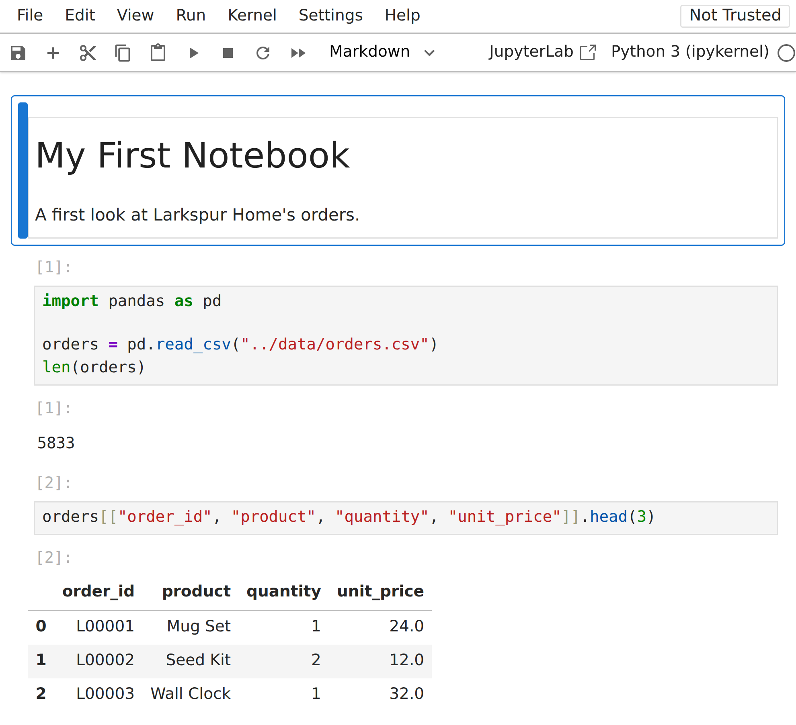
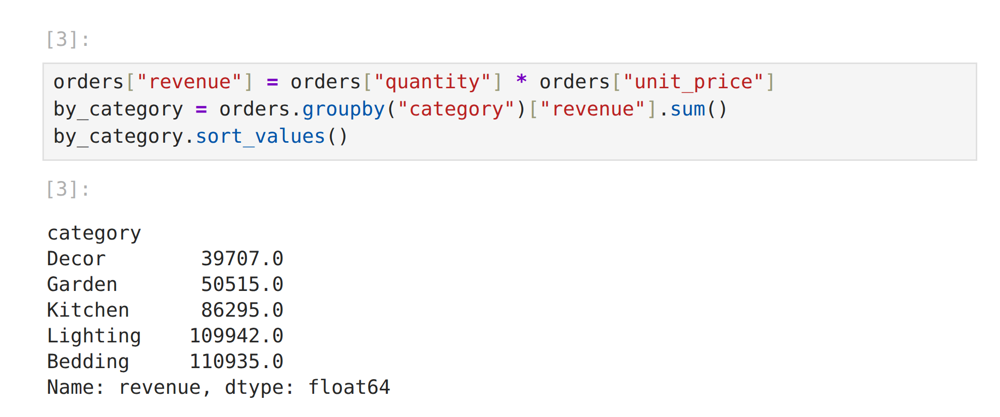
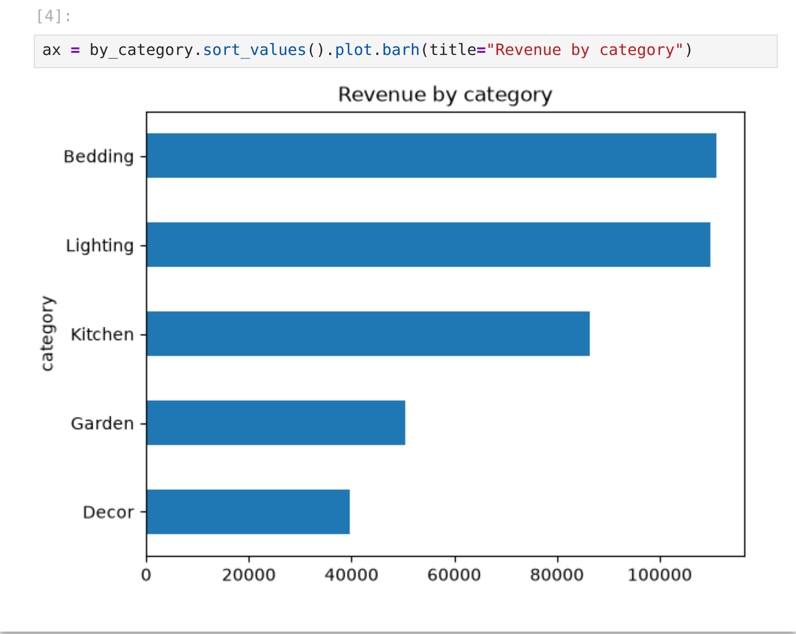

# Chapter 2: Setting Up and the Book's Data

In this chapter you'll install the four libraries the book uses, get the book's code and data, and take a first look at the datasets. It takes about fifteen minutes, and then everything else in the book just works.

## Getting the Code and Data

Every program in this book, with its exact expected output, every exercise solution and all ten datasets are in a free repository on GitHub:

**github.com/aadhavanshines/data-analysis-with-python-hands-on**

Open that address in a web browser, click the green **Code** button and choose **Download ZIP**, then unzip it wherever you keep your projects. If you use Git, you can clone it instead: type `git clone`, a space, and the address above with `https://` in front, all on one line.

Either way you get a folder called `data-analysis-with-python-hands-on`. Its `code` folder holds one folder per chapter (`ch01` to `ch27`) and a shared `data` folder with the datasets, ready to use. The repository's README file repeats these steps and lists what each chapter contains.

You can also work without downloading anything: make the folders yourself and type the programs from the book, as the rest of this chapter shows. Many readers do both: they type each program and compare it with the tested file when something doesn't match.

## Python and a Virtual Environment

You need Python 3.12 or newer. Check what you have from a terminal (on Windows, use `py` instead of `python3`):

```
$ python3 --version
```

Go to the folder you downloaded (or make your own, `data-analysis`) and create a **virtual environment** inside it: a private set of installed libraries for this project, so it can't clash with anything else on your computer:

```
$ cd data-analysis-with-python-hands-on
$ python3 -m venv .venv
```

Activate it each time you open a new terminal for this book. On macOS and Linux:

```
$ source .venv/bin/activate
```

On Windows:

```
$ .venv\Scripts\activate
```

## Installing the Libraries

The book uses four libraries:

- **NumPy:** fast arrays of numbers; pandas is built on it.
- **pandas:** tables of data (DataFrames) and almost everything you do with them.
- **matplotlib:** charts.
- **openpyxl:** reading and writing Excel files, which pandas uses behind the scenes.

Install the versions the book was tested with, so your output matches the book exactly. In the downloaded folder, one command installs them all from the repository's `requirements.txt` file:

```
$ python -m pip install -r requirements.txt
```

If you made your own folder, name the versions instead:

```
$ python -m pip install numpy==2.5.4 pandas==3.0.6 matplotlib==3.11.2
$ python -m pip install openpyxl==3.1.5 pytest==9.1.1
```

(pytest, for testing your analysis code, appears in Chapter 19.) Newer versions will almost always work too; occasionally a number in a printed table may differ in the last digit, or a message may be worded differently.

Check the installation:

```python
@include code/ch02/check_setup.py
```

```
@include code/ch02/check_setup.out
```

> **Tip:** Prefer **Jupyter notebooks**, where code, output and charts sit together on one page? Everything in this book works in a notebook too, and the end of this chapter shows how to use one.

## The Folder Layout

Each chapter's programs go in their own folder, next to a shared `data` folder. In the download, these folders are inside `code`; if you type the programs yourself, create the same layout:

```
data-analysis/
    data/
        make_data.py
        orders.csv
        ...
    ch01/
        first_look.py
    ch02/
        check_setup.py
    ...
```

The programs read data with paths like `"../data/orders.csv"`: `..` means "the folder above this one", so a program in `ch05` finds the shared data folder. Run each program from inside its own chapter folder:

```
$ cd ch01
$ python first_look.py
```

In the download, each program's expected output is stored next to it, in a file with the same name ending in `.out` (`first_look.out`), so you can compare your run with the book's at any time.

## Making the Data

All the datasets in this book are fictional, and one program makes all of them: `make_data.py`, printed in full in Appendix F. It uses NumPy's random number generator with a fixed **seed** (2026), so it makes exactly the same "random" data on every computer, every time. That's why your results will match the book's to the last digit.

The download already contains the datasets, made by this program, so you can skip this step. If you're typing the programs yourself, type or copy `make_data.py` into your `data` folder and run it there:

```
$ cd data
$ python make_data.py
```

```
@include code/data/make_data.out
```

The data was built with patterns on purpose: busy Novembers and Decembers, garden products that sell in spring, bigger orders when there's a discount, a checkout page that converts a little better, pollution that affects clinic visits two days later. Practicing on data with known patterns is the best way to learn: when your analysis finds them, you know your method works.

## Meet the Data

This program lists every file with its size and columns:

```python
@include code/ch02/peek_data.py
```

```
@include code/ch02/peek_data.out
```

Here's what each one holds.

| File | One row per | Used in |
| --- | --- | --- |
| `orders.csv` | Order at Larkspur Home in 2025 | Most chapters; Project 1 |
| `customers.csv` | Customer: signup date, region, segment, birth year | Chapters 8, 10, 18 |
| `products.csv` | Product: category, list price, unit cost | Chapters 10, 18, 21 |
| `orders_raw.csv` | A messy export of 300 orders | Chapter 7 |
| `survey.csv` | Survey response: plan, ratings, comment | Chapters 13, 22 |
| `sessions.csv` | Website visit in a checkout experiment | Chapters 17, 23 |
| `prices.csv` | Trading day: prices of three companies and an index | Chapter 24 |
| `air_quality.csv` | Day and city: fine-particle pollution | Chapters 14, 16, 25 |
| `clinic_visits.csv` | Day and city: clinic visits for breathing problems | Chapters 14, 16, 25 |
| `budget.csv` | Bank transaction of one household | Chapters 13, 26 |

**CSV** (comma-separated values) is the most common way to share tables: plain text, one row per line, columns separated by commas, with the column names on the first line. Every spreadsheet program and database can read and write it.

## Working in Jupyter Notebooks

So far you've run programs from a terminal. Many analysts prefer a **Jupyter notebook**: a page in your web browser made of **cells**. A code cell holds a few lines of Python; when you run it, its output appears right underneath, tables as neat tables and charts as pictures. Text cells hold headings and notes. You build up an analysis one small step at a time and see each result as you go.

Jupyter came with `requirements.txt` if you downloaded the book's code. If you made your own folder, install it too:

```
$ python -m pip install notebook==7.6.3
```

With your virtual environment active, start Jupyter from the book's folder:

```
$ jupyter notebook
```

Your web browser opens and lists the files in that folder. (The terminal must stay open while you work; to stop Jupyter afterwards, click in the terminal and press Ctrl+C twice.) Open `code`, then `ch02`, then `first_notebook.ipynb`. Notebook files end in `.ipynb`.

### Your First Notebook

The notebook starts with a text cell, a heading and one line of notes, and then four code cells. Click in the first code cell and press **Shift+Enter**: Jupyter runs the cell and moves to the next one. Press Shift+Enter four times to run them all.

The first cell loads the orders:

```python
@include code/ch02/first_notebook.py#L6-L9
```

There's no `print` here, yet the notebook shows 5833 under the cell. That's the first thing to know about notebooks: **the value of a cell's last line is shown automatically.** The second cell shows the first three orders, four of their columns, as a table (double brackets pick columns, which Chapter 6 explains):

```python
@include code/ch02/first_notebook.py#L12-L12
```



The number in brackets beside each cell, `[1]`, `[2]`, counts the order in which cells were run. The third cell adds a revenue column and totals it by category:

```python
@include code/ch02/first_notebook.py#L15-L17
```



Variables live on between cells: the third cell uses `orders` from the first, and the fourth uses `by_category` from the third. The fourth cell draws a chart, which appears under the cell, with no `savefig` needed:

```python
@include code/ch02/first_notebook.py#L20-L20
```



The chart is assigned to `ax` only so that the cell's last line has no value to show; without `ax =`, Jupyter would print a line describing the chart object above the picture.

> **Common Mistake:** Because variables live on, the order you run cells in matters. Run the third cell before the first, and you get `NameError: name 'orders' is not defined`. Change a cell near the top, and the cells below still show results from the old version until you run them again. When results look odd, choose **Kernel > Restart Kernel and Run All Cells**: Jupyter forgets everything and runs the notebook from top to bottom, which is exactly how anyone else will run it.

A few more things worth knowing:

- **Saving:** Jupyter saves automatically every few minutes, and Ctrl+S (Cmd+S on a Mac) saves at once. The `.ipynb` file keeps the outputs too, so you can reopen it later and see your results without running anything.
- **New notebooks:** choose **File > New > Notebook** and pick the Python 3 kernel. Save it in a chapter folder, so paths like `"../data/orders.csv"` work.
- **Text cells:** change a cell's type from Code to Markdown in the toolbar and write notes, with `#` for a heading. A notebook with a few sentences between the steps is a report someone else can follow.
- **"Not Trusted":** Jupyter marks a notebook it didn't run on your computer, like the ones you downloaded, as not trusted, and holds back anything interactive in its saved outputs until you run it yourself. Running the cells fixes it.

### A Notebook for Every Chapter

Each chapter folder in the download also has a notebook with all of that chapter's programs, in the book's order: `code/ch09/ch09.ipynb` for Chapter 9, and so on. Each code cell is one program, under the heading of the section it comes from, and the saved notebooks show every output and chart, so you can browse them on GitHub without running anything. The book's tests run every chapter notebook on Python 3.12 to 3.15 and check that each cell prints exactly what the book prints. Choose **Run > Run All Cells** to run a whole chapter.

Notebooks are best for exploring: trying an idea, looking at a table, adjusting a chart. Plain `.py` files are best for analyses you rerun, test and schedule, which is why this book's programs are files (Chapter 19 shows why). Many analysts explore in a notebook and then move the finished steps into a `.py` file. In fact, `first_notebook.py`, next to the notebook, is the same notebook written as a plain file: each `# %%` line starts a new cell, and code editors such as Visual Studio Code can run those cells one at a time, notebook style.

## Key Takeaways

- Every program, its expected output, the exercise solutions and the datasets are free at github.com/aadhavanshines/data-analysis-with-python-hands-on.
- Use a virtual environment per project, and install the exact library versions when you need reproducible results.
- The book's four libraries: NumPy (arrays), pandas (tables), matplotlib (charts) and openpyxl (Excel files).
- Keep each chapter's programs in their own folder beside a shared `data` folder.
- A fixed random seed makes "random" data identical everywhere, so your results match the book's.
- A Jupyter notebook runs code in cells and shows the last line's value, tables and charts under each cell; restart and run all cells before trusting the results.
