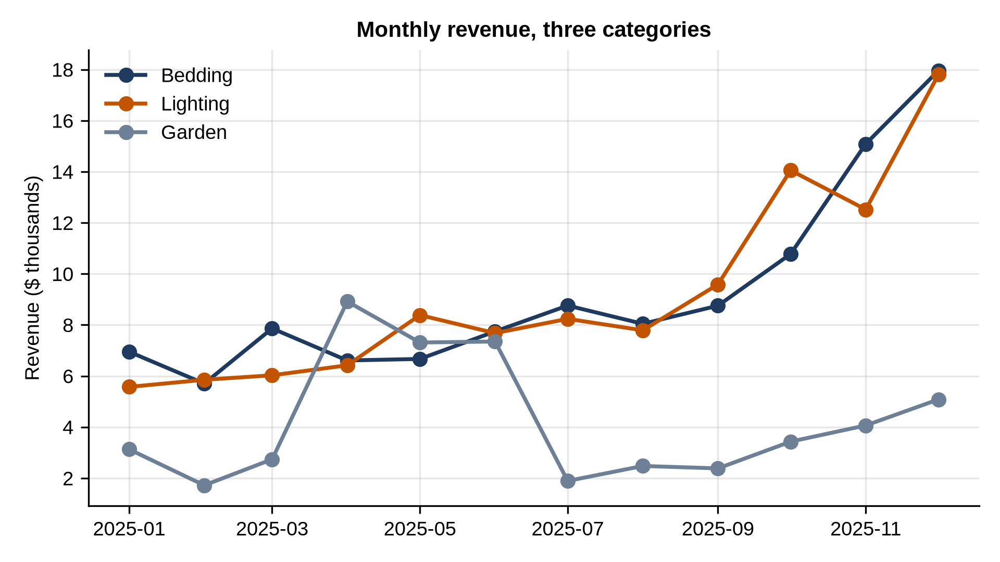
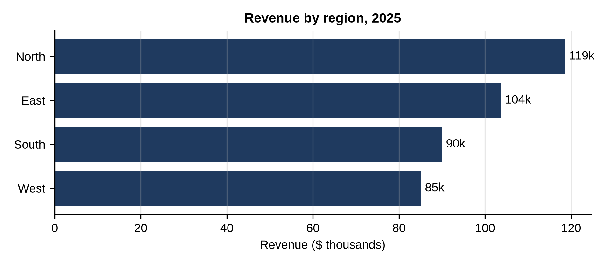
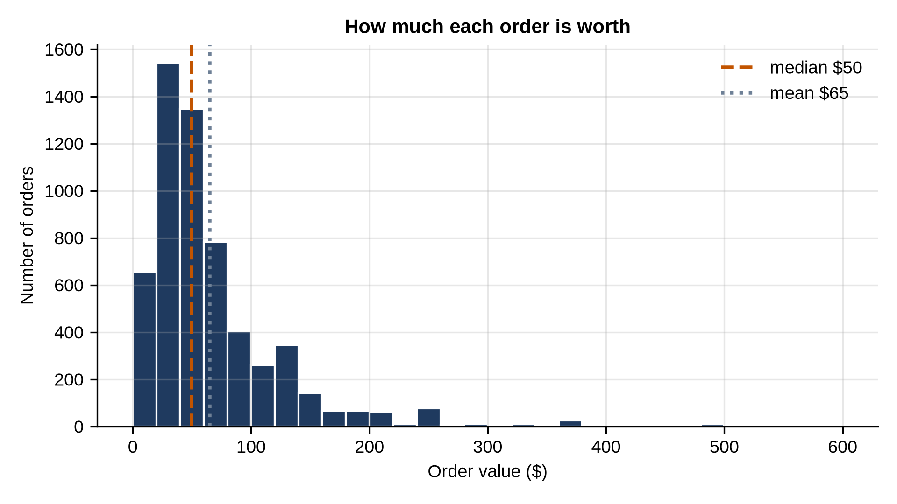
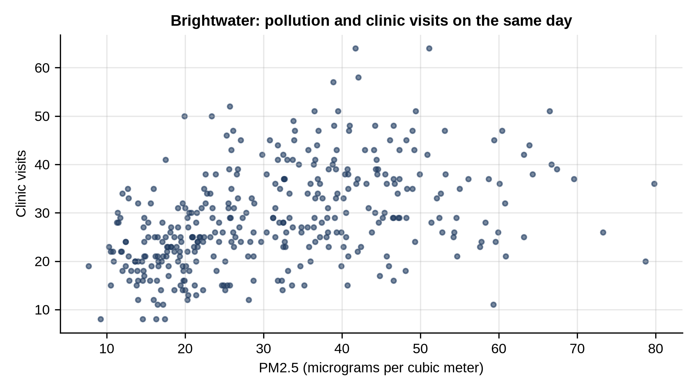

# Part III: Seeing and Explaining

# Chapter 14: Charts With matplotlib

A good chart shows in a second what a table takes a minute to read. **matplotlib** is Python's standard charting library: pandas uses it behind its own `plot` methods, and almost every other Python charting tool builds on it. This chapter draws the four charts you'll use most: line, bar, histogram and scatter.

## The Shape of Every matplotlib Program

Every chart in this chapter follows the same five steps:

1. `fig, ax = plt.subplots()` creates a **figure** (the whole image) and an **axes** (one chart area inside it).
2. Draw on the axes: `ax.plot`, `ax.bar`, `ax.hist`, `ax.scatter`.
3. Label it: `ax.set_title`, `ax.set_xlabel`, `ax.set_ylabel`, `ax.legend`.
4. `fig.tight_layout()` adjusts spacing so labels don't overlap.
5. `fig.savefig("name.png")` saves it. (`plt.show()` opens a window instead, if you're working interactively.)

> **Note:** The charts in this book were drawn by exactly the code shown, with a print-friendly style (fonts and colors chosen for paper) applied on top. Your charts will use matplotlib's default colors and fonts, but show the same data.

## Line Charts: Change Over Time

```python
@include code/ch14/line_chart.py
```

```
@include code/ch14/line_chart.out
```



The data step groups revenue by category and resamples each to months, then `unstack(level=0)` makes one column per category. Plotting three categories, rather than all five, keeps the chart readable. The story is immediate: Bedding and Lighting climb toward the holidays; Garden has its own season in spring.

## Bar Charts: Comparing Categories

```python
@include code/ch14/bar_chart.py
```

```
@include code/ch14/bar_chart.out
```



Horizontal bars (`barh`) leave room for long category names, and sorting the bars makes ranking obvious. `bar_label` writes each value at the end of its bar, so readers don't have to estimate from the axis.

## Histograms: How Values Are Spread

```python
@include code/ch14/histogram.py
```

```
@include code/ch14/histogram.out
```



A **histogram** counts how many values fall into each bin, here $20 wide. Order values are **skewed**: most orders are small, but a few large ones stretch the tail far to the right. The dashed line marks the median ($50) and the dotted line the mean ($65). The long tail pulls the mean up, which is why the median is often the better "typical" value for money (Chapter 16).

## Scatter Plots: Two Measures Together

```python
@include code/ch14/scatter.py
```

```
@include code/ch14/scatter.out
```



Each dot is one day in one city. Visits tend to be higher on more polluted days, but the cloud is wide: same-day pollution explains only part of the variation. Chapter 16 measures this with correlation and finds a much stronger link two days later.

`alpha=0.6` makes the dots partly transparent, so overlapping points show up darker, and `s=10` makes them small. Both help when there are hundreds of points.

## Exercises

1. **Pages per session.** Draw a bar chart of how many sessions in `sessions.csv` viewed 1, 2, 3, and so on pages. Label the axes and save it as `pages.png`.

## Key Takeaways

- Every matplotlib chart: create figure and axes, draw, label, tidy the layout, save.
- Line charts for change over time, bars for comparing categories, histograms for spreads, scatter plots for two measures.
- Sort bars and label values; transparency helps crowded scatter plots.
- Skewed data pulls the mean away from the median; a histogram shows why.
