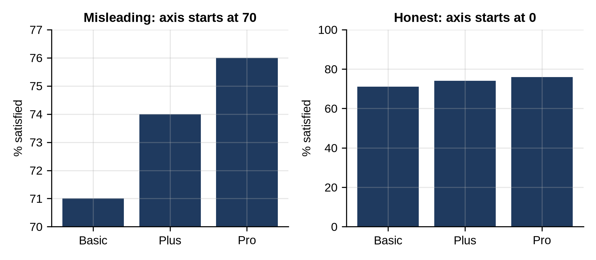
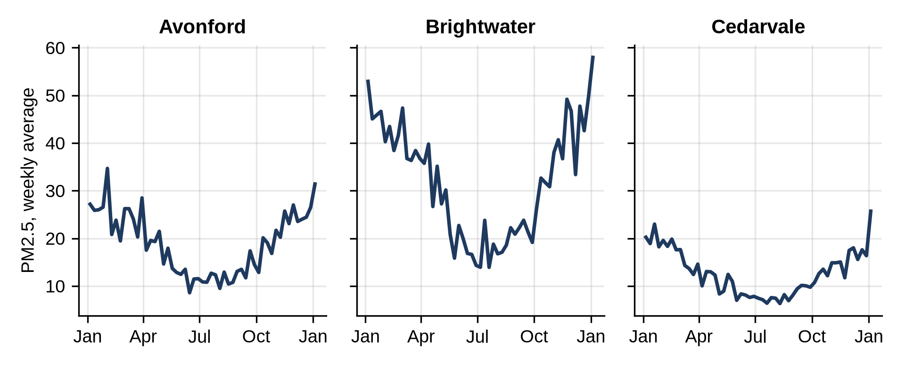

# Chapter 15: Choosing Honest Charts

A chart is an argument. The same numbers can look like a crisis or like nothing, depending on choices most readers never notice: where the axis starts, which data is included, how things are compared. This chapter is about choosing the right chart, and drawing it honestly.

## Which Chart?

| You want to show | Use | Avoid |
| --- | --- | --- |
| Change over time | Line chart | Pie charts, 3-D effects |
| Comparing categories | Bar chart, sorted | Many-slice pie charts |
| How values are spread | Histogram, box plot | Averages alone |
| Relationship of two measures | Scatter plot | Two lines on two y-axes |
| Parts of a whole | Bars of shares; a pie only with 2 or 3 parts | Stacked 3-D pies |
| Many groups, same measure | Small multiples (one small chart per group) | One crowded chart |

## Where the Axis Starts

```python
@include code/ch15/truncated_axis.py
```

```
@include code/ch15/truncated_axis.out
```



Both charts show the same three numbers: 71%, 74% and 76%. On the left, the axis starts at 70, so Pro's bar looks six times as tall as Basic's. On the right, starting at zero, the real difference, 5 points, looks like what it is: modest.

**Bar charts must start at zero**, because readers compare the bars' lengths. Line charts may zoom in, because readers look at the shape of the line, but say so clearly on the axis.

## Small Multiples

When you want to compare the same measure across groups, draw one small chart per group, with the same scales:

```python
@include code/ch15/small_multiples.py
```

```
@include code/ch15/small_multiples.out
```



`sharey=True` gives all three charts the same y-axis, so their heights can be compared directly: Brightwater is the most polluted city all year, and all three follow the same winter peak. One chart with three overlapping noisy lines would be much harder to read.

## Include All the Data

**Real-World Story:** The night before the Space Shuttle Challenger launched in January 1986, engineers discussed whether cold weather could damage the rubber O-ring seals in the rocket boosters. One chart they discussed showed only the past flights *with* O-ring damage, plotted against temperature, and on its own it showed no clear pattern. Plotting *all* flights, including those without damage, shows that every launch below about 65°F had damage, and the forecast that morning was far colder. The presidential commission that investigated the accident criticized how the data had been analyzed; the statistician Edward Tufte later made the chart a famous lesson in his book *Visual Explanations*, though some historians argue his account simplifies the engineers' debate. The lesson stands: decide which data belongs in a chart before you look at the result, and include the cases where "nothing happened".

## A Checklist for Honest Charts

- Bar axes start at zero; any zoomed axis is clearly labeled.
- The title says what the chart shows, and the axes have units.
- Comparable charts share scales.
- Nothing is left out that would change the picture, including "nothing happened" cases.
- Colors mean something, and the chart still works in black and white.
- One message per chart. If it needs a paragraph to explain, split it.

## Key Takeaways

- Pick the chart for the job: lines for time, bars for comparison, histograms for spread, scatter for relationships.
- Bar charts start at zero; truncated axes exaggerate differences.
- Small multiples with shared scales compare groups better than one crowded chart.
- Include all relevant data, including cases where nothing happened.
