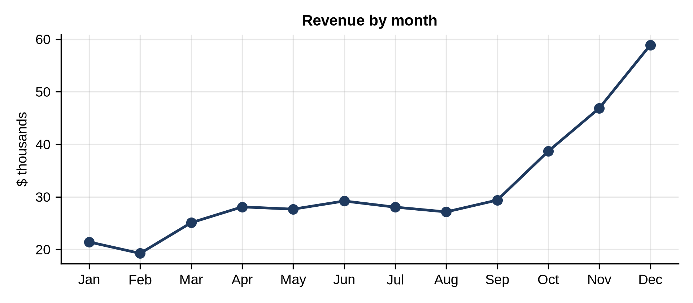

# Chapter 19: Reports, Automation and Testing Your Analysis

An analysis that only runs on your laptop, by hand, once, is fragile. The habits in this chapter make your work repeatable and trustworthy: put calculations in functions, test those functions, and generate the report with a program so next month's report is one command away.

## Reusable Calculations

Calculations you use in several places belong in a module, written once:

```python
@include code/ch19/metrics.py
```

`add_revenue` works on a copy, so it never changes the caller's DataFrame, and its docstring says exactly what it calculates. `top_products` builds on it. Type hints (`pd.DataFrame`, `pd.Series`) document what goes in and out.

## Testing an Analysis

The calculations that feed a report deserve tests, just like any other code. **pytest** runs every function whose name starts with `test_`:

```python
@include code/ch19/test_metrics.py
```

Run it from the chapter folder:

```
$ python -m pytest -q test_metrics.py
```

```
@include code/ch19/test_metrics.out
```

The tests use a tiny table where you can work out the right answers by hand: 2 lamps at $40 is $80; a $10 mug at half price is $5; a $40 lamp with 10% off is $36. They also check that the input isn't changed, a classic source of silent bugs, and that the top products come out in the right order. `pytest.approx` compares decimals safely, since decimal arithmetic can be off in the last digit.

> **Tip:** When an analysis gives a surprising number, write a test with a tiny example before you trust it. If the test passes, the surprise is probably in the data, which is exactly what you want to know.

## A Report From a Program

```python
@include code/ch19/report.py
```

```
@include code/ch19/report.out
```



The program loads the data, uses the tested functions, draws a chart, and writes a short report in **Markdown**, a plain-text format with `#` for headings and `-` for lists that many tools display nicely and can convert to a web page or a document. Every number in the report comes from the data, so it can't be mistyped, and next month you rerun one command. (The report's date is fixed so the book's output never changes; in your own reports, use `date.today()`.)

## Making It Repeatable

- **One command** reproduces everything from the raw data. If you do anything by hand, write it down, then automate it.
- **Raw data is read-only.** Never edit the original file; cleaning happens in code.
- **Pin versions** in a `requirements.txt` file, as Chapter 2 did, so the analysis gives the same answer next year.
- **Keep code in version control** (such as Git), so you can see what changed when a number changes.
- **Schedule it** with your operating system's scheduler (cron on macOS and Linux, Task Scheduler on Windows) to run reports automatically.

## Key Takeaways

- Put calculations in functions with clear names and docstrings; never change the caller's data.
- Test analysis code with tiny hand-checkable examples using pytest.
- Generate reports from code, so every number comes from the data and next month is one command away.
- Keep raw data untouched, pin library versions, and use version control.
