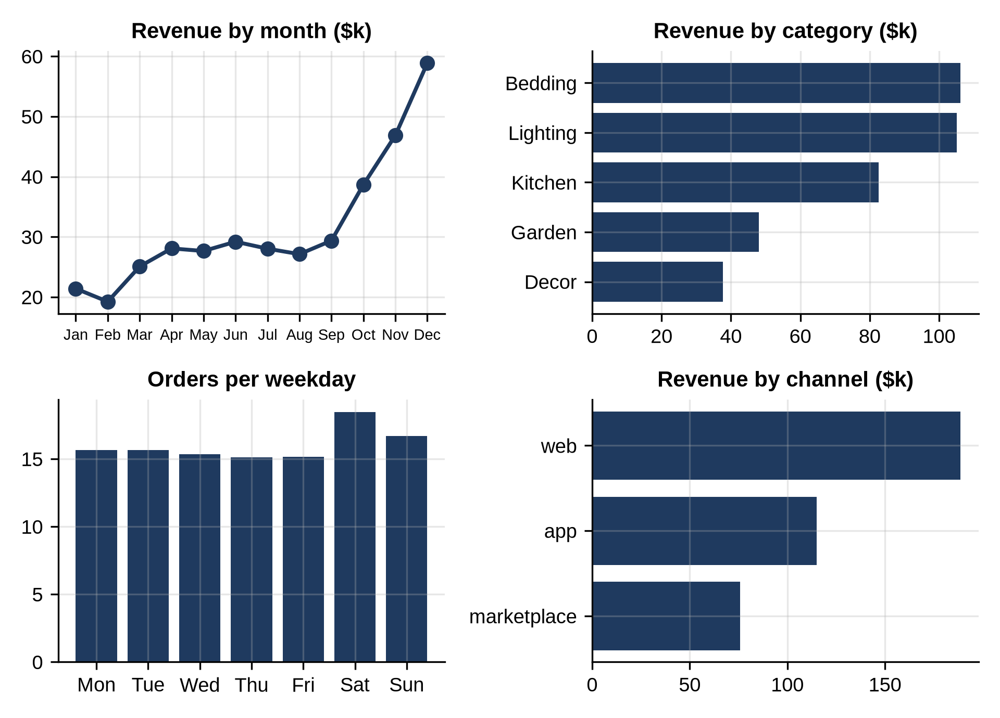

# Part IV: Six Projects

# Chapter 21: Project: Retail Sales Review

It's January, and Larkspur Home's owner wants a review of 2025 before planning the new year. Her questions:

1. How much did we sell, and how much did we keep as profit?
2. Which categories are growing, and which are shrinking?
3. Are customers coming back?
4. Do discounts work?

This project answers each one with the skills from Part II, then puts the main results on one page of charts.

## Revenue, Profit and Growth by Category

```python
@include code/ch21/sales_review.py
```

```
@include code/ch21/sales_review.out
```

The shop took $379,703 and kept $170,916 after product costs: a 45% gross margin. (Gross margin ignores rent, staff, shipping and marketing, so it isn't the shop's final profit; say so in any report.)

Comparing the second half of the year with the first:

- **Kitchen, Lighting, Decor and Bedding grew by 67% to 81%**, mostly because of the holiday season.
- **Garden fell 38%.** That's not a problem with Garden: its season is spring. A naive "Garden is shrinking, cut it" conclusion would be wrong. Comparing H2 with H1 mixes the trend with the season; with two years of data, you'd compare each half with the same half a year earlier.
- **Lighting has the best margin**, 46.6%, and Garden and Decor the lowest, about 42%.

## Customers

```python
@include code/ch21/customers_review.py
```

```
@include code/ch21/customers_review.out
```

- 1,191 of the 1,200 customers ordered at least once, and 96% of those ordered more than once: a loyal base.
- The top fifth of customers bring 40% of revenue. That's concentrated, but far from the famous "80/20" pattern; this shop doesn't depend on a handful of big buyers.
- Each order is marked "new" if it's the customer's first of the year. In the first quarter, two-thirds of revenue came from first orders of the year; by the fourth quarter, 98% came from returning customers. (A dataset that starts in January makes everyone "new" at first, so the early quarters overstate new business. Say so, or use the customer's signup date instead.)

## Do Discounts Work?

```python
@include code/ch21/discount_effect.py
```

```
@include code/ch21/discount_effect.out
```

Orders with a discount contain more items: from 1.40 to 1.83 items for consumers as the discount rises from 0 to 20%, and from 2.34 to 2.82 for business customers. Splitting by segment matters (remember Simpson's paradox, Chapter 16): business customers buy more per order *and* could receive discounts at a different rate, so mixing them would blur the comparison.

But "more items" isn't "more profit". A 20% discount on a 45% margin gives away almost half the profit on each item; the extra items would need to more than make up for it. And this is observational data: discounts weren't randomly assigned, so customers who got them may differ in other ways. The honest conclusion: discounts are associated with larger orders; whether they pay for themselves needs a proper experiment, like the one in Chapter 23.

## One Page of Charts

```python
@include code/ch21/dashboard.py
```

```
@include code/ch21/dashboard.out
```



`plt.subplots(2, 2)` returns a 2 by 2 grid of axes, addressed as `axes[row, column]`. Four small charts answer the four questions a manager asks first: when, what, which day, and through which channel.

## What to Tell the Owner

- 2025 revenue was $380,000 with a 45% gross margin; December alone brought in about three times February's sales.
- Lighting and Bedding lead in both revenue and growth; Garden is seasonal, not shrinking.
- Customers return: 96% ordered more than once.
- Discounts go with bigger orders, but whether they're profitable needs a test, not this data.

## Your Turn

- Which products have the highest return rate of customers (bought again within 60 days)?
- Is the app's share of orders growing through the year?
- Build the same review for one region, and compare it with the whole shop.

## Key Takeaways

- Start from the owner's questions, and answer each with a small, focused program.
- Seasonality can masquerade as growth or decline; compare like periods.
- Watch for artifacts of the data window, such as "new" customers in January.
- Observational associations, such as discounts and order size, aren't proof of cause.
