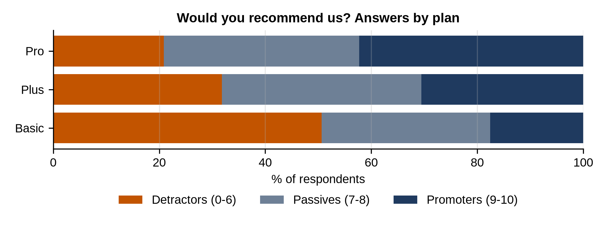

# Chapter 22: Project: Customer Survey

In September, 800 customers answered a short survey: how satisfied they are (1 to 5), how likely they are to recommend the service (0 to 10), and an optional comment. The product team wants to know which plan's customers are happiest, what the unhappy ones complain about, and one number to track over time.

## Net Promoter Score

**Interesting Fact:** The **Net Promoter Score** (NPS) was introduced by Frederick Reichheld in a 2003 *Harvard Business Review* article titled "The One Number You Need to Grow". Customers who answer 9 or 10 to "How likely are you to recommend us?" are promoters, 7 or 8 passives, and 0 to 6 detractors. NPS is the percentage of promoters minus the percentage of detractors, from -100 to +100. It's popular because it's simple, though later research questioned how well it predicts growth, so treat it as one measure among several.

```python
@include code/ch22/survey_nps.py
```

```
@include code/ch22/survey_nps.out
```

`pd.cut` with bin edges `[-1, 6, 8, 10]` sorts each answer into the three groups (the first bin starts at -1 so that 0 is included). `crosstab` with `normalize="index"` gives each plan's mix, and NPS follows directly.

The plans are very different:

- **Basic:** half the customers are detractors; NPS is -33.
- **Plus:** about even; NPS -1.
- **Pro:** promoters outnumber detractors two to one; NPS +21.

Overall NPS is -12, but that single number hides the real story: the cheapest plan is pulling the average down. Average satisfaction tells the same story more gently: 3.22, 3.71 and 4.02 out of 5.

## What the Comments Say

```python
@include code/ch22/survey_comments.py
```

```
@include code/ch22/survey_comments.out
```

The program groups comments into themes with regular expressions, then compares how often each theme comes up among unhappy (1 or 2) and happy (4 or 5) customers. Speed stands out: 55% of unhappy customers mention it ("too slow", "support was slow"), against 25% of happy ones (who mention "fast delivery"). Price, support and ease of use come up at similar rates in both groups, so they don't explain unhappiness here. 31 people left no comment.

A theme count is only a first pass. Before reporting, read a sample of real comments in each theme: keyword matching can't tell "support was slow" from "great support", which is why this program counts themes, not sentiment.

## The Chart

```python
@include code/ch22/survey_chart.py
```

```
@include code/ch22/survey_chart.out
```



A **stacked bar** shows parts of a whole: each bar is 100% of a plan's respondents. The program stacks them by hand, keeping a running `left` position for where each segment starts. Detractors shrink and promoters grow from Basic to Pro, the whole story in one picture.

## What to Tell the Product Team

- NPS is -12 overall, driven by the Basic plan (-33); Pro customers are clearly happy (+21).
- Slowness, of the app and of support, is the main complaint among unhappy customers.
- Suggested next step: investigate speed for Basic customers, then rerun the survey to track NPS by plan.

> **Common Mistake:** Reporting averages of survey scales without the distribution. An average satisfaction of 3.5 could mean everyone is lukewarm, or that half love you and half don't. Show the shares.

## Your Turn

- Do satisfaction scores differ by age group within each plan?
- Is there a difference between responses from the first and second half of September?

## Key Takeaways

- NPS turns a 0 to 10 answer into promoters, passives and detractors; report it by segment, not just overall.
- Theme counting with regular expressions is a fast first pass at comments; read samples before concluding.
- Stacked bars show the makeup of each group; always show distributions, not just averages.
