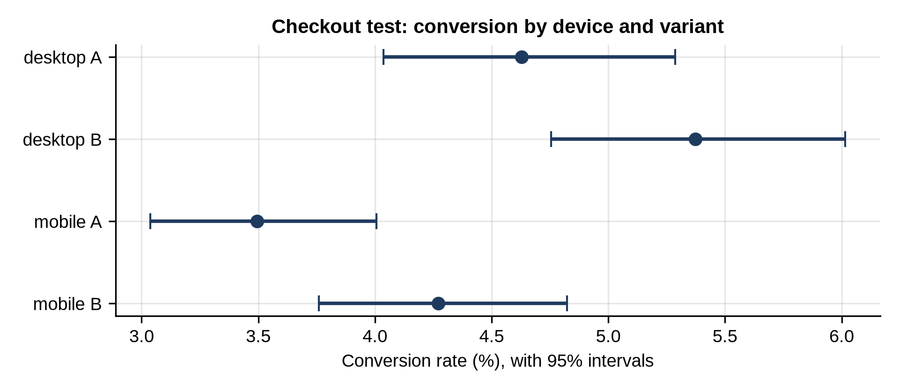

# Chapter 23: Project: Website A/B Test

Chapter 17 showed that the new checkout page (B) converts better than the old one (A). Before the team switches everyone to B, a careful analyst asks three more questions:

1. Was the experiment run correctly?
2. Does B work for everyone, or only for some visitors?
3. How much money is the improvement worth, and how sure are we?

## Was the Split Fair?

```python
@include code/ch23/ab_checks.py
```

```
@include code/ch23/ab_checks.out
```

Visitors were meant to be split 50/50. A got 10,024 and B 9,976. Is a gap of 24 from a perfect 10,000 normal? The program simulates 10,000 fair coin-flip splits of 20,000 visitors and counts how often the gap is at least as big: 75% of the time. The split is fine. A very small number here, a **sample ratio mismatch**, would mean the assignment was broken, for example if a bug sent some visitors to the wrong page, and then none of the results could be trusted.

## Does It Work for Everyone?

The pivot table splits conversion by device. B is better on both desktop (16% lift) and mobile (22% lift). Mobile visitors convert less overall, but the new page helps them at least as much, so there's no group being hurt by the change.

> **Warning:** If you check enough segments (device, country, browser, new or returning, time of day), one will look special by chance. Decide in advance which segments matter, and treat surprises in others as ideas for the next test, not conclusions.

## How Much Is It Worth?

```python
@include code/ch23/ab_revenue.py
```

```
@include code/ch23/ab_revenue.out
```

Revenue per session rose from $2.73 to $3.19, a difference of 46 cents. But the 95% bootstrap interval runs from less than a cent to 90 cents. At 600,000 sessions a month, that's somewhere between about $5,000 and $540,000 a month.

That huge range is the honest answer. Revenue varies a lot from order to order, so it's much noisier than the simple converted-or-not measure. The decision is still easy: the page is very likely better and not worse. But anyone who promises "$277,000 a month" from this test is promising more than the data can support.

## The Chart

```python
@include code/ch23/ab_chart.py
```

```
@include code/ch23/ab_chart.out
```



Each dot is a conversion rate and each bar its 95% bootstrap interval. `query` with `@device` uses Python variables inside the query string. Within each device, B's dot sits to the right of A's. The intervals overlap, because each segment has only half the data, which is one more reason to decide on the overall comparison in advance and treat segments as supporting evidence.

## What to Tell the Team

- The experiment ran correctly (the traffic split is consistent with 50/50).
- B raises conversion from 4.0% to 4.8% (95% interval for the difference: 0.2 to 1.3 points), on both desktop and mobile.
- Revenue per session is up about 46 cents, but this estimate is very uncertain: from almost nothing to about 90 cents.
- Recommendation: switch to B, and keep measuring revenue after launch.

## Key Takeaways

- Check the experiment itself first: a sample ratio mismatch invalidates the results.
- Look at key segments to make sure no group is harmed, but decide which segments in advance.
- Revenue is noisy; give intervals, not single numbers, for its effect.
- Turn the analysis into a clear recommendation, with its uncertainty stated.
